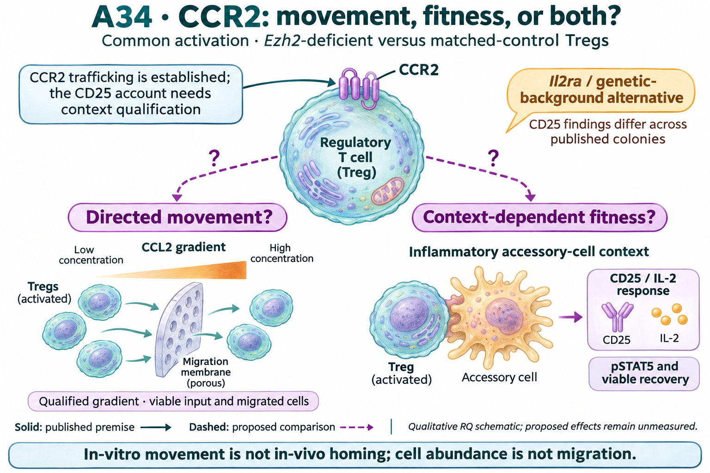

# A34: CCR2-associated movement and fitness in Tregs

## Organizing Biological Q

Which movement and fitness responses accompany Ezh2-associated CCR2 reduction in Tregs?

Lower Ccr2 RNA in DuPage KO-low Tregs motivates separating directed movement from signaling and viable recovery. Il2ra RNA supplies no matching stable deficit, and the gain-context Ccr2 direction changes after culture. The published CD25 account also has a genetic-background counterexample that the initial review missed.

Current synthesis: 12 November 2026. [Question card](../../RESEARCH_QUESTIONS.md#a34) · [Literature context](LITERATURE_CONTEXT.md) · [Dossier](../../docs/research_dossiers/A34.md).

## Literature context & visual hypothesis

Separate directed movement from receptor/signaling and recovery responses in the Ezh2 context. The CD25 branch is a conditional published account to reproduce and qualify, not an established universal CCR2 mechanism. A CCR2-independent CD25 result would also be informative. The [local source table](LITERATURE_CONTEXT.md#published-starting-point) separates published premises, contrary evidence and partial access.

GPT-generated matte illustration, 8 November 2026. The two dashed branches are alternative or coexisting response questions. Gradient arrows illustrate the migration assay, not an observed genotype difference. The accessory-cell/CD25 inset represents a context to qualify, not an autonomous CCR2-to-CD25 pathway. Cell counts, receptor shapes and ligand amounts are illustrative. [Editorial review](../../Research%20Article/gate3_09_dupage_2015/rq_derivation/FIGURE_REVIEW_20261108.md) · [Selected prompt](schematics/A34_gpt_matte_v1.prompt.txt). The initial vector comparison is retained as source history.

## Evidence, analyses and next steps

Wang adds a positive Ccr2 point contrast with a library-omission range crossing zero, unlike the DuPage decrease. A universal Ezh2-loss-to-CCR2-reduction account is therefore unsupported across these sources. The reduction named in this RQ is a context-qualified premise to verify in the chosen model, not an established property of all Ezh2-deficient Tregs. Increased, unchanged and decreased functional responses must all be retained. [Wang fixed-panel result](../../Research%20Article/gate3_10_wang_2018_ezh2/RESULTS_V1.md#s4--five-exposed-genes-across-separate-activation-contexts) · [Source limits and interpretation](../../Research%20Article/gate3_10_wang_2018_ezh2/BIOLOGICAL_INTERPRETATION_V1.md). Wang adds a descriptive context check; the values below remain the prior DuPage/Peeters lookups.

The completed [DuPage coding screen](../../Research%20Article/gate3_09_dupage_2015/TARGET_SCREEN_RESULT.md) · [executed gain-context follow-up](../../Research%20Article/gate3_09_dupage_2015/CANDIDATE_ANALYSIS_RESULT_V1.md) remain owned by Dp1-P01. Values below are rounded lookups from the existing tables, not a new analysis.

| Gene | DuPage KO − HET, CD62L-low | Peeters gain − WT, fresh | Peeters gain − WT, day 4 | What this changes |
|---|---:|---:|---:|---|
| Ccr2 | -1.966 | +0.397 | -1.952 | Stable signed DuPage RNA contrasts; gain-minus-WT changes sign between fresh and day 4. Movement is unmeasured. |
| Il2ra | +0.004 | -0.044 | -0.376 | Endpoint anchor: DuPage low contrast is near zero and interaction is fragile; RNA does not establish CD25 protein or IL-2 signaling. |

DuPage values are differences of mean log2(FPKM + 1), from 11 retained libraries; Peeters values are mean published rlog differences, from 12 libraries (three/group) in an author-selected matrix. These are different units and populations, not comparable effect magnitudes. Animals/pools and pairing remain unverified. Library-omission stability is not a confidence interval or independent replication.

[Measured sample profiles and direction comparisons](../../Research%20Article/gate3_09_dupage_2015/CANDIDATE_ANALYSIS_RESULT_V1.md#figures-and-source-values) · [screening gallery](../../Research%20Article/gate3_09_dupage_2015/TARGET_SCREEN_FIGURES.md). These figures remain at their source paths; the proposed illustration above is separate.

## Does the evidence warrant the narrowing?

**Rationale verdict: an exploratory receptor-context lead; neither movement loss nor a CCR2-to-CD25 mechanism is selected.** The source RNA supports a qualified movement/fitness comparison. The Il2ra/background precedent makes CD25 attribution a specific uncertainty rather than a universal CCR2 consequence. It does not demonstrate that Zhan used the affected colony or invalidate its inhibitor/chimera observations.

The coding reading frontier and three-route focus were outcome-exposed and literature-informed. The top-ten rule limits reading scope; it does not identify statistically validated targets. Neither successful execution nor an RQ identifier ranks this route above the rest of the frontier. The different Ezh2 alleles, genetic controls, observed states and culture contexts prevent a matched loss/gain causal interpretation.

The [public-source audit](../../Research%20Article/gate3_10_wang_2018_ezh2/public_gap_followup_20261112/G1_SOURCE_AUDIT_V1.md) narrowed assay qualification: Loyher reports specific fluorescent CCL2 binding despite an antibody stain that did not detect Treg CCR2. Bonfiglio reports impaired movement of bulk Ezh2-deficient CD4 cells to CCL19/CCL22; this is a general movement precedent, not a CCR2-dependent Treg result. The next step is the [revised measurement sequence](PLAN.md#public-source-checkpoint-and-revised-sequence). This is newly incorporated published evidence, not a new functional result from the repository; no eligible numerical contrast was recovered.

## What the result changes and the next decision

The neighboring-paper review leaves movement versus fitness as the immediate question. It makes perturbation history and linked protein/response measurements explicit; entry, retention and tissue access remain separate from the in-vitro movement endpoint. [Neighbor-paper flow review](../../Research%20Article/gate3_10_wang_2018_ezh2/RQ_FOLLOWUP_REVIEW_20261112.md#neighboring-article-flow-and-revisited-gaps) · [Model and linked measurements](PLAN.md#model-choice-and-linked-measurements).

Qualify CCR2 protein and ligand responsiveness in the actual genetic and activation context before interpreting a reduction. If reduction is absent, report that boundary; a qualified movement comparison can still estimate an Ezh2-associated phenotype without calling it CCR2 loss. Measure viable input, absolute traversing cells and a viable-input fraction, with no-gradient/equal-concentration controls. Keep CD25/IL-2 signaling and recovery in separate aliquots and qualify Il2ra/background for that branch. Target-restricted attribution is conditional on a qualified phenotype, not supplied by a mixed-cell antagonist.

The [revised development plan](PLAN.md) separates the immediate comparison from its [conditional extension](PLAN.md#conditional-extension). A qualified null or opposite direction remains informative. The [literature refresh](../../Research%20Article/gate3_10_wang_2018_ezh2/RQ_FOLLOWUP_REVIEW_20261112.md) records what is already published and what the proposed extension would add. Shared recovery/state measurements can support this RQ; Wang F3 does not execute this functional comparison or become a compulsory prerequisite.

## Registered scope and evidence records

Proposed registration requested on 7 November; presentation revisions approved on 8 November. The working hypothesis and all prior measured evidence are preserved. Scientific acceptance, target validation and experimental readiness are not inferred.

[Full hypothesis and alternatives](../../docs/research_dossiers/A34.md#working-hypothesis) · [Derivation and overlap](../../Research%20Article/gate3_09_dupage_2015/rq_derivation/README.md) · [Source qualification](../../Research%20Article/gate3_09_dupage_2015/candidates/SOURCE_QUALIFICATION.md) · [Plan](PLAN.md).
