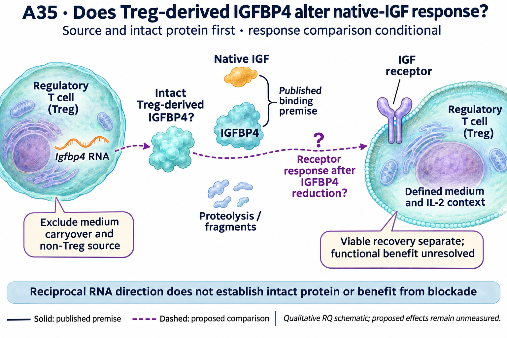

# A35: literature context

Current synthesis: 8 November 2026; underlying literature searches/read checks: 7 November. Source revision `4ae13c09383c9afbd350e662094d0655bd7fe347`. This revision reorganizes the existing bounded review and completed results; it does not claim a new exhaustive search. [Question](README.md) · [Dossier](../../docs/research_dossiers/A35.md).

## Published starting point

| Primary source | Exact locator / measured context | Relevance to this question | Access and limit |
|---|---|---|---|
| [Miyagawa 2017](https://pubmed.ncbi.nlm.nih.gov/28724578/) | Primary abstract: human MSC-derived factors and naive CD4 differentiation | An older IGFBP4/Treg precedent with a different protein source; the broad relationship is not new. | Abstract-level access only; no full methods/figure clearance. |
| [DiToro 2020](https://doi.org/10.1016/j.immuni.2020.03.013) | Figures 1–4 and desIGF1 assay rationale | Reduced-binding ligand bypasses binding-protein interference; native ligand is needed to test buffering. Th17 RNA is not mature-Treg validation. | Relevant primary Results/Methods read. |
| [Karino 2025](https://doi.org/10.1002/art.43313) | Figure 3G–I: polarization-context expression and cleavage | Processing and cell context can dissociate RNA from intact protein; this does not prove DuPage contamination. | Primary Results/legend rechecked; complete supplementary culture recipes not read. |
| [Shapiro 2023](https://doi.org/10.4049/jimmunol.2200651) | Figures 2–3: IGF1 with IL-2 | Cytokine exposure changes the meaning of an IGF response. | Relevant primary Results/figures read. |

Publication versions, source identity and detailed read/access history are recorded in the [article source audit](../../Research%20Article/gate3_09_dupage_2015/candidates/SOURCE_QUALIFICATION.md) and [refresh record](../../Research%20Article/gate3_09_dupage_2015/rq_derivation/README.md#search-record). No absent search hit establishes novelty or absence of a correction.

## Repository observation

The Igfbp4 RNA difference retains a source question: KO-low expression is higher in DuPage, while EZH2-gain expression is lower in both Peeters conditions. The original high-to-low comparison shows less downregulation in KO, not demonstrated activation induction. Whether established Tregs produce intact extracellular IGFBP4, and whether it changes native-IGF response, remain unmeasured.

[DuPage coding screen](../../Research%20Article/gate3_09_dupage_2015/TARGET_SCREEN_RESULT.md) · [executed gain-context follow-up](../../Research%20Article/gate3_09_dupage_2015/CANDIDATE_ANALYSIS_RESULT_V1.md). The [question-page table](README.md#evidence-analyses-and-next-steps) shows candidate-specific values and unfavorable anchors. DuPage values are differences of mean log2(FPKM + 1), from 11 retained libraries; Peeters values are mean published rlog differences, from 12 libraries (three/group) in an author-selected matrix. These are different units and populations, not comparable effect magnitudes. Animals/pools and pairing remain unverified. Library-omission stability is not a confidence interval or independent replication.

## Does the evidence warrant the narrowing?

**Rationale verdict: a source/protein question with a conditional functional extension.** Reciprocal signs across unmatched studies retain the candidate but do not establish regulatory reciprocity, direct EZH2 targeting or experimental priority. Different cell-source and cleavage precedents make the intact protein question consequential. A source-negative result would narrow the proposed secreted-mediator account without erasing the RNA observation.

All original DuPage outcomes and relevant published narratives were exposed. The selected Peeters candidate run was frozen for its descriptive comparison, but that later freeze does not erase earlier exposure. Shared-source reanalysis is not independent replication, and unlike alleles/states do not identify a causal inverse-response model.

## What this question could add

First, source/measurement validation in established Tregs; conditionally, a context extension testing native-IGF modulation. This is distinct from showing IGFBP4 RNA in another atlas, rediscovering IGF binding, or assuming that blockade improves Treg function.

A28–A29 concern Th17 regulatory/effector outputs and PGAM mechanisms. A35 concerns established Treg protein source and native-IGF response; the Th17 cleavage precedent is a boundary, not evidence that the questions coincide. A2 addresses AREG delivery in another source/recipient system.

## Current hypothesis and rival

The Igfbp4 RNA excess in Ezh2-deficient Tregs may produce intact Treg-derived IGFBP4 that changes native-IGF receptor response. Source and intact-protein validation precede that perturbation question; neither the direction of the signaling effect nor benefit from IGFBP4 reduction is established by RNA.

State composition, non-Treg source, serum carryover and proteolysis can dissociate RNA from intact extracellular protein. An effect on recipient cells or general viability can mimic a Treg-autonomous functional effect.

## What the comparison would teach

Resolve whether the RNA signal corresponds to intact Treg-derived protein under a defined context. If it does, a target-specific reduction under native-IGF exposure can test receptor-response modulation. Neither lower signaling nor an intervention effect determines whether suppression is improved, impaired or unchanged; that functional question remains separate.

RNA without intact Treg-derived protein restricts the proposed secreted-mediator account. Qualified reduction changing receptor response supports IGF modulation, not beneficial function. Improved, worsened or unchanged later suppression distinguish harmful contribution, possible compensation or lack of necessity only within the qualified context. An imprecise null remains unresolved.

Ezh2-deficient and matched-control lineage-identified Tregs under common activation, separating locus-specific RNA, cell-associated protein and intact supernatant protein. If source and assay qualify, compare Treg-restricted IGFBP4 reduction with matched control under defined native-IGF and IL-2 exposure.

Intact source-attributed IGFBP4 first; receptor-proximal IGF response and absolute recovery next. AKT is supportive but not IGF-specific. Suppression at matched viable input is a later distinct endpoint, not inferred from Foxp3 frequency or phosphorylation.

Independent mice/preparations define units, with nested aliquots/wells. Model availability, actual alleles/control, tissue, timing, variance and precision are unresolved. Registration does not authorize or imply a new numerical run, laboratory execution, or a target-mediated causal claim.

## Reading the registered illustration

The source-to-protein and response arrows are proposed. The binding inset is the published IGF/IGFBP4 premise; the dashed receptor-response arrow does not assert direct IGFBP4–receptor binding. The two Tregs are schematic source/readout contexts, not proof of autocrine or paracrine action. The selected edit corrects the RNA glyph to a single strand. Anatomical, cell and protein glyphs are illustrative, not measured counts or molecular structures. The drawing cannot resolve the source and functional uncertainties described above.

## Hypothesis schematic

GPT-generated matte illustration, 8 November 2026. The source-to-protein and response arrows are proposed. The binding inset is the published IGF/IGFBP4 premise; the dashed receptor-response arrow does not assert direct IGFBP4–receptor binding. The two Tregs are schematic source/readout contexts, not proof of autocrine or paracrine action. The selected edit corrects the RNA glyph to a single strand. [Editorial review](../../Research%20Article/gate3_09_dupage_2015/rq_derivation/FIGURE_REVIEW_20261108.md) · [Selected prompt](schematics/A35_gpt_matte_v1.prompt.txt). The initial vector comparison is retained as source history.

## Next literature check

The [7 November query/access record](../../Research%20Article/gate3_09_dupage_2015/rq_derivation/README.md#search-record) distinguishes completed reads from uninspected leads and incomplete methods. Reuse this bounded review until the model, perturbation or endpoint changes. Before executable design, retrieve the closest remaining methods/supplement needed for that exact comparison; source-wide absence or experimental readiness is not established by partial access.
