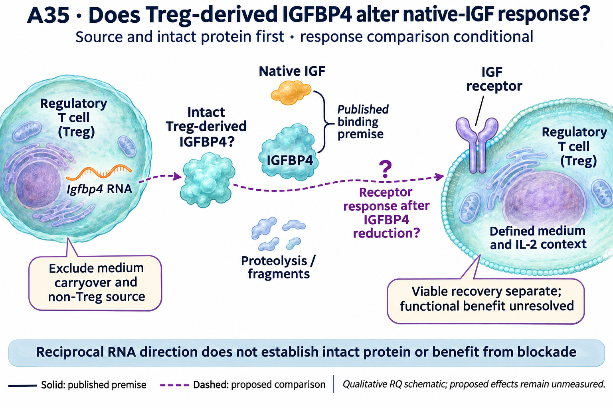

# A35: Treg IGFBP4 source and native-IGF response

## Organizing Biological Q

Does the Ezh2-associated Igfbp4 RNA difference yield intact Treg-derived protein that modulates native-IGF response?

The Igfbp4 RNA difference retains a source question: KO-low expression is higher in DuPage, while EZH2-gain expression is lower in both Peeters conditions. The original high-to-low comparison shows less downregulation in KO, not demonstrated activation induction. Whether established Tregs produce intact extracellular IGFBP4, and whether it changes native-IGF response, remain unmeasured.

Current synthesis: 8 November 2026. [Question card](../../RESEARCH_QUESTIONS.md#a35) · [Literature context](LITERATURE_CONTEXT.md) · [Dossier](../../docs/research_dossiers/A35.md).

## Literature context & visual hypothesis

First, source/measurement validation in established Tregs; conditionally, a context extension testing native-IGF modulation. This is distinct from showing IGFBP4 RNA in another atlas, rediscovering IGF binding, or assuming that blockade improves Treg function. The [local source table](LITERATURE_CONTEXT.md#published-starting-point) separates published premises, contrary evidence and partial access.

GPT-generated matte illustration, 8 November 2026. The source-to-protein and response arrows are proposed. The binding inset is the published IGF/IGFBP4 premise; the dashed receptor-response arrow does not assert direct IGFBP4–receptor binding. The two Tregs are schematic source/readout contexts, not proof of autocrine or paracrine action. The selected edit corrects the RNA glyph to a single strand. [Editorial review](../../Research%20Article/gate3_09_dupage_2015/rq_derivation/FIGURE_REVIEW_20261108.md) · [Selected prompt](schematics/A35_gpt_matte_v1.prompt.txt). The initial vector comparison is retained as source history.

## Evidence, analyses and next steps

The completed [DuPage coding screen](../../Research%20Article/gate3_09_dupage_2015/TARGET_SCREEN_RESULT.md) · [executed gain-context follow-up](../../Research%20Article/gate3_09_dupage_2015/CANDIDATE_ANALYSIS_RESULT_V1.md) remain owned by Dp1-P01. Values below are rounded lookups from the existing tables, not a new analysis.

| Gene | DuPage KO − HET, CD62L-low | Peeters gain − WT, fresh | Peeters gain − WT, day 4 | What this changes |
|---|---:|---:|---:|---|
| Igfbp4 | +1.514 | -0.523 | -2.479 | Reciprocal observed loss/gain direction; WT activation contrast is omission-sensitive. Both DuPage genotypes decline across the observed high-to-low states. |

DuPage values are differences of mean log2(FPKM + 1), from 11 retained libraries; Peeters values are mean published rlog differences, from 12 libraries (three/group) in an author-selected matrix. These are different units and populations, not comparable effect magnitudes. Animals/pools and pairing remain unverified. Library-omission stability is not a confidence interval or independent replication.

[Measured sample profiles and direction comparisons](../../Research%20Article/gate3_09_dupage_2015/CANDIDATE_ANALYSIS_RESULT_V1.md#figures-and-source-values) · [screening gallery](../../Research%20Article/gate3_09_dupage_2015/TARGET_SCREEN_FIGURES.md). These figures remain at their source paths; the proposed illustration above is separate.

## Does the evidence warrant the narrowing?

**Rationale verdict: a source/protein question with a conditional functional extension.** Reciprocal signs across unmatched studies retain the candidate but do not establish regulatory reciprocity, direct EZH2 targeting or experimental priority. Different cell-source and cleavage precedents make the intact protein question consequential. A source-negative result would narrow the proposed secreted-mediator account without erasing the RNA observation.

The coding reading frontier and three-route focus were outcome-exposed and literature-informed. The top-ten rule limits reading scope; it does not identify statistically validated targets. Neither successful execution nor an RQ identifier ranks this route above the rest of the frontier. The different Ezh2 alleles, genetic controls, observed states and culture contexts prevent a matched loss/gain causal interpretation.

## What the result changes and the next decision

Resolve whether the RNA signal corresponds to intact Treg-derived protein under a defined context. If it does, a target-specific reduction under native-IGF exposure can test receptor-response modulation. Neither lower signaling nor an intervention effect determines whether suppression is improved, impaired or unchanged; that functional question remains separate.

RNA without intact Treg-derived protein restricts the proposed secreted-mediator account. Qualified reduction changing receptor response supports IGF modulation, not beneficial function. Improved, worsened or unchanged later suppression distinguish harmful contribution, possible compensation or lack of necessity only within the qualified context. An imprecise null remains unresolved.

The [development plan](PLAN.md) names the comparison, biological unit and stopping conditions. Qualification can be integrated into a well-designed experiment; it need not become a compulsory sequence of additional public-data analyses.

## Registered scope and evidence records

Proposed registration requested on 7 November; presentation revisions approved on 8 November. The working hypothesis and all prior measured evidence are preserved. Scientific acceptance, target validation and experimental readiness are not inferred.

[Full hypothesis and alternatives](../../docs/research_dossiers/A35.md#working-hypothesis) · [Derivation and overlap](../../Research%20Article/gate3_09_dupage_2015/rq_derivation/README.md) · [Source qualification](../../Research%20Article/gate3_09_dupage_2015/candidates/SOURCE_QUALIFICATION.md) · [Plan](PLAN.md).
