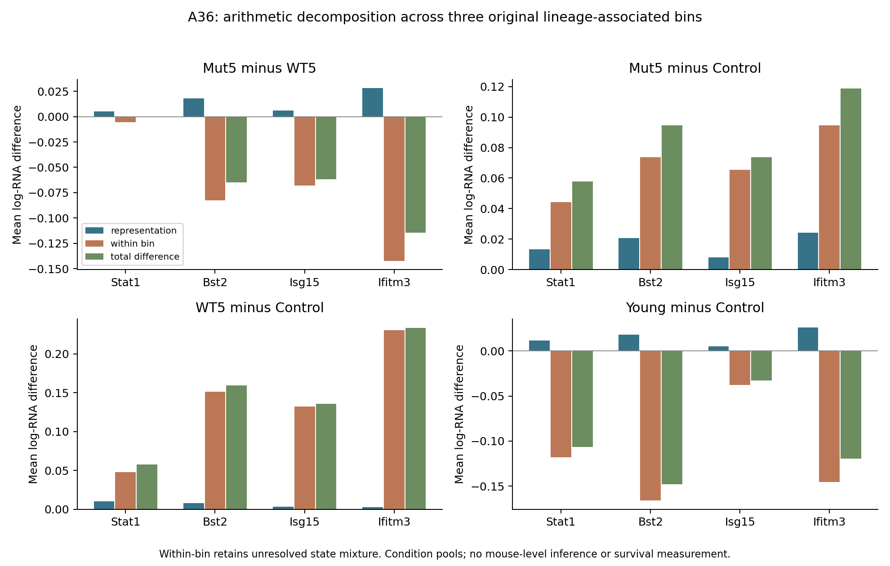
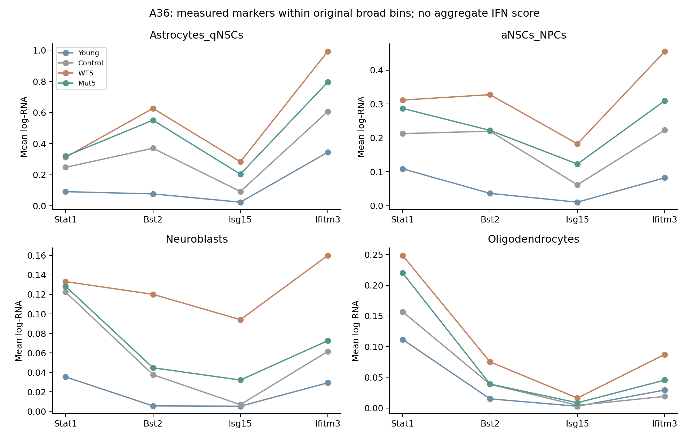

# A36 recipient screen — cloud execution, 10 November 2026

The exact transferred **v1** recipient contract executed once and its receipt
verifies. All 1,344 declared independent arithmetic checks passed. These are
exposed descriptions of condition pools in the original broad annotations;
no later neuronal-output source was qualified and no survival endpoint was
measured. Scientific acceptance remains **not assessed**.

## Frozen execution and source identity

Desktop specification freeze: `0c8f133`. Public main base:
`1a6769fc3d808ccf6b27aed3ecedc71341026f33`. Executor import/freeze:
`19ed556031dc3381af136d5f3c604f5877ec53df`, author and committer both
`Xorca <dreamtree071@gmail.com>`. All 14 transferred files match their original
SHA-256 values in working and committed bytes. The 22,932-byte transport
archive has SHA-256
`527a0e4f376cdf49f50bb60bb4f2342feda58a96eb862f06f22c1b505b397b55`.

The [contract](contracts/recipient_screen_v1.json),
[configuration](contracts/recipient_screen_v1.config.json), R extraction and
Python reconstruction remain byte-identical to that import. The main runner,
schema, library and bounded launcher are unchanged. Preflight with `--inputs`
passed before execution. The runner records the executable import commit in
the [receipt](../../analysis/research/runs/a36_recipient_screen_v1/receipt.json).
The successful receipt is registered in this executor's existing registry.

The main RDS is 2,188,161,276 bytes, MD5
`ce9bf02e41665e00e11cd1b262114506`, SHA-256
`b1fa0ce7c6ff19e5d207caff9548e5ec2dacd5a3cdb4fa0fc01b5874a15d2559`.
An independent disk-backed copy at
`/workspace/a36_20261110/ravel/raw_data/navarro_2026/IL10_svz_seurat.rds`
was verified and retained mode `0444`; the original read-only source under
`/workspace/navarro_2026/ravel` was preserved. No other biological object was
acquired. Recovery-table SHA-256 is
`4703e48a6f5974811b3c1e3ec09d36d250d40ae3f8ca08376aa7d988d12b460b`.
The two transferred source-qualification JSONs remain immutable earlier-stage
evidence, not newly executed source results.

## Measured results and denominators

The [summaries](../../analysis/research/runs/a36_recipient_screen_v1/summaries.tsv)
retain all 256 condition/bin/gene rows; the
[contrasts](../../analysis/research/runs/a36_recipient_screen_v1/contrasts.tsv)
retain all 256 predefined rows. All 16 genes are present and all selected bins
are nonempty. The 12 annotation/context markers are reported without assigning
new identities. All 11,955 selected cells enter the denominators, including
implicit expression zeros; 39,655 nonzero selected-marker entries were checked.

| Original annotation | Young | Control | WT5 | Mut5 |
|---|---:|---:|---:|---:|
| Astrocytes_qNSCs | 1,437 | 345 | 572 | 472 |
| aNSCs_NPCs | 825 | 123 | 407 | 285 |
| Neuroblasts | 1,160 | 426 | 646 | 445 |
| Oligodendrocytes | 1,926 | 469 | 1,143 | 1,274 |
| Three-bin lineage-associated denominator | 3,422 | 894 | 1,625 | 1,202 |

Recovery counts describe captured/retained cells, not numbers of biological
replicates or measured in-vivo abundance. The decomposition denominator contains
only the first three bins; oligodendrocytes are separate context.

The table below reports Mut5-minus-WT5 **mean stored log-RNA** differences across
those three bins. The symmetric representation and within-bin terms sum to
the total. These are differences of means of `log1p(10000*count/library_total)`,
not log fold changes or MAST heatmap estimates.

| Marker | Total difference | Representation term | Within-bin term | Detection-fraction difference |
|---|---:|---:|---:|---:|
| Stat1 | -0.000054865 | +0.005283484 | -0.005338349 | +0.033148854 |
| Bst2 | -0.064710821 | +0.018024372 | -0.082735193 | -0.001814412 |
| Isg15 | -0.061842194 | +0.006146264 | -0.067988458 | -0.032521183 |
| Ifitm3 | -0.114354966 | +0.028078954 | -0.142433919 | -0.035658518 |

For Bst2, Isg15 and Ifitm3, Mut5 has lower mean expression than WT5 in each of
the four original bins. Across the three-bin aggregate, positive representation
terms partially offset the negative within-bin terms. This algebra does not
establish a cell-intrinsic treatment effect: each broad bin still contains
unresolved states and pool/capture differences.

Stat1 prevents a uniform attenuation statement. Its aggregate mean difference
is near zero, with opposing representation and within-bin terms, while its
detection fraction is higher in Mut5. Within Astrocytes_qNSCs, its Mut5 mean
is slightly higher than WT5 (0.319388 versus 0.312548); it is lower in the other
three bins. Bst2 in Astrocytes_qNSCs also illustrates the distinction between
mean and detection: Mut5 has a lower mean but a higher detection fraction
(0.322034 versus 0.312937). Neither component is substituted for the other.

Both treatment aliases have higher aggregate means than Control for all four
markers. Mut5-minus-Control totals are +0.057745, +0.094462, +0.073626 and
+0.118661 for Stat1, Bst2, Isg15 and Ifitm3, respectively; WT5-minus-Control
totals are +0.057800, +0.159172, +0.135468 and +0.233016. Thus, lower values
relative to WT5 do not imply restoration to the vehicle reference.
Young-minus-Control totals are negative for all four markers, as descriptive
age context. The complete
[decomposition table](../../analysis/research/runs/a36_recipient_screen_v1/decomposition.tsv)
retains all 32 contrast/marker/metric rows, including detection decomposition
and nonuniform directions. For example, WT5-minus-Control Stat1 detection has
a negative within-bin term (-0.004635) but a positive total (+0.016602).

## Figures and numerical verification

The panels use separate vertical scales. All components and four contrasts
are retained; bar heights are measured arithmetic terms, not causal effects.

Lines connect marker positions only; they do not represent a trajectory or
aggregate score. Both frozen figures were visually inspected: labels, legends,
zero baselines and declared measurements render legibly.

The [verification record](../../analysis/research/runs/a36_recipient_screen_v1/independent_verification.json)
checks R summaries against Python reconstruction from integer counts and
complete cell denominators. Maximum normalization reconstruction error is
`5.329070518200751e-15` (declared tolerance `1e-10`). It also checks decomposition
against direct pooling and verifies component addition. Arithmetic agreement
uses the same source cells and supplies no independent biological replication.

## Runtime, resources and preserved diagnostics

The retained `/tmp/navarro_2026` runtime was absent on resume. Runtime restoration
used official Debian HTTPS packages under `/workspace/a36_20261110`, with sizes
and SHA-256 checked against the official package index. No system package,
host login or reusable environment policy changed. The disk-backed launcher is
`/workspace/a36_20261110/bin/Rscript`: R 4.5.0, Matrix 1.7-3,
SeuratObject 5.0.2, jsonlite 1.9.1; Python 3.12.14 and Matplotlib 3.10.8.
Full Seurat is not required or installed.

The Debian SeuratObject binary reported its older R/Matrix build versions.
The same 5.0.2 source was rebuilt against restored R/Matrix; official source
SHA-256 is `ded30d21f445b7e353fe4a0c4954d45ad19fbe162615d9addf6732f9318ba0cf`.
Final synthetic v3/v5 sparse serialization tests passed with warnings treated
as errors and no warnings. An earlier synthetic test stopped because artificial
feature names contained underscores; that operational log is preserved and
the synthetic names were corrected. Initial launcher-path failures are also
retained. None of these preparation attempts opened biological RDS content.

At 13:50:32 Asia/Seoul, the executor had a 16 GiB cgroup limit,
5,072,969,728 bytes charged memory, four-core CPU quota, no OOM events,
27,339,247,616 bytes free on `/workspace` and 9,441,255,424 bytes free on
tmpfs `/tmp`. The managed environment reported running/connected/current.
The [resource record](../../analysis/research/runs/a36_recipient_screen_v1/resource_usage.json)
reports R elapsed time 29.023 seconds, peak R RSS **6,767,095,808 bytes** and
peak cgroup **11,659,964,416 bytes**, with no stop condition. Limits remained
11 GiB R vector memory, 12 GiB RSS, 15 GiB cgroup and 1,800 seconds.
The runner completed at 13:51:24 Asia/Seoul on 10 November 2026.

The only run stderr message is `Fontconfig error: No writable cache directories`.
It is preserved in the original log. Both figure files rendered successfully
and were inspected; there are no R package/annotation/normalization warnings
in the run stderr. The successful exit is supported by the independent
arithmetic, resource and visual checks; no biological rerun was needed.
Runtime recipes, source/package manifests and preparation logs remain under
`/workspace/a36_20261110/{runtime-cache,logs,evidence}`. The compact package
provenance appendix is [CLOUD_RUNTIME.md](CLOUD_RUNTIME.md).

## Exact holds and desktop integration

WT5/Mut5 have the established indirect code/figure association with 0.02 mg/mL;
no new barcode-to-accession dose proof was created. The source has one library
per condition; Control contains one mouse, other main conditions pooled two.
Within-bin contrasts cannot recover mouse effects, resolve astrocytes from
qNSCs or aNSCs from NPCs, identify IFN type or secretion, or infer fate,
mediation or later survival. The young reference is not an age-by-treatment
interaction. The four-marker results are kept separate, without P values,
confidence intervals or an aggregate beneficial score. The published
recipient/pathway observations remain attributed in [LITERATURE_CONTEXT.md](LITERATURE_CONTEXT.md).

This checkout is intentionally scoped and sparse. Stage input preflight,
committed-code checks and receipt verification pass; full repository validation
is not claimed. Main's validators are unchanged. The desktop reports its own
successful full checks and a guide-label correction after the transfer. The
imported guide/docs remain exact original bytes here; they are not substituted
for the desktop's current guide, docs or complete registry on return. Parent
integration should add the successful recipient receipt and outputs while
retaining its current source-stage registration and editorial updates.

GitHub connector identity is `xorca0711`; CLI identity verification returned
Forbidden and was not treated as verified authentication. No account-dependent
CLI write occurred. No push, publication, author contact, Weft edit, host-session
change, optional acquisition or alteration of earlier frozen evidence occurred.
