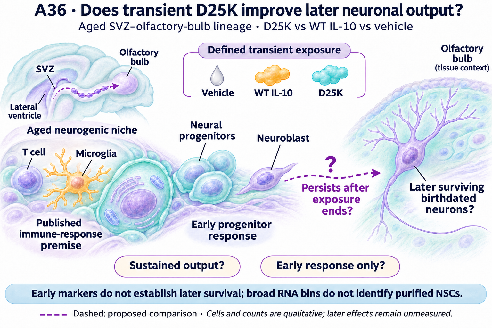
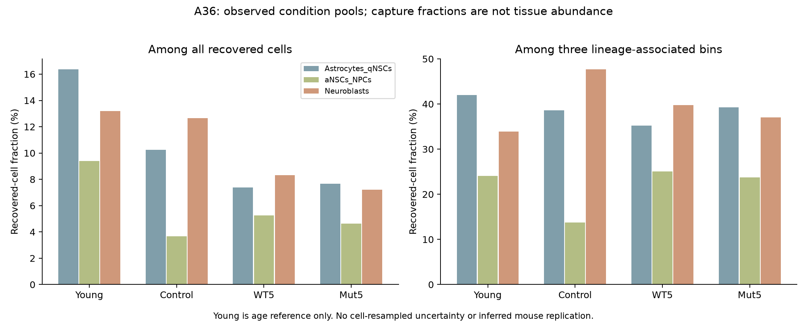

# A36 — Figure gallery

## Qualitative question

Qualitative illustration only. [Literature and boundaries](LITERATURE_CONTEXT.md).

## Originating measured evidence

The [Nn26-P01 gallery](../../Research%20Article/ungated_navarro_negredo_2026_aged_brain_il10/FIGURES.md) retains frozen animal, immune RNA and separate human-context figures. These are linked, not moved or reclassified as independent A36 experiments. A36 measured figures will be linked to their own immutable receipts in [Results](RESULTS.md).

## A36 measured representation

[Receipt](../../analysis/research/runs/a36_source_representation_v1/receipt.json) · [Interpretation and denominators](RESULTS.md#executed-source-and-representation-stage). These are finite condition-pool capture fractions, not tissue abundance or mouse-level treatment effects.
