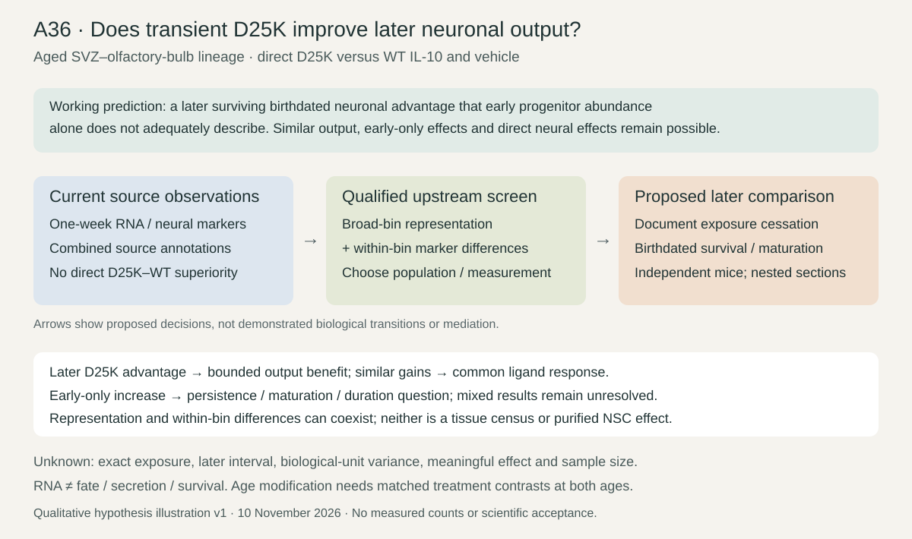

# A36: literature context

Review date: 10 November 2026, Asia/Seoul. Author: Codex, for owner-authorized question development. Base: `1a6769fc3d808ccf6b27aed3ecedc71341026f33`. Reuses the same-day [originating assessment](../../Research%20Article/ungated_navarro_negredo_2026_aged_brain_il10/QUESTION_DEVELOPMENT_20261110.md), adding the previously unaudited S6/Table S3 and targeted later-output source search. This is a bounded review, not novelty clearance.

## Published starting point

| Primary source/version and exact locator | Read evidence and consequence |
|---|---|
| [Navarro Negredo et al. 2026](https://doi.org/10.1016/j.immuni.2026.01.016), accepted-manuscript XML; final publisher supplement; Fig. 5B–I, 6B–J, S6A–F; Table S3 | T-cell/IFN perturbation and early neural-marker responses are published premises. S6A/B show cell-type age clocks; S6C–E show whole-niche PCA; S6F is DG STAT1 after behavior, not birthdated neuronal survival. Table S3 contains treatment–control broad-bin enrichment, including engineered-IL-10 astrocyte/qNSC IFN-response rows 104–105. These observations are already reported, not new residual-response findings. |
| Same paper, Methods: Quality control of 10x Genomics single-cell RNA-seq; DCX, NeuN, and EdU quantification in the olfactory bulb; Fig. 6F | Authors explicitly could not separate astrocytes/qNSCs and aNSCs/NPCs. Six OB sections per mouse are nested, with mouse-level summaries. Fig. 6F samples after one week of infusion. This is not a later post-withdrawal survival estimate. |
| [Correction, 25 June 2026 online / 14 July issue](https://doi.org/10.1016/j.immuni.2026.06.019) | Fig. 2K labels and Fig. 4J representative image are corrected; authors report unchanged quantitative analyses. Primary correction record checked in this pass. |
| [Perez-Asensio et al. 2013](https://doi.org/10.1242/jcs.127803), primary abstract, reused prior read | Direct progenitor differentiation effects motivate separating cycling/progenitor abundance from neuronal output. Full figures/methods were not recovered in this pass. |
| [Pereira et al. 2015](https://doi.org/10.3389/fncel.2015.00057), Figs. 4–7, indexed primary Results, reused | Direct IL-10/ERK/STAT3 progenitor regulation is a published alternative to an exclusively immune-mediated account. |
| [Sanchez-Molina et al. 2022](https://doi.org/10.1016/j.bbi.2021.12.026), institutional PDF, Fig. 1E–J, Methods 2.1/Results 3.1, reused | Chronic astrocytic IL-10 lowered newborn-cell survival without corresponding early proliferation differences in adult hippocampus. Region, age, source and exposure differ: a contrary context, not a direct D25K contradiction. |
| [Nissen et al. 2026](https://doi.org/10.1038/s41467-026-74104-x), published Europe PMC full XML PMC13342090, Figs. 2–4 and 7, model/scRNA Methods, reused | Recipient IFNAR/DCX precedent in a fetal-derived human progenitor line, not aged donors. Fig. 7 does not show an analogous MAP2 deficit/rescue; one scRNA library per condition/time. Does not validate aged D25K survival or establish the repository's causal explanation. |

Supplement source: [publisher PDF](https://ars.els-cdn.com/content/image/1-s2.0-S1074761326000385-mmc1.pdf), PDF p.22 legend and preceding S6 graphic; [Table S3](https://ars.els-cdn.com/content/image/1-s2.0-S1074761326000385-mmc4.xlsx), all three cell-type tabs. Figure 6B–D pathway findings are reused; no broad IFN score is rerun to rediscover them. Table S3 GO names do not establish actual IFN type, production or secretion.

## Repository observation

[Nn26-P01 RNA results](../../Research%20Article/ungated_navarro_negredo_2026_aged_brain_il10/RNA_RESULTS.md) retain heterogeneous immune-marker directions, eight aliases versus six reported libraries, no per-mouse assignments and indirect main-pair dose association. [Animal results](../../Research%20Article/ungated_navarro_negredo_2026_aged_brain_il10/RESULTS.md) retain direct nonsignificant D25K–WT neural-marker comparisons and D25K–vehicle cognition tests. The separate Canaria human agonist context cannot replace D25K/aged-brain evidence. All are exposed, and reused source data are not independent replication.

## What this question could add

Published immune selectivity plus early neural markers → incomplete later-output inference → a transient-exposure, birthdated survival comparison. This is a duration/endpoint extension, conditional on source/assay feasibility. Upstream, the added descriptive contribution is an explicit broad-bin representation/within-bin decomposition, beyond published enrichment/PCA. Fine NSC states remain unresolved; a new cell label or age label alone would not establish novelty.

## Current hypothesis and rival

After a defined transient exposure in aged SVZ–olfactory-bulb lineage, D25K may increase later surviving birthdated neuronal output relative to WT IL-10 and vehicle in a way not adequately described by early progenitor abundance alone. Similar later output with both ligands, an early-only response, differential survival and direct progenitor effects remain alternatives; they can coexist.

Mice are intended effect-estimation units; current RNA has condition pools and nested cells. Capture, within-bin mixture, pooling and exposure confounding restrict RNA interpretation. Dose, interval, precision and animal identities cannot be inferred from aliases or group averages.

## What the comparison would teach

A sustained direct D25K advantage would support a bounded later-output benefit, without establishing immune mediation. Similar benefits favor common ligand response. An early-only increase motivates survival/maturation/exposure discrimination while retaining the early response. Mixed or imprecise outcomes remain unresolved. RNA representation changes and within-bin differences may coexist; neither supplies later survival. [Plan](PLAN.md) states the exact measurement dependencies and conditional age comparison.

## Hypothesis schematic

This versioned qualitative illustration separates current one-week observations from proposed post-exposure measurements, shows contrary outcomes and leaves unknown timing/precision explicit. It contains no measured results and certifies neither novelty nor laboratory readiness.

## Next literature check

Actual live web queries on 10 November 2026: `"D25K" "neurogenesis" survival`; `"Targeting immune cells" "Navarro" "S6"`; `"D25K" "neuronal" "withdrawal"`; `"D25K" "survival" neurogenesis site:pubmed.ncbi.nlm.nih.gov`; `"D25K" "neurogenesis" site:ncbi.nlm.nih.gov/geo`; `"IL-10" neural progenitor survival withdrawal 2024 2025 2026`. These supplement the assessment's unrestricted older and 2024–2026 primary searches; no formal exhaustive date-filter or citation-index sweep was performed. Irrelevant and review hits were discovery leads, not evidence.

Primary Navarro/erratum records and the live [Zenodo v1 object listing](https://zenodo.org/records/17594828) were inspected. The linked deposit lists main IL-10, separate WT, RIPR and brain/lung RNA objects; none is described as a later birthdated D25K/WT survival cohort. Prior ENA/BioSample refresh and author commit `c08010bb29f0cb9b56143a25f6a2b1c28692cf70` are reused. S1/S4/XML/code cache bytes match the retained inputs; new publisher PDF/S3 acquisitions have manifest hashes. The retrieved supplements resolve this local overlap question. No inspected public source in this bounded pass supplies the required later-output tuple; this is not proof of global absence.

Backward references were followed in the originating assessment; this pass follows its primary supplement and deposit links. Full Perez-Asensio figures and exhaustive forward citations remain uninspected. Reopen on a source with explicit treatment cessation, birthdating, later timing, direct comparator arms and biological-unit identity, or on a changed comparison. Further generic pathway searches would not fill those measurements.

## A36 source-screen interpretation — 10 November

The governed representation screen retains mixed Mut5–WT5 captured-bin directions: larger astrocyte/qNSC share, smaller progenitor and neuroblast shares among three lineage-associated bins. Both lineage and all-recovered denominators are retained. This narrows a uniform-restoration reading but cannot estimate tissue abundance or contradict a separate histological endpoint. It justifies the already-frozen broad-bin representation/within-bin RNA decomposition; fine NSC identities and later survival remain unestimated. See the current [results](RESULTS.md) for immutable receipt and exact verification.
