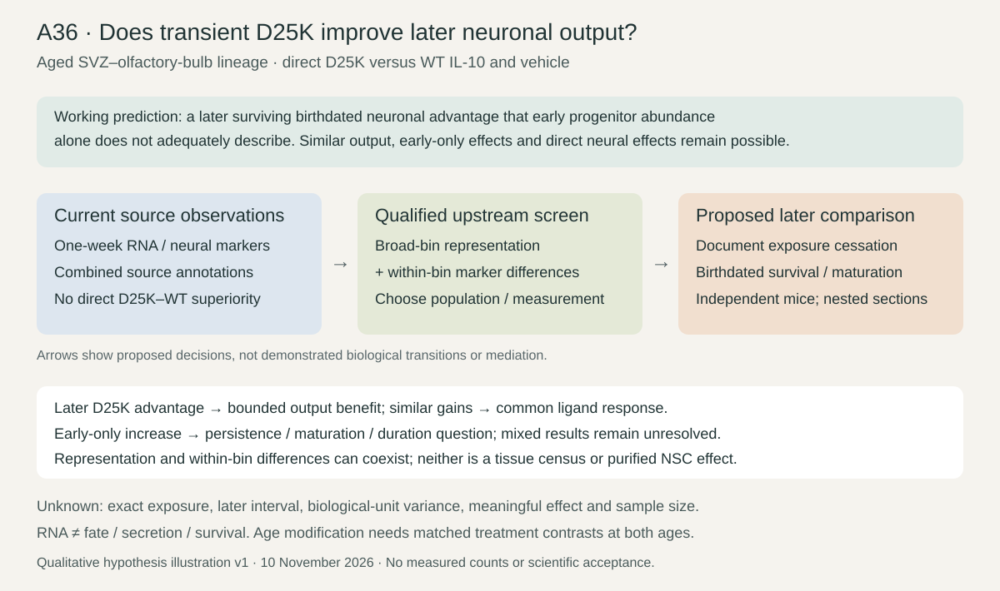

# A36 — Transient IL-10 exposure and later neuronal output

**Organizing biological question:** In the aged SVZ–olfactory-bulb lineage, does a defined transient D25K exposure increase later surviving neuronal output relative to WT IL-10 and vehicle, and how does that compare with the early progenitor response?

Registered on 10 November 2026 at the owner's explicit request. This is a proposed duration/endpoint extension, not scientific acceptance. [Canonical card](../../RESEARCH_QUESTIONS.md#a36) · [Dossier](../../docs/research_dossiers/A36.md) · [Literature context](LITERATURE_CONTEXT.md) · [Stepwise plan](PLAN.md) · [Results](RESULTS.md) · [Gallery](FIGURES.md).

## Literature and visual hypothesis

Navarro et al. (2026), Fig. 5, already test the immune/IFN premise; Fig. 6 measures neural-marker endpoints after one week of infusion. Direct D25K–WT neural-marker superiority was not established by the repository's source reproduction. Early progenitor recovery need not imply later survival. Direct progenitor effects and chronic IL-10 survival findings make exposure duration and endpoint separation consequential; they do not predict a guaranteed D25K advantage.

Qualitative proposed comparison, with no measured counts, effect sizes or inferred lineage arrows. The [context](LITERATURE_CONTEXT.md) separates primary results, same-source reanalysis and unmeasured links.

## What the source audit changes

Table S3 already includes interferon-related enrichment in engineered-IL-10 astrocyte/qNSC comparisons. Fig. S6 contains age clocks and whole-niche PCA. Neither is a new residual-IFN discovery here. The added descriptive question is whether broad-bin representation and within-bin RNA differences contribute together to a measured recipient pattern. The source explicitly cannot separate astrocytes/qNSCs or aNSCs/NPCs. Within-bin is therefore not within a purified NSC state.

The screen can change the population/measurement decision for later work. It cannot estimate survival, identify IFN type, show secretion, establish maturation or prove immune mediation. Recovered-cell fractions are not tissue abundance. All outcome exposure is retained; a new freeze does not make these data unexposed.

## Current work and next decision

The [stage plan](PLAN.md) defines local source/representation qualification, a conditional exact-matrix RNA decomposition, later-output source feasibility, and conditional age modification. [Results](RESULTS.md) owns actual execution status and exact holds. Later surviving output remains a separate biological endpoint even if all eligible computational stages finish.

Nn26-P01 remains the [originating reproduction package](../../Research%20Article/ungated_navarro_negredo_2026_aged_brain_il10/README.md). Its frozen inputs, outputs and receipts stay in place. A25 owns cortical microglial age structure; A26/A27 own CD8 repertoire comparisons; Sx10-P01 owns ligand/dose/co-input selectivity. A36 does not replace any of them.

## Workspace map

| Location | Purpose |
|---|---|
| [PLAN.md](PLAN.md) | Steps, methods, informative outcomes and exact dependencies |
| [LITERATURE_CONTEXT.md](LITERATURE_CONTEXT.md) | Primary-source overlap, contrary evidence, search/access log |
| [RESULTS.md](RESULTS.md) | Current findings, immutable receipt links and remaining estimates |
| [FIGURES.md](FIGURES.md) | Qualitative illustration and measured-result navigation |
| `contracts/`, `scripts/` | Versioned frozen specifications and implementation |
| `analysis/research/runs/a36_*` | Immutable governed execution products, linked here |

No claim grade, human retain/reject decision, animal protocol or laboratory readiness is inferred.
