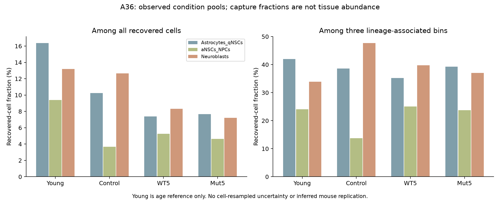

# A36 — Current results and dependent holds

Both eligible computational stages completed and their exact receipts verify locally. Later neuronal survival and age modification remain unestimated. [Plan](PLAN.md) · [Literature](LITERATURE_CONTEXT.md) · [Cloud execution](CLOUD_EXECUTION.md) · [Validation](VALIDATION.md).

| Stage | Status | Evidence or exact dependency |
|---|---|---|
| Registration and source qualification | Complete | A36 card/guide/dossier; Fig. S6 and Table S3 audit |
| Captured-cell representation | Executed and verified | 4,316 source/arithmetic checks |
| Exact-matrix recipient RNA | Executed and verified | 1,344 arithmetic checks; 11,955 cells, original labels |
| Later post-exposure neuronal output | Source search complete; estimate held | No eligible inspected birthdated D25K/WT/vehicle cohort with exposure cessation and biological-unit linkage |
| Age modification | Held | Matched young/old treatment contrasts absent; young vehicle is context only |

## What narrowed

The added question is broad-bin representation plus within-bin RNA, not discovery of a residual IFN pathway. Navarro Table S3 already reports engineered-IL-10 astrocyte/qNSC interferon-beta response enrichment (rows 104–105). Its three tabs contain treatment–control comparisons, with no direct engineered–WT table. S6A/B show clocks, C–E whole-niche PCA, and F DG STAT1 after behavior. The PDF graphic (p.21), legend (p.22), table labels and relevant source Methods were inspected. Enrichment terms do not measure IFN type or secretion.

The source explicitly could not separate astrocytes/qNSCs or aNSCs/NPCs. Fine NSC-specific attribution is therefore held. Original-bin description remains useful, with within-bin mixture retained as a limitation.

## Executed source and representation stage

Freeze: `6ce40d7`. [Contract](contracts/source_representation_v1.json) · [Immutable receipt](../../analysis/research/runs/a36_source_representation_v1/receipt.json) · [Input hashes](../../analysis/research/runs/a36_source_representation_v1/input_manifest.json) · [Source overlap](../../analysis/research/runs/a36_source_representation_v1/source_overlap.json) · [Complete published S3 rows](../../analysis/research/runs/a36_source_representation_v1/S3_source_rows.tsv).

All 96 original alias/bin recovery rows reconcile between the two retained metadata products and sum to 51,176 cells. The new comparisons use only Young, Control, WT5 and Mut5; eight-alias/six-library and dose/pool limitations remain. The published S3 values are archived with exact sheet/row coordinates; enrichment was not rerun.

| Original bin | Control cells / lineage fraction | WT5 cells / lineage fraction | Mut5 cells / lineage fraction | Mut5–WT5 lineage fraction |
|---|---:|---:|---:|---:|
| Astrocytes_qNSCs | 345 / 38.59% | 572 / 35.20% | 472 / 39.27% | +4.07 percentage points |
| aNSCs_NPCs | 123 / 13.76% | 407 / 25.05% | 285 / 23.71% | −1.34 percentage points |
| Neuroblasts | 426 / 47.65% | 646 / 39.75% | 445 / 37.02% | −2.73 percentage points |

The three-bin denominators are Control 894, WT5 1,625 and Mut5 1,202. The [complete table](../../analysis/research/runs/a36_source_representation_v1/representation.tsv) also retains all-recovered-cell denominators (3,365; 7,760; 6,162), Young context and every original bin. [All contrasts](../../analysis/research/runs/a36_source_representation_v1/representation_contrasts.tsv) retain both denominator definitions.

Mut5 does not simply increase every captured lineage fraction over WT5. This weakens a uniform-restoration interpretation of these capture fractions and justifies keeping population representation and RNA response separate. It does not refute the separately measured histological endpoint, establish tissue abundance or estimate a mouse treatment effect. Recovery and tissue counts are different measurements.

Independent verification passed **156** recovery/denominator/rational-arithmetic checks and **4,160** workbook scalar comparisons against direct ZIP/OOXML, for **4,316 checks**. [Verification](../../analysis/research/runs/a36_source_representation_v1/independent_verification.json). The measured figure was visually inspected. Agreement across two reads of shared data is numerical verification, not biological replication.

## Executed exact-matrix recipient stage

Desktop specification freeze: `0c8f133`; exact cloud import/freeze: `19ed556031dc3381af136d5f3c604f5877ec53df`. [Contract](contracts/recipient_screen_v1.json) · [Configuration](contracts/recipient_screen_v1.config.json) · [Immutable receipt](../../analysis/research/runs/a36_recipient_screen_v1/receipt.json) · [All summaries](../../analysis/research/runs/a36_recipient_screen_v1/summaries.tsv) · [All contrasts](../../analysis/research/runs/a36_recipient_screen_v1/contrasts.tsv).

The exact retained 51,176-cell/31,053-gene RDS was reverified read-only. All 16 predefined genes are present. The screen retains 11,955 cells across Young, Control, WT5 and Mut5 in the original Astrocytes_qNSCs, aNSCs_NPCs, Neuroblasts and Oligodendrocytes bins, including implicit zeros. Oligodendrocytes are separate context; decomposition uses the first three bins only. No relabeling, aggregate score, biological-unit inference or population P values were added.

The following Mut5-minus-WT5 differences concern mean `log1p(10000*count/library_total)`, not log fold changes. The symmetric representation and within-bin terms sum to the total. Detection differences are fractions, not percentages.

| Marker | Mean-RNA difference | Representation term | Within-bin term | Detection-fraction difference |
|---|---:|---:|---:|---:|
| Stat1 | −0.000055 | +0.005283 | −0.005338 | +0.033149 |
| Bst2 | −0.064711 | +0.018024 | −0.082735 | −0.001814 |
| Isg15 | −0.061842 | +0.006146 | −0.067988 | −0.032521 |
| Ifitm3 | −0.114355 | +0.028079 | −0.142434 | −0.035659 |

Bst2, Isg15 and Ifitm3 means are lower in Mut5 than WT5 in each of the four original bins. Across the three-bin aggregate, positive representation terms partly offset negative within-bin terms. Stat1's aggregate mean is near unchanged, its detection is higher, and its astrocyte/qNSC mean is slightly higher in Mut5. Bst2 also has lower mean but higher detection in that bin. These exceptions rule out describing all measured features as uniformly attenuated.

Both treatment aliases have higher three-bin aggregate means than Control for all four markers; lower Mut5 versus WT5 therefore does not imply return to the vehicle reference. Young-minus-Control means are lower for all four, but young vehicle alone cannot identify age modification. The [full decomposition](../../analysis/research/runs/a36_recipient_screen_v1/decomposition.tsv) retains all 32 contrast/marker/metric rows and both metrics. Twelve context markers are reported without turning them into new identities.

These arithmetic terms retain potentially informative representation differences and measured RNA differences together. They do not identify cell-intrinsic treatment effects or causal mediation: broad-bin state mixture, condition pooling and capture remain alternatives. The qualified result can inform compartment and readout choice, but it does not resolve the organizing later-output hypothesis.

The [independent verification](../../analysis/research/runs/a36_recipient_screen_v1/independent_verification.json) passed 1,344 checks against count-based Python reconstruction, 39,655 sparse entries and complete denominators; maximum normalization error was `5.33e-15`. Exact returned figures are in [the gallery](FIGURES.md#a36-measured-recipient-rna) and were inspected locally. Shared-source arithmetic agreement is not biological replication.

The owner authorized the existing cloud executor, exact input archive and result-bundle return. Restored R 4.5.0/Matrix 1.7-3/SeuratObject 5.0.2 completed within limits, with 6,767,095,808-byte peak R RSS and no OOM. The bundle and all 85 pieces match their hashes; all new output bytes and original frozen scripts/contracts agree. [Cloud report](CLOUD_EXECUTION.md) and [runtime record](CLOUD_RUNTIME.md) preserve preparation issues, package provenance and the nonfatal font-cache message. No biological rerun was needed.

## Later-output and age feasibility

The bounded primary/source search did not locate an eligible later post-withdrawal D25K/WT/vehicle birthdated neuronal-survival cohort. Inspected Navarro measurements are one-week snapshots; its public object listing concerns RNA. The [feasibility record](../../analysis/research/runs/a36_source_representation_v1/feasibility.json) and [search log](LITERATURE_CONTEXT.md#next-literature-check) specify coverage and limits. Absence of an inspected eligible source is not proof that none exists.

Held estimates require actual exposure cessation and later timing, birthdated survival/maturation measurements, and biological-unit/comparator linkage. A measurement plan is specified in [stage 5](PLAN.md#5-later-output-source-search-and-conditional-execution), with interval, dose, variance, meaningful effect and sample size explicitly unresolved. No unpaired group-average linkage or fabricated cohort is used.

Age modification remains conditional on matched young/old treatment contrasts. An aged-context treatment effect remains legitimate without that design. There is no measured lesion, so no injury-repair analysis is launched.

## Preserved interpretation and next decision

Nn26-P01's direct nonsignificant D25K–WT neural-marker comparisons, nonsignificant direct cognition tests, mixed-dose nesting, RNA exceptions and source discrepancies remain unchanged. A36 does not promote these results, replace the originating candidate, or merge A25/A26/A27/Sx10-P01. The eligible frozen computations are complete. The next informative step requires the organizing later-output endpoint and its biological-unit/exposure linkage; another RNA score would not supply it. Execution and biological resolution remain separate. No human acceptance or claim-grade change is recorded.
