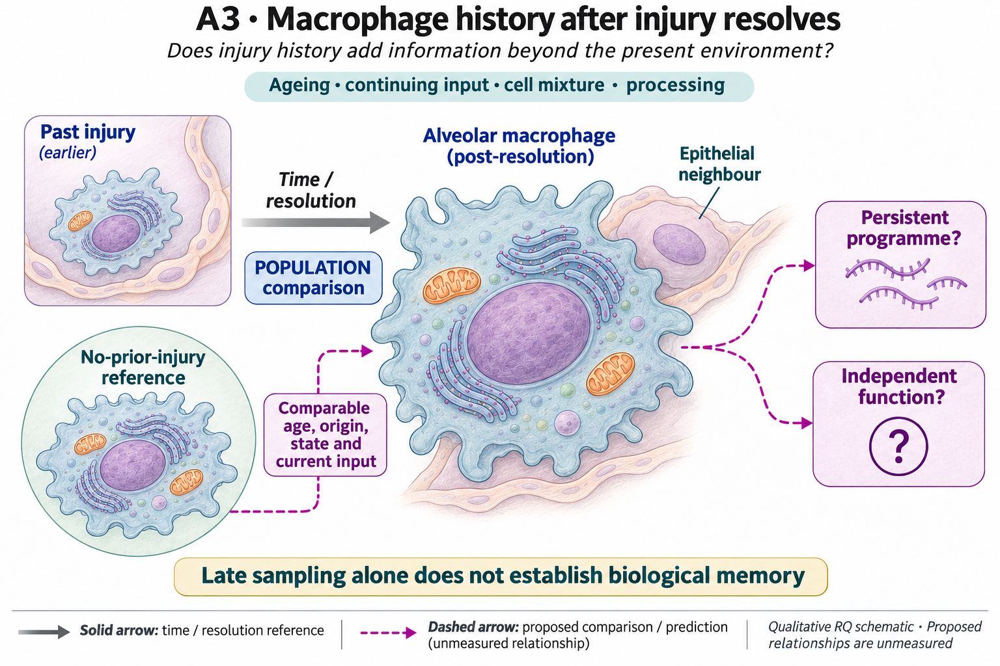

# A3: literature context and hypothesis schematic

[Question home](README.md) · [Scientific dossier](../../docs/research_dossiers/A3.md).

**Source-navigation update, 2 November 2026:** [DY1-P02 current results and holds](../../Research%20Article/gate2_DY1_damani_yokota_2026/rq_discordance/README.md) support measurement/context assessment for A3. This link introduces no new mechanism, literature claim or change to the registered hypothesis; the [scope assessment](../../docs/audits/2026-11-02-navigation-hygiene/RQ_ASSESSMENT.md) preserves the source ownership.

Reviewed 3 October 2026. This note connects published findings to the current proposed question. It is a bounded synthesis, not novelty clearance or scientific acceptance.

## Published starting point

Origin and past tissue history already help explain macrophage behaviour. Normal ageing also supplies a reference alternative to an injury-specific interpretation.

| Primary source | Inspected locator and access record |
|---|---|
| [Aegerter 2020](https://www.nature.com/articles/s41590-019-0568-x) | Abstract and Figs. 5–7 headings; subscription limits. [Access / prior review](../../docs/research_dossiers/review_2026-10-03/SOURCES.md#s11) |

Sources above reuse the named review unless the update ledger explicitly records a fresh inspection. Published-source evidence and reanalysis of the same material are not independent replication.

## Repository observation

The reviewed separate BMDM source contains six libraries: two source controls, two initial IL4 and two post-IL4. Egr2/Irf4 post values exceed control but remain well below initial exposure. Pparg post values lie within the control range, Stat6 is lower, and Rxra has a higher-post context. Arg1 is much lower post than initially while remaining above low control values. The readout is deposited-count CPM with all 24,411 genes in the denominator, retaining Salmon-derived count/estimate semantics.

[Current result, design and limits](reports/RNA_CONTEXT_DISPLAY_V1_RESULTS.md). This reuses existing evidence rather than providing a new run or independent replication.

## What this question could add

Exploratory transcript-context narrowing, not identification of a persistence-maintaining regulator. The measured regulator RNAs are not uniformly maintained in these libraries. This does not test a requirement of the mechanistic axis or exclude sequential regulation; regulator activity is unmeasured. Egr2/Irf4 are source-specific leads after prior outcome exposure; annotations and repeated use of these libraries do not independently validate maintenance, activity or an ARG1 mechanism.

Preparation/batch sharing and time-matched control harvest remain unresolved. Library suffixes do not establish pairing or six independent animals. This source is distinct from the original NAM context and does not resolve same-cell RNA–ATAC coupling or a withdrawal effect.

## Current hypothesis and rival

Prior lung injury may leave a persistent macrophage programme within comparable macrophage origins and states after the current environment has resolved. The additional question concerns history beyond age, origin and continuing tissue stimulation. A programme and independent functional consequence still need nomination; late sampling alone cannot demonstrate biological memory.

**Strongest rival:** The signal is normal aging, processing variation, altered macrophage mixture or continuing tissue stimulation.

## What the comparison would teach

Use the existing temporal/source qualification to decide what a matched post-exposure contrast could estimate. Consistent transcript persistence after qualified cessation would narrow a temporal explanation; dependence on current input, timing or composition would restrict it. Regulator activity and effector consequences are separate questions. No additional unlinked enrichment score or intervention is selected by this display.

## Hypothesis schematic

GPT-generated matte illustration, 3 November 2026. Proposed relationships and cell counts are qualitative; the owning context defines the comparison and interpretation limits. [Editorial review](../../docs/audits/2026-11-02-rq-schematic-review/MATTE_PUBLICATION_2026-11-03.md) · [Selected edit prompt](schematics/A3_gpt_matte_v1.prompt.txt). Earlier SVG files are retained as history.

A3 concerns history-associated persistence in comparable age, origin, state and resolved context, using independent animals/donors. W1 retains age/processing confounding and negative/ineligible pathway findings. Late RNA is neither intrinsic memory nor flux; DY1 does not nominate an accepted memory mechanism.

Class-level glyphs and qualitative geometry are not molecular structures, organelle measurements or evidence of functional assembly. Neutral epithelial/stromal shapes do not assert subtype identity or organelle loss, and icon counts are illustrative. Read locally labelled solid premises/references separately from dashed proposed comparisons; no complete mechanism follows from their juxtaposition.

The newer [Nb5 normal-age reference](../../docs/research_dossiers/extensions_2026-10-03/A3_Nb5_age_reference.md) develops the age rival already shown in the illustration; it is not an injury experiment.

## Next literature check

Planned query (not reported as newly executed): `alveolar macrophage injury history persistent function origin ageing matched context 2025 2026`. Expand to synonyms, nearest source references/citations and conflicting results using the [literature workflow](../../docs/governance/LITERATURE_WORKFLOW.md). Recheck the exact population, comparison, timing, unit and endpoint before making a stronger contribution claim.

**Current unresolved specification:** An age-matched, independently replicated comparison separating within-state changes from abundance and current environment is missing.

**Interpretation limit:** Neither a pathway score nor an ineligible metabolic gene set demonstrates flux or trained immunity.

[Current dossier](README.md) · [All-question context index](../../docs/research_dossiers/literature_context_2026-10-03/README.md)

## Literature-informed screening scope — 3 November 2026

The owner-authorized [DY1-P02 fixed identity-target specification](../../Research%20Article/gate2_DY1_damani_yokota_2026/rq_discordance/IDENTITY_TARGETS_SPEC_V1.md) fixes the measured RNA comparison, units, literature selection and limits before execution. It reuses complete frozen non-infectious reference estimates for six literature-nominated targets, retaining every target and mapped region. This does not reopen original NAM/pathogen analyses or establish a maintenance mechanism. No canonical hypothesis, registered illustration, prior result or scientific acceptance changes. [Completed numerical result](../../Research%20Article/gate2_DY1_damani_yokota_2026/rq_discordance/IDENTITY_TARGETS_V1_RESULTS.md). The complete fixed-target screen finds co-increased Irf4/Pparg RNA in WT IL4 and heterogeneous mapped-region point differences. This neither reproduces nor refutes the distinct alveolar IL13 mechanism.
