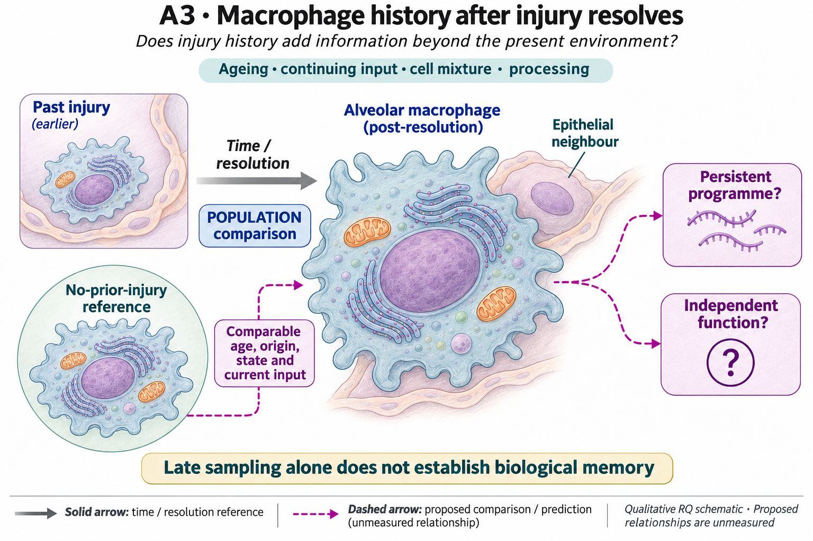
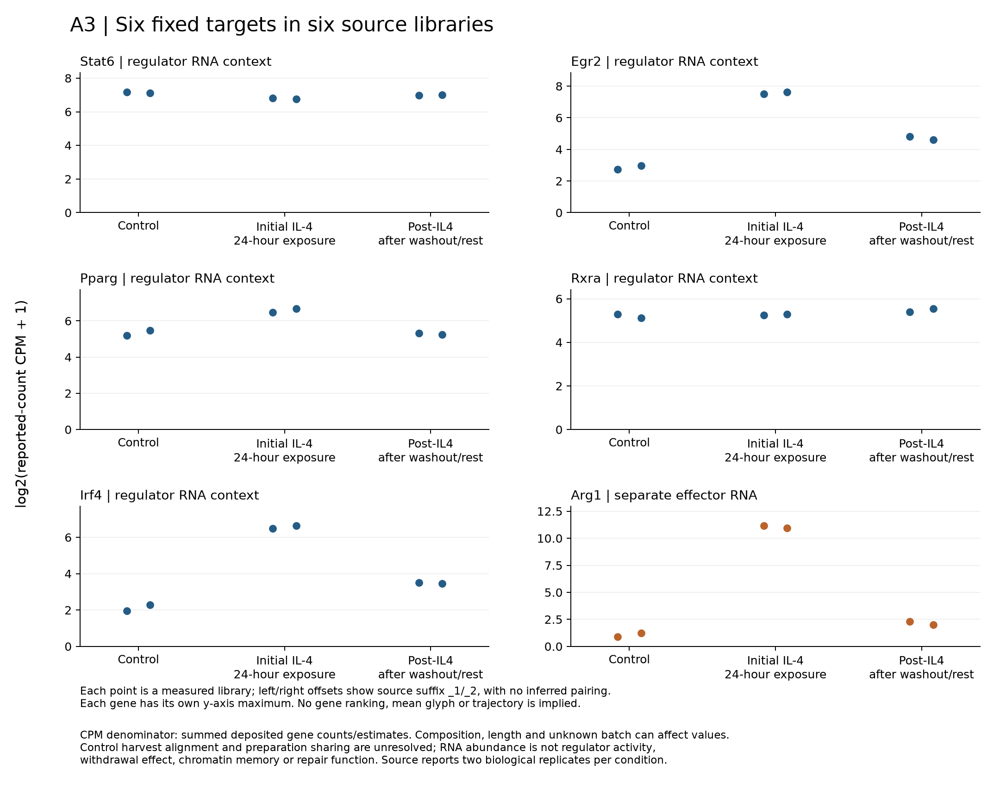

# A3: macrophage injury history

## Organizing Biological Q

Which consequences of macrophage exposure history remain after the initial input, and which observations distinguish retained regulatory context from current stimulation or a different cell mixture?

Published macrophage priming and the Damani–Yokota history study motivate induction, maintenance and effector questions. STAT6/EGR2/PPARγ–RXRA and ARG1 occupy different parts of that explanation; their RNA measurements cannot establish one continuous causal axis.

Current synthesis: 4 November 2026. [Full rationale](../../docs/research_dossiers/A3.md) · [Source context](LITERATURE_CONTEXT.md).

<!-- literature-visual-context:start -->

## Literature context & visual hypothesis

[Published findings, repository observations and interpretation limits](LITERATURE_CONTEXT.md).

GPT-generated matte illustration, 3 November 2026. Proposed relationships and
cell counts are qualitative. [Editorial review](../../docs/audits/2026-11-02-rq-schematic-review/MATTE_PUBLICATION_2026-11-03.md) · [Selected edit prompt](schematics/A3_gpt_matte_v1.prompt.txt). Earlier artwork is retained as history.
<!-- literature-visual-context:end -->

The illustration presents the registered question and untested relationships. The current argument follows the result below; the drawing does not establish its proposed mechanism.

## What the analysis changed

The reviewed separate BMDM source contains six libraries: two source controls, two initial IL4 and two post-IL4. Egr2/Irf4 post values exceed control but remain well below initial exposure. Pparg post values lie within the control range, Stat6 is lower, and Rxra has a higher-post context. Arg1 is much lower post than initially while remaining above low control values. The readout is deposited-count CPM with all 24,411 genes in the denominator, retaining Salmon-derived count/estimate semantics.

[Current result, design and limits](reports/RNA_CONTEXT_DISPLAY_V1_RESULTS.md).

The existing result figure is reused unchanged. Its owning report records the units, provenance and display limits.

**Rationale check.** Exploratory transcript-context narrowing, not identification of a persistence-maintaining regulator. The measured regulator RNAs are not uniformly maintained in these libraries. This does not test a requirement of the mechanistic axis or exclude sequential regulation; regulator activity is unmeasured. Egr2/Irf4 are source-specific leads after prior outcome exposure; annotations and repeated use of these libraries do not independently validate maintenance, activity or an ARG1 mechanism.

## Current interpretation and next decision

Preparation/batch sharing and time-matched control harvest remain unresolved. Library suffixes do not establish pairing or six independent animals. This source is distinct from the original NAM context and does not resolve same-cell RNA–ATAC coupling or a withdrawal effect.

Use the existing temporal/source qualification to decide what a matched post-exposure contrast could estimate. Consistent transcript persistence after qualified cessation would narrow a temporal explanation; dependence on current input, timing or composition would restrict it. Regulator activity and effector consequences are separate questions. No additional unlinked enrichment score or intervention is selected by this display.

## Registered scope and analysis history

The records below preserve earlier framing and execution checkpoints. Read the current result before an older plan. Historical unfinished-work wording does not supersede completed later diagnostics. Registered hypotheses remain unchanged; this synthesis grants no claim grade or human acceptance.

Registered framing and retained analysis history

## Organizing Biological Q

Does prior injury leave a persistent macrophage programme after age and current tissue context are accounted for?

**Unresolved gap:** An age-matched, independently replicated comparison separating within-state changes from abundance and current environment is missing.

[Working hypothesis and competing explanations](../../docs/research_dossiers/A3.md#working-hypothesis) · [Canonical card](../../RESEARCH_QUESTIONS.md#a3).

## Current evidence and interpretation

The [reviewed six-library RNA-context result, 4 November 2026](reports/RNA_CONTEXT_DISPLAY_V1_RESULTS.md) narrows the induced/above-control post-IL4 RNA nomination to Egr2 and Irf4, whose post values remain below the initial-IL4 values. Pparg post-IL4 values lie within the source-control range; Stat6 remains lower and Rxra has a distinct higher-post context. The separate Arg1 effector is much lower post than initially, while retaining above-control values. The full fixed panel is heterogeneous; none of these RNA measurements establishes regulator activity.

This separate BMDM source is a descriptive context for the earlier DY1 repeat-stimulation finding, not its exact replication or a NAM/injury-memory mechanism. Preparation sharing, batch and control harvest alignment remain unresolved. The next discriminator is matched harvest/preparation qualification or a separately justified time-matched comparison of the fixed candidates, with protein/activity and effector function measured separately if that inference is sought. No maintenance/withdrawal effect, accepted causal axis or automatic follow-up run follows.

Measured library points use log2(reported-count CPM+1), with per-gene y scales; source suffixes do not imply paired preparations. Exact source totals, raw-CPM means/ranges, receipts and limits are in the linked report.

**Historical screen snapshot, 3 November 2026:** The reviewed six-target, two-offset repeat-stimulation view has completed. Target directions are heterogeneous and ARG1 is offset-sensitive; source group averages supply neither individual variance nor persistent macrophage memory. This same-source measurement does not establish NAM/injury memory or a repair mechanism. [Complete result and evidence](../../Research%20Article/gate2_DY1_damani_yokota_2026/rq_discordance/IDENTITY_REPEAT_VIEW_V1_RESULTS.md); [reviewed sequence and source rationale](../../docs/research_reviews/2026-11-03-full-priority-screening/PLANS.md). Scientific acceptance and the registered hypothesis remain unchanged.

<!-- evidence-followthrough:start -->
**Evidence follow-through — 3 November 2026:** Exclude the affirmative claim
“Late macrophage RNA demonstrates intrinsic memory, flux or the nominated axis.” from current conclusions.
[Bounded fill, stop rule and reopening evidence](../../docs/audits/2026-11-03-rq-evidence-trajectory/CUT_OR_FILL_PLAN.md#a3).
The hypothesis remains a proposal where its decisive comparison is untested.
<!-- evidence-followthrough:end -->

**Source connection, 2 November 2026:** ungated [DY1-P02](../../Research%20Article/gate2_DY1_damani_yokota_2026/rq_discordance/README.md) provides assay/selection and regulatory-context qualification relevant to this question. Its external references do not measure a NAM memory mechanism, nominate an accepted causal programme or supply independent functional consequences. The A3 working hypothesis, prior results and registered illustration are unchanged.

**Current entrypoints:** [existing source-analysis context](../../Research%20Article/gate1_01_niethamer_2025/README.md) ·
[conditional hypothesis package](../../docs/research_dossiers/packages_2026-10-03/A3.md).
The package draft exists. The requested specificity/novelty revision is applied;
scientific acceptance and experiment-specific qualification remain pending. Use [current work disposition](../../docs/research_dossiers/REMAINING_WORK.md), not an older
package-pending checkpoint, to decide what is active.

Does prior injury leave a macrophage programme that differs from normal aging?

Status: proposed refinement, 3 October 2026. This is a development aid, not scientific acceptance or an experimental protocol.

W1 is a pseudobulk analysis, not a completed Compass flux analysis. Age and processing are confounded; the reference CAMERA analysis found no significant sets and the seven-gene ornithine set was ineligible.

Evidence locators (source citations and numerical details remain in these records):

- [Research Article/gate1_01_niethamer_2025/README.md](../../Research%20Article/gate1_01_niethamer_2025/README.md)

## Analysis plan and next decision

Recover source ages, processing batches and independent sample identities. Define eligibility before another pathway analysis; preserve the negative and ineligible findings.

[Plan and existing implementation](PLAN.md) · [Full scientific dossier](../../docs/research_dossiers/A3.md) · [Current interpretation boundary](../../docs/research_dossiers/A3.md#interpretation-boundary).

This folder is the question home. Existing paper-owned analyses, shared code and frozen runs retain their original ownership and paths.

## Literature-informed screening scope — 3 November 2026

The owner-authorized [DY1-P02 fixed identity-target specification](../../Research%20Article/gate2_DY1_damani_yokota_2026/rq_discordance/IDENTITY_TARGETS_SPEC_V1.md) fixes the measured RNA comparison, units, literature selection and limits before execution. It reuses complete frozen non-infectious reference estimates for six literature-nominated targets, retaining every target and mapped region. This does not reopen original NAM/pathogen analyses or establish a maintenance mechanism. No canonical hypothesis, registered illustration, prior result or scientific acceptance changes. [Completed numerical result](../../Research%20Article/gate2_DY1_damani_yokota_2026/rq_discordance/IDENTITY_TARGETS_V1_RESULTS.md). The complete fixed-target screen finds co-increased Irf4/Pparg RNA in WT IL4 and heterogeneous mapped-region point differences. This neither reproduces nor refutes the distinct alveolar IL13 mechanism.

