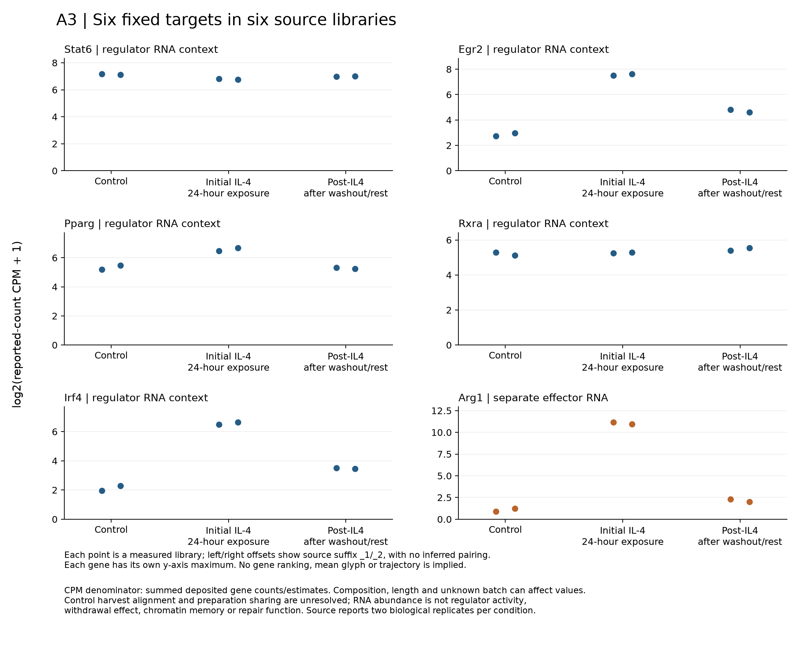

# A3: six-library fixed-target RNA-context result v1

4 November 2026. Egr2 and Irf4 retain higher post-IL4 RNA abundance than source control in these libraries, while lying well below the initial-IL4 values. Pparg post-IL4 values lie within the source-control range, Stat6 remains below control and Rxra is higher in the post context. The separate Arg1 effector is far lower after washout/rest than in initial IL4, while still above its low control values. This is a heterogeneous RNA context, not uniform regulator activation or a demonstrated withdrawal/memory mechanism. Coordinator numerical, biological and figure review passed on 4 November 2026.

## Question, source and estimand

The organizing A3/DY1 question distinguishes induction, post-stimulation context and later effector association. The [preceding fixed-target repeat-source view](../../../Research%20Article/gate2_DY1_damani_yokota_2026/rq_discordance/IDENTITY_REPEAT_VIEW_V1_RESULTS.md) was heterogeneous and did not measure maintenance. This separate source asks whether those same five regulator transcripts, with Arg1 kept separate, show a post-stimulation context worth a more specific persistence comparison. Earlier outcomes and the source paper's figures were exposed; this is not an unexposed confirmatory test or exact replication of DY1's measurement.

[Daniel et al.](https://doi.org/10.1073/pnas.2600693123) provides the published stimulation/priming premise. Its main text reports two biological replicates, and the accessed SI describes the exposure/rest intervals and Salmon-derived gene counts. [Exact methods/access qualification](../../../docs/research_reviews/2026-11-03-tool-assisted-screening-review/A3_METHOD_QUALIFICATION_AND_SCOPE_V3.md) remains separate from the repository measurements here. Individual preparation/GSM sharing, batch mapping and duration-matched control harvest remain unresolved.

The units displayed are six measured WT RNA libraries: two source controls, two initial 24-hour-IL4 and two post-IL4 libraries. Source suffixes do not establish pairing or six independent mice. The endpoint is reported-count CPM: each target's deposited gene value divided by the sum of all 24,411 deposited gene values for that library, multiplied by one million. This is not total sequenced reads or molecules. [Full-file semantic manifest](../../../docs/research_reviews/2026-11-03-tool-assisted-screening-review/prerequisites/A3_FULL_SOURCE_SEMANTICS_V1.json), [exact target rows](../../../docs/research_reviews/2026-11-03-tool-assisted-screening-review/prerequisites/A3_FIXED_TARGET_MAP_V1.tsv) and [52-column/GSM join](../../../docs/research_reviews/2026-11-03-tool-assisted-screening-review/prerequisites/A3_GSE247943_HEADER_JOIN_V1.tsv) bind source identity. Salmon/tximport origin and integer export are both recorded; fractional values would be preserved, and no gene was filtered from the denominator.

## Complete observed result

Points are log2(CPM+1), with per-gene y-axis maxima and a zero baseline. No mean glyph or trajectory is drawn. Table entries below are arithmetic means and observed ranges of the two **raw CPM** values, not means of logged points or confidence intervals. These measured library differences cannot isolate withdrawal from elapsed culture time or unknown batch.

| Fixed target | Source control mean [range] | Initial IL4 mean [range] | Post-IL4 mean [range] |
|---|---:|---:|---:|
| Stat6 | 140.572 [137.672, 143.471] | 109.901 [107.856, 111.947] | 125.731 [124.445, 127.016] |
| Egr2 | 6.280 [5.652, 6.908] | 188.295 [179.741, 196.849] | 25.441 [23.510, 27.372] |
| Pparg | 39.539 [35.596, 43.483] | 93.658 [87.034, 100.282] | 37.761 [36.771, 38.750] |
| Rxra | 35.911 [33.594, 38.229] | 37.614 [37.249, 37.979] | 43.350 [41.362, 45.338] |
| Irf4 | 3.358 [2.879, 3.838] | 93.977 [89.494, 98.461] | 10.160 [10.014, 10.305] |
| Arg1 | 1.099 [0.843, 1.355] | 2137.838 [1997.949, 2277.727] | 3.472 [2.973, 3.972] |

All [36 target/library values](../../../analysis/research/runs/A3_rna_context_display_v1_20261104/target_library_values.tsv), [18 condition summaries](../../../analysis/research/runs/A3_rna_context_display_v1_20261104/target_condition_summary.tsv), [52 source library totals](../../../analysis/research/runs/A3_rna_context_display_v1_20261104/source_library_totals.tsv) and [run metadata](../../../analysis/research/runs/A3_rna_context_display_v1_20261104/summary.json) are retained. No target was dropped, no added positive panel was sought, and no fold-change test, ranking, score or population interval was generated. Zero values would remain observed zero; missing or duplicate targets stop the run rather than become zero.

## What narrowed and what remains unmeasured

The descriptive nomination narrows to Egr2/Irf4 transcript context rather than persistence of the full regulator panel. Their post values exceed control in both libraries but are substantially below the initial condition. Pparg's control-range post values and Stat6's lower values argue against describing all five regulator RNAs as uniformly maintained. Rxra's higher post values add distinct context without proving a shared regulatory mechanism. Arg1's separate, much lower post abundance prevents equating retained regulator RNA context with sustained effector abundance; its residual above-control values are also retained.

A next fit-for-purpose discriminator would establish matched control harvest and preparation provenance, or measure these fixed candidates in a separately justified time-matched comparison, before attributing differences to persistence after cessation. Regulator protein/activity and effector function are separate measurements. The present evidence does not select an intervention or show that Egr2/Irf4 cause Arg1 behavior, NAM/infection memory or repair. Differences between the earlier DY1 repeat-stimulation source and this BMDM context remain contextual rather than pooled cross-study effects. No automatic further numerical screen follows.

## Verification and limits

The [exact specification](../../../docs/research_reviews/2026-11-03-tool-assisted-screening-review/prerequisites/A3_RNA_CONTEXT_DISPLAY_SPEC_V1.md), [entrypoint](../scripts/rna_context_display_v1.py) and [contract](../../../analysis/research/contracts/A3.rna_context_display_v1.json) were frozen at `43f633f8e2a7a3bfe3ab5f66dc0d52ad7c19fa1a` after review. Targeted synthetic checks passed whitespace parsing, fractional/zero preservation, full-denominator arithmetic, missing/duplicate rejection, actual raw-CPM summaries, ordering and transformation. A fixture-label formatting error and a Windows-style preflight command path were corrected before freeze; no source substitution or gate weakening occurred. All 52 source totals and exact gene/sample mappings match their preparation records. The governed [receipt](../../../analysis/research/runs/A3_rna_context_display_v1_20261104/receipt.json) verifies; technical visual inspection found the six-panel display legible. Independent coordinator reconstruction passed 374 checks with zero numerical discrepancy; the figure and biological wording passed review. The current A3/DY1 evidence sections now carry the cleared synthesis. [Coordinator review](../../../docs/research_reviews/2026-11-03-tool-assisted-screening-review/COORDINATOR_REVIEW.md).

Compositional normalization, unresolved effective-length/isoform handling, unknown batch, uncertain untreated harvest alignment and preparation sharing limit interpretation. RNA abundance is not regulator activity. Two library values do not justify a population interval or causal withdrawal effect. Successful execution does not grant human scientific acceptance or a claim-grade change.
