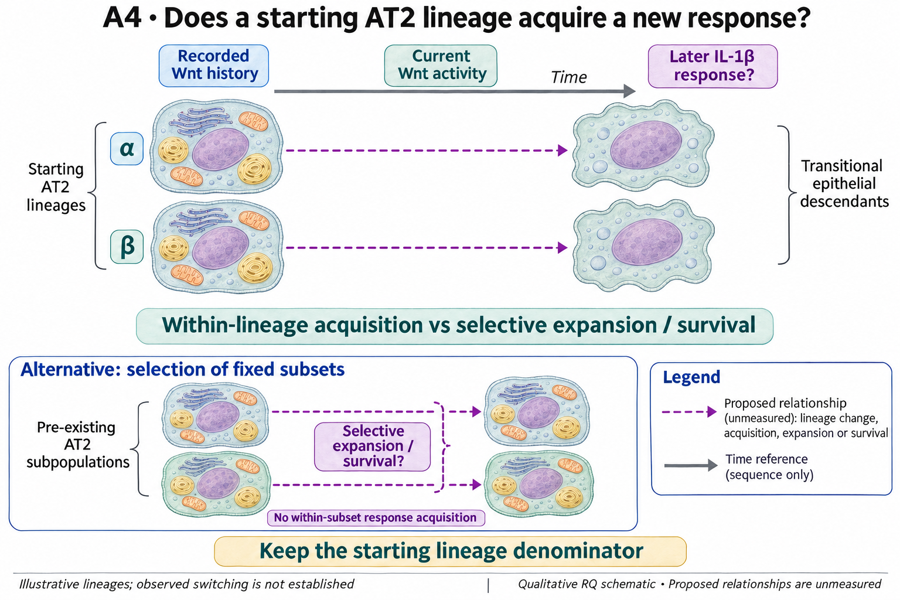

# A4: literature context and current argument

[Question home](README.md) · [Scientific dossier](../../docs/research_dossiers/A4.md).

Synthesis updated 4 November 2026 using the recorded primary-source reviews and
current owning results. Their actual search dates, versions, access and figure
locators remain in the records below. No new literature search or biological run
was performed for this documentation batch.

## Published starting point

Wnt-associated alveolar stem-cell behaviour, changing Wnt responsiveness and inflammatory transitions are published. These findings provide the two ends of the proposed adult sequence.

| Primary source | Inspected locator and access record |
|---|---|
| [Nabhan 2018](https://pmc.ncbi.nlm.nih.gov/articles/PMC5997265/) | Wnt niche and tracing result. [Access / prior review](../../docs/history/reviews/NOVELTY_SPECIFICITY_APPLICATION_2026-10-03.md) |
| [Frank 2016](https://pubmed.ncbi.nlm.nih.gov/27880906/) | Developmental Wnt history; Fig. S2G–H. [Access / prior review](../../docs/research_dossiers/followup_2026-10-03/NOVELTY.md) |
| [Choi 2020](https://pmc.ncbi.nlm.nih.gov/articles/PMC7487779/) | Fig. 7 and Discussion. [Access / prior review](../../docs/history/reviews/NOVELTY_SPECIFICITY_APPLICATION_2026-10-03.md) |

Sources above reuse the named review unless the update ledger explicitly records a fresh inspection. Published-source evidence and reanalysis of the same material are not independent replication.

Nabhan's Wnt-niche work, Frank's developmental responsiveness and Choi's inflammatory-transition study motivate the endpoints. Choi explicitly proposed comparing the reporter populations, so the broad question is not newly discovered here. [Recorded primary locators](../../RQ_Specified/A4_wnt_history_il1_response/LITERATURE_CONTEXT.md#published-starting-point) distinguish developmental history, adult current state and the proposed linked adult sequence.

## Repository observation

The [Axin2/Il1r1 branch](../../Research%20Article/gate1_02_choi_2020/axin2_il1r1/README.md#figure-gallery) displays current transcript detection/co-detection under a stated Sftpc-positive, non-transitional AT2 rule in GSE310539. Cells are observations within source wells/captures, not independently tracked starting lineages. The detection range is source-specific; it cannot be replaced by that from GSE145031.

The [chromatin Route B result](../../Research%20Article/gate1_02_choi_2020/axin2_il1r1/ROUTE_B_OUTCOME.md) remains closed under its declared rule on the inspected deposits. Improved detection of linked peaks did not qualify an interpretable history proxy or the proposed replicated interaction. The report also retains the control/null limitations; failure of that instrument is not evidence that the biological sequence is absent. The [current screening disposition](../../docs/research_reviews/2026-11-03-full-priority-screening/PLANS.md#a4--current-wntil-1-state-versus-historical-lineage) records that GSE109444 contains mesenchymal cells, not the required historical AT2 matrix.

AF1 Wnt2 and AF2 Wnt4 RNA provide source contexts. They do not show that the same epithelial cells switched response, and accessibility is not a record of prior Wnt exposure.

## Does the evidence warrant the narrowing?

**Rationale verdict: a useful measurement boundary and a justified lineage question; response acquisition remains untested.** Current co-detection narrows what can be described, not which historical subsets interconvert. Rejecting transcript or accessibility substitution does not select fixed subsets, reversible switching or an Fzd5 gate. No Fzd5 entry-gating mechanism is adopted.

The branch and question reuse exposed source evidence. Source-dependent detection, operational AT2 selection, reporter design/history, selective expansion and death remain consequential. Neither more detected peaks nor more cells supplies independent lineage units. Earlier blanket statements that no dataset exists or nobody has compared populations are historical search claims, not current exhaustive conclusions. Uncertainty about the sequence is not evidence of random noise.

## What remains unmeasured

Verified adult Wnt-responsive history is not linked to a later qualified IL-1 response in the same starting lineage. The eligible starting lineage set and its loss/missing-follow-up accounting remain unqualified for this comparison.

The unchanged registered hypothesis below is a proposal. The rationale assessment
does not select its mechanism or confer scientific acceptance.

## Current hypothesis and rival

Adult AT2 starting lineages with documented Wnt-responsive history can later acquire an IL-1-beta-responsive transitional epithelial state, rather than the apparent sequence arising only from expansion or survival of different pre-existing subsets. Wnt history, current Wnt activity and current IL-1 response must be measured separately. This restores the existing sequence question; it does not adopt the proposed Fzd5-dependent gate on transition entry.

**Strongest rival:** Fixed subsets respond differently; selective expansion, death or reporter history creates an apparent switch.

## What the comparison would teach

Acquisition of the qualified response within tracked starting lineages would support the sequential account. Stable subset responses with differential growth or loss would favor selection. Response, loss and unresolved follow-up must be assessed over the eligible starting-lineage denominator; a survivor-only fraction cannot identify switching.

Qualify a source linking historical exposure/reporting to later response with biological animals/donors and nested lineages identified. Reuse completed current-state screens; more transcript relabeling or a mesenchymal proxy cannot supply the missing history. The next decision is measurement suitability, not a newly nominated receptor target.

## Hypothesis schematic

GPT-generated matte illustration, 3 November 2026. Proposed relationships and cell counts are qualitative; the owning context defines the comparison and interpretation limits. [Editorial review](../../docs/audits/2026-11-02-rq-schematic-review/MATTE_PUBLICATION_2026-11-03.md) · [Selected edit prompt](schematics/A4_gpt_matte_v1.prompt.txt). Earlier SVG files are retained as history.

The comparison asks whether a response is acquired within eligible starting AT2 lineages rather than selected by differential expansion or survival. Animals define independent units and clones are nested; retain the starting denominator. Wnt history, current Wnt and IL-1 response are separate readouts.

Class-level glyphs and qualitative geometry are not molecular structures, organelle measurements or evidence of functional assembly. Neutral epithelial/stromal shapes do not assert subtype identity or organelle loss, and icon counts are illustrative. Read locally labelled solid premises/references separately from dashed proposed comparisons; no complete mechanism follows from their juxtaposition.

## Earlier source and development records

The following records preserve dated searches, access limits, outcome exposure,
earlier interpretations and review blocks. Read current results/amendments above
before any older plan. Planned queries remain plans; an absent hit never proves
novelty or global data absence. A newly specified comparison needs its relevant
source review under the [literature workflow](../../docs/LITERATURE_WORKFLOW.md).

Dated source searches and retained development notes

[Question home](README.md) · [Scientific dossier](../../docs/research_dossiers/A4.md).

<!-- full-priority-screening-20261103:start -->
**Screening follow-through — 3 November 2026:** Current Axin2/Il1r1 RNA and locus context have already been screened. They measure present molecular state, not a cell's prior Wnt exposure. The missing discriminator is a verified historical reporter or exposure linked to later epithelial response. Mesenchymal GSE109444 data cannot supply historical AT2 identity. [Reviewed screening sequence](../../docs/research_reviews/2026-11-03-full-priority-screening/PLANS.md) · [Coordination and review](../../docs/research_reviews/2026-11-03-full-priority-screening/README.md).
<!-- full-priority-screening-20261103:end -->

Reviewed 3 October 2026. This note connects published findings to the current proposed question. It is a bounded synthesis, not novelty clearance or scientific acceptance.

## Repository observation

Nb1 lacks sufficient acute sampling for the proposed switch. AF1 Wnt2 and AF2 Wnt4 expression nominate source contexts but do not demonstrate switching by the same cells.

Exact current result locators:

- [Research Article/gate1_03_nabhan_2018/README.md](../../Research%20Article/gate1_03_nabhan_2018/README.md)
- [docs/research_dossiers/followup_2026-10-03/NOVELTY.md](../../docs/research_dossiers/followup_2026-10-03/NOVELTY.md)
- [docs/research_dossiers/followup_2026-10-03/OUTCOMES.md](../../docs/research_dossiers/followup_2026-10-03/OUTCOMES.md)
- [docs/research_dossiers/continuation_2026-10-03/PACKAGE_REVIEW.md](../../docs/research_dossiers/continuation_2026-10-03/PACKAGE_REVIEW.md)

## What this question could add

Link Wnt history and a later current IL-1 response to the same starting lineage to separate response acquisition from replacement by an already-responsive subset. This adds an ancestry-linked comparison, not a newly invented Fzd5 entry gate.

## What the comparison would teach

Acquisition of the qualified response within tracked starting clones favors the sequential model; stable subset responses with differential growth or death favor selection. Count response, loss and unresolved follow-up over the eligible t0 lineage set. A survivor-only fraction or endpoint KRT8 fraction cannot identify switching or entry.

## Next literature check

Planned query (not reported as newly executed): `adult Wnt history AT2 lineage acquisition IL1 response selection clonal 2025 2026`. Expand to synonyms, nearest source references/citations and conflicting results using the [literature workflow](../../docs/LITERATURE_WORKFLOW.md). Recheck the exact population, comparison, timing, unit and endpoint before making a stronger contribution claim.

**Current unresolved specification:** Within-lineage response flexibility has not been distinguished from replacement or selective survival of pre-existing subsets.

**Interpretation limit:** Ligand-source RNA and reporter positivity cannot establish a reversible cellular switch.

[Current dossier](README.md) · [All-question context index](../../docs/research_dossiers/literature_context_2026-10-03/README.md)

