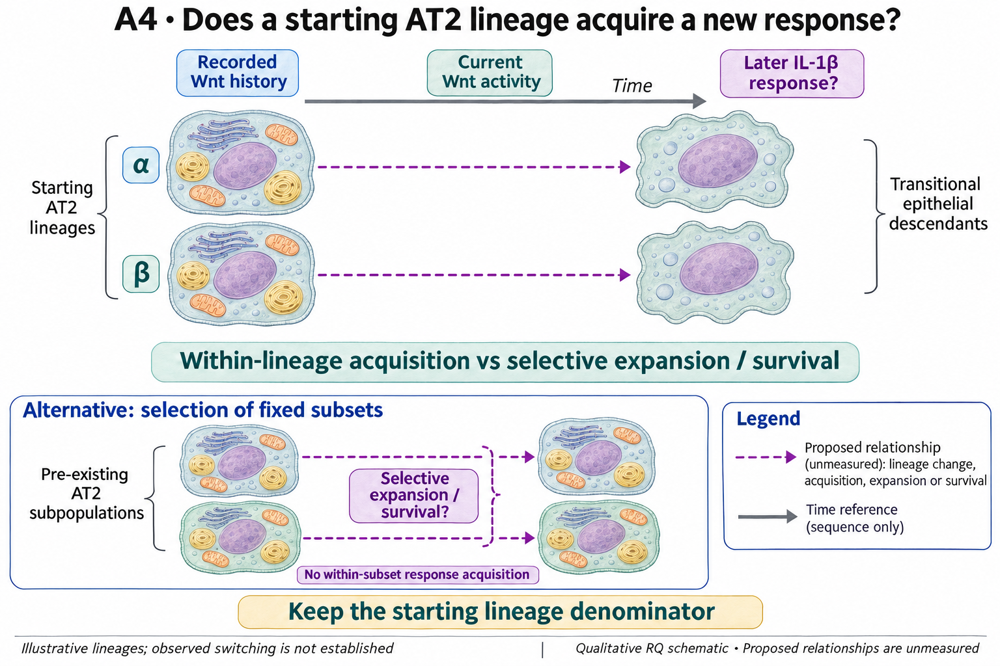

# A4: Wnt history and a later IL-1 response in the same lineage

## Organizing Biological Q

Can an adult AT2 starting lineage with documented Wnt-responsive history later acquire an IL-1-responsive transitional state, rather than the apparent sequence reflecting selection of different subsets? History, current molecular state and later response are separate measurements. Existing screens have characterized current state without recovering that lineage sequence.

Current synthesis: 4 November 2026. [Literature context](LITERATURE_CONTEXT.md) ·
[Dossier](../../docs/research_dossiers/A4.md) · [Canonical card](../../RESEARCH_QUESTIONS.md#a4).

<!-- literature-visual-context:start -->

## Literature context & visual hypothesis

[Published findings, repository observations and interpretation limits](LITERATURE_CONTEXT.md).

GPT-generated matte illustration, 3 November 2026. Proposed relationships and
cell counts are qualitative. [Editorial review](../../docs/audits/2026-11-02-rq-schematic-review/MATTE_PUBLICATION_2026-11-03.md) · [Selected edit prompt](schematics/A4_gpt_matte_v1.prompt.txt). Earlier artwork is retained as history.
<!-- literature-visual-context:end -->

Nabhan's Wnt-niche work, Frank's developmental responsiveness and Choi's inflammatory-transition study motivate the endpoints. Choi explicitly proposed comparing the reporter populations, so the broad question is not newly discovered here. [Recorded primary locators](../../RQ_Specified/A4_wnt_history_il1_response/LITERATURE_CONTEXT.md#published-starting-point) distinguish developmental history, adult current state and the proposed linked adult sequence.

The retained illustration describes the registered proposal. Its dashed relationships
are unmeasured; the completed comparisons below have their own narrower endpoints.

## Evidence, analyses and next steps

The [Axin2/Il1r1 branch](../../Research%20Article/gate1_02_choi_2020/axin2_il1r1/README.md#figure-gallery) displays current transcript detection/co-detection under a stated Sftpc-positive, non-transitional AT2 rule in GSE310539. Cells are observations within source wells/captures, not independently tracked starting lineages. The detection range is source-specific; it cannot be replaced by that from GSE145031.

The [chromatin Route B result](../../Research%20Article/gate1_02_choi_2020/axin2_il1r1/ROUTE_B_OUTCOME.md) remains closed under its declared rule on the inspected deposits. Improved detection of linked peaks did not qualify an interpretable history proxy or the proposed replicated interaction. The report also retains the control/null limitations; failure of that instrument is not evidence that the biological sequence is absent. The [current screening disposition](../../docs/research_reviews/2026-11-03-full-priority-screening/PLANS.md#a4--current-wntil-1-state-versus-historical-lineage) records that GSE109444 contains mesenchymal cells, not the required historical AT2 matrix.

AF1 Wnt2 and AF2 Wnt4 RNA provide source contexts. They do not show that the same epithelial cells switched response, and accessibility is not a record of prior Wnt exposure.

## Does the evidence warrant the narrowing?

**Rationale verdict: a useful measurement boundary and a justified lineage question; response acquisition remains untested.** Current co-detection narrows what can be described, not which historical subsets interconvert. Rejecting transcript or accessibility substitution does not select fixed subsets, reversible switching or an Fzd5 gate. No Fzd5 entry-gating mechanism is adopted.

The branch and question reuse exposed source evidence. Source-dependent detection, operational AT2 selection, reporter design/history, selective expansion and death remain consequential. Neither more detected peaks nor more cells supplies independent lineage units. Earlier blanket statements that no dataset exists or nobody has compared populations are historical search claims, not current exhaustive conclusions. Uncertainty about the sequence is not evidence of random noise.

## What a further comparison would decide

Acquisition of the qualified response within tracked starting lineages would support the sequential account. Stable subset responses with differential growth or loss would favor selection. Response, loss and unresolved follow-up must be assessed over the eligible starting-lineage denominator; a survivor-only fraction cannot identify switching.

Qualify a source linking historical exposure/reporting to later response with biological animals/donors and nested lineages identified. Reuse completed current-state screens; more transcript relabeling or a mesenchymal proxy cannot supply the missing history. The next decision is measurement suitability, not a newly nominated receptor target.

**Current boundary:** Current RNA/accessibility, ligand-source RNA and endpoint fractions do not establish a reversible lineage switch. The original adult-sequence hypothesis is preserved; no new molecular gate or claim of exhaustive data absence follows.

## Registered scope and earlier records

The complete earlier framing below retains its dated scope and registered hypotheses.
Current results and amendments govern interpretation. Older unfinished-work, source-access
or priority statements do not supersede this synthesis or start an execution queue.
Registration and completed analysis confer neither human acceptance nor a claim promotion.

Registered framing, source links and retained development history

## Organizing Biological Q

Can tracked adult AT2 starting lineages with documented Wnt-responsive history later acquire an IL-1-beta response, rather than merely select a different subset?

**Unresolved gap:** Within-lineage response flexibility has not been distinguished from replacement or selective survival of pre-existing subsets.

[Working hypothesis and competing explanations](../../docs/research_dossiers/A4.md#working-hypothesis) · [Canonical card](../../RESEARCH_QUESTIONS.md#a4).

## Current evidence and interpretation

<!-- full-priority-screening-20261103:start -->
**Screening follow-through — 3 November 2026.** Current Axin2/Il1r1 RNA and locus context have already been screened. They measure present molecular state, not a cell's prior Wnt exposure.

**Remaining discriminator:** The missing discriminator is a verified historical reporter or exposure linked to later epithelial response. Mesenchymal GSE109444 data cannot supply historical AT2 identity.

[Reviewed screening sequence](../../docs/research_reviews/2026-11-03-full-priority-screening/PLANS.md) · [Coordination and review](../../docs/research_reviews/2026-11-03-full-priority-screening/README.md). This reuses reviewed evidence and does not record human scientific acceptance.
<!-- full-priority-screening-20261103:end -->

<!-- evidence-followthrough:start -->
**Evidence follow-through — 3 November 2026:** Exclude the affirmative claim
“Fzd5 gates transition entry or the same starting cells have switched.” from current conclusions.
[Bounded fill, stop rule and reopening evidence](../../docs/audits/2026-11-03-rq-evidence-trajectory/CUT_OR_FILL_PLAN.md#a4).
The hypothesis remains a proposal where its decisive comparison is untested.
<!-- evidence-followthrough:end -->

**Current entrypoints:** [existing source-analysis context](../../Research%20Article/gate1_03_nabhan_2018/README.md) ·
[conditional hypothesis package](../../docs/research_dossiers/packages_2026-10-03/A4.md).
The package draft exists. The requested specificity/novelty revision is applied;
scientific acceptance and experiment-specific qualification remain pending. Use [current work disposition](../../docs/history/planning/REMAINING_WORK.md), not an older
package-pending checkpoint, to decide what is active.
Source recovery is closed at its documented evidence limit: [M08](../../docs/research_dossiers/source_mapping_closeout_2026-10-03/README.md). Missing biological links remain held.
Review the [t0-denominator and missing-lineage refinement](../../docs/research_dossiers/continuation_2026-10-03/PACKAGE_REVIEW.md) with the package; survivor-conditioned fractions are not the proposed primary denominator.

Can Wnt-supported maintenance precede an IL-1-responsive transition in the same AT2 lineage?

Status: proposed refinement, 3 October 2026. This is a development aid, not scientific acceptance or an experimental protocol.

Nb1 lacks sufficient acute sampling for the proposed switch. AF1 Wnt2 and AF2 Wnt4 expression nominate source contexts but do not demonstrate switching by the same cells.

Evidence locators (source citations and numerical details remain in these records):

- [Research Article/gate1_03_nabhan_2018/README.md](../../Research%20Article/gate1_03_nabhan_2018/README.md)

## Analysis plan and next decision

Identify a dataset or model with lineage history, current state and temporal coverage. Do not substitute RNA-derived ordering for lineage transitions.

[Plan and existing implementation](PLAN.md) · [Full scientific dossier](../../docs/research_dossiers/A4.md) · [Current interpretation boundary](../../docs/research_dossiers/A4.md#interpretation-boundary).

This folder is the question home. Existing paper-owned analyses, shared code and frozen runs retain their original ownership and paths.

