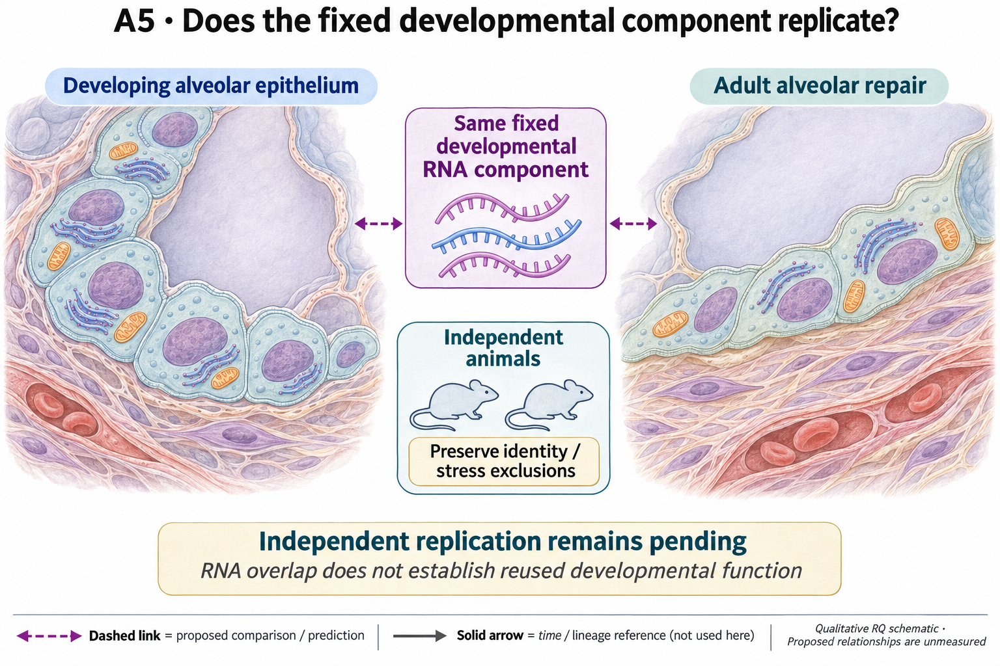

# A5: literature context and hypothesis schematic

[Question home](README.md) · [Scientific dossier](../../docs/research_dossiers/A5.md).

Reviewed 3 October 2026. This note connects published findings to the current proposed question. It is a bounded synthesis, not novelty clearance or scientific acceptance.

## Published starting point

Developmental states and adult repair transitions make programme reuse plausible. Shared expression has value as a reproducibility question before anyone assigns it a developmental function.

| Primary source | Inspected locator and access record |
|---|---|
| [Guo 2019](https://www.nature.com/articles/s41467-018-07770-1) | Neonatal epithelial subtype results. [Access / prior review](../../docs/research_dossiers/review_2026-10-03/SOURCES.md#s04) |
| [Strunz 2020](https://www.nature.com/articles/s41467-020-17358-3) | Krt8-associated repair transition; abstract and source identification. [Access / prior review](../../docs/research_dossiers/review_2026-10-03/SOURCES.md#s05) |

Sources above reuse the named review unless the update ledger explicitly records a fresh inspection. Published-source evidence and reanalysis of the same material are not independent replication.

## Repository observation

The external Guo developmental signature was positive across 24 mice and survived identity/stress exclusions. GSE303646 contains 56 libraries from 55 mice, but annotation remains unresolved and it is not completed replication.

Exact current result locators:

- [RQ_Specified/A5_developmental_programme_reuse/README.md](README.md)
- [RQ_Specified/A5_A11_shared_component_contract/reports/REVISED_TEST_RESULTS.md](../A5_A11_shared_component_contract/reports/REVISED_TEST_RESULTS.md)
- [docs/research_dossiers/qualification_2026-10-03/RESULTS.md](../../docs/research_dossiers/qualification_2026-10-03/RESULTS.md)
- [docs/research_dossiers/followup_2026-10-03/NOVELTY.md](../../docs/research_dossiers/followup_2026-10-03/NOVELTY.md)
- [docs/research_dossiers/followup_2026-10-03/METADATA.md](../../docs/research_dossiers/followup_2026-10-03/METADATA.md)

## What this question could add

Replicate the fixed component with independently mapped animals and author states. Agreement would strengthen that exact measurement; it would not show that the component performs a developmental role in repair.

## Current hypothesis and rival

Adult alveolar repair recruits the exact independently sourced developmental epithelial component beyond the identity, stress and labeling genes excluded by the frozen shared-component contract. Its association in 24 mice motivates independent replication of that same component. Whether it performs a developmental function during repair is a separate, untested biological question.

**Strongest rival:** Overlap reflects shared plasticity, composition or annotation choices rather than a functionally reused developmental module.

## What the comparison would teach

Reproduction in independent, source-qualified animals supports transport of the fixed component. Failure or loss after valid state/identity comparison weakens that generalization. Functional reuse requires a separately justified endpoint and intervention; gene overlap alone cannot supply it.

## Hypothesis schematic

GPT-generated matte illustration, 3 November 2026. Proposed relationships and cell counts are qualitative; the owning context defines the comparison and interpretation limits. [Editorial review](../../docs/audits/2026-11-02-rq-schematic-review/MATTE_PUBLICATION_2026-11-03.md) · [Selected edit prompt](schematics/A5_gpt_matte_v1.prompt.txt). Earlier SVG files are retained as history.

The prior component association motivates replication in independent source-qualified mice with frozen exclusions. Multiple libraries and reused source data are not additional animals. Transport of a fixed RNA component would not establish functional reuse of a developmental mechanism.

Class-level glyphs and qualitative geometry are not molecular structures, organelle measurements or evidence of functional assembly. Neutral epithelial/stromal shapes do not assert subtype identity or organelle loss, and icon counts are illustrative. Read locally labelled solid premises/references separately from dashed proposed comparisons; no complete mechanism follows from their juxtaposition.

## Next literature check

Planned query (not reported as newly executed): `fixed developmental gene component adult alveolar repair independent animals replication`. Expand to synonyms, nearest source references/citations and conflicting results using the [literature workflow](../../docs/LITERATURE_WORKFLOW.md). Recheck the exact population, comparison, timing, unit and endpoint before making a stronger contribution claim.

**Current unresolved specification:** The observed partial recruitment has not been connected to an independent repair function or shown to exceed generic plasticity under a qualified replication design.

**Interpretation limit:** Transcriptional reuse establishes neither developmental ancestry nor a beneficial role.

[Current dossier](../../docs/research_dossiers/A5.md) · [All-question context index](../../docs/research_dossiers/literature_context_2026-10-03/README.md)

## Cut-or-fill execution — 3 November 2026

The refreshed source inventory is executed; exact mouse and barcode-state maps remain unqualified, so fixed-component expression replication is held.

[Current technical result and limits](../../docs/audits/2026-11-03-rq-evidence-trajectory/A5_TECHNICAL_RESULT.md) · [Execution ledger](../../docs/audits/2026-11-03-rq-evidence-trajectory/TECHNICAL_STATUS.md).

## Literature-informed screening scope — 3 November 2026

The owner-authorized [A5 destination-feature specification](DESTINATION_SCREEN_SPEC_V1.md) fixes the measured RNA comparison, units, literature selection and limits before execution. It uses original Strunz labels and mouse-paired named genes; basal-state support remains below the original floor. The fixed Guo component and held external replication remain unchanged. No canonical hypothesis, registered illustration, prior result or scientific acceptance changes. [Completed numerical result](reports/DESTINATION_SCREEN_V1_RESULTS.md). The screen completed with mixed identity features and no single destination; basal support remains below floor. The twelve-gene panel does not explain or identify a driver of Guo recruitment.
