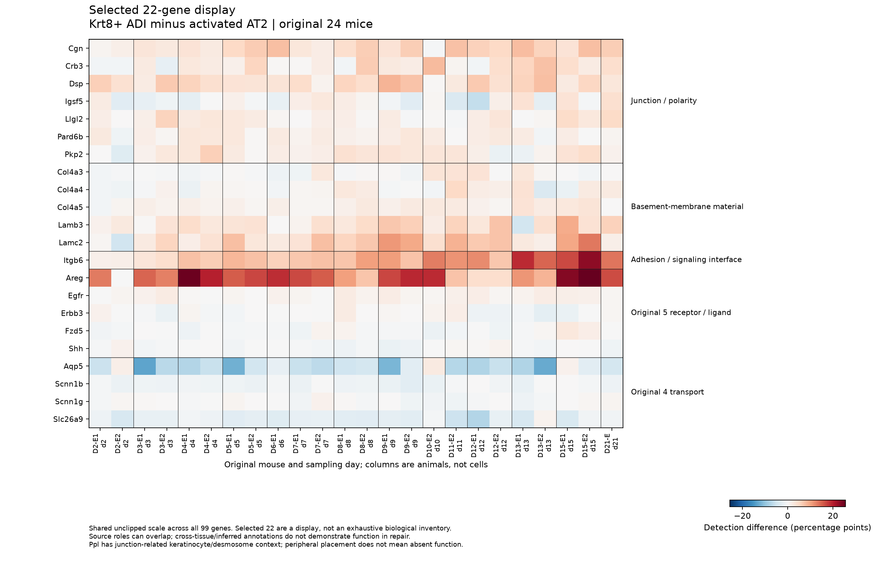
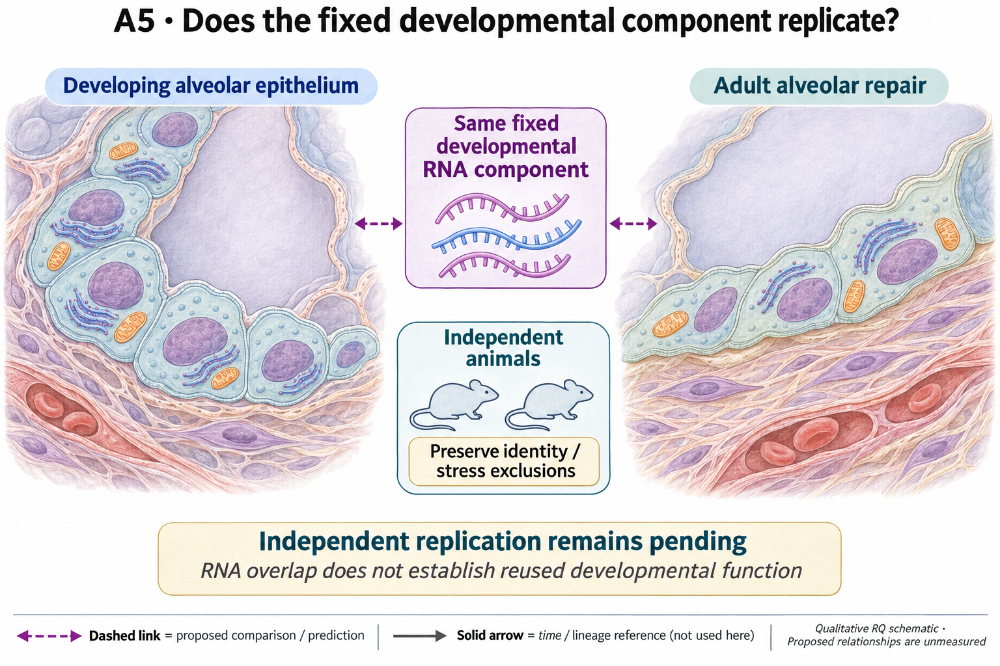

# A5: developmental-gene recruitment in adult repair

## Organizing Biological Q

A5 asks whether adult alveolar repair reuses part of a developmental epithelial
programme, and what that recurrence means. The fixed developmental RNA component
is higher in repair intermediates in the original 24 mice. Inspecting its members
has made the interpretation more specific: **junction/polarity-associated RNA with
selected matrix support**, alongside heterogeneous signaling and lower original
transport-gene means. This nominates a process to investigate; productive repair
versus prolonged transition remains unresolved.

Current synthesis: 4 November 2026, using the reviewed results below.
[Question card](../../RESEARCH_QUESTIONS.md#a5) · [Literature context](LITERATURE_CONTEXT.md)
· [Scientific dossier](../../docs/research_dossiers/A5.md).

## Literature context & visual hypothesis

Guo's postnatal-day-1 AT1/AT2 epithelial population supplies a defined developmental
comparison. Adult injury-associated Krt8+ transitional cells provide a setting in
which some of those genes might recur. Birth stress, ordinary alveolar identity
and injury-associated plasticity are alternatives to functional developmental
reuse. Strunz also reported poor overall correspondence between developmental
and injury signatures. A positive *subset* can coexist with that observation;
A5 does not require the two populations to have the same global identity.
[Published premises and source locators](LITERATURE_CONTEXT.md#published-starting-point)
· [Original biological rationale](../A5_A11_shared_component_contract/BIOLOGICAL_LOGIC.md).

The [registered qualitative schematic](#registered-replication-scope-and-illustration)
illustrates the separate fixed-component replication branch. The
[measured member display](#evidence-analyses-and-next-steps) shows the current RNA
evidence; published premises, observed differences and proposed functional links
have distinct roles. Both images appear once below.

The initial test therefore asked whether an independently defined component was
recruited beyond activated AT2 cells in the same injured mouse. Once that result
was positive, the descriptive question became what kind of RNA recruitment the
component contains. The later attribution and feature interpretation used
already-exposed outcomes; they were not unexposed predictions or independent
replications.

## Evidence, analyses and next steps

The comparison uses author-defined **Krt8+ ADI minus activated AT2** cells within
24 original Strunz mice sampled on days 2-21. Each mouse had at least 30 cells per
arm after the fixed raw-depth floor of 500 UMI. The readout is expected gene
detection at a common 500-UMI sampling depth, expressed as a paired difference in
percentage points and averaged equally across mice. It measures RNA detection,
not the fraction of cells changing fate. Cells are nested within animals, and
sampling-day columns are cross-sectional observations.

The 99-gene primary already retains the fixed operational/labeling exclusions;
the 57/53-gene forms add the specified identity and control-list exclusions.

The [original fixed-component result](../A5_A11_shared_component_contract/reports/REVISED_TEST_RESULTS.md#a5-partial-developmental-signature-recruitment)
was positive in all 24 mice: mean **+0.735 pp**, 95% CI **0.579-0.892**. The
57-gene identity-excluded and 53-gene identity/control-excluded forms remained
positive (+0.557 and +0.602 pp). These exclusions weaken the specific nominated
identity/stress explanations; they do not exhaust plasticity, annotation or
composition effects. Independent sourcing of the gene list is distinct from
replicating the observation in another injury study.

The [member-attribution result](reports/COMPONENT_ATTRIBUTION_V1_RESULTS.md) then
showed why the positive aggregate should not be called uniform regulatory
activation. The original six gene-expression-regulation members contribute a
net **-0.125824 pp** to the full 99-gene component, and the four original transport
members contribute **-0.093947 pp**. These are module-denominated contributions,
not gene-level means; overlapping role rows must not be summed. The small positive
regulator contributions in the 57/53 forms concern four retained members and do
not reverse the full-component finding.

The [reviewed all-member feature display](reports/FEATURE_CONTEXT_DISPLAY_V1_RESULTS.md)
answers the narrower process question:

| RNA feature | What the original mice show | What changed in the interpretation |
|---|---|---|
| Junction/polarity | Six of seven candidates have positive means and predominantly positive mice; Dsp is positive in 24/24. Igsf5 is mixed with a slightly negative mean. | Distributed support across distinct members makes junction/polarity context a defensible nomination. |
| Matrix/attachment | Lamb3, Lamc2 and Col4a5 are positive in 23/24 mice each; Col4a3/Col4a4 remain mixed. Itgb6 is positive in 24/24. | Selected matrix support accompanies the nomination; uniform basement-membrane recruitment or assembly is unsupported. |
| Signaling context | Areg is strongly positive and Egfr predominantly positive; Erbb3 is mixed, while Fzd5 and Shh are negative in 18/24 mice. | Signal context coexists with the junction/polarity pattern. These genes do not establish one activated pathway or causal sequence. |
| Original transport members | Aqp5, Scnn1b, Scnn1g and Slc26a9 all have negative means; Scnn1g is nearly balanced across animals. | The component does not uniformly recruit these specialized transport features; RNA cannot measure transport function. |

Each column is one of the original 24 mice; warm/cool colors show positive/negative
ADI-minus-activated-AT2 detection differences. The shared unclipped scale is fixed
across all 99 genes. The 22 source-selected rows are a display subset, not an
exhaustive biological inventory. [Full 99-gene display](../../analysis/research/runs/A5_feature_context_figures_v2_20261104/all_members_by_mouse_v2.png)
· [Gene summaries and sign counts](../../analysis/research/runs/A5_feature_context_display_v1_20261104/gene_summary.tsv).

All **99 members have now received source-annotation review**. The earlier
18-member role pass and its then-unreviewed remainder are preserved in the
attribution report as history. Inferred annotations, unreviewed accessions and
missing-function cases remain explicit; completed annotation is not demonstrated
function. The source-only display map was fixed before accessing effects for that
display, but all member outcomes were already exposed.

## Does the evidence warrant the narrowing?

The fixed-component contrast is supported in the original 24 mice. The newer
junction/polarity interpretation is an **exploratory process-context lead** from
an outcome-exposed examination of those same measurements. Functional annotations
help describe the members; they are not independent evidence that the selected
process is active or unusually coherent relative to an appropriate alternative.
The complete member display, mixed matrix/signaling findings and negative
original transport and regulator contributions restrict a uniform programme claim.

This warrants a more specific question about where that RNA context occurs. It
does not yet choose junction assembly, beneficial repair or prolonged transition
as the explanation, nor justify calling the pattern random noise. No automatic
target priority follows from the annotation label or the selected display.

## What remains open, and why it follows

The current interpretation is a **junction/polarity-associated RNA context with
selected matrix support**, rather than a uniformly recruited developmental
programme. A consequential alternative is a heterogeneous, selected transitional
state: broad or cross-tissue annotations and the mixture of sampled days may make
RNA differences appear to describe an assembled process. Persistent remodeling
and productive repair could both produce parts of this pattern. The existing
cross-sectional comparison cannot distinguish them.

The next proposed biological discriminator is therefore an independent
localization/state comparison: do the nominated junction proteins and
laminin/Col4a5 material assemble in transitional epithelial regions, and does
that context accompany productive or persistent transition? Localized structure
would support an architecture-associated state; absent or mislocalized protein
would weaken that reading. Persistence without maturation would weaken the
productive-repair interpretation. An RNA-only result would leave those links
unresolved. No protein assembly, maturation trajectory, lineage or repair function
has been measured here. The [reviewed proposal and literature record](../../docs/research_reviews/2026-11-03-tool-assisted-screening-review/prerequisites/A5_CANDIDATE_PROCESS_COMPARISON_V1.md)
explain this discriminator; it is not a newly authorized experiment or analysis.

**External replication is a separate branch.** Testing the unchanged component
in GSE303646 still requires the authentic barcode/library/mouse/author-state map,
pool/split information, reconciliation of 56 libraries with the 55-mouse report,
and raw-count alignment. The [latest source qualification](../../docs/audits/2026-11-03-rq-evidence-trajectory/A5_TECHNICAL_RESULT.md)
is held before scoring, not a negative replication result or proof that the map
is globally unavailable. Resolving that input would test generality of the fixed
RNA measurement; it would not itself answer the localization/function question.
No further annotation sweep follows automatically from the completed display.

## Registered replication scope and illustration

The complete blocks below remain unchanged and still registered. Their
fixed-component replication framing describes that branch under A5's broader
purpose; it has not been withdrawn or silently replaced by the descriptive
process nomination above. The qualitative illustration depicts this replication
question. The measured heatmap above has a separate evidential purpose.

<!-- current-rq-framing:start -->

## Organizing Biological Q

Adult alveolar repair recruits the exact independently sourced developmental epithelial component beyond the identity, stress and labeling genes excluded by the frozen shared-component contract. Its association in 24 mice motivates independent replication of that same component. Whether it performs a developmental function during repair is a separate, untested biological question.

**What is already known, and what remains:** Developmental-programme reuse is established broadly. The current contribution is reproducibility of a fixed measurement; replication is useful without being a new mechanism. [Primary-source comparison](../../docs/history/reviews/NOVELTY_SPECIFICITY_APPLICATION_2026-10-03.md#a5).

**What the measurements would decide:** Reproduction in independent, source-qualified animals supports transport of the fixed component. Failure or loss after valid state/identity comparison weakens that generalization. Functional reuse requires a separately justified endpoint and intervention; gene overlap alone cannot supply it.

**Current disposition:** Fixed-component replication; mapping held. This revision specifies proposed work; scientific acceptance, model access and assay qualification remain pending.

| Evidence and implementation | Current boundary |
|---|---|
| Biological unit and endpoint | Author-defined transitional and activated AT2 states within independent biological mice. Retain the frozen paired detection-probability contrast, gene definitions, UMI budget and eligibility rules. |
| Current evidence and limit | The original positive recruitment result across 24 primary mice survives the specified exclusions. The 56-library/55-mouse distinction and per-cell author-state mapping remain unresolved for the external candidate. |
| Next decision / hold | External replication stays held at M02. Reopen for the authentic barcode/library/mouse/author-state and pool/split export, then qualify count alignment; no new classifier or relaxed threshold substitutes for it. |

**Read in this order:** [current evidence](../A5_A11_shared_component_contract/reports/REVISED_TEST_RESULTS.md),
[development dossier](../../docs/research_dossiers/A5.md),
[conditional hypothesis package](../../docs/research_dossiers/packages_2026-10-03/A5.md).
Source-mapping closeout: [M02 and reopening conditions](../../docs/research_dossiers/source_mapping_closeout_2026-10-03/README.md).
[Deferred work](../../docs/history/planning/REMAINING_WORK.md) and
[execution requirements](../../docs/RESEARCH_GOVERNANCE.md) govern any later
analysis. Draft completion does not establish assay validity, resource access,
meaningful effects, precision or scientific acceptance. Existing numerical
results and original plans below retain their recorded scope.
<!-- current-rq-framing:end -->

<!-- literature-visual-context:start -->

## Literature context & visual hypothesis

[What previous findings contribute, what remains, and what the readouts would decide](LITERATURE_CONTEXT.md).

GPT-generated matte illustration, 3 November 2026. Proposed relationships and cell counts are qualitative; the owning context defines the comparison and interpretation limits. [Editorial review](../../docs/audits/2026-11-02-rq-schematic-review/MATTE_PUBLICATION_2026-11-03.md) · [Selected edit prompt](schematics/A5_gpt_matte_v1.prompt.txt). Earlier SVG files are retained as history.

*Explanatory proposal, not measured results. Read the linked context and caption; arrows do not certify a mechanism or novelty.*
<!-- literature-visual-context:end -->

## Evidence and analysis history

Current reports own interpretation; older plans retain their original scope and
exposure. Execution and agent review do not confer human acceptance or a new
claim grade.

| Record | What it preserves |
|---|---|
| [Fixed-component plan](PLAN.md), [data audit](DATA_AUDIT.md), [shared-component result](../A5_A11_shared_component_contract/reports/REVISED_TEST_RESULTS.md) | The 99/57/53 definitions, frozen exclusions, original inference and source hashes. Older Strunz-filtered 94/51 forms remain descriptive references. |
| [Component attribution](reports/COMPONENT_ATTRIBUTION_V1_RESULTS.md) | Original contributions, all members and denominators, role overlap and the bounded annotation status at that time. |
| [Feature-context report](reports/FEATURE_CONTEXT_DISPLAY_V1_RESULTS.md), [coordinator review](../../docs/research_reviews/2026-11-03-tool-assisted-screening-review/COORDINATOR_REVIEW.md#a5-final-report-and-corrected-figure-clearance--4-november-2026) | All-member annotation, exposed descriptive interpretation, immutable tables, numerical review and rendering-only v2 supersession. |
| [Destination-feature result](reports/DESTINATION_SCREEN_V1_RESULTS.md), [specification](DESTINATION_SCREEN_SPEC_V1.md), [figure](../../analysis/research/runs/PS1_A5_destination_features_v1_20261103/destination_features.png) | A separate twelve-gene panel found mixed identity features and no single destination. Its two terminal references share ten mice; it does not explain or identify a driver of the Guo component. Basal support is below the original floor. |
| [Independent-cohort recovery](replication_gate_20260928/REPORT.md), [M02 closeout](../../docs/research_dossiers/source_mapping_closeout_2026-10-03/README.md), [source refresh](../../docs/audits/2026-11-03-rq-evidence-trajectory/A5_TECHNICAL_RESULT.md) | The external mapping hold and exact reopening inputs; no external expression result. |

<!-- evidence-followthrough:start -->
**Evidence follow-through — 3 November 2026:** Exclude the affirmative claim
“Partial RNA recruitment proves developmental function or full state identity.” from current conclusions.
[Bounded fill, stop rule and reopening evidence](../../docs/audits/2026-11-03-rq-evidence-trajectory/CUT_OR_FILL_PLAN.md#a5).
The hypothesis remains a proposal where its decisive comparison is untested.
<!-- evidence-followthrough:end -->

### Reproduce the completed test

The [frozen plan](PLAN.md) and its linked source/score records retain the original
execution instructions. Preserve archived outputs; any new numerical work follows
[research governance](../../docs/RESEARCH_GOVERNANCE.md). This synthesis did not
rerun biological analyses. A0 retains the broader epithelial-transition transfer
question; A5 retains developmental-component recruitment in adult alveolar repair.
