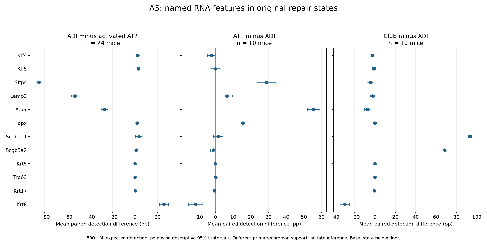

# A5: named destination-feature RNA screen

3 November 2026. **Completed exposed descriptive screen; mixed identity features,
no single destination selected.** Agent execution is not scientific acceptance.
[Exact specification](../DESTINATION_SCREEN_SPEC_V1.md) ·
[Contract](../config/destination_features_contract_v1.json) ·
[Receipt](../../../analysis/research/runs/PS1_A5_destination_features_v1_20261103/receipt.json).
Freeze `94f6efb`; all original raw-file hashes match the prior qualified Strunz data.

## Question, units and actual comparison

The question is whether twelve literature-named KLF/identity RNA features in
original repair states support a uniform alveolar or secretory-airway reading.
This panel is **not the fixed Guo component**. It neither explains that component's
positive recruitment nor identifies its driver; no membership/relationship test
was done. The Guo result and held GSE303646 replication are unchanged.

Original author labels are retained. ADI minus activated AT2 has 24 paired mice
across days 2-21. AT1 minus ADI and Club minus ADI use exactly the same 10 mice
at days 10,11,12,13,15,21. These terminal-reference contrasts share support but
must not be subtracted from the different-support primary. Cells are nested
observations, not replicates. Raw depth>=500 UMI and>=30 cells/state are unchanged.
No basal state qualifies: its maximum is14 cells/mouse even before depth.
This prevents the proposed basal-diversion discriminator; it is not evidence
that basal diversion is absent biologically.

## Complete feature results

Numbers are equal-mouse paired differences in expected 500-UMI detection,
in percentage points. They are neither log fold changes nor percentages of
cells changing fate. The complete pointwise descriptive intervals, per-mouse
values, equal-day sensitivity and per-day values are in the linked immutable tables.

| Gene | ADI − activated AT2 (24 mice) | AT1 − ADI (10 common mice) | Club − ADI (same 10 mice) |
|---|---:|---:|---:|
| Klf4 | +2.3576 | -2.1895 | -2.7025 |
| Klf5 | +2.9688 | +0.0094 | -1.0189 |
| Sftpc | -85.0634 | +28.9380 | -4.5269 |
| Lamp3 | -53.1473 | +6.4480 | -2.3442 |
| Ager | -26.8691 | +55.5901 | -7.4437 |
| Hopx | +1.8421 | +15.5525 | -0.0447 |
| Scgb1a1 | +3.5943 | +1.5759 | +93.4139 |
| Scgb3a2 | +0.9919 | -1.3124 | +68.7651 |
| Krt5 | +0.0096 | -0.1556 | -0.1556 |
| Trp63 | +0.0139 | +0.0956 | -0.0614 |
| Krt17 | +0.3099 | -0.5523 | -0.5986 |
| Krt8 | +25.6258 | -11.2677 | -29.6781 |

Klf4 and Klf5 are higher in ADI than activated AT2 (+2.358/+2.969 pp;
positive in 22/24 and23/24 mice). On the common reference support, Klf4 is lower
in both AT1 and Club than ADI. Klf5's AT1 and Club pointwise intervals include
zero. Thus increased KLF RNA is not a selective airway-destination marker here.
This does not test the causal HIF/KLF result in human organoids.

The identity features do not move uniformly. ADI loses strong Sftpc/Lamp3
signal relative to activated AT2, while Hopx and both secretory markers increase.
Ager is lower, not higher, in that comparison (−26.869 pp); this adverse direction
is retained rather than relabeled. On common support, AT1 exceeds ADI in Ager
and Hopx, and Club greatly exceeds ADI in Scgb1a1/Scgb3a2. Krt8 remains higher
in ADI than either reference. These observations support a mixed transitional
RNA description, not assignment of the sampled cells' future destination.
Krt5/Trp63 signals are sparse; absence of eligible basal groups prevents a valid
basal-reference comparison. No selected significance family is asserted.

**Biological implication:** the twelve-gene screen does not justify choosing
HIF/KLF-associated airway diversion or mature alveolar recovery as the explanation
of A5. A destination-specific hypothesis still needs independently supported
lineage/outcome linkage. Expression labels, ambient RNA and selection are
unresolved alternatives; no new regulon, trajectory or function was inferred.

Intervals in the figure are pointwise descriptive 95% t intervals, not simultaneous
or causal intervals. Small effects near zero are numerically resolved in the
[full summary](../../../analysis/research/runs/PS1_A5_destination_features_v1_20261103/feature_summary.tsv).
[Mouse/state features](../../../analysis/research/runs/PS1_A5_destination_features_v1_20261103/mouse_state_features.tsv) ·
[every paired difference](../../../analysis/research/runs/PS1_A5_destination_features_v1_20261103/paired_features.tsv) ·
[support](../../../analysis/research/runs/PS1_A5_destination_features_v1_20261103/state_support.tsv) ·
[per-day results](../../../analysis/research/runs/PS1_A5_destination_features_v1_20261103/per_day_features.tsv).

## Verification and limits

38 pre-run exact synthetic checks passed. The run verifies the 24,051×32,559
matrix, unique joins/units, full feature coverage and aggregation in 1,147 checks;
exact-combination probability error is at most2.06e−11. A separate standard-library
streaming audit of both new runs passed 8,604 arithmetic/source-parity checks,
including every A5 paired subtraction and summary mean/SD. This is technical
verification on reused data, not biological replication. The figure was inspected.
The old biological analyses, hypotheses and registered illustration were not rerun
or changed. Complete numerical provenance is in the receipt and verification JSON.
