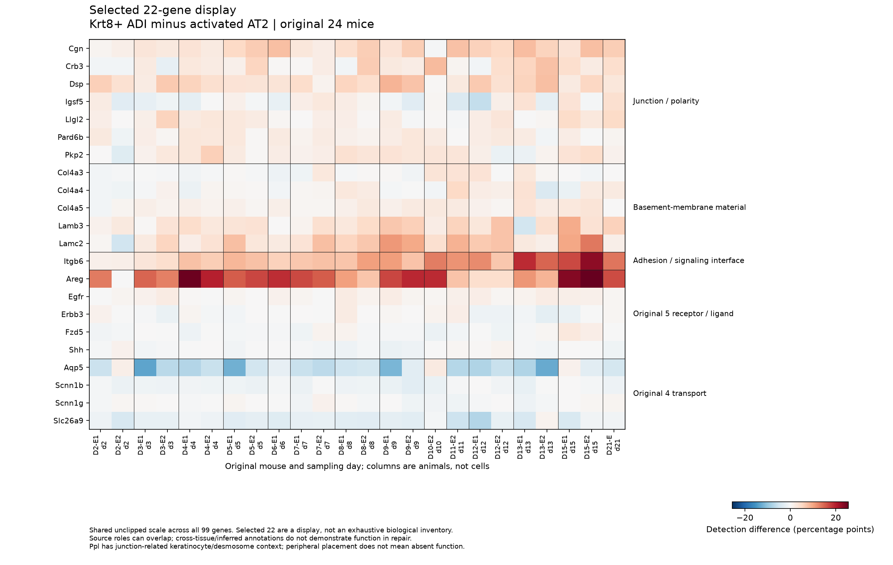

# A5: source-fixed feature context of the developmental component

4 November 2026. The existing component narrows toward **distributed junction/polarity-associated RNA with selected laminin/Col4a5 support**, alongside Areg/Itgb6 context. Matrix and signaling members remain heterogeneous; the original four transport-gene means are negative. This is an exploratory nomination from the same Strunz source, not a uniform architectural programme, independent replication, maturation or repair function.

## Question, premise and measured comparison

The organizing question is which development-associated process is recruited during adult repair and what consequence merits further investigation. The preceding [component attribution](COMPONENT_ATTRIBUTION_V1_RESULTS.md) found a positive full aggregate despite negative net original regulator and transport contributions, while leaving 81 members unreviewed in that bounded role pass. The [source-grounded comparison proposal](../../../docs/research_reviews/2026-11-03-tool-assisted-screening-review/prerequisites/A5_CANDIDATE_PROCESS_COMPARISON_V1.md) connects Guo/Strunz premises and the recent primary-literature refresh to the narrower question: do distinct junction/basement-membrane-associated members show distributed RNA differences, or is recruitment predominantly signal context and heterogeneous members? These explanations can coexist. The proposal preserves exact primary-source access/result locators, including limits on full-text/supplement access; this report adds repository observations, not a new literature or novelty claim.

The biological units are the original 24 eligible mice. For each gene and mouse, the endpoint is Krt8+ ADI minus activated-AT2 expected RNA detection at the original 500-UMI depth, expressed in percentage points. Equal-mouse means describe these mice; cells are not independent animals. Original eligibility, labels and sampling days are unchanged. All member outcomes were already exposed before this view. The source-only map was fixed before accessing effects for this display; that does not restore an unexposed test.

The main validity threats are cross-sectional state selection, day mixture and broad or cross-tissue functional annotations being mistaken for an active process. RNA abundance/detection cannot establish junction assembly, basement-membrane deposition, transport activity, developmental ancestry or beneficial repair.

## Fixed display and complete evidence

The reviewed [map](../../../docs/research_reviews/2026-11-03-tool-assisted-screening-review/prerequisites/A5_FEATURE_DISPLAY_MAP_V1.tsv) retains all 99 members in fixed group/alphabetical order, original 99/57/53 membership, manual roles and uncertainty. Layout counts are 7/5/1/5/4/25/6/46; the first five groups supply the fixed 22-gene display. Layout groups are not mutually exclusive biological functions. Ppl's peripheral placement retains its keratinocyte/desmosome context; it does not mean absent junction function. All 4,344 qualifier/evidence-bearing GO records remain available; NOT/ND exclusions, unreviewed accessions and annotation scope are explicit in the linked map and rules. Broad GO associations do not overwrite the original six-regulator result.

The run reuses immutable attribution outputs; it does not reprocess counts. [All 2,376 gene/mouse values](../../../analysis/research/runs/A5_feature_context_display_v1_20261104/all_member_values.tsv), [99 gene summaries](../../../analysis/research/runs/A5_feature_context_display_v1_20261104/gene_summary.tsv), [1,386 gene/day summaries](../../../analysis/research/runs/A5_feature_context_display_v1_20261104/gene_day_summary.tsv), [all 52 original support rows](../../../analysis/research/runs/A5_feature_context_display_v1_20261104/support.tsv) and the [exact role crosswalk](../../../analysis/research/runs/A5_feature_context_display_v1_20261104/source_role_crosswalk.tsv) preserve positive, negative and zero values. Contributions retain the original module denominators (d/99, d/57 or d/53 for included genes). Excluded genes have zero contribution and NA module-specific mean, not biological absence. No family aggregate, architecture score, effect-based ordering, new interval or hypothesis test was introduced.

Each column is one original mouse, ordered by sampling day then sample ID. Both displays use the same unclipped scale, +/-25.536807215314504 percentage points across all 99 genes. These cross-sectional columns are not longitudinal trajectories. [Full 99-gene figure](../../../analysis/research/runs/A5_feature_context_figures_v2_20261104/all_members_by_mouse_v2.png). The 22-gene panel is a source-fixed selection, not an exhaustive inventory of architecture-related biology.

## Findings and what they narrow

Six of seven junction/polarity candidates have positive means and predominantly positive mice; Igsf5 is mixed with a slightly negative mean. Dsp is positive in every mouse. This distribution supports a candidate RNA context across distinct members, beyond a single large ligand value.

Lamb3, Lamc2 and Col4a5 are positive in 23/24 mice. Col4a3 has a positive mean but more negative than positive mice (13 versus 11); Col4a4 is also mixed. Itgb6 is positive in every mouse. Thus selected matrix/interface members support the nomination, but a uniformly increased basement-membrane or whole-architecture claim is unsupported.

Areg is strongly positive and Egfr predominantly positive; Erbb3 is mixed, while Fzd5 and Shh are negative in 18/24 mice. Signal context therefore coexists with the junction/polarity candidate without showing uniform receptor/ligand recruitment. All four original transport means are negative, but Scnn1g is nearly balanced across mice; it is inaccurate to say every transport gene decreases in every animal.

| Fixed candidate | Equal-mouse mean difference (pp) | Positive / negative / exact-zero mice |
|---|---:|---:|
| Cgn | +4.4667 | 23 / 1 / 0 |
| Crb3 | +2.4621 | 19 / 5 / 0 |
| Dsp | +4.4543 | 24 / 0 / 0 |
| Igsf5 | -0.1240 | 11 / 13 / 0 |
| Llgl2 | +1.7726 | 21 / 3 / 0 |
| Pard6b | +1.4662 | 20 / 3 / 1 |
| Pkp2 | +1.8791 | 21 / 3 / 0 |
| Col4a3 | +0.4130 | 11 / 13 / 0 |
| Col4a4 | +0.5906 | 14 / 10 / 0 |
| Col4a5 | +1.4404 | 23 / 1 / 0 |
| Lamb3 | +3.4510 | 23 / 1 / 0 |
| Lamc2 | +5.0739 | 23 / 1 / 0 |
| Itgb6 | +9.4197 | 24 / 0 / 0 |
| Areg | +14.3450 | 23 / 1 / 0 |
| Egfr | +0.9295 | 21 / 3 / 0 |
| Erbb3 | -0.1456 | 11 / 13 / 0 |
| Fzd5 | -0.1252 | 6 / 18 / 0 |
| Shh | -0.3209 | 6 / 18 / 0 |
| Aqp5 | -5.7350 | 3 / 21 / 0 |
| Scnn1b | -1.0320 | 0 / 22 / 2 |
| Scnn1g | -0.1325 | 11 / 12 / 1 |
| Slc26a9 | -2.4013 | 1 / 23 / 0 |

These gene-level differences are not the module-denominated subset totals in the earlier attribution report. The original negative full-99 regulator and transport totals remain unchanged. The 57/53 membership exclusions remain definition sensitivities, not evidence of transport loss. Full tables retain the peripheral and remaining members without relabeling them as nonfunctional.

## Next biological decision and interpretation limit

The result favors a narrower nomination: junction/polarity RNA with selected matrix context, while retaining signal context, heterogeneous members and lower specialized transport means. A next independent localization/state comparison could ask whether nominated junction proteins and laminin/Col4a5 material actually assemble in transitional epithelial regions, and whether that context accompanies productive versus persistent transition. Concordant localized structure would support an architecture-associated state; absent/mislocalized protein or persistence without maturation would narrow or weaken that interpretation. An isolated RNA difference would remain RNA evidence. The present result does not select a beneficial intervention, a mediator, an effect margin or a laboratory-ready protocol, and does not itself authorize another numerical screen.

## Execution, rendering supersession and review

The numerical [contract](../../../analysis/research/contracts/A5.feature_context_display_v1.json) was frozen at `53820f064629fa8320af169465cbf32a21b2f93a`; its [receipt](../../../analysis/research/runs/A5_feature_context_display_v1_20261104/receipt.json) verifies. Targeted synthetic checks covered joins/order, equal-mouse means, excluded-member NA, duplicate rejection, support floor and contribution arithmetic. Maximum internal contribution parity error was 1.11e-16. The coordinator independently checked all values/summaries/support/crosswalk: 27,324 checks, maximum numerical difference 3.553e-15 pp; biological interpretation and the native-resolution full display passed review. [Coordinator review](../../../docs/research_reviews/2026-11-03-tool-assisted-screening-review/COORDINATOR_REVIEW.md).

The original candidate image had a caption/x-axis collision. A rendering-only [v2 contract](../../../analysis/research/contracts/A5.feature_context_figures_v2.json), frozen at `e076aeb`, reads only immutable v1 values/summary and preserves all rows, order and color scale. Its [receipt](../../../analysis/research/runs/A5_feature_context_figures_v2_20261104/receipt.json) verifies, and [render metadata](../../../analysis/research/runs/A5_feature_context_figures_v2_20261104/render_metadata.json) binds the exact source-value hash. The full 99-gene v2 image is byte-identical to v1. Technical visual inspection confirms the candidate caption collision is resolved. V2 supersedes the v1 figures for current display; all v1 bytes and numerical outputs remain preserved. Final coordinator review of this report and corrected candidate image passed on 4 November 2026, including all 22 reported means/sign counts and local links. The owning README, literature context and dossier now carry the cleared synthesis and next discriminator. Execution/review does not confer human acceptance or claim promotion.
