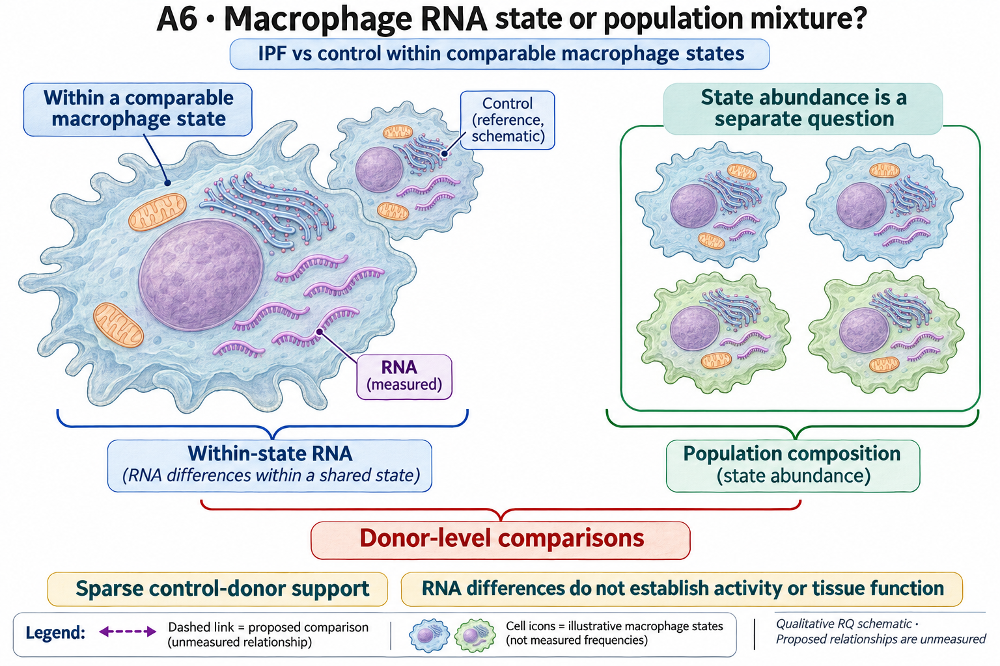

# A6: literature context and hypothesis schematic

[Question home](README.md) · [Scientific dossier](../../docs/research_dossiers/A6.md).

Reviewed 3 October 2026. This note connects published findings to the current proposed question. It is a bounded synthesis, not novelty clearance or scientific acceptance.

## Published starting point

Human lung atlases already report disease-associated macrophage states and population redistribution. They make mixture a substantive biological rival, not merely a nuisance covariate.

| Primary source | Inspected locator and access record |
|---|---|
| [Sikkema 2023](https://www.nature.com/articles/s41591-023-02327-2) | Integrated healthy/disease cell-state comparison. [Access / prior review](../../docs/research_dossiers/followup_2026-10-03/NOVELTY.md) |

Sources above reuse the named review unless the update ledger explicitly records a fresh inspection. Published-source evidence and reanalysis of the same material are not independent replication.

## Repository observation

The available proliferating-state validation contains three IPF and one control donor. In the broader 254-candidate RNA gene-set screen, no candidate passes corrected discovery and validation under estimated intergene correlation; the post-primary fixed-0.01 sensitivity supports 30, including 28 macrophage sets. This sensitivity cannot replace the primary result or establish pathway activity. Different subtype labels and sparse support prevent a composition-only conclusion. Additional cells, gene sets or reuse through an atlas integration do not create independent control donors, and a more complex score does not supply a reproducible within-state target.

[Statistical correction and subtype support](../../analysis/corrections/statistics/README.md). This reuses existing evidence rather than providing a new run or independent replication.

## What this question could add

A coherent question with sparse source support and a useful interpretation limit. The current evidence has not selected a reproducible IPF effector; it also does not establish absence of within-state biology or demonstrate that the observed signal is random noise.

Donor/state support for a fixed within-state comparison and a specific biological consequence remain unqualified. Existing owner reservations remain in force; no retain/reject decision is created here.

## Current hypothesis and rival

IPF may change macrophage activity within a shared macrophage state as well as change the abundance of that state. The current task is a donor-level within-state comparison; a specific effector and tissue consequence are not yet nominated. The available three-IPF/one-control comparison cannot establish a population-wide disease mechanism.

**Strongest rival:** Disease differences reflect mixture, sparse controls or state-definition shifts rather than altered activity of comparable macrophages.

## What the comparison would teach

Reuse the current decomposition and correlation checks. A new source would need adequate donor/state support for a stated contrast, rather than another broad signature. A reproducible within-state pattern would motivate a more specific consequence question; dependence on composition or a single donor would restrict the claim. No new target is selected by the current dataset.

## Hypothesis schematic

GPT-generated matte illustration, 3 November 2026. Proposed relationships and cell counts are qualitative; the owning context defines the comparison and interpretation limits. [Editorial review](../../docs/audits/2026-11-02-rq-schematic-review/MATTE_PUBLICATION_2026-11-03.md) · [Selected edit prompt](schematics/A6_gpt_matte_v1.prompt.txt). Earlier SVG files are retained as history.

Donor-level within-state RNA association and state abundance are distinct endpoints. The current sparse control support cannot establish a population disease mechanism, and more cells do not supply new donors. No inferred effector activity is depicted.

Class-level glyphs and qualitative geometry are not molecular structures, organelle measurements or evidence of functional assembly. Neutral epithelial/stromal shapes do not assert subtype identity or organelle loss, and icon counts are illustrative. Read locally labelled solid premises/references separately from dashed proposed comparisons; no complete mechanism follows from their juxtaposition.

## Next literature check

Planned query (not reported as newly executed): `IPF macrophage within state effector function composition donor replication 2025 2026`. Expand to synonyms, nearest source references/citations and conflicting results using the [literature workflow](../../docs/LITERATURE_WORKFLOW.md). Recheck the exact population, comparison, timing, unit and endpoint before making a stronger contribution claim.

**Current unresolved specification:** There is no adequately supported within-state effector and recipient consequence that warrants a broad mechanistic claim.

**Interpretation limit:** Cell count is not donor count, and within-state RNA difference is not an effector mechanism.

[Current dossier](README.md) · [All-question context index](../../docs/research_dossiers/literature_context_2026-10-03/README.md)
