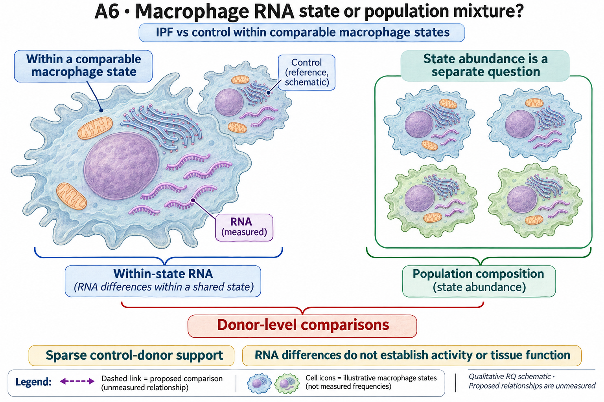

# A6: ipf macrophage state composition

## Organizing Biological Q

Which macrophage programme changes within shared states in IPF, and which measurable consequence would make that change biologically useful to explain?

**Unresolved gap:** There is no adequately supported within-state effector and recipient consequence that warrants a broad mechanistic claim.

[Working hypothesis and competing explanations](../../docs/research_dossiers/A6.md#working-hypothesis) · [Canonical card](../../RESEARCH_QUESTIONS.md#a6).

<!-- literature-visual-context:start -->

## Literature context & visual hypothesis

[Published findings, repository observations and interpretation limits](LITERATURE_CONTEXT.md).

GPT-generated matte illustration, 3 November 2026. Proposed relationships and
cell counts are qualitative. [Editorial review](../../docs/audits/2026-11-02-rq-schematic-review/MATTE_PUBLICATION_2026-11-03.md) · [Selected edit prompt](schematics/A6_gpt_matte_v1.prompt.txt). Earlier artwork is retained as history.
<!-- literature-visual-context:end -->

## Current evidence and interpretation

<!-- evidence-followthrough:start -->
**Evidence follow-through — 3 November 2026:** Exclude the affirmative claim
“The sparse within-state IPF comparison establishes a population mechanism.” from current conclusions.
[Bounded fill, stop rule and reopening evidence](../../docs/audits/2026-11-03-rq-evidence-trajectory/CUT_OR_FILL_PLAN.md#a6).
The hypothesis remains a proposal where its decisive comparison is untested.
<!-- evidence-followthrough:end -->

**Current entrypoints:** [existing source-analysis context](../../Research%20Article/gate1_04_sikkema_2023_hlca/README.md) ·
[conditional hypothesis package](../../docs/research_dossiers/packages_2026-10-03/A6.md).
The package draft exists. The requested specificity/novelty revision is applied;
scientific acceptance and experiment-specific qualification remain pending. Use [current work disposition](../../docs/research_dossiers/REMAINING_WORK.md), not an older
package-pending checkpoint, to decide what is active.

Does IPF alter shared macrophage states beyond changing their abundance?

Status: proposed refinement, 3 October 2026. This is a development aid, not scientific acceptance or an experimental protocol.

The proliferating-state comparison has only three IPF donors and one control at its gate. Earlier owner reservations about this direction remain recorded; registration does not reverse them.

Evidence locators (source citations and numerical details remain in these records):

- [Research Article/gate1_04_sikkema_2023_hlca/README.md](../../Research%20Article/gate1_04_sikkema_2023_hlca/README.md)

## Analysis plan and next decision

First assess donor eligibility and nominate a specific effector from source-grounded evidence. Stop if controls cannot support the contrast; do not expand gene-set screening to compensate.

[Plan and existing implementation](PLAN.md) · [Full scientific dossier](../../docs/research_dossiers/A6.md) · [Current interpretation boundary](../../docs/research_dossiers/A6.md#interpretation-boundary).

This folder is the question home. Existing paper-owned analyses, shared code and frozen runs retain their original ownership and paths.
