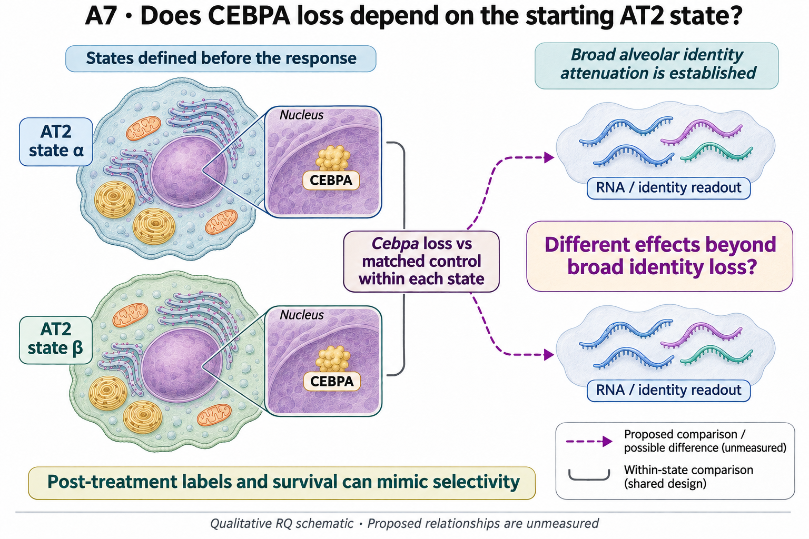

# A7: literature context and hypothesis schematic

[Question home](README.md) · [Scientific dossier](../../docs/research_dossiers/A7.md).

<!-- full-priority-screening-20261103:start -->
**Screening follow-through — 3 November 2026:** The completed CEBPA/AP1 conditional screens retain pooled-well and gating sensitivities; a post-treatment identity gate is not the starting epithelial state. A baseline-state-by-perturbation contrast needs baseline-linked units. Current pooled post-treatment samples cannot identify that interaction, so no replacement state score is added. [Reviewed screening sequence](../../docs/research_reviews/2026-11-03-full-priority-screening/PLANS.md) · [Coordination and review](../../docs/research_reviews/2026-11-03-full-priority-screening/README.md).
<!-- full-priority-screening-20261103:end -->

Reviewed 3 October 2026. This note connects published findings to the current proposed question. It is a bounded synthesis, not novelty clearance or scientific acceptance.

## Published starting point

CEBPA support of AT2 identity and alternative reparative/defensive programmes are prior knowledge. Broad loss of identity is therefore the premise for a more specific interaction question.

| Primary source | Inspected locator and access record |
|---|---|
| [Hassan and Chen 2024](https://www.nature.com/articles/s41467-024-48632-3) | Results and Figs. 3, 5, 6. [Access / prior review](../../docs/research_dossiers/review_2026-10-03/SOURCES.md#s02) |
| [Sawhney 2025](https://www.nature.com/articles/s41467-025-64224-1) | Fig. 7 and Discussion. [Access / prior review](../../docs/research_dossiers/review_2026-10-03/SOURCES.md#s03) |

Sources above reuse the named review unless the update ledger explicitly records a fresh inspection. Published-source evidence and reanalysis of the same material are not independent replication.

## Repository observation

ES1 measures context-dependent label-versus-reference RNA-panel detection at 2,000 UMIs per retained cell. The Cldn4/Krt8 call and Sftpc-conditioned reference are defined after treatment; the label-free ADI contrast differs across contexts, rather than testing an independently manipulated reference or starting state. Six CEBPA-condition wells and four separate AP-1 wells are pooled libraries, not a replicated starting-state interaction. Technical seeds and reusing these outcomes add no independent biological replication.

[Current result, design and limits](../../Research%20Article/epithelial_state_specificity/results/SUMMARY.md). This reuses existing evidence rather than providing a new run or independent replication.

## What this question could add

Useful measurement and design correction. The evidence has not selected a selectively vulnerable starting population or demonstrated that initial competence determines response. The distinction is worth testing, but it was not established by the reference-dependent RNA pattern.

Qualified pre-intervention state and independent preparation information remain missing for the interaction question. Separate perturbation series do not supply a factorial comparison by proximity.

## Current hypothesis and rival

CEBPA loss attenuates alveolar identity across AT2 states; the additional candidate is that its effect differs between independently established starting states beyond this broad identity loss. Broad attenuation is the published premise, not the novel claim. The state interaction must be specified before genotype changes the state labels; CEBPA and AP-1 studies remain separate sources.

**Strongest rival:** The apparent breadth or interaction arises from post-genotype state selection, reference enrichment, differential survival or depth-sensitive measurement rather than a difference between starting states.

## What the comparison would teach

Keep the conditional panel contrasts and reference-selection limitation as results. A future state-dependent effect comparison needs a defensible starting-state measurement and units appropriate to that question. A reproducible interaction would support state dependence; an effect explained by a changed reference would limit it. No additional post-treatment relabelling can recover the missing starting history.

## Hypothesis schematic

GPT-generated matte illustration, 3 November 2026. Proposed relationships and cell counts are qualitative; the owning context defines the comparison and interpretation limits. [Editorial review](../../docs/audits/2026-11-02-rq-schematic-review/MATTE_PUBLICATION_2026-11-03.md) · [Selected edit prompt](schematics/A7_gpt_matte_v1.prompt.txt). Earlier SVG files are retained as history.

A7 separates published broad alveolar identity attenuation from an additional interaction with independently established starting states. Source animals define biological independence; pooled wells/cells do not create it. Post-genotype labels, survival and depth can mimic selectivity; CEBPA and AP-1 sources remain separate.

Class-level glyphs and qualitative geometry are not molecular structures, organelle measurements or evidence of functional assembly. Neutral epithelial/stromal shapes do not assert subtype identity or organelle loss, and icon counts are illustrative. Read locally labelled solid premises/references separately from dashed proposed comparisons; no complete mechanism follows from their juxtaposition.

## Next literature check

Planned query (not reported as newly executed): `CEBPA alveolar baseline cell state interaction identity loss lineage 2025 2026`. Expand to synonyms, nearest source references/citations and conflicting results using the [literature workflow](../../docs/LITERATURE_WORKFLOW.md). Recheck the exact population, comparison, timing, unit and endpoint before making a stronger contribution claim.

**Current unresolved specification:** How much of the apparent reference-versus-transition compression survives independent state definitions and valid biological replication is unresolved. Broad identity change and an additional state interaction can coexist.

**Interpretation limit:** More cells in one well cannot establish genotype replication; a reduced transitional fraction does not establish altered fate.

[Current dossier](README.md) · [All-question context index](../../docs/research_dossiers/literature_context_2026-10-03/README.md)
