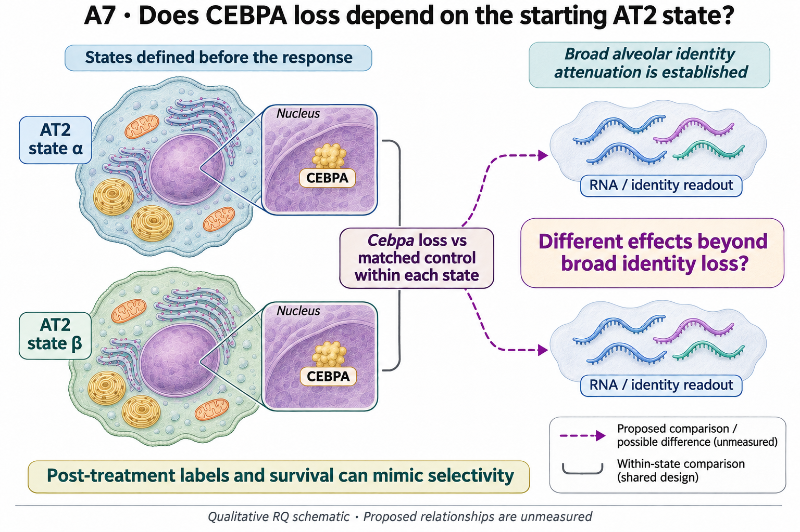

# A7: cebpa baseline state dependence

## Organizing Biological Q

How broadly does Cebpa loss attenuate AT2 identity, and is there an additional effect associated with independently defined states?

**Unresolved gap:** How much of the apparent reference-versus-transition compression survives independent state definitions and valid biological replication is unresolved. Broad identity change and an additional state interaction can coexist.

[Working hypothesis and competing explanations](../../docs/research_dossiers/A7.md#working-hypothesis) · [Canonical card](../../RESEARCH_QUESTIONS.md#a7).

<!-- literature-visual-context:start -->

## Literature context & visual hypothesis

[Published findings, repository observations and interpretation limits](LITERATURE_CONTEXT.md).

GPT-generated matte illustration, 3 November 2026. Proposed relationships and
cell counts are qualitative. [Editorial review](../../docs/audits/2026-11-02-rq-schematic-review/MATTE_PUBLICATION_2026-11-03.md) · [Selected edit prompt](schematics/A7_gpt_matte_v1.prompt.txt). Earlier artwork is retained as history.
<!-- literature-visual-context:end -->

## Current evidence and interpretation

<!-- full-priority-screening-20261103:start -->
**Screening follow-through — 3 November 2026.** The completed CEBPA/AP1 conditional screens retain pooled-well and gating sensitivities; a post-treatment identity gate is not the starting epithelial state.

**Remaining discriminator:** A baseline-state-by-perturbation contrast needs baseline-linked units. Current pooled post-treatment samples cannot identify that interaction, so no replacement state score is added.

[Reviewed screening sequence](../../docs/research_reviews/2026-11-03-full-priority-screening/PLANS.md) · [Coordination and review](../../docs/research_reviews/2026-11-03-full-priority-screening/README.md). This reuses reviewed evidence and does not record human scientific acceptance.
<!-- full-priority-screening-20261103:end -->

<!-- evidence-followthrough:start -->
**Evidence follow-through — 3 November 2026:** Exclude the affirmative claim
“Post-genotype labels establish baseline-state susceptibility.” from current conclusions.
[Bounded fill, stop rule and reopening evidence](../../docs/audits/2026-11-03-rq-evidence-trajectory/CUT_OR_FILL_PLAN.md#a7).
The hypothesis remains a proposal where its decisive comparison is untested.
<!-- evidence-followthrough:end -->

**Current entrypoints:** [existing source-analysis context](../../Research%20Article/epithelial_state_specificity/README.md) ·
[conditional hypothesis package](../../docs/research_dossiers/packages_2026-10-03/A7.md).
The package draft exists. The requested specificity/novelty revision is applied;
scientific acceptance and experiment-specific qualification remain pending. Use [current work disposition](../../docs/research_dossiers/REMAINING_WORK.md), not an older
package-pending checkpoint, to decide what is active.
Source recovery is closed at its documented evidence limit: [M03/M04](../../docs/research_dossiers/source_mapping_closeout_2026-10-03/README.md). Missing biological links remain held.

Does Cebpa loss attenuate AT2 identity across states or preferentially within a transitional state?

Status: proposed refinement, 3 October 2026. This is a development aid, not scientific acceptance or an experimental protocol.

The relevant record is ES1 epithelial-state specificity using the CEBPA source, not the England mutant-clone paper. The shared ES1 resource has six CEBPA-source and four separate AP-1-source condition wells. These support conditional, label-sensitive descriptions; cells and pooled wells do not supply a replicated genotype-by-state interaction at animal level.

Evidence locators:

- [Research Article/epithelial_state_specificity/README.md](../../Research%20Article/epithelial_state_specificity/README.md)
- [Research Article/epithelial_state_specificity/results/SUMMARY.md](../../Research%20Article/epithelial_state_specificity/results/SUMMARY.md)

## Analysis plan and next decision

Audit state definitions, pooled-source identities and animal-level replication in ES1. Use the existing results descriptively unless the source can support the intended interaction; do not manufacture replication from cells.

[Plan and existing implementation](PLAN.md) · [Full scientific dossier](../../docs/research_dossiers/A7.md) · [Current interpretation boundary](../../docs/research_dossiers/A7.md#interpretation-boundary).

This folder is the question home. Existing paper-owned analyses, shared code and frozen runs retain their original ownership and paths.
