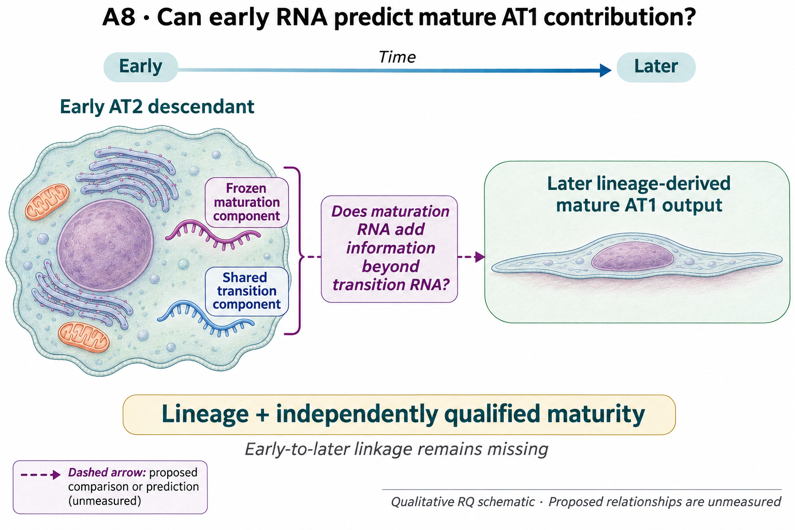

# A8: literature context and hypothesis schematic

**Completed full-priority screen, 3 November 2026:** The fixed attribution screen has completed across 35 original units using both original seeds and the full 1,503-gene sampling order. All original panel scores/support reconstruct; only 34 of 140 panel contrasts qualify and all 106 held contrasts remain visible. The selected three-gene early and four-gene late panels are published-marker subsets, not complete programmes. Heterogeneous member contributions and technical sign changes do not predict later AT1 contribution; the required early-to-later biological-unit link remains missing. [Complete result and evidence](reports/PANEL_ATTRIBUTION_V1_RESULTS.md); [reviewed sequence and source rationale](../../docs/research_reviews/2026-11-03-full-priority-screening/PLANS.md). Scientific acceptance and the registered hypothesis remain unchanged.

[Question home](README.md) · [Scientific dossier](../../docs/research_dossiers/A8.md).

**External context, 1 November 2026:** [Arozamena article-local evidence and limits](../../Research%20Article/ungated_arozamena_2026_inflammatory_memory/RQ_CONNECTIONS.md). The intestinal source has molecular and later functional figures, but no early-to-later biological-unit join was located in the inspected deposits. It cannot validate this question's maturation-to-AT1 relationship. This is a context link; the canonical hypothesis, registered illustration and scientific disposition are unchanged.

**Proposed Wagner companion, 4 October 2026:** [Wg-P05](../../Research%20Article/gate2_W1_wagner_th17_autoimmunity/rq_derivation/P05.md) nominates early epithelial glycolytic relaxation after IL-1β withdrawal as a biochemical comparison against this question's unchanged fixed RNA component. It remains an article-local proposal; the canonical hypothesis, prior outcomes and registered illustration here are unchanged. Linked biochemical/output measurements and scientific adoption are not yet qualified.

Reviewed 3 October 2026. This note connects published findings to the current proposed question. It is a bounded synthesis, not novelty clearance or scientific acceptance.

## Published starting point

Transition and maturation programmes are published, and human expansion/differentiation measurements offer candidate endpoint sources. None automatically supplies the exact early-feature/later-output join.

| Primary source | Inspected locator and access record |
|---|---|
| [Strunz 2020](https://www.nature.com/articles/s41467-020-17358-3) | Krt8-associated repair transition; abstract and source identification. [Access / prior review](../../docs/research_dossiers/review_2026-10-03/SOURCES.md#s05) |
| [Sawhney 2025](https://www.nature.com/articles/s41467-025-64224-1) | Fig. 7 and Discussion. [Access / prior review](../../docs/research_dossiers/review_2026-10-03/SOURCES.md#s03) |
| [Rochelle 2026](https://www.jci.org/articles/view/188701) | Figs. 6–8 and supporting-table headers. [Access / prior review](../../docs/research_dossiers/packages_2026-10-03/SOURCES.md) |

Sources above reuse the named review unless the update ledger explicitly records a fresh inspection. Published-source evidence and reanalysis of the same material are not independent replication.

## Repository observation

The completed exposed-source attribution retains 35 original units: ten pooled multiome libraries and 25 external animals. Of 140 unit/seed/panel contrasts, 34 qualify and 106 remain unsupported. Seeds are technical sensitivity, not independent replicates. The endpoint is the equal-member mean detection difference in percentage points between Cldn4/Krt8-labelled and Sftpc-reference cells at the original 2,000-UMI budget. Contributions are heterogeneous; some late-panel totals change sign across seeds, including the sole external animal eligible at both seeds. Those changes describe a fixed-budget detection measurement, not later AT1 output.

[Current result, design and limits](reports/PANEL_ATTRIBUTION_V1_RESULTS.md). This reuses existing evidence rather than providing a new run or independent replication.

## What this question could add

A useful panel/measurement diagnostic rather than selection of a maturation driver. The results limit interpretation of small-panel totals as coordinated maturation. Neither a favorable panel score nor a technically stable member has been validated as an early predictor of later contribution.

The early measurement and later mature output are not linked in the required biological units. Pooled libraries, external animals and repeated technical seeds cannot be pooled as equivalent independent replicates.

## Current hypothesis and rival

An early, frozen maturation-associated RNA component may identify AT2 descendants that later contribute mature AT1 cells beyond information in the shared transition component. The additional claim is prospective information about independent later mature output, not that the score is fate or that one marker causes maturation. The component remains unchanged and the early-to-later biological-unit link is still missing.

**Strongest rival:** The component is an identity label, generic injury response, compositional artifact or information leaked from the later endpoint.

## What the comparison would teach

Keep every supported and unsupported panel contrast and the technical sign changes. A predictive question needs an eligible early-to-later endpoint link and an explicit fixed component. Improvement on an appropriate earlier-state baseline would support bounded prediction; a signal confined to concurrent markers or technical choices would restrict it. More same-source scoring does not supply the missing later outcome.

## Hypothesis schematic

GPT-generated matte illustration, 3 November 2026. Proposed relationships and cell counts are qualitative; the owning context defines the comparison and interpretation limits. [Editorial review](../../docs/audits/2026-11-02-rq-schematic-review/MATTE_PUBLICATION_2026-11-03.md) · [Selected edit prompt](schematics/A8_gpt_matte_v1.prompt.txt). Earlier SVG files are retained as history.

The frozen early component is a candidate indicator of later mature AT1 contribution beyond shared transition RNA. Prediction requires linked and held-out biological units. RNA, contemporaneous overlap and MYRF expression cannot replace independently established lineage and maturity.

Class-level glyphs and qualitative geometry are not molecular structures, organelle measurements or evidence of functional assembly. Neutral epithelial/stromal shapes do not assert subtype identity or organelle loss, and icon counts are illustrative. Read locally labelled solid premises/references separately from dashed proposed comparisons; no complete mechanism follows from their juxtaposition.

## Next literature check

Planned query (not reported as newly executed): `early alveolar RNA programme prospective lineage mature AT1 output prediction independent donor`. Expand to synonyms, nearest source references/citations and conflicting results using the [literature workflow](../../docs/governance/LITERATURE_WORKFLOW.md). Recheck the exact population, comparison, timing, unit and endpoint before making a stronger contribution claim.

**Current unresolved specification:** A linked early predictor and later mature AT1 outcome, with a baseline transition comparator, is missing.

**Interpretation limit:** Score separation is not mature AT1 contribution; MYRF alone cannot serve as a cell-specific maturation endpoint.

[Current dossier](../../docs/research_dossiers/A8.md) · [All-question context index](../../docs/research_dossiers/literature_context_2026-10-03/README.md)
