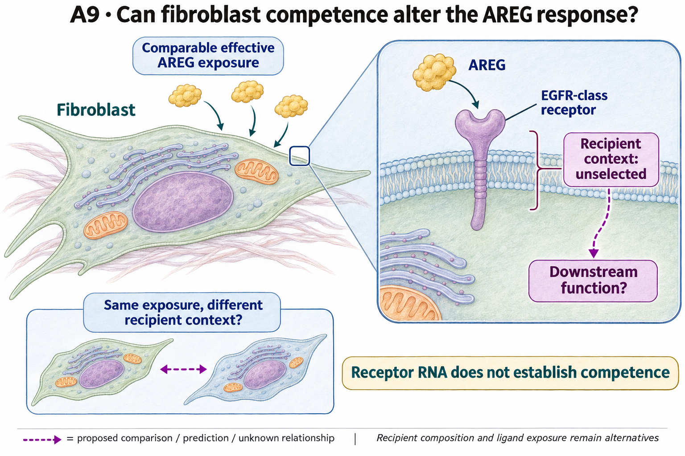

# A9: literature context and hypothesis schematic

**Completed full-priority screen, 3 November 2026:** The reviewed six-gene recipient context has completed in the original 22 donors. Nineteen paired donors support 114 gene contrasts; 18 remain unsupported. EGFR and ERRFI1 RNA are lower in Myofibroblast in all supported pairs, with mixed directions for the other four targets. The original 7/22 encoded-complex coverage failure remains. This context does not establish receptor competence, effective inhibition or AREG dependence. [Complete result and evidence](reports/RECEPTOR_CONTEXT_V1_RESULTS.md); [reviewed sequence and source rationale](../../docs/research_reviews/2026-11-03-full-priority-screening/PLANS.md). Scientific acceptance and the registered hypothesis remain unchanged.

[Question home](README.md) · [Scientific dossier](../../docs/research_dossiers/A9.md).

Reviewed 3 October 2026. This note connects published findings to the current proposed question. It is a bounded synthesis, not novelty clearance or scientific acceptance.

## Published starting point

Known AREG/EGFR biology suggests a recipient-competence question as well as a supply question. The ligand correction in this repository restricts what its source scores mean.

| Primary source | Inspected locator and access record |
|---|---|
| [Cardoso 2026](https://www.nature.com/articles/s41586-026-10399-6) | Primary abstract, AREG/EGFR niche finding. [Access / prior review](../../docs/research_dossiers/review_2026-10-03/SOURCES.md#s10) |
| [Kaiser 2023 (online 2022)](https://pmc.ncbi.nlm.nih.gov/articles/PMC9767680/) | Mesenchymal EGFR/AREG niche results; indexed text and primary record. [Access / prior review](../../docs/research_dossiers/review_2026-10-03/SOURCES.md#s15) |

Sources above reuse the named review unless the update ledger explicitly records a fresh inspection. Published-source evidence and reanalysis of the same material are not independent replication.

## Repository observation

The resource correction found AREG/HBEGF–EGFR_ERBB2 scoreable in only 7 of 22 donors, below the fixed 11-donor rule; the encoded complexes existed in the resource. The completed 3 November six-target screen then retained all 132 attempted within-donor recipient-label contrasts: 114 estimated in 19 paired donors and 18 unsupported. Mean per-cell log1p(full-library CP10k) EGFR and ERRFI1 are lower in Myofibroblast in every supported pair; ERBB2, ERBB3, ERBB4 and LRIG1 have mixed directions. These reused donors support an exploratory RNA-context lead, not independent validation or a response contrast at comparable effective input.

[Completed recipient RNA-context result](reports/RECEPTOR_CONTEXT_V1_RESULTS.md) · [Earlier resource correction](../../analysis/corrections/ligand/RESULTS.md). This reuses existing evidence rather than providing a new run or independent replication.

## What this question could add

Supported technical correction and exploratory recipient RNA-context narrowing, with the competence mechanism still unmeasured. The concordant EGFR/ERRFI1 directions do not rank receptor activity or effective inhibition; annotation, depth and transcript detection remain alternatives. Exclusion by expression coverage does not establish homodimer signaling, receptor absence or functional competence, and correcting database absence does not select a causal configuration.

A recipient definition, comparable effective exposure and a specific measured response are not jointly supplied by the current source. Receptor assembly/activity and downstream state remain unmeasured alternatives.

## Current hypothesis and rival

Fibroblast competence to receive AREG may change its downstream response even at comparable effective AREG exposure. This asks about the recipient side of the AREG-EGFR axis, separately from A2 delivery. The relevant receptor/co-receptor or inhibitory contrast and functional response remain to be nominated; receptor RNA and database complex membership do not specify either.

**Strongest rival:** Recipient differences arise from other ligands, general activation, different fibroblast mixtures or ligand exposure rather than receptor competence.

## What the comparison would teach

The [existing candidate comparison](../../docs/research_reviews/2026-11-03-tool-assisted-screening-review/BIOLOGICAL_LINK_SCREENING_V1.md#a9-specify-which-recipient-configuration-changes-the-hypothesis) asks whether EGFR and ERRFI1/LRIG1 transcript context occurs together within an independently identified fibroblast population or reflects different subpopulations. This follows from the lower EGFR and ERRFI1 marginal measurements without assigning a net response direction. A within-population pattern would motivate a receptor/feedback-context question; segregation among populations would shift the interpretation toward recipient composition. Neither outcome would turn RNA into surface receptor availability or effective inhibition. Feedback-associated RNA may also reflect earlier stimulation.

This is a proposed descriptive branch, not a completed co-occurrence result or a selected mechanism. It needs an interpretable population definition and transcript-detection comparison before any new run. The separate response question still asks whether recipient contexts differ at comparable effective input. A directly informative response comparison need not wait for the optional RNA branch. The 7/22 encoded-complex coverage failure and all six measured targets remain unchanged.

## Hypothesis schematic

GPT-generated matte illustration, 3 November 2026. Proposed relationships and cell counts are qualitative; the owning context defines the comparison and interpretation limits. [Editorial review](../../docs/audits/2026-11-02-rq-schematic-review/MATTE_PUBLICATION_2026-11-03.md) · [Selected edit prompt](schematics/A9_gpt_matte_v1.prompt.txt). Earlier SVG files are retained as history.

A9 asks whether recipient competence changes a qualified response at comparable AREG input in independent preparations/donors. Sparse receptor-complex RNA coverage remains a hold. Receptor RNA and database membership do not establish functional assembly or activity.

Class-level glyphs and qualitative geometry are not molecular structures, organelle measurements or evidence of functional assembly. Neutral epithelial/stromal shapes do not assert subtype identity or organelle loss, and icon counts are illustrative. Read locally labelled solid premises/references separately from dashed proposed comparisons; no complete mechanism follows from their juxtaposition.

## Next literature check

Planned query (not reported as newly executed): `AREG EGFR fibroblast recipient competence matched effective ligand function`. Expand to synonyms, nearest source references/citations and conflicting results using the [literature workflow](../../docs/LITERATURE_WORKFLOW.md). Recheck the exact population, comparison, timing, unit and endpoint before making a stronger contribution claim.

**Current unresolved specification:** Receptor-dependent response has not been separated from ligand availability, other growth factors or recipient-state composition.

**Interpretation limit:** Ligand-receptor resource membership establishes neither binding in the experiment nor pathway activity or functional response.

[Current dossier](README.md) · [All-question context index](../../docs/research_dossiers/literature_context_2026-10-03/README.md)
