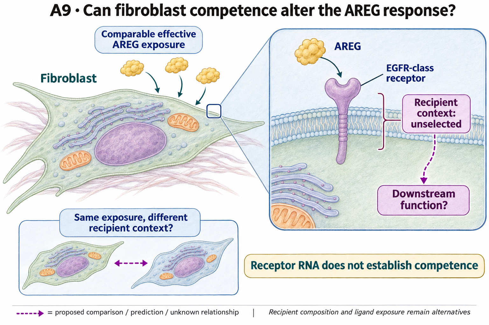

# A9: areg recipient competence

## Organizing Biological Q

At comparable effective AREG input, which recipient properties explain a different response?

Receptor context can alter signaling in published systems, but endogenous receiver competence is not determined by receptor RNA alone. A9 develops the recipient side, distinct from A2's source/delivery question.

Current synthesis: 4 November 2026. [Full rationale](../../docs/research_dossiers/A9.md) · [Source context](LITERATURE_CONTEXT.md).

<!-- literature-visual-context:start -->

## Literature context & visual hypothesis

[Published findings, repository observations and interpretation limits](LITERATURE_CONTEXT.md).

GPT-generated matte illustration, 3 November 2026. Proposed relationships and
cell counts are qualitative. [Editorial review](../../docs/audits/2026-11-02-rq-schematic-review/MATTE_PUBLICATION_2026-11-03.md) · [Selected edit prompt](schematics/A9_gpt_matte_v1.prompt.txt). Earlier artwork is retained as history.
<!-- literature-visual-context:end -->

The illustration presents the registered question and untested relationships. The current argument follows the result below; the drawing does not establish its proposed mechanism.

## What the analysis changed

The resource correction found AREG/HBEGF–EGFR_ERBB2 scoreable in only 7 of 22 donors, below the fixed 11-donor rule; the encoded complexes existed in the resource. The completed 3 November six-target screen then retained all 132 attempted within-donor recipient-label contrasts: 114 estimated in 19 paired donors and 18 unsupported. Mean per-cell log1p(full-library CP10k) EGFR and ERRFI1 are lower in Myofibroblast in every supported pair; ERBB2, ERBB3, ERBB4 and LRIG1 have mixed directions. These reused donors support an exploratory RNA-context lead, not independent validation or a response contrast at comparable effective input.

[Completed recipient RNA-context result](reports/RECEPTOR_CONTEXT_V1_RESULTS.md) · [Earlier resource correction](../../analysis/corrections/ligand/RESULTS.md).

**Rationale check.** Supported technical correction and exploratory recipient RNA-context narrowing, with the competence mechanism still unmeasured. The concordant EGFR/ERRFI1 directions do not rank receptor activity or effective inhibition; annotation, depth and transcript detection remain alternatives. Exclusion by expression coverage does not establish homodimer signaling, receptor absence or functional competence, and correcting database absence does not select a causal configuration.

## Current interpretation and next decision

A recipient definition, comparable effective exposure and a specific measured response are not jointly supplied by the current source. Receptor assembly/activity and downstream state remain unmeasured alternatives.

The [existing candidate comparison](../../docs/research_reviews/2026-11-03-tool-assisted-screening-review/BIOLOGICAL_LINK_SCREENING_V1.md#a9-specify-which-recipient-configuration-changes-the-hypothesis) asks whether EGFR and ERRFI1/LRIG1 transcript context occurs together within an independently identified fibroblast population or reflects different subpopulations. This follows from the lower EGFR and ERRFI1 marginal measurements without assigning a net response direction. A within-population pattern would motivate a receptor/feedback-context question; segregation among populations would shift the interpretation toward recipient composition. Neither outcome would turn RNA into surface receptor availability or effective inhibition. Feedback-associated RNA may also reflect earlier stimulation.

This is a proposed descriptive branch, not a completed co-occurrence result or a selected mechanism. It needs an interpretable population definition and transcript-detection comparison before any new run. The separate response question still asks whether recipient contexts differ at comparable effective input. A directly informative response comparison need not wait for the optional RNA branch. The 7/22 encoded-complex coverage failure and all six measured targets remain unchanged.

## Registered scope and analysis history

The records below preserve earlier framing and execution checkpoints. Read the current result before an older plan. Historical unfinished-work wording does not supersede completed later diagnostics. Registered hypotheses remain unchanged; this synthesis grants no claim grade or human acceptance.

Registered framing and retained analysis history

**Completed full-priority screen, 3 November 2026:** The reviewed six-gene recipient context has completed in the original 22 donors. Nineteen paired donors support 114 gene contrasts; 18 remain unsupported. EGFR and ERRFI1 RNA are lower in Myofibroblast in all supported pairs, with mixed directions for the other four targets. The original 7/22 encoded-complex coverage failure remains. This context does not establish receptor competence, effective inhibition or AREG dependence. [Complete result and evidence](reports/RECEPTOR_CONTEXT_V1_RESULTS.md); [reviewed sequence and source rationale](../../docs/research_reviews/2026-11-03-full-priority-screening/PLANS.md). Scientific acceptance and the registered hypothesis remain unchanged.

## Organizing Biological Q

Does recipient receptor competence explain different fibroblast responses to comparable AREG input?

**Unresolved gap:** Receptor-dependent response has not been separated from ligand availability, other growth factors or recipient-state composition.

[Working hypothesis and competing explanations](../../docs/research_dossiers/A9.md#working-hypothesis) · [Canonical card](../../RESEARCH_QUESTIONS.md#a9).

## Current evidence and interpretation

<!-- evidence-followthrough:start -->
**Evidence follow-through — 3 November 2026:** Exclude the affirmative claim
“Failed complex coverage implies homodimer signaling or functional competence.” from current conclusions.
[Bounded fill, stop rule and reopening evidence](../../docs/audits/2026-11-03-rq-evidence-trajectory/CUT_OR_FILL_PLAN.md#a9).
The hypothesis remains a proposal where its decisive comparison is untested.
<!-- evidence-followthrough:end -->

**Current entrypoints:** [existing source-analysis context](../../analysis/corrections/ligand/RESULTS.md) ·
[conditional hypothesis package](../../docs/research_dossiers/packages_2026-10-03/A9.md).
The package draft exists. The requested specificity/novelty revision is applied;
scientific acceptance and experiment-specific qualification remain pending. Use [current work disposition](../../docs/history/planning/REMAINING_WORK.md), not an older
package-pending checkpoint, to decide what is active.
Source recovery is closed at its documented evidence limit: [M01](../../docs/research_dossiers/source_mapping_closeout_2026-10-03/README.md). Missing biological links remain held.

Does fibroblast receptor context determine the response to AREG?

Status: proposed refinement, 3 October 2026. This is a development aid, not scientific acceptance or an experimental protocol.

The primary resource/complex-coverage observation is in the corrected ligand report; the Nb3 screen is adjacent EGF/compartment context. EGFR_ERBB2 coverage was only 7 of 22 donors, below the specified 11-donor eligibility floor. This establishes neither receptor competence nor an EGFR homodimer mechanism.

Evidence locators:

- [analysis/corrections/ligand/RESULTS.md](../../analysis/corrections/ligand/RESULTS.md)
- [Research Article/gate2_N2_nabhan_2026/README.md](../../Research%20Article/gate2_N2_nabhan_2026/README.md)

## Analysis plan and next decision

Establish the exact recipient population, receptor measurement and intended response endpoint. Check source medium and ligand context before selecting an interaction score.

[Plan and existing implementation](PLAN.md) · [Full scientific dossier](../../docs/research_dossiers/A9.md) · [Current interpretation boundary](../../docs/research_dossiers/A9.md#interpretation-boundary).

This folder is the question home. Existing paper-owned analyses, shared code and frozen runs retain their original ownership and paths.

