# Research-question figure gallery

All 36 questions have qualitative biological illustrations. A33–A35 were added and reviewed on 8 November; the earlier A0–A32 artwork is preserved. These are qualitative question diagrams, not measured results or scientific acceptance. Each owning page displays only its selected matte image.

[Question index](README.md) · [Publication and review record](../docs/audits/2026-11-02-rq-schematic-review/MATTE_PUBLICATION_2026-11-03.md) · [Searchable HTML](SCHEMATIC_GALLERY.html)

## A0 — Do epithelial transitions correspond across organs?

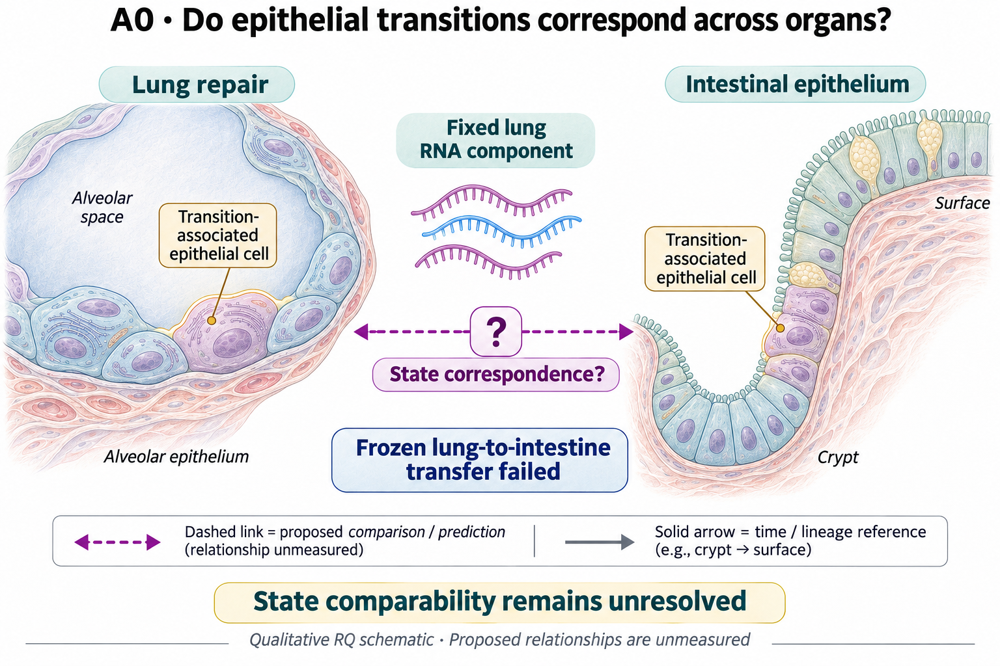

[Full resolution](A0_conserved_epithelial_transition_program/schematics/A0_gpt_matte_v1.png) · [Question](A0_conserved_epithelial_transition_program/README.md) · [Context](A0_conserved_epithelial_transition_program/LITERATURE_CONTEXT.md) · [Selected prompt](A0_conserved_epithelial_transition_program/schematics/A0_gpt_matte_v1.prompt.txt)

## A1 — Can early regulation add information about later output?

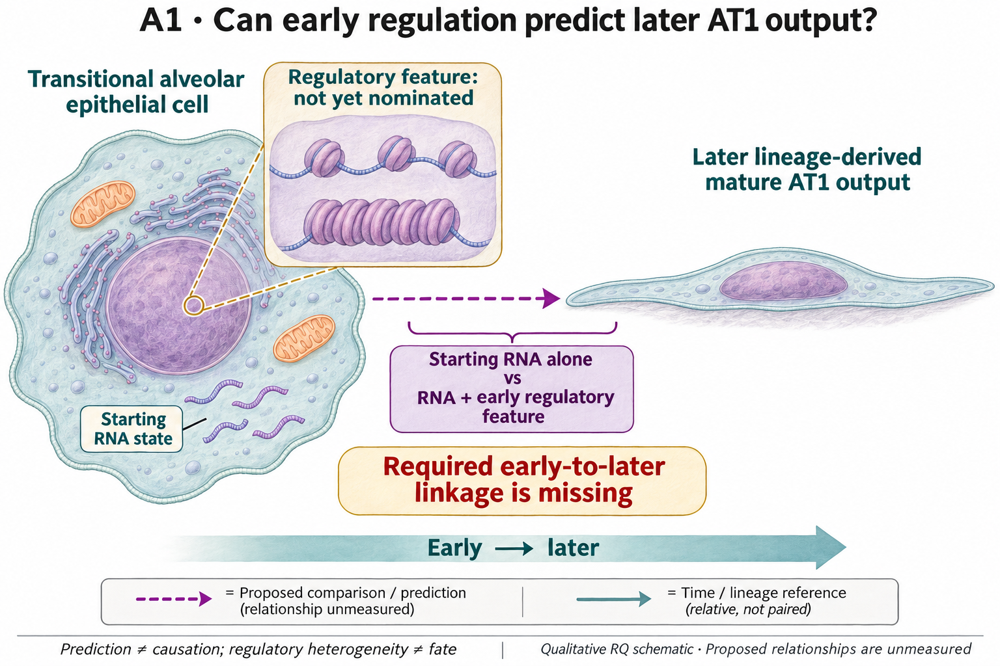

[Full resolution](A1_transitional_epithelial_state_distinction/schematics/A1_gpt_matte_v1.png) · [Question](A1_transitional_epithelial_state_distinction/README.md) · [Context](A1_transitional_epithelial_state_distinction/LITERATURE_CONTEXT.md) · [Selected prompt](A1_transitional_epithelial_state_distinction/schematics/A1_gpt_matte_v1.prompt.txt)

## A2 — Does epithelial AREG delivery change effective input?

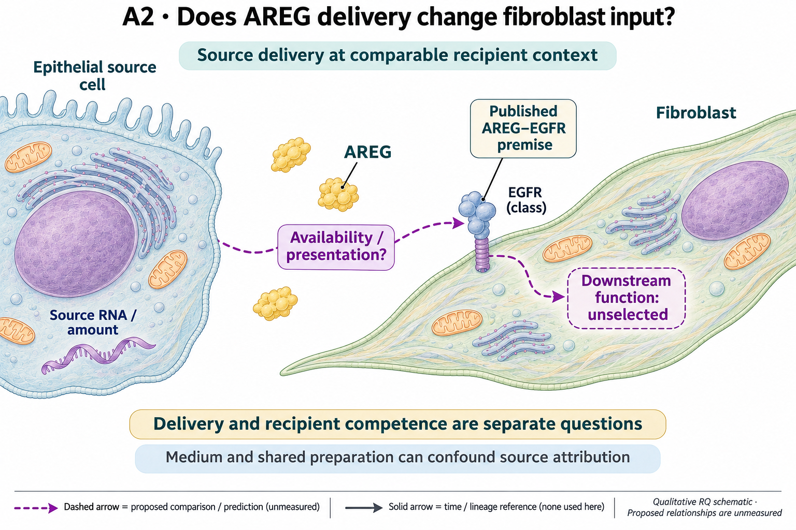

[Full resolution](A2_areg_source_delivery/schematics/A2_gpt_matte_v1.png) · [Question](A2_areg_source_delivery/README.md) · [Context](A2_areg_source_delivery/LITERATURE_CONTEXT.md) · [Selected prompt](A2_areg_source_delivery/schematics/A2_gpt_matte_v1.prompt.txt)

## A3 — Macrophage history after injury resolves

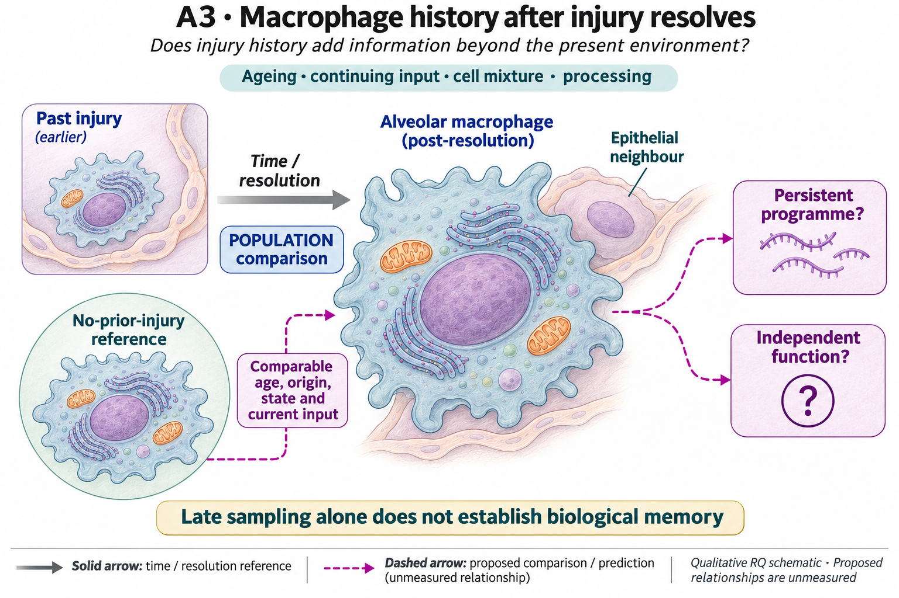

[Full resolution](A3_macrophage_injury_history/schematics/A3_gpt_matte_v1.png) · [Question](A3_macrophage_injury_history/README.md) · [Context](A3_macrophage_injury_history/LITERATURE_CONTEXT.md) · [Selected prompt](A3_macrophage_injury_history/schematics/A3_gpt_matte_v1.prompt.txt)

## A4 — Does a starting AT2 lineage acquire a new response?

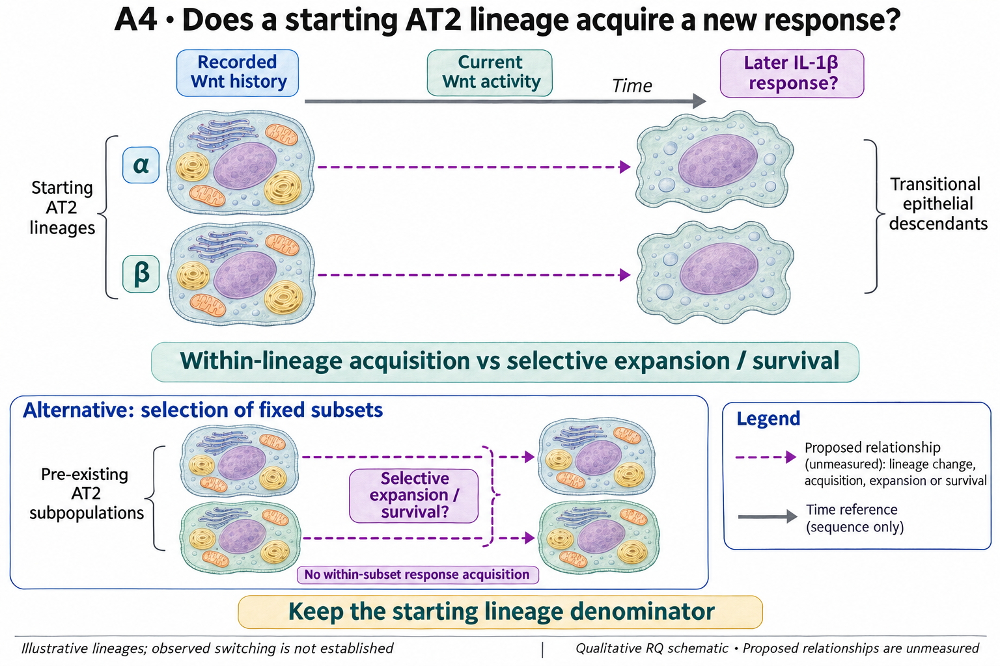

[Full resolution](A4_wnt_history_il1_response/schematics/A4_gpt_matte_v1.png) · [Question](A4_wnt_history_il1_response/README.md) · [Context](A4_wnt_history_il1_response/LITERATURE_CONTEXT.md) · [Selected prompt](A4_wnt_history_il1_response/schematics/A4_gpt_matte_v1.prompt.txt)

## A5 — Does the fixed developmental component replicate?

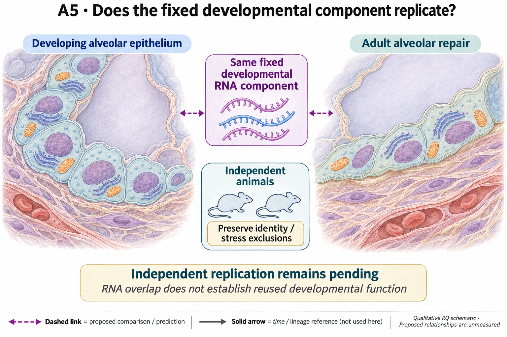

[Full resolution](A5_developmental_programme_reuse/schematics/A5_gpt_matte_v1.png) · [Question](A5_developmental_programme_reuse/README.md) · [Context](A5_developmental_programme_reuse/LITERATURE_CONTEXT.md) · [Selected prompt](A5_developmental_programme_reuse/schematics/A5_gpt_matte_v1.prompt.txt)

## A6 — Within-state macrophage RNA or a changed mixture?

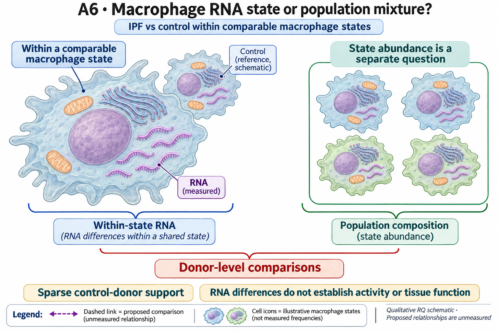

[Full resolution](A6_ipf_macrophage_state_composition/schematics/A6_gpt_matte_v1.png) · [Question](A6_ipf_macrophage_state_composition/README.md) · [Context](A6_ipf_macrophage_state_composition/LITERATURE_CONTEXT.md) · [Selected prompt](A6_ipf_macrophage_state_composition/schematics/A6_gpt_matte_v1.prompt.txt)

## A7 — Does CEBPA loss differ across AT2 starting states?

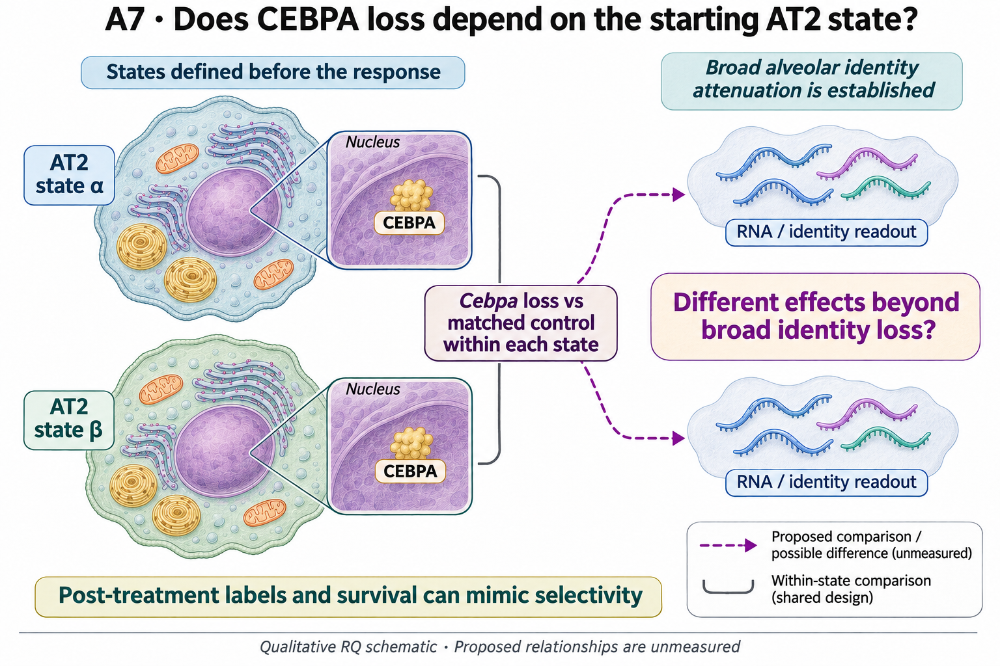

[Full resolution](A7_cebpa_baseline_state_dependence/schematics/A7_gpt_matte_v1.png) · [Question](A7_cebpa_baseline_state_dependence/README.md) · [Context](A7_cebpa_baseline_state_dependence/LITERATURE_CONTEXT.md) · [Selected prompt](A7_cebpa_baseline_state_dependence/schematics/A7_gpt_matte_v1.prompt.txt)

## A8 — Can early RNA predict later mature AT1 contribution?

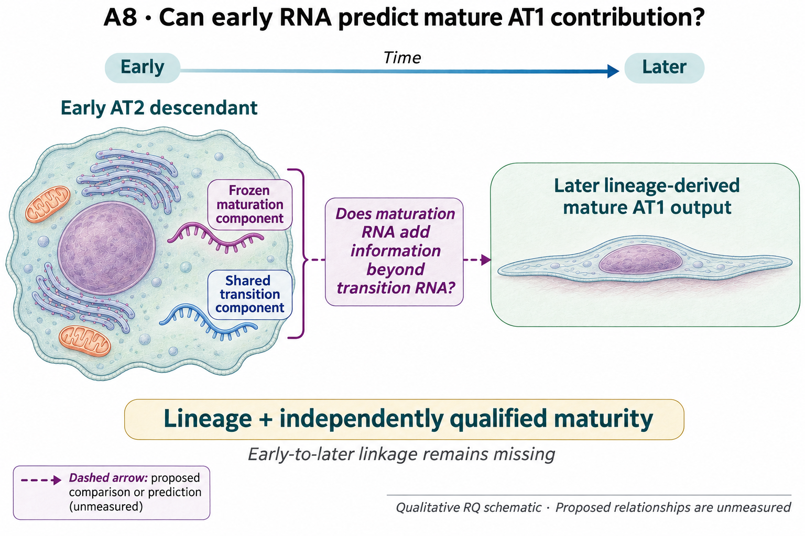

[Full resolution](A8_maturation_component_at1_contribution/schematics/A8_gpt_matte_v1.png) · [Question](A8_maturation_component_at1_contribution/README.md) · [Context](A8_maturation_component_at1_contribution/LITERATURE_CONTEXT.md) · [Selected prompt](A8_maturation_component_at1_contribution/schematics/A8_gpt_matte_v1.prompt.txt)

## A9 — Can recipient competence alter the AREG response?

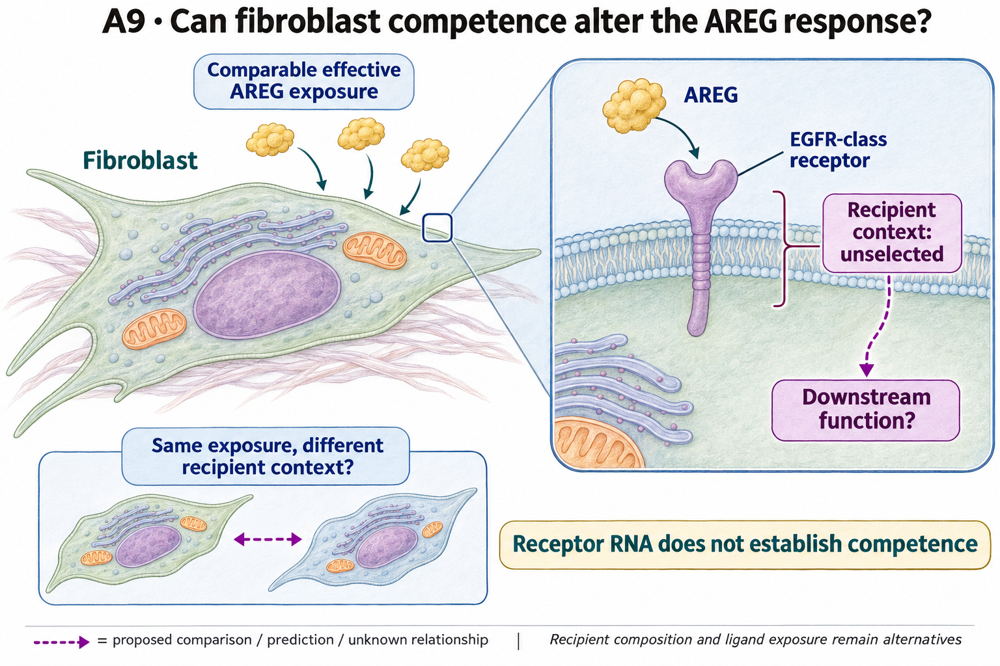

[Full resolution](A9_areg_recipient_competence/schematics/A9_gpt_matte_v1.png) · [Question](A9_areg_recipient_competence/README.md) · [Context](A9_areg_recipient_competence/LITERATURE_CONTEXT.md) · [Selected prompt](A9_areg_recipient_competence/schematics/A9_gpt_matte_v1.prompt.txt)

## A10 — Can early information forecast later organoid area?

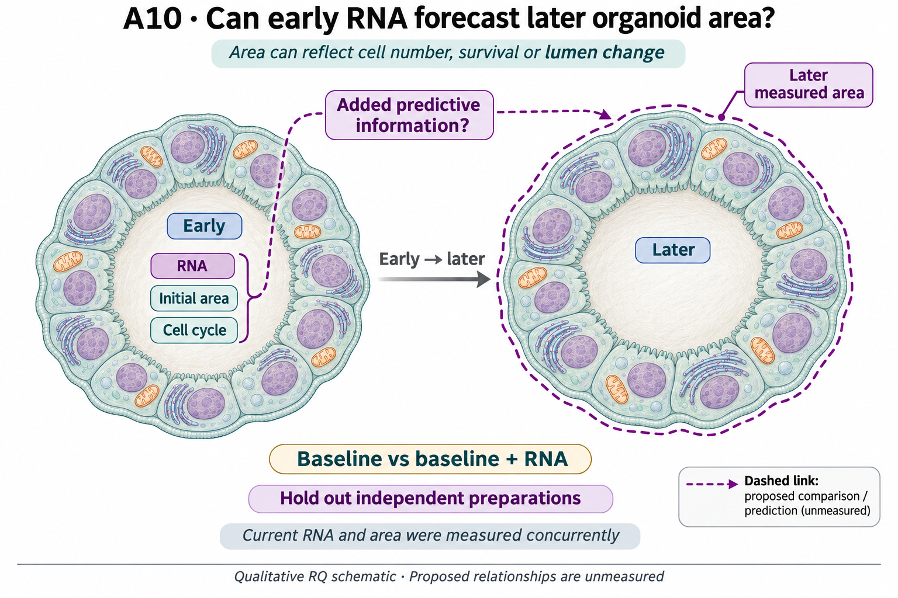

[Full resolution](A10_organoid_growth_outcome/schematics/A10_gpt_matte_v1.png) · [Question](A10_organoid_growth_outcome/README.md) · [Context](A10_organoid_growth_outcome/LITERATURE_CONTEXT.md) · [Selected prompt](A10_organoid_growth_outcome/schematics/A10_gpt_matte_v1.prompt.txt)

## A11 — Does the frozen residual add lesion-context information?

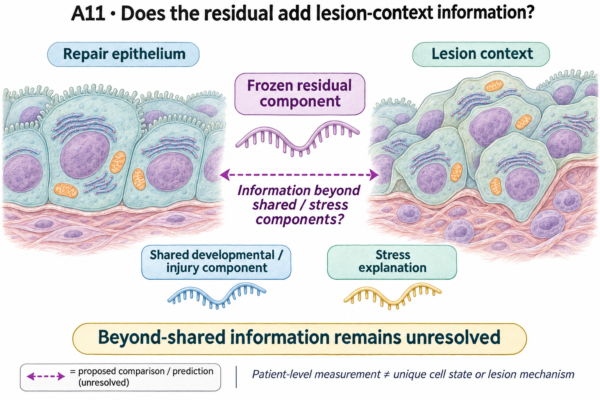

[Full resolution](A11_lesion_programme_addition/schematics/A11_gpt_matte_v1.png) · [Question](A11_lesion_programme_addition/README.md) · [Context](A11_lesion_programme_addition/LITERATURE_CONTEXT.md) · [Selected prompt](A11_lesion_programme_addition/schematics/A11_gpt_matte_v1.prompt.txt)

## A12 — Which recipient context changes an IL-1 response?

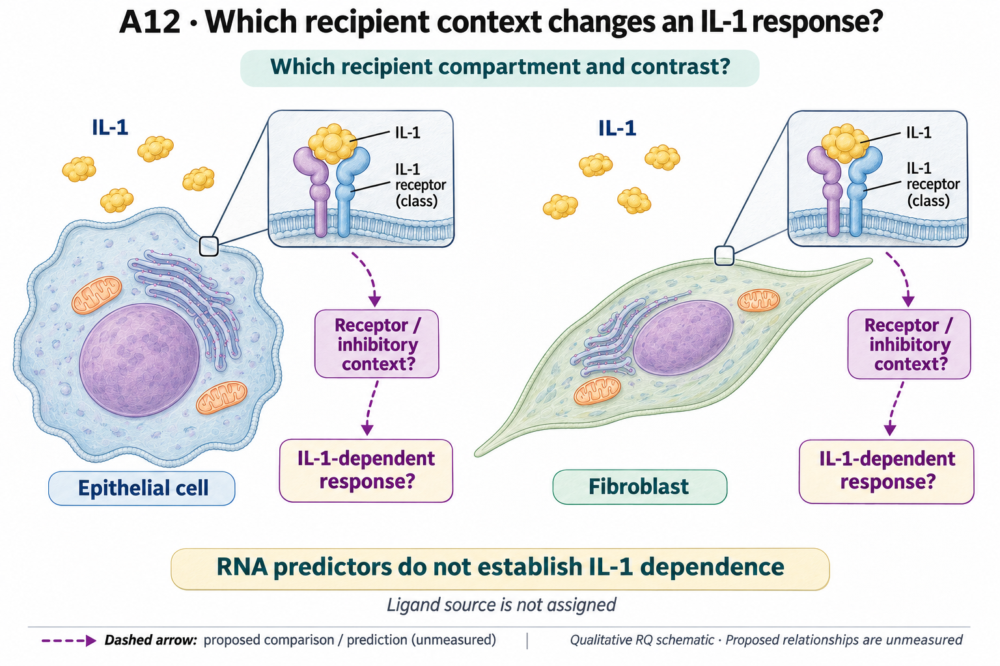

[Full resolution](A12_recipient_context/schematics/A12_gpt_matte_v1.png) · [Question](A12_recipient_context/README.md) · [Context](A12_recipient_context/LITERATURE_CONTEXT.md) · [Selected prompt](A12_recipient_context/schematics/A12_gpt_matte_v1.prompt.txt)

## A13 — Does fibroblast output add beyond macrophage IL-1β?

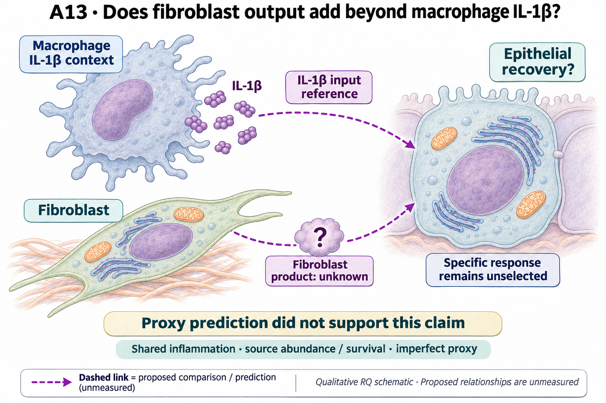

[Full resolution](A13_fibroblast_beyond_macrophage_il1b/schematics/A13_gpt_matte_v1.png) · [Question](A13_fibroblast_beyond_macrophage_il1b/README.md) · [Context](A13_fibroblast_beyond_macrophage_il1b/LITERATURE_CONTEXT.md) · [Selected prompt](A13_fibroblast_beyond_macrophage_il1b/schematics/A13_gpt_matte_v1.prompt.txt)

## A14 — Does IL-1 exposure duration change epithelial output?

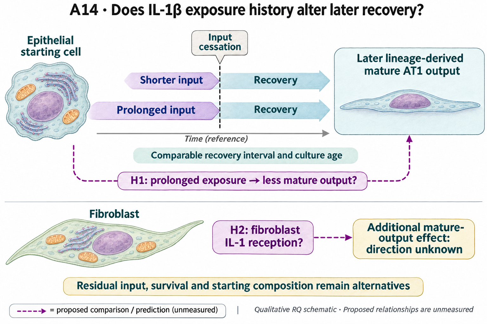

[Full resolution](A14_withdrawal_recovery_and_reception/schematics/A14_gpt_matte_v1.png) · [Question](A14_withdrawal_recovery_and_reception/README.md) · [Context](A14_withdrawal_recovery_and_reception/LITERATURE_CONTEXT.md) · [Selected prompt](A14_withdrawal_recovery_and_reception/schematics/A14_gpt_matte_v1.prompt.txt)

## A15 — Does source context change local TGF-β activation?

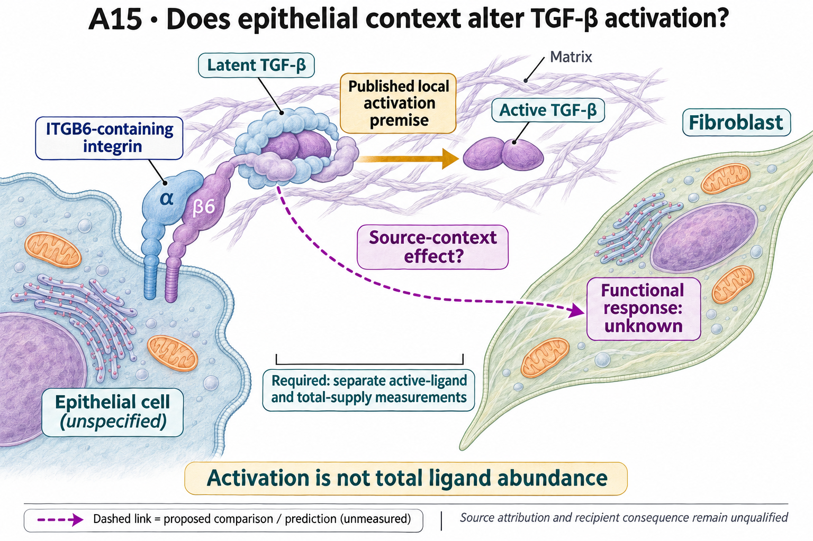

[Full resolution](A15_epithelial_integrin_tgfb_activation/schematics/A15_gpt_matte_v1.png) · [Question](A15_epithelial_integrin_tgfb_activation/README.md) · [Context](A15_epithelial_integrin_tgfb_activation/LITERATURE_CONTEXT.md) · [Selected prompt](A15_epithelial_integrin_tgfb_activation/schematics/A15_gpt_matte_v1.prompt.txt)

## A16 — Can epithelial CD177 add information about later output?

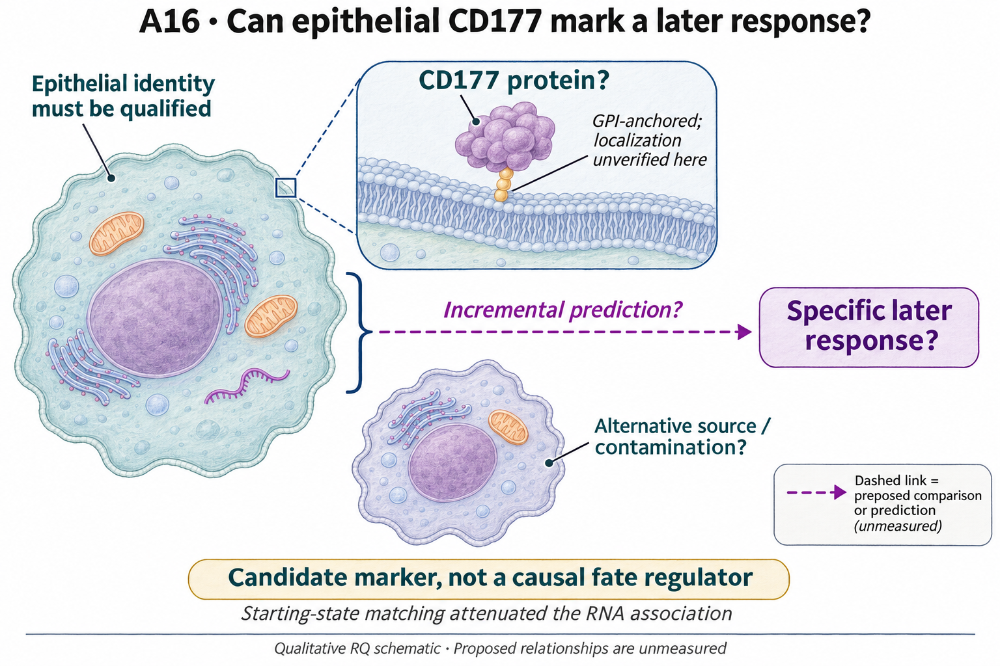

[Full resolution](A16_cd177_state_attribution/schematics/A16_gpt_matte_v1.png) · [Question](A16_cd177_state_attribution/README.md) · [Context](A16_cd177_state_attribution/LITERATURE_CONTEXT.md) · [Selected prompt](A16_cd177_state_attribution/schematics/A16_gpt_matte_v1.prompt.txt)

## A17 — Do founder differences explain unequal clone growth?

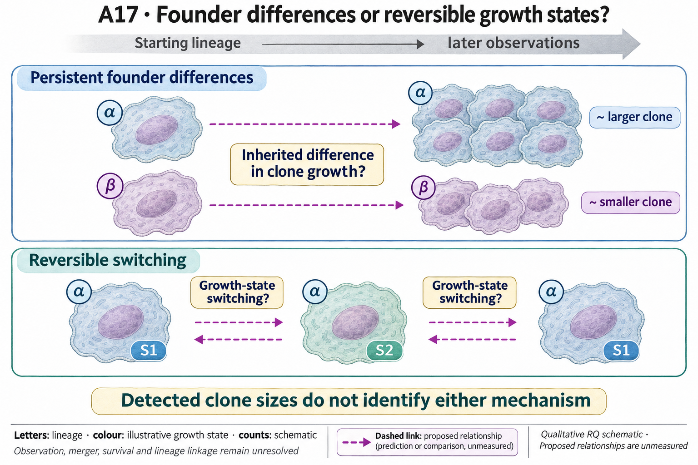

[Full resolution](A17_clonal_growth_persistence/schematics/A17_gpt_matte_v1.png) · [Question](A17_clonal_growth_persistence/README.md) · [Context](A17_clonal_growth_persistence/LITERATURE_CONTEXT.md) · [Selected prompt](A17_clonal_growth_persistence/schematics/A17_gpt_matte_v1.prompt.txt)

## A18 — Does mutant context change the neighbouring WT lineage?

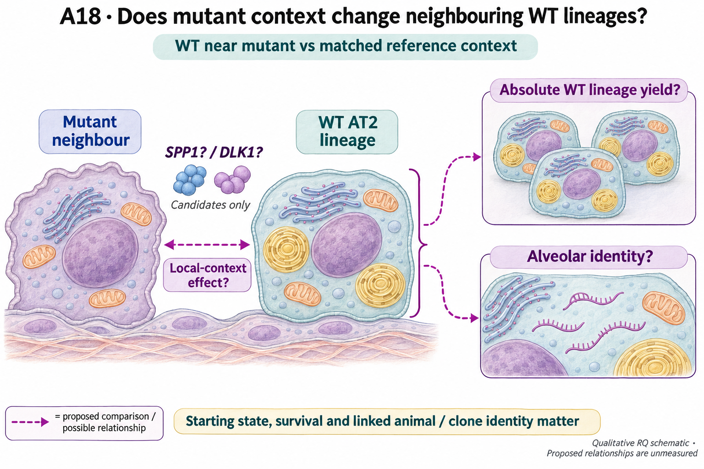

[Full resolution](A18_neighbor_wt_expansion_identity/schematics/A18_gpt_matte_v1.png) · [Question](A18_neighbor_wt_expansion_identity/README.md) · [Context](A18_neighbor_wt_expansion_identity/LITERATURE_CONTEXT.md) · [Selected prompt](A18_neighbor_wt_expansion_identity/schematics/A18_gpt_matte_v1.prompt.txt)

## A19 — Does ending input separate maturation from AT2 reserve?

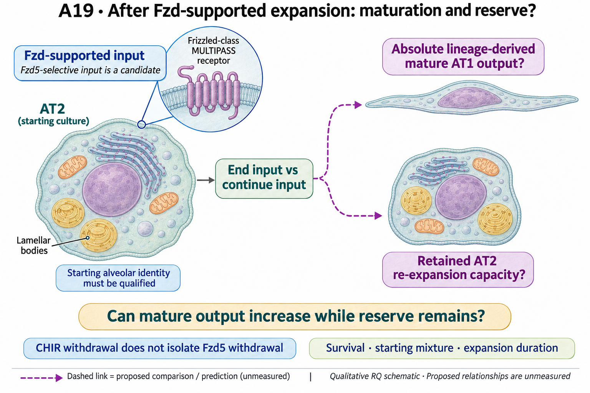

[Full resolution](A19_fzd_response_reversibility/schematics/A19_gpt_matte_v1.png) · [Question](A19_fzd_response_reversibility/README.md) · [Context](A19_fzd_response_reversibility/LITERATURE_CONTEXT.md) · [Selected prompt](A19_fzd_response_reversibility/schematics/A19_gpt_matte_v1.prompt.txt)

## A20 — Does fibroblast Fzd loss alter an early competent pool?

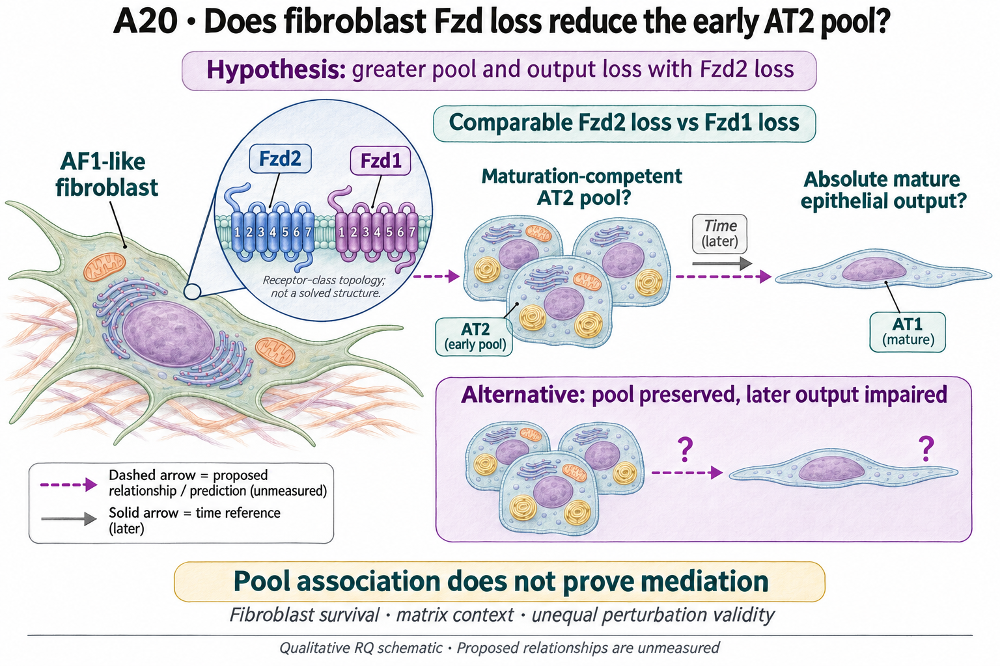

[Full resolution](A20_fibroblast_fzd_context/schematics/A20_gpt_matte_v1.png) · [Question](A20_fibroblast_fzd_context/README.md) · [Context](A20_fibroblast_fzd_context/LITERATURE_CONTEXT.md) · [Selected prompt](A20_fibroblast_fzd_context/schematics/A20_gpt_matte_v1.prompt.txt)

## A21 — Does Fzd4-dependent vascular integrity couple to repair?

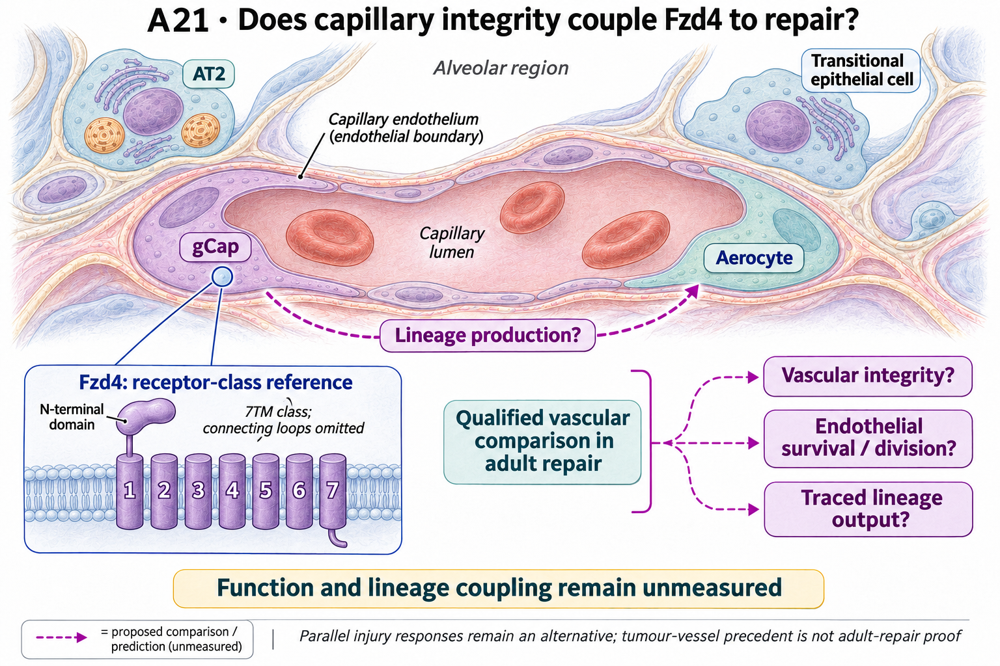

[Full resolution](A21_fzd4_capillary_function/schematics/A21_gpt_matte_v1.png) · [Question](A21_fzd4_capillary_function/README.md) · [Context](A21_fzd4_capillary_function/LITERATURE_CONTEXT.md) · [Selected prompt](A21_fzd4_capillary_function/schematics/A21_gpt_matte_v1.prompt.txt)

## A22 — Does epithelial identity alter fibroblast protein output?

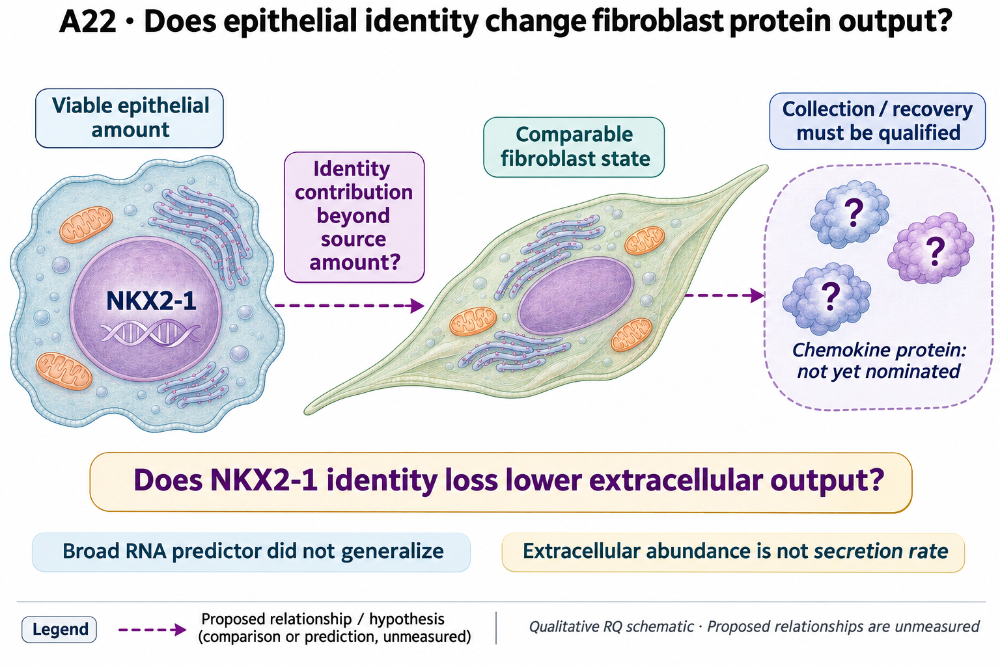

[Full resolution](A22_epithelial_identity_niche_response/schematics/A22_gpt_matte_v1.png) · [Question](A22_epithelial_identity_niche_response/README.md) · [Context](A22_epithelial_identity_niche_response/LITERATURE_CONTEXT.md) · [Selected prompt](A22_epithelial_identity_niche_response/schematics/A22_gpt_matte_v1.prompt.txt)

## A23 — Does SLC34A2 affect entry, residence or exit?

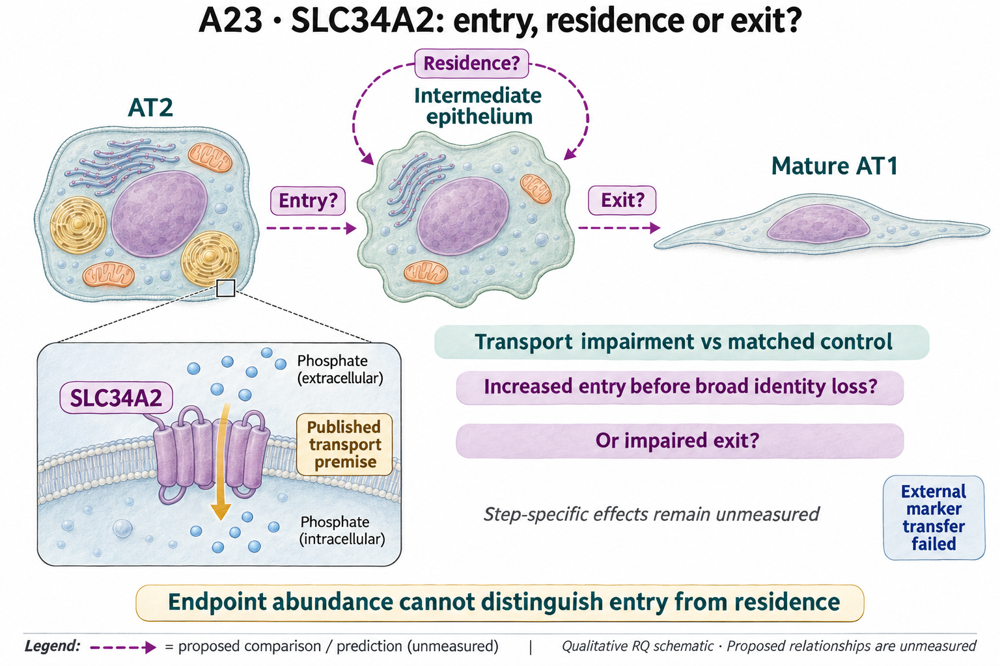

[Full resolution](A23_slc34a2_transition_homeostasis/schematics/A23_gpt_matte_v1.png) · [Question](A23_slc34a2_transition_homeostasis/README.md) · [Context](A23_slc34a2_transition_homeostasis/LITERATURE_CONTEXT.md) · [Selected prompt](A23_slc34a2_transition_homeostasis/schematics/A23_gpt_matte_v1.prompt.txt)

## A24 — Does stromal context contribute to bladder barrier ageing?

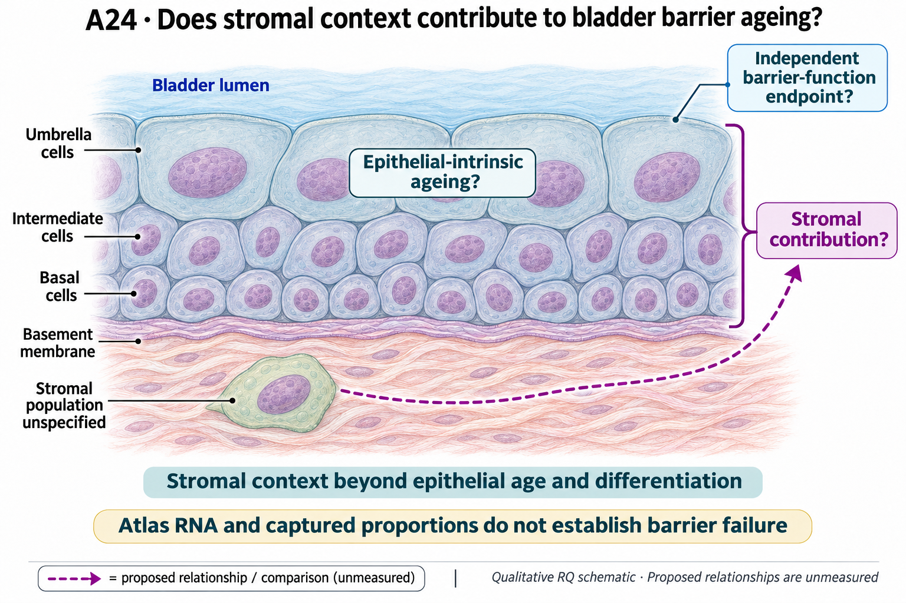

[Full resolution](A24_bladder_stromal_urothelial_maintenance/schematics/A24_gpt_matte_v1.png) · [Question](A24_bladder_stromal_urothelial_maintenance/README.md) · [Context](A24_bladder_stromal_urothelial_maintenance/LITERATURE_CONTEXT.md) · [Selected prompt](A24_bladder_stromal_urothelial_maintenance/schematics/A24_gpt_matte_v1.prompt.txt)

## A25 — Is microglial RNA variation more than mixture or continuum?

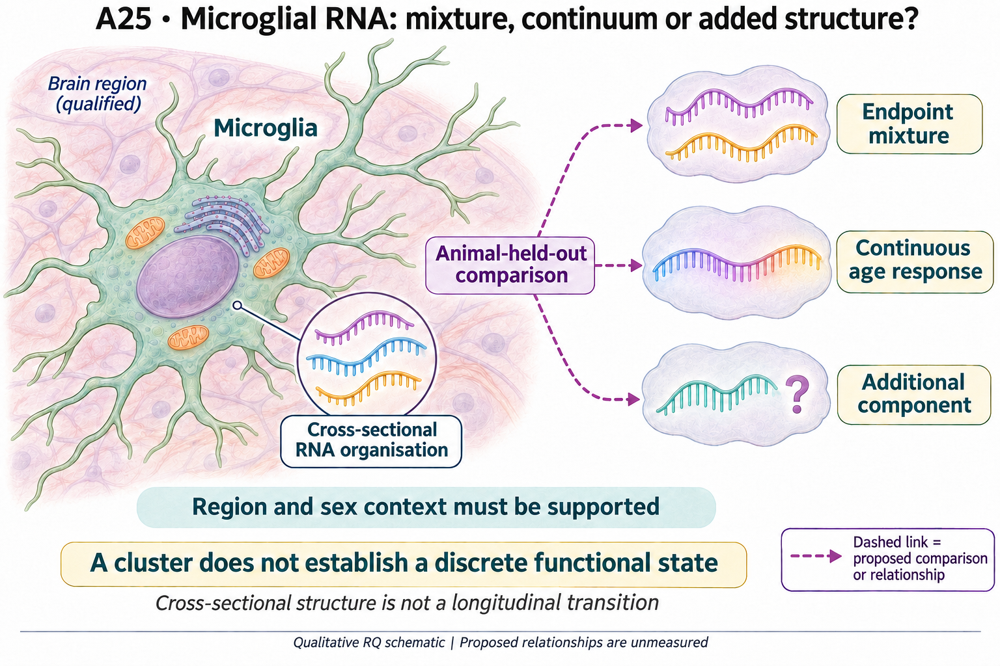

[Full resolution](A25_microglial_midlife_configuration/schematics/A25_gpt_matte_v1.png) · [Question](A25_microglial_midlife_configuration/README.md) · [Context](A25_microglial_midlife_configuration/LITERATURE_CONTEXT.md) · [Selected prompt](A25_microglial_midlife_configuration/schematics/A25_gpt_matte_v1.prompt.txt)

## A26 — Does paired tissue context alter the age–clone association?

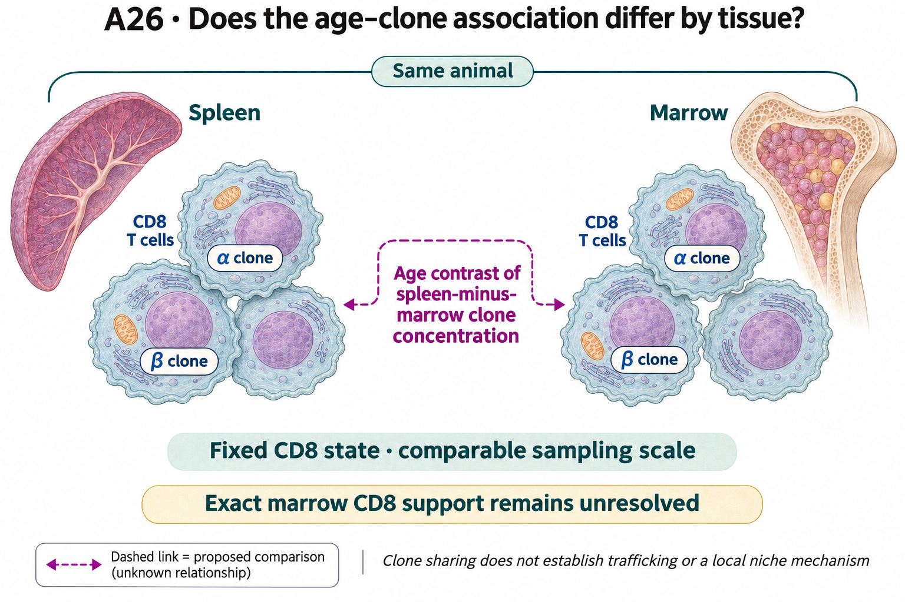

[Full resolution](A26_tissue_context_cd8_ageing/schematics/A26_gpt_matte_v1.png) · [Question](A26_tissue_context_cd8_ageing/README.md) · [Context](A26_tissue_context_cd8_ageing/LITERATURE_CONTEXT.md) · [Selected prompt](A26_tissue_context_cd8_ageing/schematics/A26_gpt_matte_v1.prompt.txt)

## A27 — How does state composition relate to CD8 clonal ageing?

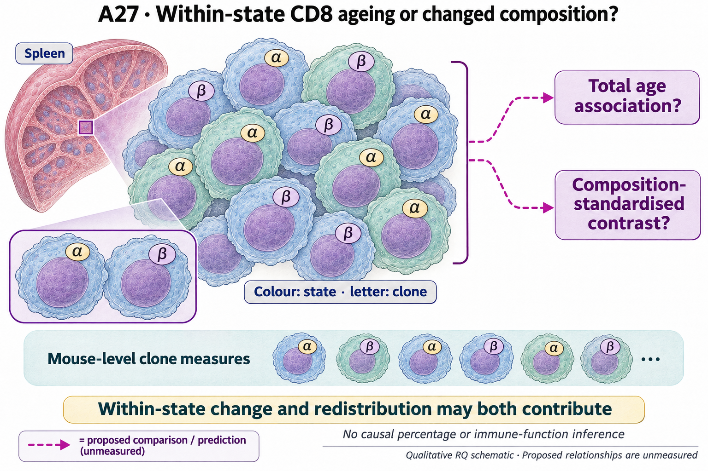

[Full resolution](A27_cd8_repertoire_state_redistribution/schematics/A27_gpt_matte_v1.png) · [Question](A27_cd8_repertoire_state_redistribution/README.md) · [Context](A27_cd8_repertoire_state_redistribution/LITERATURE_CONTEXT.md) · [Selected prompt](A27_cd8_repertoire_state_redistribution/schematics/A27_gpt_matte_v1.prompt.txt)

## A28 — Can marker outputs dissociate within the same Th17 cell?

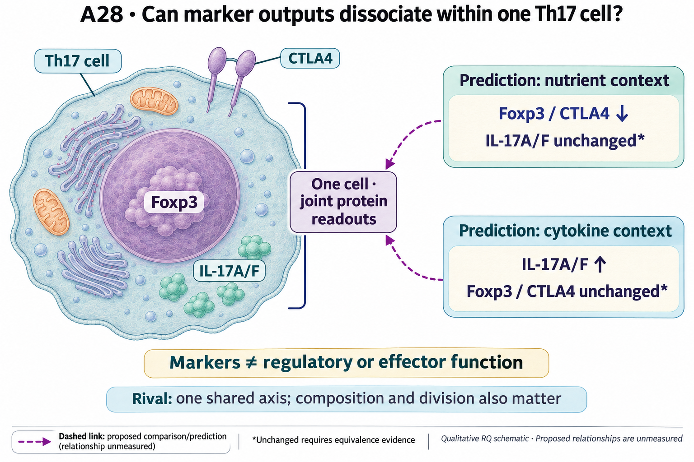

[Full resolution](A28_th17_arm_asymmetry/schematics/A28_gpt_matte_v1.png) · [Question](A28_th17_arm_asymmetry/README.md) · [Context](A28_th17_arm_asymmetry/LITERATURE_CONTEXT.md) · [Selected prompt](A28_th17_arm_asymmetry/schematics/A28_gpt_matte_v1.prompt.txt)

## A29 — Does PGAM context alter Th17 output through PEP?

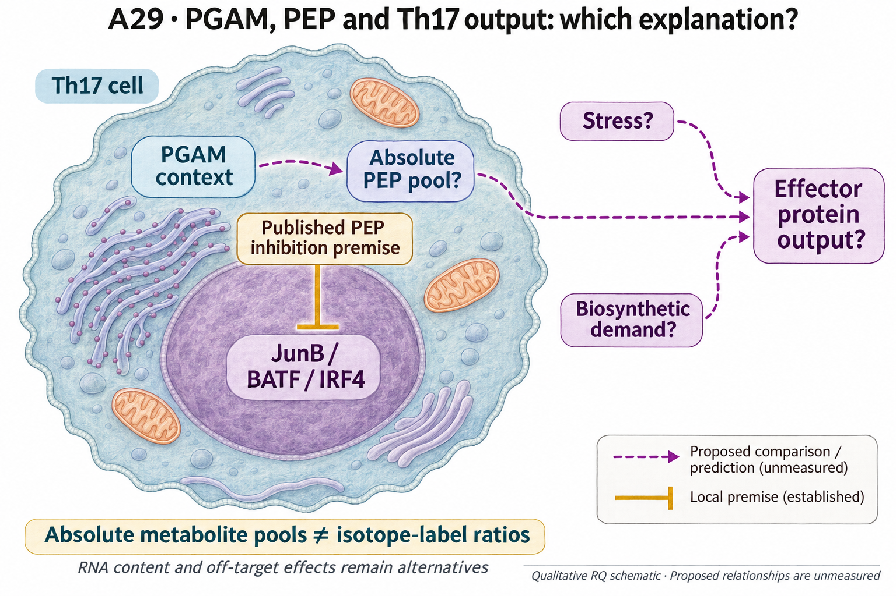

[Full resolution](A29_pgam_effector_mechanism/schematics/A29_gpt_matte_v1.png) · [Question](A29_pgam_effector_mechanism/README.md) · [Context](A29_pgam_effector_mechanism/LITERATURE_CONTEXT.md) · [Selected prompt](A29_pgam_effector_mechanism/schematics/A29_gpt_matte_v1.prompt.txt)

## A30 — Do matched CD4 RNA associations differ in CSF and blood?

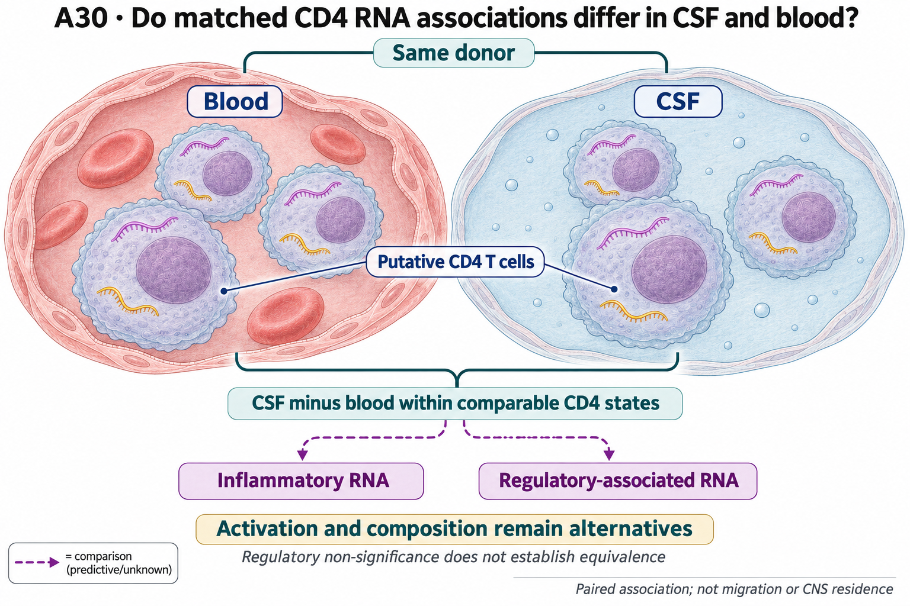

[Full resolution](A30_csf_compartment_effector_state/schematics/A30_gpt_matte_v1.png) · [Question](A30_csf_compartment_effector_state/README.md) · [Context](A30_csf_compartment_effector_state/LITERATURE_CONTEXT.md) · [Selected prompt](A30_csf_compartment_effector_state/schematics/A30_gpt_matte_v1.prompt.txt)

## A31 — Can GRIA1 contribute to an acute fibroblast response?

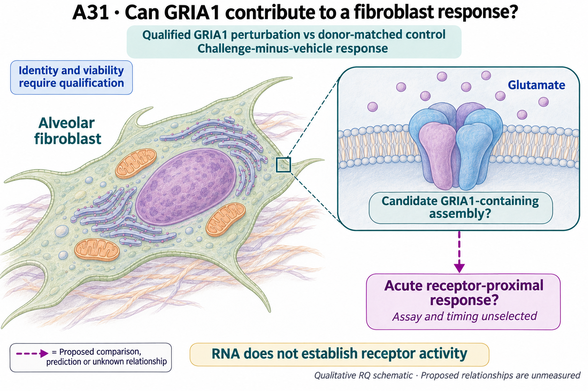

[Full resolution](A31_gria1_fibroblast_response/schematics/A31_gpt_matte_v1.png) · [Question](A31_gria1_fibroblast_response/README.md) · [Context](A31_gria1_fibroblast_response/LITERATURE_CONTEXT.md) · [Selected prompt](A31_gria1_fibroblast_response/schematics/A31_gpt_matte_v1.prompt.txt)

## A32 — Does myeloid ARG1 affect matrix and mature epithelial output?

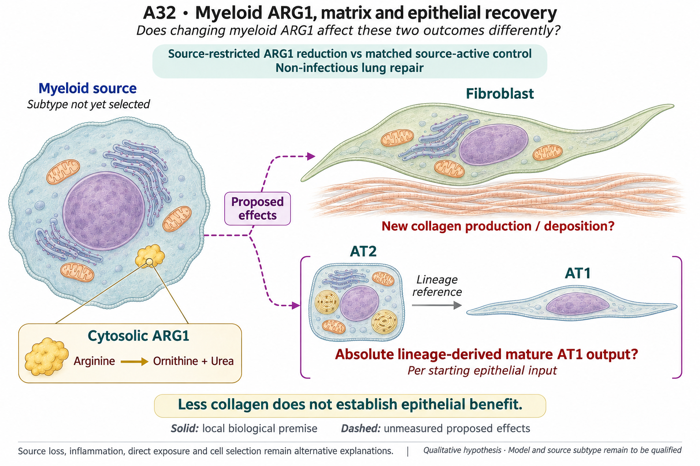

[Full resolution](A32_myeloid_arg1_matrix_epithelial_recovery/schematics/A32_gpt_matte_v1.png) · [Question](A32_myeloid_arg1_matrix_epithelial_recovery/README.md) · [Context](A32_myeloid_arg1_matrix_epithelial_recovery/LITERATURE_CONTEXT.md) · [Selected prompt](A32_myeloid_arg1_matrix_epithelial_recovery/schematics/A32_gpt_matte_v1.prompt.txt)

## A33 — TIGIT-responsive AREG output

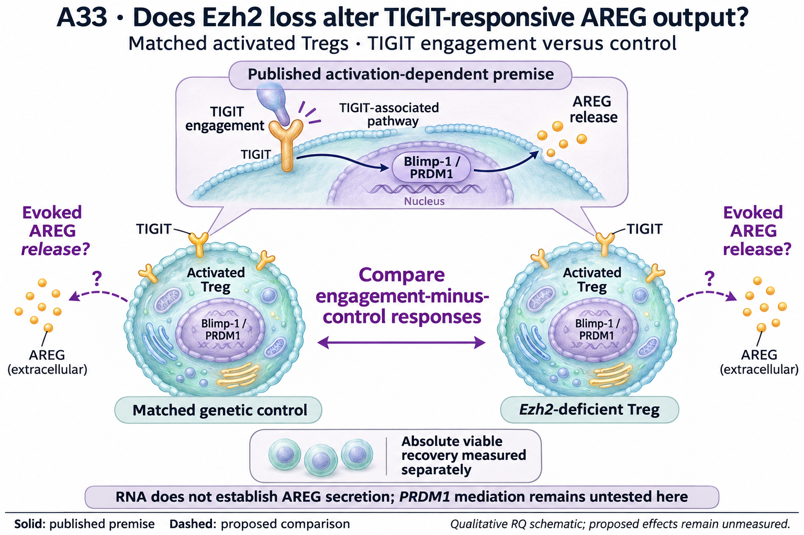

[Question](A33_ezh2_tigit_areg_output/README.md) · [Context](A33_ezh2_tigit_areg_output/LITERATURE_CONTEXT.md). Biological matte illustration; [8 November review](../Research%20Article/gate3_09_dupage_2015/rq_derivation/FIGURE_REVIEW_20261108.md). No measured result is depicted.

## A34 — CCR2 movement and fitness

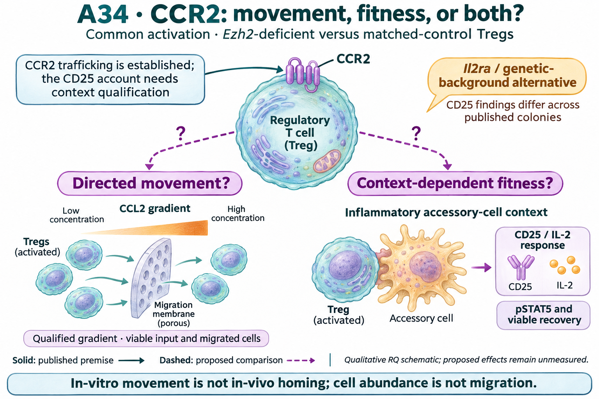

[Question](A34_ezh2_ccr2_movement_fitness/README.md) · [Context](A34_ezh2_ccr2_movement_fitness/LITERATURE_CONTEXT.md). Biological matte illustration; [8 November review](../Research%20Article/gate3_09_dupage_2015/rq_derivation/FIGURE_REVIEW_20261108.md). No measured result is depicted.

## A35 — IGFBP4 source and IGF response

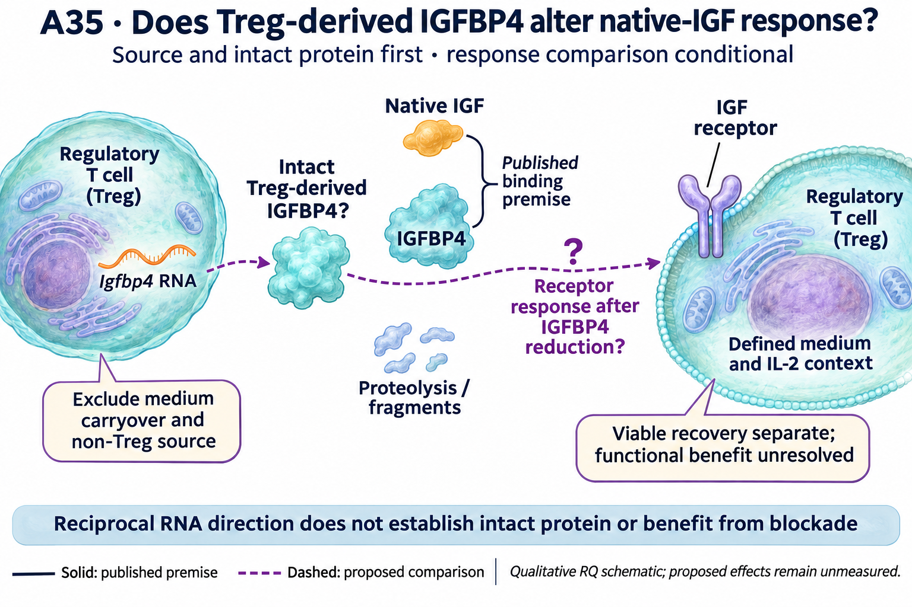

[Question](A35_treg_igfbp4_source_igf_response/README.md) · [Context](A35_treg_igfbp4_source_igf_response/LITERATURE_CONTEXT.md). Biological matte illustration; [8 November review](../Research%20Article/gate3_09_dupage_2015/rq_derivation/FIGURE_REVIEW_20261108.md). No measured result is depicted.
