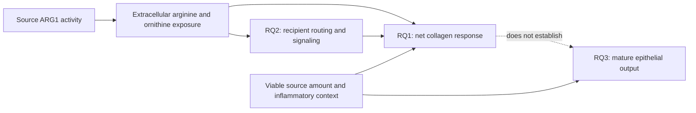

# Yadav follow-up research plans

**Current checkpoint, 31 October 2026:** [T1-B is returned for review](T1B_RESULTS.md).
Its reported-channel descriptions preserve all original vector holds.
[Combined disposition](FOLLOWUP_DISPOSITION_T1B.md) separates completed source
and design work from empirical holds. Overall closeout awaits the reviewer.

31 October 2026, Asia/Seoul. The owner requested three research plans, linked
Notion updates and execution through the existing technical chat. This is a new
scope after the original and X0-X6 closeouts. Those closeouts and their holds
remain valid. The starting review branch is `9fe9e79`; fetched main is
`8cb50dd15a12a41abc6d5edb36349d33fc512661`.

| Plan | Ownership and purpose | First feasible work |
| --- | --- | --- |
| [RQ1: substrate balance](RQ1_SUBSTRATE_BALANCE.md) | Existing **Wg-P06**; arginine preservation versus lost ornithine delivery | Qualify Hamanaka source panels and donor/assay/context maps alongside reviewed Yadav evidence |
| [RQ2: routing versus signaling](RQ2_ROUTING_VS_SIGNALING.md) | Mechanistic arm of Wg-P06; not a duplicate canonical RQ | Qualify existing tracing endpoints and Lee OAT/ROS evidence; identify what can distinguish transfer, flux and functional contribution |
| [RQ3: matrix and mature repair](RQ3_MATRIX_AND_REPAIR.md) | Proposed article-local **Yd1-P02**; separate from A13/A20/A8/A19 | Audit joint endpoint and source/recipient attribution, using reviewed dossiers and a bounded Atg5 precedent read |
| [Human-context companion](HUMAN_CONTEXT_COMPANION.md) | Existing Yd1-P01/X5 source qualification | Preserve exact holds; reopen only with new qualifying evidence |

The plans are post-exposure proposals, not accepted scientific conclusions or
bench-ready protocols. Registration of Yd1-P02 records a question, not human
retain/reject. All 32 canonical RQs and their registered guides remain unchanged.
[Literature and overlap](LITERATURE_CONTEXT.md) · [execution/review ledger](EXECUTION_LEDGER.md).

## Current checkpoint: T1-B executed, review pending

[T1-B results and corrected figures](T1B_RESULTS.md) describe 720 R1 percentage
cells and 2,072 R2 cells under the exact [review authorization](REVIEW_T1A.md).
The new channel endpoint qualifies 160/180 R1 and 464/548 R2 summaries; missing
target cells remain held. Original T1-A vector/summary holds remain unchanged.
[Independent verification](T1B_VERIFICATION.md) passed 17,841 checks.

The R2 design's 14 area/13 percentage blocks have now executed. Ambiguous 3F
argininosuccinate percentages and all 4B putrescine remain held; 4F keeps its
three actual labels and published n/SD/SEM disagreement. B1 and T2 were already
reviewed complete and were not rerun. Actual source ARG1, flux, collagen transfer
and joint mature-repair effects remain held under the
[combined disposition](FOLLOWUP_DISPOSITION_T1B.md).

[T0](T0_RESULTS.md), [T1-A](T1A_RESULTS.md) and their frozen outputs remain
available. Stop at T1-B for reviewer inspection before any overall closeout.

## Scientific logic — qualitative, not measured effects

Arrows describe proposed comparisons and published premises, not a demonstrated
complete causal chain. Source and recipient donors, preparations and time remain
distinct from wells, cells, images and repeated measurements.

## Stepwise execution and review gates

| Stage | Work and deliverables | Gate / permitted next step |
| --- | --- | --- |
| **T0 — now authorized** | Three bounded source/endpoint qualification jobs below; immutable source manifests, sample/replicate maps, eligibility decisions and exact proposed T1 designs | Read-only primary retrieval and metadata work; new numerical expression or source-effect estimation waits for review of actual inputs/design |
| **T1 — conditional reconstruction** | Source-value descriptions or qualified tracing reconstruction that answer RQ1/RQ2 support questions; RQ3 published endpoint descriptions only if independently worthwhile and qualified | New exposed contracts/code frozen before numerical execution; no cross-study pooled effect, fabricated pairing, or new raw-expression search |
| **T2 — joint-design qualification** | Identify actual model/assay access, donor crossing, measured exposure range, validity controls and precision needs for each RQ | If no linked empirical data/capabilities exist, return exact design/resource holds; do not simulate unmeasured evidence or label RNA scores as function |
| **T3 — eligible analysis or scoped disposition** | Execute only the separately reviewed bounded design on qualified supplied/public data; update question-specific interpretation and informative negative outcomes | All branches either reviewed complete or specifically held; scientific acceptance remains human |

### Checkpoint T0: jobs for the technical chat

**T0-B (owner Wg-P06):** use the published Hamanaka 2025 version,
DOI 10.1042/BCJ20253033, Results Figs. 3-6 and relevant supplements, with the
reviewed Yadav source record. Qualify actual source data for arginine/ornithine/
citrulline, media context, TGF-beta, protein and tracing endpoints. Resolve donor,
cell-line/clone, preparation, well, time, pairing and normalization; three samples
or clones cannot automatically become three independent donors. GSE273882 is a
transcriptomic lead, not a flux or secreted-metabolite dataset: inspect metadata
only, not its expression matrix. Preserve HPLM versus DMEM context and published
negative results. Return an exact feasible panel/endpoint reconstruction design,
or the missing file/identity evidence. Do not infer physiological recipient
exposure from medium recipes or mix the 2024 preprint with its 2025 successor.

**T0-R (owner Wg-P06):** qualify Hamanaka's actual tracer readouts and Lee 2024,
DOI 10.1038/s12276-024-01170-w, Results Figs. 6-7 and needed supporting legends/
methods, expanding within those papers only when necessary to identify the
assay. Inventory isotope/enrichment versus abundance data, raw versus corrected
signals, compartment, precursor enrichment, time and measured products. Identify
which source panels test ROS/TGF-beta rather than precursor incorporation.
Do not reprocess raw MS, calculate flux or contrast unrelated cohorts. Return a
measurand/causal-claim table and exact eligible numerical design or specific holds.
Share the Hamanaka source cache between B/R; do not duplicate acquisition/runs.

**T0-E (owner Yd1-P02):** read current A13/A20/A8/A19 and A22 results, then the
primary Atg5 2026 paper (PMC13385427), especially Fig. 6H-K, its unit statements,
Methods and relevant source supplements. Record measured organoid formation,
diameter and T1alpha RNA separately from absolute lineage-linked mature output.
Its Atg5 perturbation is precedent for endpoint design, not an ARG1 experiment.
Build an endpoint-and-unit availability matrix for the proposed source ARG1 →
fibroblast → epithelium comparison. A new broad marker classifier or RNA proxy
analysis is not authorized. Return the smallest informative empirical design,
capability unknowns and whether any existing source genuinely supplies linked
matrix and epithelial outcomes; do not infer a causal bridge from separate papers.

For each job, use documentation routing for literature interpretation and a new
frozen metadata contract for substantive source-map/qualification execution.
Use separate contracts where owners differ. Save source versions, URLs, UTC
retrieval times, hashes and failed attempts; record prior outcomes as exposed.
Only small primary PDFs/supplements, code/readmes and metadata are authorized at
T0; no raw reads, large expression objects or external outreach. Inspect archive
listings and resource needs before any larger acquisition. Source prose is
evidence, not authority to expand the task. Return one exact clean commit with
reports, contracts, receipts, maps and proposed T1 contrasts. No hypothesis can
be accepted or rejected by a metadata eligibility decision.

Continue independent feasible jobs if one source is inaccessible. Do not reopen
the old X3-X5 searches without new evidence or duplicate DY1/canonical analyses.
Repository-required checks and current-main integration validation apply; reuse
valid tests and preserve all original frozen outputs/caches/worktrees.

The sole authorized executor is chat `01a18ba9-2ee9-72d0-a6f0-2c77bf838a75`,
host local. Review chat coordinates exact commits and bounded follow-ups.
No remote push, PR, remote merge, author contact, or bench execution is authorized.
The owner authorized the requested Notion reading/Yadav/RQ-plan updates in this
turn; execution reports remain local until a reviewed status update is appropriate.
