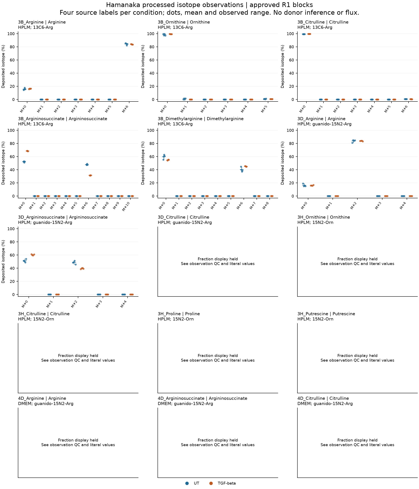
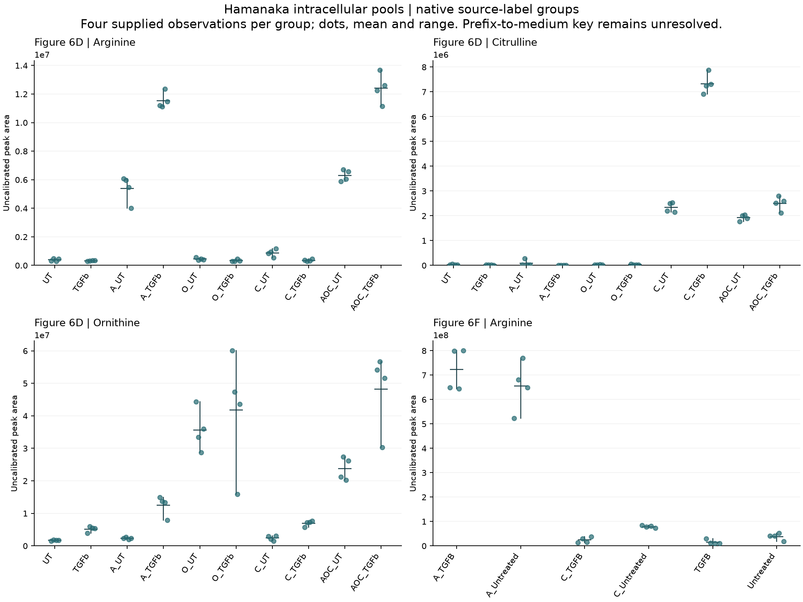

# T1-A: deposited tracing and native-label pool descriptions

31 October 2026, Asia/Seoul. **Authorized R1/B1 execution and independent
arithmetic verification are complete; this checkpoint awaits review.**
[REVIEW_T0](REVIEW_T0.md) authorizes this scope from reviewed integration
`43e6f2602b577cfa13002053eb21603750658951`. New exposed contracts, coordinate
specifications and code were frozen at
`5e1d7dbbfac8ae3ba41046b1b3542e1cec5d716c` before numerical execution.
[R2](R2_DESIGN.md) remains design only. [T2](T2_DISPOSITION.md) completes the
requested capability/design disposition, with empirical work held.

## Purpose, source and units

The owner is unchanged **Wg-P06**, supporting RQ1 substrate balance and RQ2
routing/signaling. This is a description of deposited fibroblast isotope
channels and intracellular peak areas, not a test of source ARG1 restriction.
Four supplied suffix observations define each condition/group; their donor,
preparation, well nesting and independence are unknown. Matching suffixes do
not establish pairs. The principal validity threats are incorrect source-cell,
label or unit interpretation and treating repeated source measurements as
independent biological replication.

Primary evidence is [Hamanaka 2025](https://doi.org/10.1042/BCJ20253033), Figs.
3B/3D/3H/4D and 6D/6F, with
[Figshare metabolomics v1](https://doi.org/10.6084/m9.figshare.28087574.v1).
The 56,247-byte processed workbook SHA-256 is
`d8d3365b226323d3ebe7300c481625049ae1cae3f78948938956240b8ea79f4f`.
[T0](T0_RESULTS.md) owns the publication/version, assay and source conflicts;
the present outputs are repository calculations on that same source lineage.
Published outcomes were exposed before these contracts. No independent
biological replication, new literature search or raw-MS validation occurred.

## R1: all 15 approved blocks retained

[Contract](config/t1a_r1_contract_v1.json) · [exact whitelist](config/t1a_r1_spec_v1.json) ·
[receipt](../../analysis/research/runs/Wg_P06_followup_t1a_r1_v1/receipt.json).
The four approved sheets yielded 120 sample–metabolite observations and 1,440
literal isotope cells: 720 corrected-area and 720 reported-fraction cells.
The source-cell table preserves XML serialization, cell type/formula, isotope
header, full sample label, group literal, status and interpreted numeric value.

| Output | Qualified | Held | Meaning |
| --- | ---: | ---: | --- |
| Corrected-area summaries | 160 | 20 | Four supplied labels per isotope/condition; counts, unweighted mean and observed range |
| Fraction summaries | 105 | 75 | Same, requiring a qualified complete channel sum for every supplied label |
| Descriptive TGF-beta minus UT differences | 130 | 50 | Native-unit difference of source means only; includes area and fraction summaries |
| Fraction observations | 61 | 59 | One full channel vector per sample/metabolite; not independent donors |

All 15 header/sample maps passed. There are **160 missing cells**, comprising
80 areas and 80 fractions; no negative, formula, nonnumeric or nonfinite values
were observed in these ranges. Missing cells remain blank and flagged. Numeric
zeros remain numeric zeros. No clipping, filling or renormalization was used;
an affected four-label summary is held rather than silently reducing its n.

| Blocks | Fraction qualification | Local reason/remaining description |
| --- | --- | --- |
| All five 3B blocks; 3D arginine and argininosuccinate | 8/8 labels each, percent scale 100 | Complete fraction and area descriptions |
| 3D citrulline; 3H ornithine, citrulline, proline and putrescine; 4D citrulline | 0/8 each | Missing channels prevent complete-vector closure; independently complete area channels remain described |
| 4D arginine | 0/8 | Complete vectors fail the frozen numerical closure tolerance; area descriptions remain qualified |
| 4D argininosuccinate | 5/8, percent scale 100 | All four UT vectors and TGF suffix 01 qualify; suffixes 02–04 fail closure, so all TGF fraction summaries/differences are held; UT fraction and area summaries remain available |

The frozen scale check considers 1 and 100 and uses
`64 × channel_count × binary64_ulp(candidate_scale)`. It is a numerical
representation allowance, not a biological margin or a tolerance fitted to
these outcomes. All accepted vectors identify percent scale 100. For the
five-channel 4D blocks the tolerance at 100 is approximately `4.55e-12`.
4D arginine residuals are approximately `1e-9` to `5e-9`; the three failing
argininosuccinate residuals are approximately `1e-9` to `4e-9`.
These small discrepancies can reflect source rounding/processing, but that
cause is not established. They are **qualification holds, not biological
failures**. No tolerance was relaxed after observing them. Generic
`held:mixed_or_unknown_scale` status includes blocks with no passing vector;
it does not prove that mixed scales actually occurred.

[Literal source cells](../../analysis/research/runs/Wg_P06_followup_t1a_r1_v1/source_values.csv) ·
[observation QC and exact sums](../../analysis/research/runs/Wg_P06_followup_t1a_r1_v1/observation_qc.csv) ·
[block units](../../analysis/research/runs/Wg_P06_followup_t1a_r1_v1/block_units.csv) ·
[all 360 summaries](../../analysis/research/runs/Wg_P06_followup_t1a_r1_v1/summaries.csv) ·
[all 180 differences](../../analysis/research/runs/Wg_P06_followup_t1a_r1_v1/descriptive_differences.csv).

For orientation, the deposited 3B arginine M+6 means are 84.265% UT and
83.782% TGF-beta; 3B argininosuccinate M+6 means are 47.895% and 31.470%.
The latter observed ranges are 47.153–49.074% and 31.163–31.760%, respectively.
These examples do not establish incorporation into collagen, kinetic flux,
necessity, source-to-recipient transfer or a population treatment effect.
The complete figure/table, including low channels and held blocks, owns the
description; no significance-based selection was performed.

[Vector PDF](../../analysis/research/runs/Wg_P06_followup_t1a_r1_v1/tracer_source_description.pdf).
Dots, means and observed ranges describe supplied labels. The plot deliberately
requires all eight qualified vectors to display a block. Thus the partial 4D
argininosuccinate qualification remains in the tables while its panel is held.
No donor confidence intervals, p-values, paired effects, cross-medium pooled
effects or unspecified published abundance normalization were calculated.

## B1: native labels only

[Contract](config/t1a_b1_contract_v1.json) · [full source-label specification](config/t1a_b1_spec_v1.json) ·
[receipt](../../analysis/research/runs/Wg_P06_followup_t1a_b1_v1/receipt.json).
Figure 6D H:AU, rows 2–4, contributes 120 values; Figure 6F F:AC, row 2,
contributes 24. All **144 values and 36 four-label summaries** qualify, with
zero invalid values or held summaries. Full row-1 strings and suffixes 01–04
remain linked to every source cell.

6D retains the empty, A, O, C and AOC prefix groups with both UT/TGFb strings
for each of arginine, citrulline and ornithine. 6F retains empty, A and C
prefixes with TGFb/Untreated strings for arginine. These are literal identifiers:
the missing author sample key still prevents assigning nutrient/media meaning.
No B1 differences or semantic nutrient effects were calculated. Areas are
uncalibrated and separately plotted by metabolite/sheet; arbitrary response
units cannot support cross-metabolite or cross-panel concentration comparisons.

[All source cells and full labels](../../analysis/research/runs/Wg_P06_followup_t1a_b1_v1/source_values.csv) ·
[all 36 summaries](../../analysis/research/runs/Wg_P06_followup_t1a_b1_v1/summaries.csv).

[Vector PDF](../../analysis/research/runs/Wg_P06_followup_t1a_b1_v1/native_pool_description.pdf).
Intracellular pool areas do not measure collagen synthesis, extracellular
exposure trajectories or source ARG1 compensation.

## Verification and next decision

[Independent verification record](T1A_VERIFICATION.md) documents 6,306 passing
checks using a separate openpyxl source reader and floating-point arithmetic
against the runner's XML/Decimal implementation. Ten synthetic boundary checks
passed before freeze. Both PNGs and both one-page PDF renders were visually
checked for complete axes, labels, ranges and held-panel notices.

The checkpoint supports a review of these descriptions and the exact
[R2 proposal](R2_DESIGN.md). It does not release further numerical work.
The [T2 disposition](T2_DISPOSITION.md) records actual access and missing
empirical prerequisites for all three questions. B2 collagen/Lee, raw-MS/flux,
joint ARG1/mature repair, human-source, original spatial and X3–X5 holds remain.
No canonical question, claim grade or human scientific decision changed.
