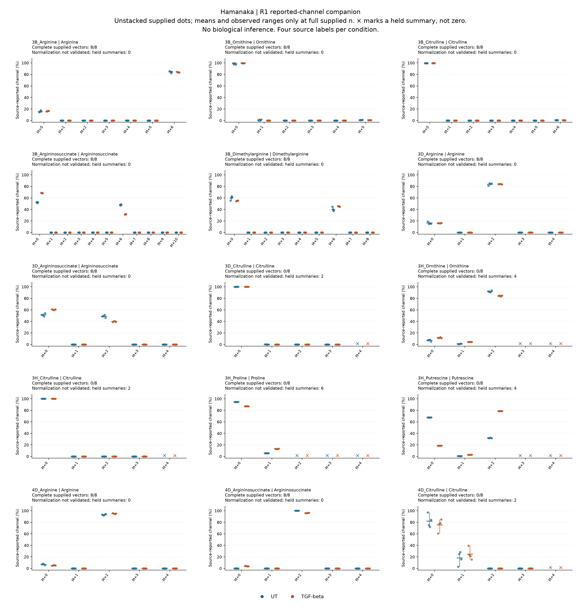
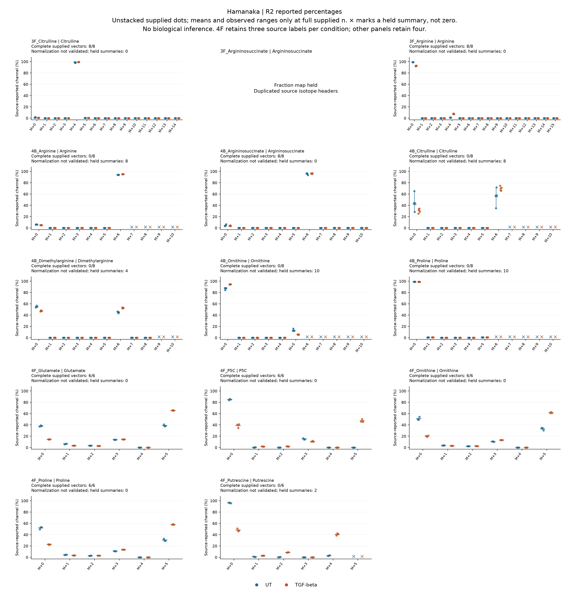
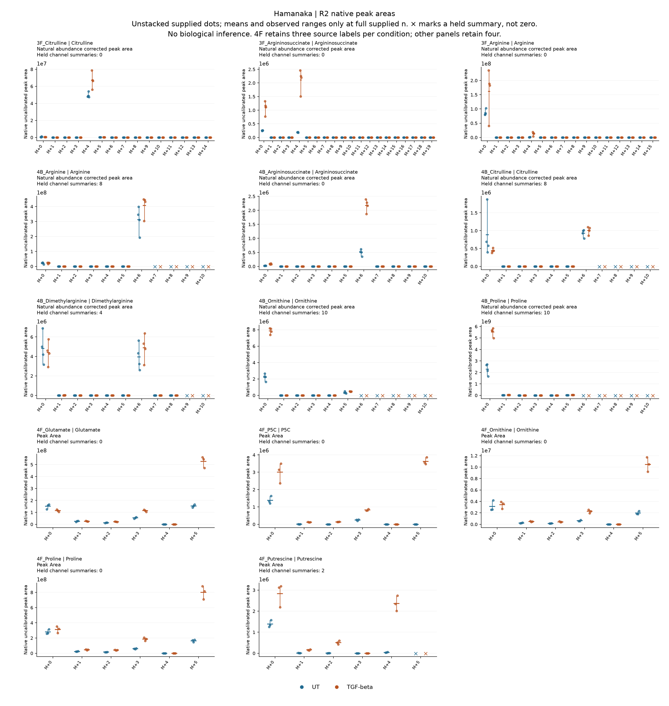

# T1-B: reported channels, separate vector diagnostics

31 October 2026, Asia/Seoul. **The authorized R1 companion and R2 descriptions
are executed and independently verified; T1-B awaits reviewer inspection.**
This does not declare the whole follow-up scope finished. The scope authority
is [REVIEW_T1A](REVIEW_T1A.md), adopted at
`2a0f32c32cd180bc6e58c252ff0531dd00a8252a`.

## Endpoint amendment and evidence lineage

Owner **Wg-P06**, supporting substrate balance and its routing/signaling arm.
The question here is what individual isotope channels the deposited fibroblast
source supplies. The endpoint is a **literal source-reported channel
percentage**, not validated normalized composition. R2 also describes native
peak areas. The biological unit remains a supplied sample string: four per
condition, except three in 4F. Donor/preparation identity, independence and
pairing remain unknown. Source mapping errors and conflating channel observation
with vector completeness/normalization are the principal validity threats.

The primary source remains [Hamanaka 2025](https://doi.org/10.1042/BCJ20253033),
Figs. 3–4 and S4/S5, and the same
[Figshare workbook v1](https://doi.org/10.6084/m9.figshare.28087574.v1), SHA-256
`d8d3365b226323d3ebe7300c481625049ae1cae3f78948938956240b8ea79f4f`.
[T0](T0_RESULTS.md) records publication/version and assay qualification.
Published outcomes and every T1-A result were already exposed. R2 headers and
sample maps were exposed; its numerical extraction followed the new freeze.
These are calculations on one source lineage, not independent replication.

The original [T1-A contract](config/t1a_r1_contract_v1.json), **95 held
summaries and 59 held vectors remain unchanged**. The reviewer authorized a
different channel endpoint because explicit percentage headers survive failure
of a complete-vector test. A missing neighbor does not erase a supplied target
channel. The [R1 amendment](config/t1b_r1_contract_v1.json) supersedes only the
restriction on describing valid channels under that narrower endpoint; it does
not supersede or validate the original failed vector diagnostics.

Both numerical contracts/code/specifications were frozen at
`53a5f8f3cee36ed67eb87afdbf53017324ee6c74` before extraction. Every isotope,
unit and sample header matched. Percentages must be finite numeric values in
[0,100], areas finite and nonnegative; formulas are not used as observations.
Each summary requires all supplied target-channel values and exact source maps.
Missing/invalid target values hold that summary with its full supplied n retained.
No clipping, filling, inferred detection limit, decimal-precision inference,
rescaling, renormalization, paired effects, p-values or donor confidence intervals.

## R1: 15 percentage blocks, no area or B1 rerun

[Exact map](config/t1b_r1_spec_v1.json) ·
[receipt](../../analysis/research/runs/Wg_P06_followup_t1b_r1_v1/receipt.json).
Unit provenance is literal: 3B K2/J13/K24/O35/M46, and 3D/3H/4D J1.
The singular/plural `percentage`/`percentages` source wording is preserved.

| Item | Outcome |
| --- | --- |
| Literal percentage cells | 720 retained: 640 valid, 80 missing |
| Channel summaries | 160 qualified; 20 held; four supplied labels each |
| Descriptive TGF-minus-UT differences | 80 qualified; 10 held; percentage points |
| Vector completeness | 72 complete supplied vectors; 48 incomplete |
| Fixed closure diagnostic | 61 complete vectors close; 11 fail; 48 incomplete vectors are not tested |

There are no negative, out-of-domain, nonfinite, nonnumeric or formula values
in these ranges. All 20 channel-summary holds arise from missing target cells:
3D citrulline M+4; 3H ornithine M+3–4, citrulline M+4, proline M+2–4 and
putrescine M+3–4; 4D citrulline M+4, each in both conditions.

For a concrete distinction, 3H proline M+0 is fully supplied at J23:J26 (UT)
and J27:J30 (TGF-beta), with means 94.4758% and 86.9679%. Missing M+2–4
keeps every corresponding vector incomplete, while these four-label M+0
descriptions qualify. In 4D arginine, M+0 means are 6.8742% and 5.0101%; all
eight complete vectors still fail the original closure rule. Neither example
establishes normalization, flux, route necessity or collagen incorporation.

The new QC keeps complete sums and residuals separate from explicitly labelled
incomplete valid-channel subtotals. It retains every original v1 diagnostic
record unchanged, plus its original path/hash. The same fixed
`64 × channel_count × binary64_ulp(100)` tolerance is used diagnostically;
none of the eleven failures was relaxed or repaired. Passing that arithmetic
check also does not independently validate biological normalization.

[Source cells](../../analysis/research/runs/Wg_P06_followup_t1b_r1_v1/source_values.csv) ·
[unit/header/sample map](../../analysis/research/runs/Wg_P06_followup_t1b_r1_v1/unit_and_header_map.csv) ·
[vector QC and unchanged v1 records](../../analysis/research/runs/Wg_P06_followup_t1b_r1_v1/vector_qc.csv) ·
[all summaries](../../analysis/research/runs/Wg_P06_followup_t1b_r1_v1/summaries.csv) ·
[all descriptive differences](../../analysis/research/runs/Wg_P06_followup_t1b_r1_v1/descriptive_differences.csv).

[R1 vector PDF](../../analysis/research/runs/Wg_P06_followup_t1b_figures_v2/r1_reported_percent_channels_v2.pdf).
Unstacked dots are supplied valid observations. Means/ranges require full n;
crosses denote held summaries, not zeros. The endpoint difference makes 55
additional channel summaries describable relative to v1's 105 qualified
fraction summaries; it does not alter v1's findings or recover missing values.

## R2: exact reviewed 14 area and 13 percentage blocks

[Contract](config/t1b_r2_contract_v1.json) · [exact map](config/t1b_r2_spec_v1.json) ·
[receipt](../../analysis/research/runs/Wg_P06_followup_t1b_r2_v1/receipt.json).
The frozen [design record](R2_DESIGN.md) remains the original proposal;
[REVIEW_T1A](REVIEW_T1A.md) supplies subsequent execution authority.

| Endpoint | Literal cells | Valid / missing | Qualified / held summaries | Qualified / held descriptive differences |
| --- | ---: | ---: | ---: | ---: |
| Native area | 1,116 | 950 / 166 | 252 / 42 | 126 / 21 |
| Reported percentage | 956 | 790 / 166 | 212 / 42 | 106 / 21 |

All 2,072 whitelisted cells and all 548 summaries remain in the outputs.
The only invalid cells are the 332 missing cells. Missing target channels are
4B arginine/citrulline M+7–10, dimethylarginine M+9–10,
ornithine/proline M+6–10, and 4F putrescine M+5, for both area and percentage.
No absent higher channel was declared a structural zero. Of 94 percentage
vectors, 48 are complete and close under the unchanged diagnostic; 46 remain
incomplete with no complete sum or closure test reported.

All 3F argininosuccinate percentages remain excluded for duplicate headers;
its independently clear area channels are described. **All 4B putrescine is
held**, without source-value extraction or header repair. These mapping holds
are separate from the 84 missing-target summary holds in the eligible ranges.

4F retains exactly three supplied observations per condition. Its unit headers
are `Peak Area` and `Percent`, without an explicit corrected label. The general
Methods correction statement is separate. Published n=4/SEM versus S5 n=4/SD,
and 3F's D4 sample/panel versus 13C5 Methods tracer wording, remain unresolved.
No fourth label, published uncertainty convention or biochemical repair was
invented. Native area scales are not compared across metabolites.

As source-description examples, 4F proline M+5 means are 30.4226% UT and
57.8802% TGF-beta (three labels each). The UT P5C M+5 entries are literal
zeros, while TGF-beta has a mean of 47.2092%. A deposited zero is not proof
of absence or a detection-limit estimate. Neither contrast establishes an
ARG1 source effect, source-to-recipient transfer, kinetic flux or mature repair.
All other channels, including low values and holds, are retained in the tables
and figures; these examples are not a significance-based selection.

[Source cells](../../analysis/research/runs/Wg_P06_followup_t1b_r2_v1/source_values.csv) ·
[unit/header/sample map](../../analysis/research/runs/Wg_P06_followup_t1b_r2_v1/unit_and_header_map.csv) ·
[vector QC](../../analysis/research/runs/Wg_P06_followup_t1b_r2_v1/vector_qc.csv) ·
[all summaries](../../analysis/research/runs/Wg_P06_followup_t1b_r2_v1/summaries.csv) ·
[all descriptive differences](../../analysis/research/runs/Wg_P06_followup_t1b_r2_v1/descriptive_differences.csv).

[R2 percentage PDF](../../analysis/research/runs/Wg_P06_followup_t1b_figures_v2/r2_reported_percent_channels_v2.pdf).

[R2 area PDF](../../analysis/research/runs/Wg_P06_followup_t1b_figures_v2/r2_native_area_channels_v2.pdf).

## Verification, presentation correction and stop

[Independent verification](T1B_VERIFICATION.md) passed 17,841 checks, including
source units/headers, target-channel domains, full supplied n, arithmetic,
separate incomplete subtotals and every unchanged original R1 diagnostic.
Fifteen new endpoint boundary checks passed before the numerical freeze.

Initial figure QA found crowded R2 titles and last-channel held markers.
The original numerical runs and figures were preserved. A
[presentation-only amendment](config/t1b_figures_contract_v2.json), frozen at
`a89b42c3b3c6a66adb71a327d3dea94e0d77b32e`, generated the linked v2 figures
from verified tables; it did not reread the workbook or recompute estimates.
[Receipt](../../analysis/research/runs/Wg_P06_followup_t1b_figures_v2/receipt.json) and
[manifest](../../analysis/research/runs/Wg_P06_followup_t1b_figures_v2/figure_manifest.json)
identify each superseded figure and unchanged source-table hashes. The corrected
PDF renders have readable separated labels, legends and padded held markers.

The [combined follow-up disposition](FOLLOWUP_DISPOSITION_T1B.md) distinguishes
completed source/design work from precise empirical holds. Stop here for
reviewer inspection; no whole-scope closeout or scientific acceptance is claimed.
