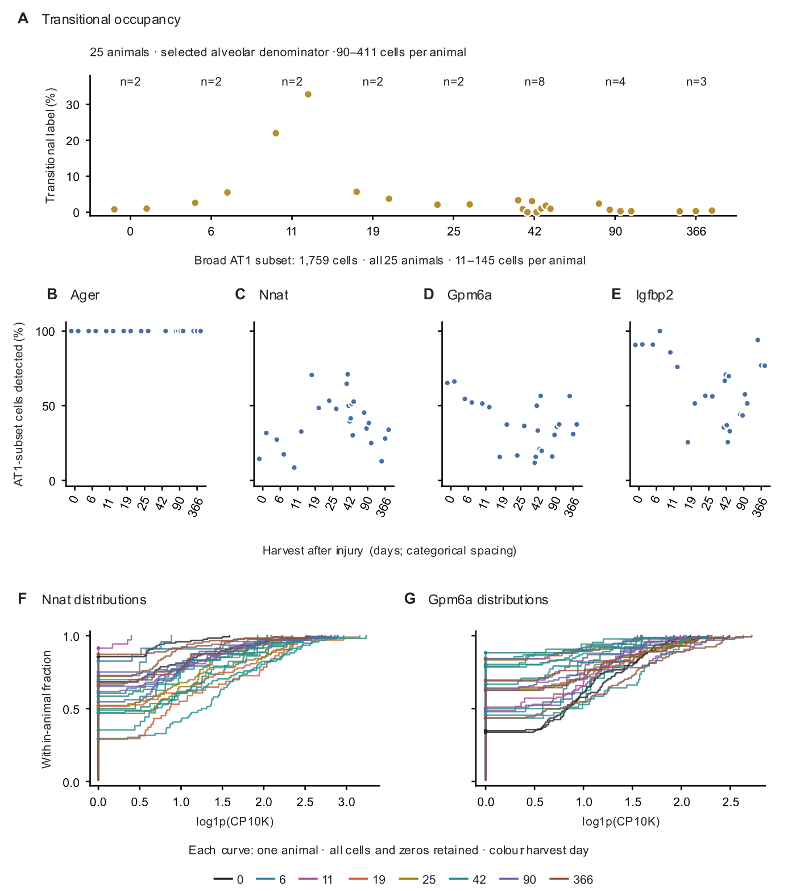

# Approved figure displays — 13 November 2026

These figures preserve approved public-data displays prepared for a research portfolio. They reuse the linked article analyses; they are not independent replication or new scientific acceptance. Numerical results and historical figures are unchanged.

[Article home](../README.md) · [Archive overview](../../../docs/PORTFOLIO_FIGURE_ARCHIVE_20261113.md)

G-SURF microscopy and personal outreach documents are deliberately excluded.

## Niethamer

Figure 4. Transitional occupancy and AT1 RNA distributions. (A) Transitional labels among 5,694 selected alveolar cells; each point is one animal. (B-E) Raw-count detection above zero for four genes within broad AT1-labeled cells, retaining all 25 animals. (F-G) Empirical cumulative distributions for Nnat and Gpm6a; one curve per animal, colored by harvest. Expression is log1p(count × 10,000 / total cell UMI), including zeros. The two distribution plots were selected after inspecting the results.

[PNG](../../../analysis/research/runs/portfolio_nabhan_figures_20261113_v1/niethamer.png) · [Provenance](../../../analysis/research/runs/portfolio_nabhan_figures_20261113_v1/manifest.json)
