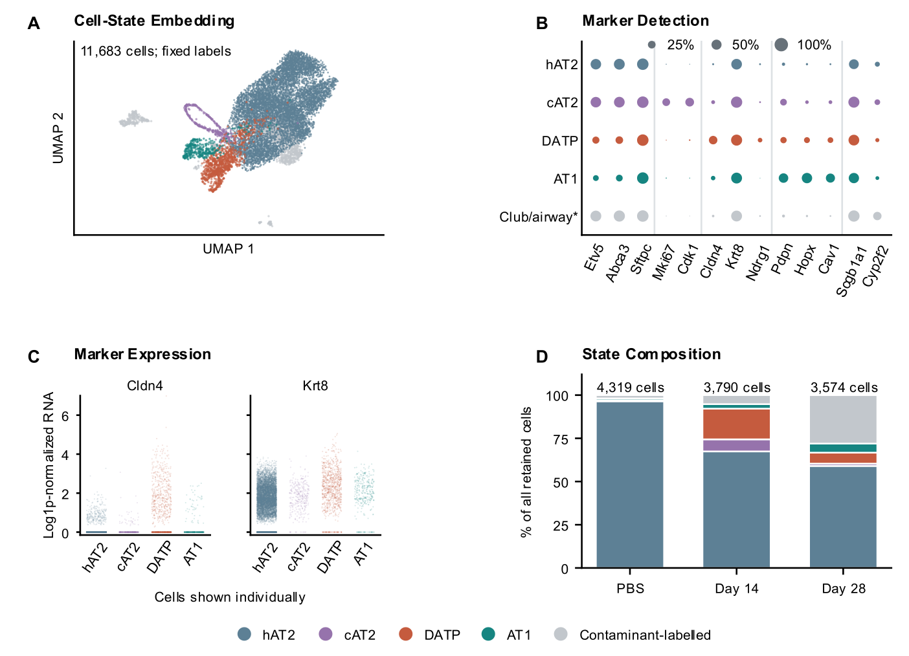

# Approved figure displays — 13 November 2026

These figures preserve approved public-data displays prepared for a research portfolio. They reuse the linked article analyses; they are not independent replication or new scientific acceptance. Numerical results and historical figures are unchanged.

[Article home](../README.md) · [Archive overview](../../../docs/PORTFOLIO_FIGURE_ARCHIVE_20261113.md)

G-SURF microscopy and personal outreach documents are deliberately excluded.

## Choi

Figure 3. Epithelial annotations and RNA markers. (A) UMAP of 11,683 retained cells. (B) Dot area indicates gene detection within annotations. (C) Expression in 10,399 cells from four alveolar-labeled groups, normalized to 10,000 counts and log1p-transformed, including zeros. (D) Fractions among all retained cells. hAT2, AT2-like; cAT2, cycling AT2; DATP, damage-associated transient progenitor. Club/airway* is an exclusion annotation.

[PNG](../../../analysis/research/runs/portfolio_nabhan_figures_20261113_v1/choi.png) · [Provenance](../../../analysis/research/runs/portfolio_nabhan_figures_20261113_v1/manifest.json)
