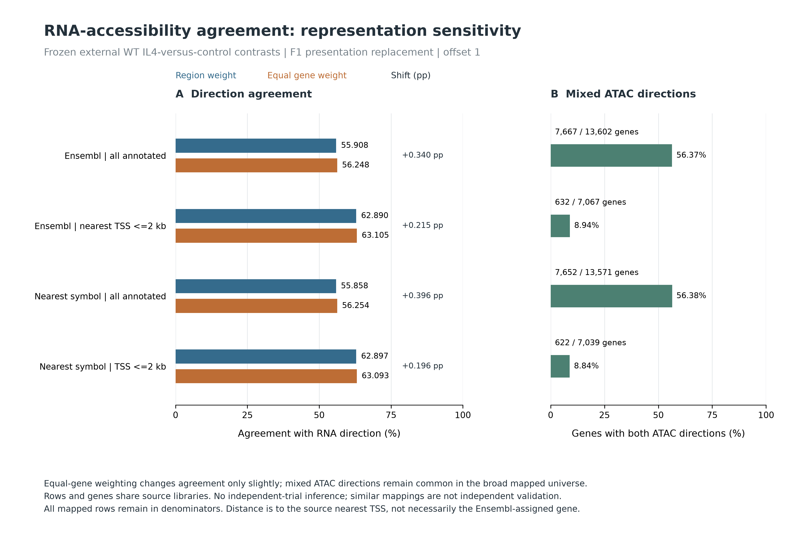
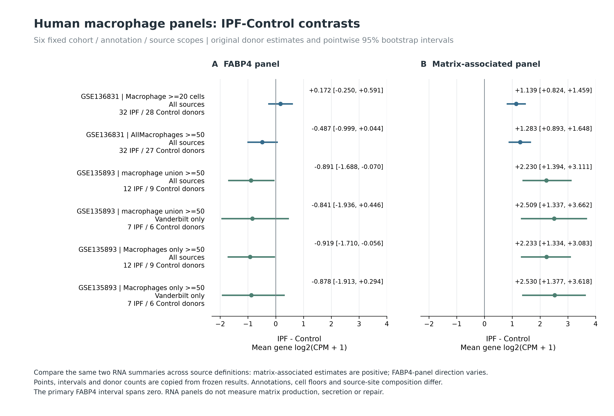
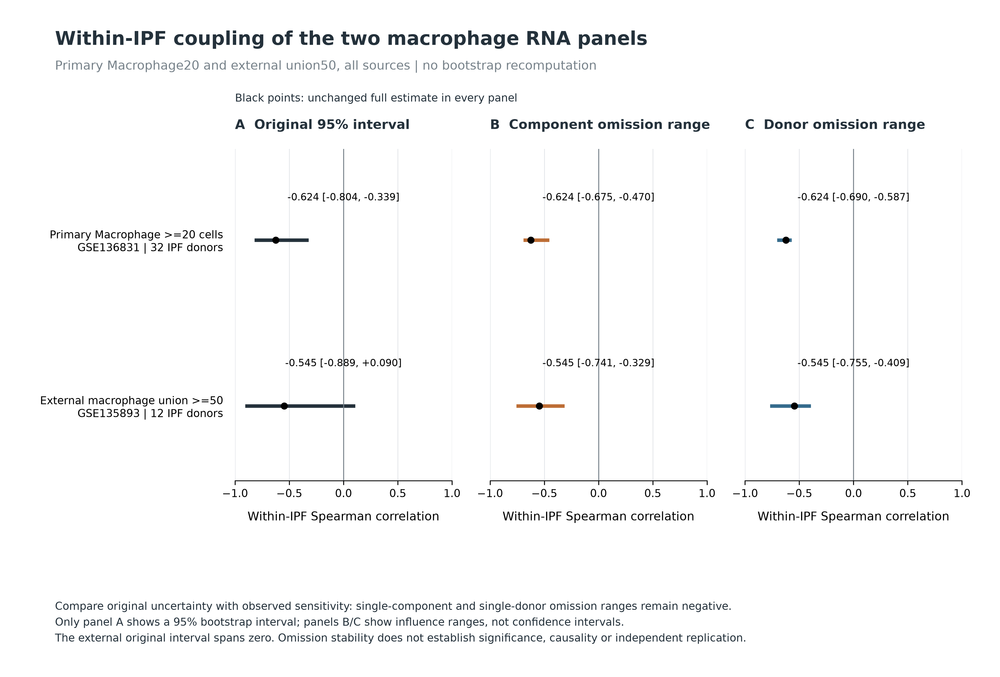
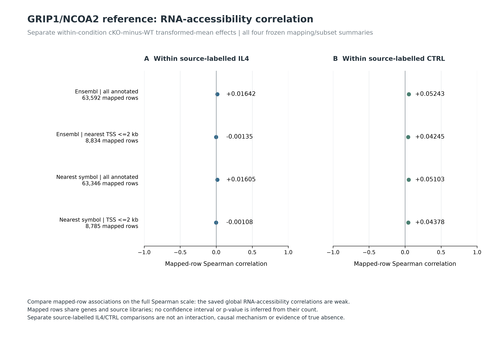

# DY1 figure gallery

Figures prepared and reviewed 30 October 2026; integrated 31 October 2026.
Figures from the reviewed article-local analyses, organized by
question. The source paper concerns N. brasiliensis-associated type-2 immune
history, separate baseline bulk RNA/ATAC preparations and a later IAV challenge.
The human and external reference figures below answer narrower measurement or
descriptive questions; they do not reproduce that entire design.

[Study overview](README.md) ·
[Analysis inventory and implications](ANALYSIS_INVENTORY_AND_SYNTHESIS_2026-10-30.md) ·
[DY1-P02 question and completion ledger](rq_discordance/README.md) ·
[Specific source/design holds](JOB_ASSESSMENT_2026-10-30.md)

## Reading the gallery

The existing inventory contains **10 original PNG figures**. All ten have
executed-run receipts and matching current output hashes. Technical checks and
figure readability do not confer human scientific acceptance.

Four new presentation plates use the saved, reviewed F1/F2/F4 tables: a clearer
F1 representation plot plus three additional summaries. The current gallery
therefore displays **13 plates**, preserving the crowded original F1 as a linked
historical asset (14 PNG assets across editions). No biological model,
bootstrap interval, omission analysis or correlation is recomputed to create
these presentation derivatives.

Each entry states its measured unit, finding and limit. Original PNGs keep their
original resolution. Only the four new plates have 300-dpi PNG, vector SVG and PDF
exports, together with a four-page PDF bundle. The saved source data and receipt
are linked with every figure; uncertainty intervals and omission ranges are
explicitly different quantities.

| Question | Current figures | Evidence boundary |
|---|---|---|
| What is technically visible in the deposited baseline files? | 1 | Six-library exon-bin diagnostic; biological pool/animal map unresolved |
| What human RNA and captured-composition patterns are observed? | 2–4 | Donor descriptions; annotations and disease/site composition differ |
| How do cross-assay direction and detection summaries behave? | 5–8 | External reference and synthetic diagnostics; dependent mappings and assay uncertainty |
| What does the external cofactor comparison show? | 9, 13 | GRIP1/NCOA2 cKO-minus-WT within each condition; no interaction or NAM mechanism |
| Which human findings depend on scope or panel components? | 10–12 | Fixed panels, donor-level contrasts/correlations and saved sensitivities |

Human panels are means of per-gene log2(CPM + 1): FABP4-associated =
ATP10A, FABP4, SERPING1 and SVIL; matrix-associated = MMP9, LGMN, PLA2G7
and RGS1. These names describe measured RNA panels, not validated functional
states. IPF denotes idiopathic pulmonary fibrosis.

[Download the four new plates as one PDF](../../analysis/research/runs/DY1_presentation_figures_v1/DY1_presentation_plates_v1.pdf) ·
[Render record](../../analysis/research/runs/DY1_presentation_figures_v1/render_record.json) ·
[Value/label verification](../../analysis/research/runs/DY1_presentation_figures_v1/data_label_verification.json) ·
[Export inventory](../../analysis/research/runs/DY1_presentation_figures_v1/render_inventory.tsv) ·
[Rendering and independent review](FIGURE_REVIEW_2026-10-30.md)

## Figure 1. Six-library exon-bin profile

**DY1-P01 · baseline diagnostic.** Unit: Six deposited libraries; animal/pool independence unresolved.

PC1 and PC2 describe 31.3% and 24.5% of variance after the fixed logCPM transformation. This checks the deposited exon-bin profile.

**Limit:** This adapted full-SVD diagnostic is not the author's gene-count/VST PCA. Separation does not establish a history effect, and no library was removed.

[PNG](../../analysis/research/runs/DY1_baseline_exon_profile_v1/sample_profile.png) · [sample_coordinates.tsv](../../analysis/research/runs/DY1_baseline_exon_profile_v1/sample_coordinates.tsv) · [variance.tsv](../../analysis/research/runs/DY1_baseline_exon_profile_v1/variance.tsv) ·
[Code](scripts/baseline_exon_profile_v1.py) · [Receipt](../../analysis/research/runs/DY1_baseline_exon_profile_v1/receipt.json)

## Figure 2. Primary human atlas: captured fractions and RNA panels

**DY1-P01 · human description.** Unit: Donor; primary Macrophage RNA floor 20 retains 28 controls, 32 IPF and 17 COPD donors.

Captured macrophage fractions and the RNA-panel relation differ across disease groups and annotation choices. Points are donors; black bars in the fraction panels mark medians.

**Limit:** Captured fractions are not absolute tissue abundance. The deposited labels and proxy subset do not identify validated human NAMs; panel RNA is not pathway activity.

[PNG](../../analysis/research/runs/DY1_human_observational_v1/human_overview.png) · [donor_abundance.tsv](../../analysis/research/runs/DY1_human_observational_v1/donor_abundance.tsv) · [contrasts.tsv](../../analysis/research/runs/DY1_human_observational_v1/contrasts.tsv) ·
[Code](scripts/human_observational_v1.py) · [Receipt](../../analysis/research/runs/DY1_human_observational_v1/receipt.json)

## Figure 3. Primary human atlas: pooled and within-disease associations

**DY1-P01 · human description.** Unit: Same-donor associations; eligible donor n is printed in each cell.

Macrophage matrix-panel versus fibroblast matrix-panel correlation is about +0.49 pooled, but −0.07 within IPF. The comparison illustrates the influence of disease grouping.

**Limit:** These are exposed correlations of RNA/captured fractions, with held sparse or constant comparisons. They do not establish macrophage-to-epithelium signaling, direction or repair.

[PNG](../../analysis/research/runs/DY1_human_observational_v1/human_associations.png) · [associations.tsv](../../analysis/research/runs/DY1_human_observational_v1/associations.tsv) · [donor_context.tsv](../../analysis/research/runs/DY1_human_observational_v1/donor_context.tsv) ·
[Code](scripts/human_observational_v1.py) · [Receipt](../../analysis/research/runs/DY1_human_observational_v1/receipt.json)

## Figure 4. External human atlas: annotation-specific RNA context

**DY1-P01 · external human description.** Unit: 21 donors: 12 IPF and 9 controls; deposited macrophage union, floor 50.

The matrix-associated panel is higher and the FABP4-associated panel lower in IPF in this scope; ARG1 RNA is sparse. Black bars mark group means.

**Limit:** Annotations and source-site composition differ from the primary atlas. This is external human context, not replication of the mouse mechanism or evidence for ARG1 enzyme activity.

[PNG](../../analysis/research/runs/DY1_external_human_observational_v1/external_overview.png) · [donor_expression.tsv](../../analysis/research/runs/DY1_external_human_observational_v1/donor_expression.tsv) · [contrasts.tsv](../../analysis/research/runs/DY1_external_human_observational_v1/contrasts.tsv) ·
[Code](scripts/external_human_observational_v1.py) · [Receipt](../../analysis/research/runs/DY1_external_human_observational_v1/receipt.json)

## Figure 5. WT reference: RNA and ATAC directions under alternative mappings

**DY1-P02 · E2 external benchmark.** Unit: Mapped gene–region rows, with repeated genes; RNA 3 and ATAC 4 source libraries per group.

At offset 1, same-direction fractions are approximately 55.9% across all annotated rows and 62.9% within 2 kb of the source nearest TSS. Roughly 6% have both conditional envelopes excluding zero.

**Limit:** Separate WT IL4-versus-vehicle assays; no established assay pairing. The envelopes are design-conditional sensitivities, not population CIs. Dependent rows are not biological replicates, and this is not the NAM source.

[PNG](../../analysis/research/runs/DY1_P02_reference_benchmark_v1/reference_benchmark.png) · [mapping_sensitivity.tsv](../../analysis/research/runs/DY1_P02_reference_benchmark_v1/mapping_sensitivity.tsv) · [feature_eligibility.tsv](../../analysis/research/runs/DY1_P02_reference_benchmark_v1/feature_eligibility.tsv) ·
[Code](rq_discordance/scripts/reference_benchmark_v1.py) · [Receipt](../../analysis/research/runs/DY1_P02_reference_benchmark_v1/receipt.json)

## Figure 6. Synthetic diagnostic: detection mismatch can arise from precision

**DY1-P02 · E3 synthetic diagnostic.** Unit: 200,000 simulated draws per fixed independent-normal scenario; no biological samples.

Equal nonzero truths yield about 50.1% detection-label mismatch at equal precision and 83.0% at unequal precision in the specified scenarios.

**Limit:** An illustration of threshold behavior, not calibration to NAM data. RNA and ATAC measurement scales are not equated; no biological equivalence margin or mechanistic conclusion is supplied.

[PNG](../../analysis/research/runs/DY1_P02_synthetic_uncertainty_v1/synthetic_diagnostic.png) · [scenario_summary.tsv](../../analysis/research/runs/DY1_P02_synthetic_uncertainty_v1/scenario_summary.tsv) · [event_frequencies.tsv](../../analysis/research/runs/DY1_P02_synthetic_uncertainty_v1/event_frequencies.tsv) ·
[Code](rq_discordance/scripts/synthetic_uncertainty_v1.py) · [Receipt](../../analysis/research/runs/DY1_P02_synthetic_uncertainty_v1/receipt.json)

## Figure 7. RNA-only reference: first and second source-defined stages

**DY1-P02 · E6 source-average description.** Unit: 16,253 nonzero-WT source feature rows; deposited group-average CPM values.

The plot compares separate first- and second-stage source-average log ratios at offsets 1 and 0.5. Hexagon color counts feature rows, and the diagonal marks equal displayed ratios.

**Limit:** Group averages supply no replicate variance, confidence interval or tracked-cell trajectory. There is no matched ATAC comparison or causal interaction estimate.

[PNG](../../analysis/research/runs/DY1_P02_source_average_response_v1/source_average_response.png) · [offset_sensitivity.tsv](../../analysis/research/runs/DY1_P02_source_average_response_v1/offset_sensitivity.tsv) ·
[Code](rq_discordance/scripts/source_average_response_v1.py) · [Receipt](../../analysis/research/runs/DY1_P02_source_average_response_v1/receipt.json)

## Figure 8. Representation sensitivity: weighting shifts are small

**DY1-P02 · F1 presentation replacement.** Unit: Dependent gene–region rows and genes from the same external WT libraries.

Across the four fixed mapping/subset summaries, equal-gene weighting changes the same-direction fraction by +0.196 to +0.396 percentage points. In the broad mappings, about 56% of genes have both positive and negative mapped ATAC directions.

**Limit:** This addresses the tested weighting choice, not every representation bias. Common-support annotations largely coincide, and the source nearest-TSS distance need not be the distance to the Ensembl-assigned gene. No independent trials or 50% null are inferred.

[PNG, 300 dpi](../../analysis/research/runs/DY1_presentation_figures_v1/01_representation_weighting_v1.png) · [SVG](../../analysis/research/runs/DY1_presentation_figures_v1/01_representation_weighting_v1.svg) · [PDF](../../analysis/research/runs/DY1_presentation_figures_v1/01_representation_weighting_v1.pdf) ·
[weighting_summary.tsv](../../analysis/research/runs/DY1_P02_representation_audit_v1/weighting_summary.tsv) ·
[Rendering code](scripts/presentation_figures_v1.py) · [Render receipt](../../analysis/research/runs/DY1_presentation_figures_v1/receipt.json)

## Figure 9. GRIP1/NCOA2 cofactor reference: direction agreement across conditions

**DY1-P02 · F4 external cofactor reference.** Unit: Dependent mapped rows; RNA cKO IL4 n=3 versus CTRL n=4; WT RNA n=3 and ATAC n=4 per group.

Same-direction fractions are roughly 48.3–48.6% in IL4 and 50.2–50.6% in CTRL for separate cKO-minus-WT comparisons; weighting and conditional-envelope summaries are retained.

**Limit:** These are separate within-condition contrasts, not a genotype-by-condition interaction. The source cofactor model is not the NAM regulatory mechanism; neither about-50% agreement nor small correlations establish decoupling.

[PNG](../../analysis/research/runs/DY1_P02_genotype_reference_v1/genotype_reference.png) · [mapping_summary.tsv](../../analysis/research/runs/DY1_P02_genotype_reference_v1/mapping_summary.tsv) · [selected_source_samples.tsv](../../analysis/research/runs/DY1_P02_genotype_reference_v1/selected_source_samples.tsv) ·
[Code](rq_discordance/scripts/genotype_reference_v1.py) · [Receipt](../../analysis/research/runs/DY1_P02_genotype_reference_v1/receipt.json)

## Figure 10. Human-panel robustness: component omissions can change the summary

**DY1-P01 · F2 human robustness.** Unit: Donor pseudobulk; fixed four-component RNA panels, one component omitted at a time.

Primary Macrophage FABP4-panel IPF-minus-control contrast changes sign after one component omission. The primary matrix-panel contrast remains positive under the saved single-component and single-donor checks.

**Limit:** Omission ranges are dependent sensitivity summaries, not confidence intervals or independent replications. Full panels and all unfavorable results are retained; no donor or gene is removed from the original analysis.

[PNG](../../analysis/research/runs/DY1_human_panel_robustness_v1/human_panel_robustness.png) · [full_estimates.tsv](../../analysis/research/runs/DY1_human_panel_robustness_v1/full_estimates.tsv) · [robustness_summary.tsv](../../analysis/research/runs/DY1_human_panel_robustness_v1/robustness_summary.tsv) · [all_omissions.tsv](../../analysis/research/runs/DY1_human_panel_robustness_v1/all_omissions.tsv) ·
[Code](rq_discordance/scripts/human_panel_robustness_v1.py) · [Receipt](../../analysis/research/runs/DY1_human_panel_robustness_v1/receipt.json)

## Figure 11. Human contrasts across all six fixed scopes

**DY1-P01 evidence · new presentation.** Unit: Donor; displayed n, annotation, cell floor and source site remain specific to each row.

Both fixed panels are shown for all six cohort/annotation/site scopes, with the original pointwise 95% bootstrap intervals. Matrix-associated estimates are positive across these scopes; FABP4-panel direction depends on scope. The primary Macrophage20 FABP4 contrast is +0.172 with its interval spanning zero.

**Limit:** Scopes overlap within cohorts and are not six independent replications. Different annotations, cell floors and source-site composition complicate transport of the RNA-panel contrast. This figure copies existing intervals; it adds no new inference.

[PNG, 300 dpi](../../analysis/research/runs/DY1_presentation_figures_v1/02_human_contrasts_v1.png) · [SVG](../../analysis/research/runs/DY1_presentation_figures_v1/02_human_contrasts_v1.svg) · [PDF](../../analysis/research/runs/DY1_presentation_figures_v1/02_human_contrasts_v1.pdf) ·
[full_estimates.tsv](../../analysis/research/runs/DY1_human_panel_robustness_v1/full_estimates.tsv) ·
[Rendering code](scripts/presentation_figures_v1.py) · [Render receipt](../../analysis/research/runs/DY1_presentation_figures_v1/receipt.json)

## Figure 12. Within-IPF panel coupling: intervals and omission ranges answer different questions

**DY1-P01 evidence · new presentation.** Unit: 32 primary and 12 external IPF donors in the displayed populations, all sources.

Full panel correlations are −0.624 in primary Macrophage20 and −0.545 in external union50. The primary original interval is negative; the external interval spans zero. Single-component and single-donor omission ranges remain negative in both displayed populations.

**Limit:** Only panel A shows the original 95% bootstrap intervals. Panels B/C are observed sensitivity ranges, not confidence intervals. Negative omission ranges do not override the external sampling uncertainty, establish causality, or create independent replication.

[PNG, 300 dpi](../../analysis/research/runs/DY1_presentation_figures_v1/03_human_coupling_v1.png) · [SVG](../../analysis/research/runs/DY1_presentation_figures_v1/03_human_coupling_v1.svg) · [PDF](../../analysis/research/runs/DY1_presentation_figures_v1/03_human_coupling_v1.pdf) ·
[full_estimates.tsv](../../analysis/research/runs/DY1_human_panel_robustness_v1/full_estimates.tsv) · [robustness_summary.tsv](../../analysis/research/runs/DY1_human_panel_robustness_v1/robustness_summary.tsv) ·
[Rendering code](scripts/presentation_figures_v1.py) · [Render receipt](../../analysis/research/runs/DY1_presentation_figures_v1/receipt.json)

## Figure 13. GRIP1/NCOA2 reference: small global correlations on the full scale

**DY1-P02 · F4 new presentation.** Unit: Dependent mapped gene–region rows; separate source-labelled IL4 and CTRL cKO-minus-WT contrasts.

The four frozen mapping/subset correlations per condition are displayed on the full −1 to +1 Spearman scale. Broad Ensembl estimates are +0.01642 under IL4 and +0.05243 under CTRL; the precise values remain visible despite their small size.

**Limit:** No p-value or interval is inferred from the mapped-row count. Small global associations do not prove absence of selected regulatory relationships, identify a temporal relay, or establish a NAM mechanism. These are not genotype-by-condition interactions.

[PNG, 300 dpi](../../analysis/research/runs/DY1_presentation_figures_v1/04_cofactor_correlations_v1.png) · [SVG](../../analysis/research/runs/DY1_presentation_figures_v1/04_cofactor_correlations_v1.svg) · [PDF](../../analysis/research/runs/DY1_presentation_figures_v1/04_cofactor_correlations_v1.pdf) ·
[mapping_summary.tsv](../../analysis/research/runs/DY1_P02_genotype_reference_v1/mapping_summary.tsv) ·
[Rendering code](scripts/presentation_figures_v1.py) · [Render receipt](../../analysis/research/runs/DY1_presentation_figures_v1/receipt.json)
## Original inventory and version preservation

All ten original PNGs remain at their frozen paths. The table below distinguishes
a presentation replacement from a change in the scientific result.

| Original file | Analysis | Current use |
|---|---|---|
| [sample_profile.png](../../analysis/research/runs/DY1_baseline_exon_profile_v1/sample_profile.png) | DY1-P01 · baseline diagnostic | Figure 1 |
| [human_overview.png](../../analysis/research/runs/DY1_human_observational_v1/human_overview.png) | DY1-P01 · human description | Figure 2 |
| [human_associations.png](../../analysis/research/runs/DY1_human_observational_v1/human_associations.png) | DY1-P01 · human description | Figure 3 |
| [external_overview.png](../../analysis/research/runs/DY1_external_human_observational_v1/external_overview.png) | DY1-P01 · external human description | Figure 4 |
| [reference_benchmark.png](../../analysis/research/runs/DY1_P02_reference_benchmark_v1/reference_benchmark.png) | DY1-P02 · E2 external benchmark | Figure 5 |
| [synthetic_diagnostic.png](../../analysis/research/runs/DY1_P02_synthetic_uncertainty_v1/synthetic_diagnostic.png) | DY1-P02 · E3 synthetic diagnostic | Figure 6 |
| [source_average_response.png](../../analysis/research/runs/DY1_P02_source_average_response_v1/source_average_response.png) | DY1-P02 · E6 source-average description | Figure 7 |
| [genotype_reference.png](../../analysis/research/runs/DY1_P02_genotype_reference_v1/genotype_reference.png) | DY1-P02 · F4 external cofactor reference | Figure 9 |
| [human_panel_robustness.png](../../analysis/research/runs/DY1_human_panel_robustness_v1/human_panel_robustness.png) | DY1-P01 · F2 human robustness | Figure 10 |
| [representation_audit.png](../../analysis/research/runs/DY1_P02_representation_audit_v1/representation_audit.png) | DY1-P02 · F1 representation | Historical crowded-label edition; Figure 8 is the presentation replacement |

The F1 [original data](../../analysis/research/runs/DY1_P02_representation_audit_v1/weighting_summary.tsv),
[code](rq_discordance/scripts/representation_audit_v1.py) and
[receipt](../../analysis/research/runs/DY1_P02_representation_audit_v1/receipt.json)
remain authoritative frozen evidence. The new presentation does not supersede
the original numerical analysis.

## What is not plotted

No original NAM gene/peak effect, within-state ATAC decomposition, regulatory
relay, ARG1 mediation, history-by-later-condition interaction, or epithelial
repair effect was estimated by these gallery additions. Their source/unit,
counting, state or linked-functional-data requirements remain in the
[completion ledger](README.md#completion-ledger). F3 has no numerical plot because
controlled-access files, paired barcodes and preparation identities remain
unqualified. This gallery adds no canonical RQ or human retain/reject decision.
