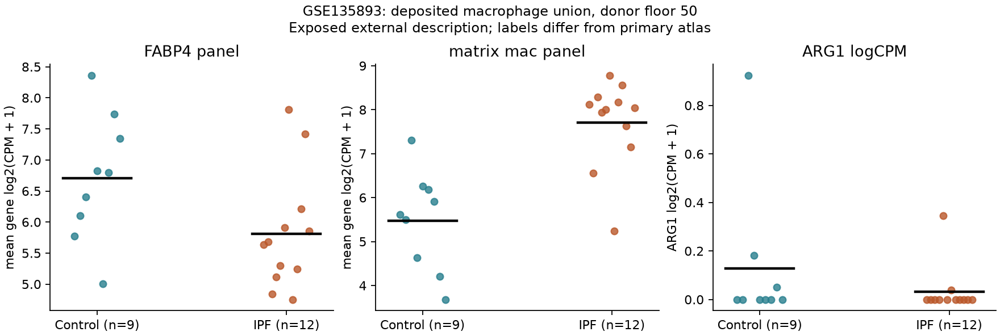

# External human RNA transport description

29 October 2026. DY1-P01; exposed descriptive analysis, not unexposed confirmation.
The [prospective plan](HUMAN_EXTERNAL_PLAN.md) and
[source discovery record](HUMAN_EXTERNAL_SOURCES.md) distinguish separate collection,
assay qualification, retained identity-marker holds and interpretation limits.

## Supported comparison

GSE135893 contains 30 annotated donors: 12 IPF, ten Control and eight other
fibrotic diagnoses. The inherited macrophage-compartment cache floor of 50 cells
retains 12 IPF and nine Control donors. Other diagnoses are not relabeled IPF.
The external union contains exact source labels Macrophages and Proliferating
Macrophages; Macrophages alone is a sensitivity. Counts and full-gene denominators
were summed before transformation. These labels are not NAM identities or exact
equivalents of the primary atlas's deposited Macrophage label.

All nine outcome genes map uniquely and match direct raw-assay aggregates.
The full 30-symbol requested set remains on hold because SELENOP has no
exact match; no alias or zero-expression substitution was made. Qualification
v1's failed historical-script check and its v2 correction remain preserved.

## Results

All numbers below are IPF minus Control differences in unweighted donor means.
Intervals are exploratory pointwise 95% donor-bootstrap intervals, not
multiplicity-controlled discoveries. The GSE136831 comparator is its previously
declared **AllMacrophages, floor 50 sensitivity**, not the primary Macrophage20.

| RNA endpoint | External union, 12/9 donors | External Vanderbilt-only, 7/6 | Primary-atlas union sensitivity, 32/27 |
|---|---:|---:|---:|
| FABP4 panel | −0.891 [−1.688, −0.069] | −0.841 [−1.936, +0.446] | −0.487 [−0.999, +0.044] |
| Matrix macrophage panel | +2.230 [+1.394, +3.111] | +2.509 [+1.337, +3.662] | +1.283 [+0.893, +1.648] |
| ARG1 log2(CPM+1) | −0.097 [−0.322, +0.052] | −0.033 [−0.094, +0.009] | −0.222 [−0.390, −0.061] |

The matrix-associated RNA contrast has the same direction in both source
collections and remains positive in the common-source sensitivity. Its magnitude
is source-dependent. External FABP4-panel means are lower in IPF, but the
Vanderbilt interval spans zero. This agrees directionally with the primary
atlas's broad union sensitivity while the fixed primary Macrophage20 contrast
was +0.172 [−0.250, +0.591]. Thus the work does not establish a universal
population-independent FABP4-panel difference.

With Proliferating Macrophages excluded, external mean differences are −0.919,
+2.233 and −0.018 for FABP4, matrix and ARG1, respectively. Vanderbilt-only
differences are −0.878, +2.530 and −0.036. Full intervals remain in the
[contrast table](../../analysis/research/runs/DY1_external_human_observational_v1/contrasts.tsv).
ARG1 remains sparse and imprecise; annotation dependence of a small RNA estimate
cannot establish enzyme activity or a functional contradiction.

Within IPF, external union FABP4-versus-matrix rho is −0.545
[−0.889, +0.090], n=12. Control rho is −0.533 [−0.852, +0.179], n=9.
Macrophages-only point estimates are identical, with their saved bootstrap
intervals also spanning zero. The within-IPF direction resembles the primary
atlas, but uncertainty is substantial; this is not confirmed causal antagonism.
All four Vanderbilt within-group correlations remain unestimated under the
fixed minimum of eight donors. The cached fibroblast support of seven IPF and
three Control likewise cannot support the planned within-disease recipient
correlation; no relaxed threshold or substitute pooled mechanism claim was used.

## What the external result adds

The external data support a bounded description of higher measured matrix-panel
RNA in IPF macrophage annotations and a directionally similar but imprecise
within-IPF panel correlation. They preserve the annotation sensitivity of the
FABP4 contrast and the weak ARG1 evidence. They do not validate NAM identity,
prove recipient coupling, measure secretion/activity or nominate a mechanism.

Source-site composition remains a material threat: IPF includes seven Vanderbilt
and five NTI donors; eligible Controls include six Vanderbilt and three DNA
source labels. Restriction to the shared source is informative but does not
remove all confounding. External age/sex and other clinical covariates are
unqualified, so no adjusted clinical conclusion is offered. The 43 orig.ident
metadata labels and 34 GEO records are not independent donor counts. The assay
checks establish correspondence to deposited raw RNA, not biological equivalence
between differently prepared/annotated atlases or absence of all scale effects.

Habermann's published separate-dataset statement supports a separate collection
from Adams; direct patient-identity auditing was unavailable. Existing Ravel
analyses exposed this cohort before the new freeze. GSE122960 remains a documented
discovery lead; it was not further fitted to rescue the present results.

Freeze: `d4ee3cb`. [Run receipt](../../analysis/research/runs/DY1_external_human_observational_v1/receipt.json) ·
[184 independent arithmetic checks](../../analysis/research/runs/DY1_external_human_observational_v1/verification.json) ·
[Donor/source coverage](../../analysis/research/runs/DY1_external_human_observational_v1/coverage.tsv) ·
[All correlations and holds](../../analysis/research/runs/DY1_external_human_observational_v1/associations.tsv) ·
[Cross-cohort table](../../analysis/research/runs/DY1_external_human_observational_v1/cross_cohort_description.tsv).
The figure was visually checked; all eight declared outputs are receipt-bound.
No scientific acceptance, canonical RQ, claim-grade promotion or publication was made.
