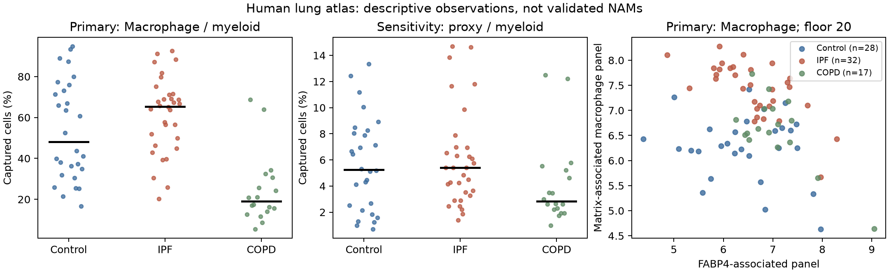
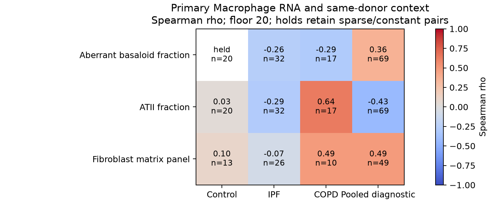

# Human atlas observations: DY1-P01

29 October 2026. Exposed, non-infectious human observational analysis. The
[prospective numerical plan](HUMAN_NUMERICAL_PLAN.md) fixes the measured endpoints,
population, donor floors and sensitivities. This completes the adapted GSE136831
human description; it does not reproduce the author's unavailable NAM reclustering
or limma-voom model, and does not complete the restricted original numerical stages.

## Question, units and measurements

Do deposited macrophage RNA panels differ between IPF, COPD and Control donors,
and do their same-donor associations with epithelial composition and fibroblast
RNA persist within disease groups? Disease mixture, population definition,
capture/depth and unmeasured clinical factors are the principal alternatives to
a biological source-to-recipient explanation.

The biological unit is the donor: 28 Control, 32 IPF and 18 COPD, with 107 nested
libraries. The fixed primary population is deposited **Macrophage**, requiring
20 cells per donor for expression. It retains 28/32/17 donors, respectively.
This label is not a verified anatomical or NAM identity. The 10/50-cell floors,
Macrophage_Alveolar, AllMacrophages union and three analyst marker-detection rules
remain sensitivities. No threshold was selected from the outcomes.

Each panel is the mean of its genes' log2(1 + counts per million **all-gene**
pseudobulk UMI). The FABP4 panel contains ATP10A, FABP4, SERPING1 and SVIL; the
matrix-associated macrophage panel contains MMP9, LGMN, PLA2G7 and RGS1. These
published lists were selected using this same atlas, so this is a source-adapted
description, not independent panel validation. The fibroblast panel, individual
paper-highlighted genes and disjoint identity markers are specified in the
[gene contract](config/human_panels_v1.json) and
[primary-source literature note](HUMAN_LITERATURE_CONTEXT.md).

## Disease contrasts

Differences are unweighted donor means, first group minus second. Intervals are
pointwise 95% donor-bootstrap intervals, with 2,000 resamples; they do not control
multiplicity. Age/recorded-sex OLS coefficients are descriptive sensitivities,
without intervals or a claim of complete confounder control.

| Primary RNA endpoint | IPF − Control (32/28 donors), interval | COPD − Control (17/28) | IPF − COPD (32/17) | Age/sex IPF − Control |
|---|---:|---:|---:|---:|
| FABP4 panel | +0.172 [−0.250, +0.591] | +0.624 | −0.452 | −0.266 |
| Matrix-associated macrophage panel | +1.139 [+0.824, +1.459] | +0.336 | +0.803 | +1.133 |
| ARG1 log2(CPM+1) | −0.250 [−0.451, −0.032] | −0.042 | −0.208 | −0.402 |

The matrix-associated RNA difference is positive across all prespecified
population/floor combinations. The FABP4-panel direction depends on annotation
and adjustment. Individual genes are not interchangeable with their panel:
primary IPF−Control FABP4 alone is +1.028, while SERPING1 and SVIL are each −0.365.
The ten paper-highlighted genes remain individually reported; examples are
SPP1 +3.800, FN1 +3.023 and CCL18 +2.720. These are RNA differences, not secretion,
matrix production, pathway activity or a repair phenotype.

| Population sensitivity | FABP4-panel IPF−Control range over floors 10/20/50 | Matrix-panel range | IPF donors retained |
|---|---:|---:|---:|
| Macrophage (primary label) | +0.164 to +0.172 | +1.134 to +1.139 | 32 |
| AllMacrophages | −0.487 to −0.425 | +1.261 to +1.283 | 32 |
| Macrophage_Alveolar | −0.379 to −0.312 | +0.433 to +0.457 | 29–32 |
| Proxy1: ≥1 of 5 identity genes | −0.242 to −0.186 | +1.214 to +1.216 | 32 |
| Proxy2: ≥2 of 5 | +0.067 to +0.190 | +0.921 to +1.167 | 29–32 |
| Proxy3: ≥3 of 5 | −0.014 to +0.703 | +0.454 to +0.898 | 12–31 |

The strictest proxy loses substantial donor support. These detection rules do
not establish NAM identity, and changing the label can change both composition
and measured RNA. Macrophage abundance also depends on denominator: mean
IPF−Control is −0.008 among all captured non-multiplet cells, +0.080 among
myeloid cells and +0.087 among macrophages; all three pointwise intervals span
zero. These proportions are capture-dependent, not tissue population counts.

## Same-donor associations

Within IPF, the primary FABP4/matrix-panel Spearman correlation is −0.624
[−0.804, −0.339], n=32; the adjusted descriptive rank correlation is −0.627.
Across declared floors it is −0.744 in AllMacrophages and −0.472 to −0.428 in
Proxy2 (29–32 donors). Control is −0.005 and COPD −0.304 with wide intervals.
Source-selected genes, inherited labels and cell mixture remain explanations;
the inverse association does not establish causal antagonism or protection.

| Matrix macrophage panel versus | Pooled diagnostic rho (n) | Within-IPF rho (n), interval | Pooled adjusted rho |
|---|---:|---:|---:|
| Fibroblast + myofibroblast matrix panel | +0.485 (49) | −0.073 (26) [−0.432, +0.303] | +0.049 |
| Fibroblast-only matrix panel | +0.206 (39) | −0.032 (21) [−0.484, +0.463] | −0.068 |
| Aberrant-basaloid / epithelial fraction | +0.362 (69) | −0.262 (32) [−0.599, +0.105] | −0.226 |
| ATII / epithelial fraction | −0.426 (69) | −0.287 (32) [−0.603, +0.068] | +0.065 |

Pooled associations are not stable evidence of a within-disease recipient
mechanism. The IPF intervals remain wide; this is not proof of no association.
The Fibroblast-only sensitivity and donor-level fibroblast/myofibroblast shares
make the union's composition dependence visible. Control aberrant-basaloid
fractions are constant at the applicable floor, so their correlations are
undefined. Across the full planned table, 415 correlations are estimated,
30 have fewer than eight donors and 27 have a constant variable. All remain
saved. Partial-rank fits use separate complete-case support and record rank,
residual degrees of freedom and failure status.

## ARG1 capture and interpretation

| Primary group | ARG1-positive cells / captured Macrophage cells | Donors with zero ARG1 RNA | Median donor detection fraction |
|---|---:|---:|---:|
| Control | 126 / 40,747 (0.309%) | 4 / 28 | 0.319% |
| IPF | 143 / 60,483 (0.236%) | 3 / 32 | 0.205% |
| COPD | 38 / 7,753 (0.490%) | 5 / 17 | 0.258% |

ARG1 is sparse. Among the 39 deposited annotations, the most captured ARG1
counts are in Macrophage_Alveolar (348 UMI) and Macrophage (345 UMI), followed
by ncMonocyte (43) and cMonocyte (34). The atlas has **no neutrophil annotation**;
these totals cannot establish tissue-wide source dominance. Multiplet rows are
retained for audit and excluded from attribution. RNA does not measure enzyme
activity, extracellular metabolite delivery or a recipient effect. The negative
IPF RNA contrast therefore does not contradict a functional enzyme experiment.

## Execution evidence and limits

Freeze: `aad1d86c13d989dc12a1aaff08ef7f3c2297f71a`.
[Receipt](../../analysis/research/runs/DY1_human_observational_v1/receipt.json) ·
[Independent arithmetic checks](../../analysis/research/runs/DY1_human_observational_v1/verification.json) ·
[All contrasts](../../analysis/research/runs/DY1_human_observational_v1/contrasts.tsv) ·
[All associations](../../analysis/research/runs/DY1_human_observational_v1/associations.tsv) ·
[ARG1 by donor/annotation](../../analysis/research/runs/DY1_human_observational_v1/arg1_by_annotation.tsv).

All 692,789,348 sparse entries were read. Every one of 312,928 cells matched
source total UMI and detected-gene counts; 5,278 multiplets were excluded from
analytical denominators. All 30 native human symbols were uniquely mapped.
The separate verifier passed 27,545 scalar/array checks and independently checked
52 primary correlation rows. Synthetic tests cover bootstrap and adjustment
edge cases. The coordinating reviewer checked frozen hashes and all declared
outputs and visually inspected both figures. These checks establish execution
integrity on the same source, not scientific acceptance or independent biology.

Exact age/recorded-sex joins cover all 78 donors, but smoking, treatment, lung
function and tissue region remain unqualified. Control ages span 20–80 years,
IPF 54–78 and COPD 55–73; adjustment cannot remove all sampling differences.
Shared data remain shared data. Existing A1/A2/A8/A14/A19/A22 endpoints, adverse
results and claim authorities remain unchanged. The conditional external source
and its supported comparison are recorded separately; no new canonical RQ or
human retain/reject decision is created here.
