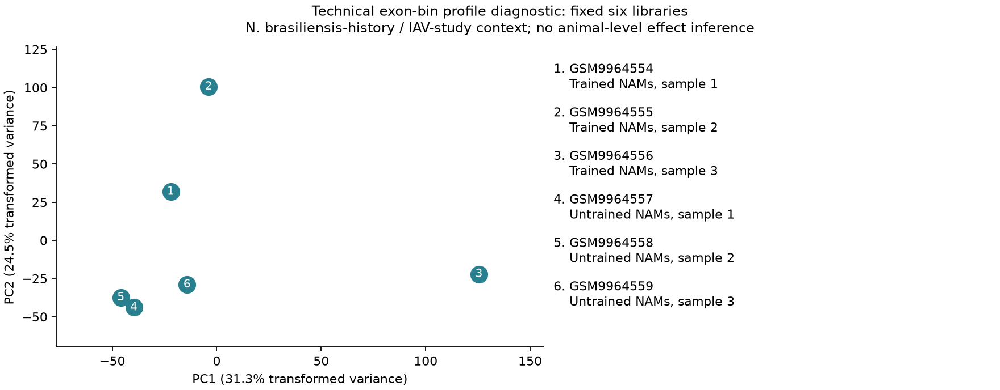

# DY1: NAM immune-history source reproduction

30 October 2026. Current disposition of the [original stages 0–8](../../docs/research_reviews/2026-10-29-nam-memory/README.md).
This article package owns paper reproduction and article-local descriptions; it
creates no canonical A-series question or scientific acceptance.

The study concerns N. brasiliensis-associated type-2 immune history in lung
macrophages, separate baseline bulk RNA/ATAC, baseline and later IAV-challenge
scRNA, STAT6–EGR2–PPARγ/RXRA associations, ARG1 and human disease context.
The [job-by-job assessment](JOB_ASSESSMENT_2026-10-30.md) records each completed
substep and the specific reason for every remaining hold.

Three existing [baseline diagnostics](BASELINE_QC_RESULTS_2026-10-30.md) are complete:
six exon-file/eight peak-file structural QC, full baseline sparse integrity and
CMO signal inventory, and an adapted six-library exon-profile PCA. Previously
completed [78-donor human observations](HUMAN_RESULTS.md) and
[21-donor external descriptions](HUMAN_EXTERNAL_RESULTS.md) remain reviewed evidence.
The [published evidence matrix](PUBLISHED_EVIDENCE_BOUNDARIES_2026-10-30.md)
separates paper findings from repository observations and mechanistic claims.

The subsequent [F1–F4 follow-ups](rq_discordance/README.md#authorized-follow-ups-after-e1e6)
are now assessed through the existing technical chat: representation, cofactor
reference and human-panel robustness runs completed and passed
[independent review](rq_discordance/FOLLOWUP_REVIEW_2026-10-30.md). The paired
source remains numerically held on access/files/identities. The
[follow-up results](rq_discordance/FOLLOWUP_RESULTS_2026-10-30.md) preserve all
mixed and unfavorable findings; original-stage holds below remain unchanged.

The [complete analysis inventory and synthesis](ANALYSIS_INVENTORY_AND_SYNTHESIS_2026-10-30.md)
connects reproduction, human branches and extensions to the remaining question.

## Candidate DY1-P01

Can deposited bulk and single-cell measurements reproduce persistent NAM
RNA/accessibility associations and distinguish RNA composition from within-state
differences? The baseline and separate later-condition comparisons have unresolved
source-specific unit, state and technical support. Libraries, cells, exon bins
and peaks are measured objects, not automatically independent biological units.
Qualified independently collected pools can be units without naming each mouse.

The paper, figures and prior repository results were exposed before these
contracts. Endpoints remain RNA counts, called intervals and annotations; none
alone is TF activity, secretion, fate or mature repair function. The key published
discrepancy is bulk RNA versus separate bulk ATAC. scRNA addresses composition and
within-state RNA; it does not supply within-state ATAC in those separate samples.

## Completion ledger

The earlier platform rejection is a historical execution event, preserved in
[CLOSEOUT](CLOSEOUT.md). It does not establish that all mouse-data tasks are
prohibited. The current assessment separates permissible completed work, missing
data/design prerequisites and inference limits. No qualified original job remains queued; the original numerical sequence is not
claimed fully reproduced. Newly completed DY1-P02 extensions are listed separately below.

| Stage | Completed | Specific remaining hold |
|---|---|---|
| 0: Source and units | V1 provenance, V2 corrected labels, source-local feature records, current baseline file hashes and raw CMO signal inventory | Deposited-library/tag → independent-pool and overlap map, validated cell assignments and condition/library/batch support are unresolved. Published pooling statements do not supply the crosswalk. |
| 1: Baseline RNA/ATAC QC | Six exon files share 406,850 ordered features; 143,437 all-zero rows. Eight peak files pass limited basic format checks. Fixed six-library logCPM/SVD diagnostic completed. | Exact gene-count semantics and author filtering/VST/PCA remain unresolved. ATAC lacks qualified common-region counts/read-level QC, reconciled pipeline version and author-excluded sample identity/rationale. No gene/peak effects or outlier removal. |
| 2: RNA/accessibility discordance | Assay distinction and published-direction evidence matrix completed | Numerical discordance requires qualified assay effects/uncertainty, compatible annotation and declared peak→gene rules. No paired RNA–ATAC map; significance mismatch alone is not poising. |
| 3: Composition/within-state RNA | Both baseline matrices fully scanned: 67,983,499 entries; sparse accounting and 12 CMO signal rows checked | Raw signal is not cell assignment or pool identity. Qualified state labels, biological units, denominator and common-state/condition support remain missing; no decomposition fitted. |
| 4: Regulatory association | Primary precedents and STAT6/EGR2/PPARγ/RXRA measurement boundaries reviewed | Motif/target tests depend on qualified effects, annotation/backgrounds and context-qualified target/binding resources. Late RNA, motifs and external ChIP do not establish activity, local occupancy or a temporal relay. |
| 5: History-by-condition host-RNA response | Original descriptive interaction estimand and separate-unit design retained | Data/design hold: unresolved cell/condition/unit/batch support, eligible shared states and target sets. No interaction estimate. A single later endpoint cannot distinguish kinetics or supply individual longitudinal linkage. |
| 6: ARG1/context | Published functional-design limits, context-dependent literature and captured-human RNA attribution completed | Mouse state attribution depends on held contrasts. Unlinked omics/functional cohorts cannot support mediation; genotype effect in trained animals is distinct from a training-specific interaction. NAM/AM targeting and enzyme/output limits remain. |
| 7: Human/recipient context | Primary 78-donor and external 12-IPF/9-control exposed descriptions, clinical/annotation/source sensitivities and negative/imprecise findings completed | Exact author NAM/model unavailable; external SELENOP mapping absent; subsets below frozen donor minimum remain non-estimable. RNA/composition is not activity, spatial signaling or recovery. |
| 8: Current-evidence synthesis | Paper/repository evidence and missing discriminators integrated; existing RQ notes retained | Complete synthesis does not establish the regulatory–ARG1–epithelial causal chain, laboratory readiness or scientific acceptance. Required linked functional endpoints remain missing. |

The [detailed ledger](JOB_ASSESSMENT_2026-10-30.md) supplies job-level requirements,
receipt hashes and review evidence. The [methods/input assessment](METHODS_AND_INPUT_ASSESSMENT_2026-10-30.md)
records source availability. The plan changed only to separate technical QC,
biological effect estimation and current-evidence synthesis because they have
different evidentiary requirements. No missing effect was replaced with a proxy
claim or inferred independent replicate.

Human results remain mixed: higher matrix-panel RNA transports directionally;
FABP4 depends on annotation; pooled recipient coupling is not stable within
disease; ARG1 is sparse. Donors, not cells, are the units. See the
[independent human review](../../docs/research_reviews/2026-10-29-nam-memory/HUMAN_REVIEW.md).

## DY1-P02: executed reference extensions and original holds

The owner-requested [RNA-ATAC discordance dossier](rq_discordance/README.md)
asks whether the late baseline pattern is interpretable under measurement/mapping
and RNA-composition sensitivity, and consistent with independent STAT6-EGR2-PPARgamma/RXRA
evidence. Separate bulk-ATAC composition remains unresolved.

The analysis chat completed five frozen runs: external count/source qualification,
a descriptive RNA-ATAC benchmark, a synthetic detection-label diagnostic,
temporal-source qualification and an RNA-only source-average description.
The [full results](rq_discordance/EXTENSION_RESULTS_2026-10-30.md) preserve all outcomes.
The coordinating [review](rq_discordance/REVIEW.md) checked their designs,
receipts, hashes, saved arithmetic and figures. The [E1-E6 ledger](rq_discordance/README.md#extension-execution-and-remaining-holds)
records every completion and exact remaining limitation.

The reference has mixed RNA-ATAC directions (about 56% same sign over full mapped
rows, about 63% in the nearest-TSS subset). Synthetic examples show substantial
detection-label mismatch even with equal truths. Repeated-stimulation RNA averages
also retain mixed responses and provide no replicate variance. These results
strengthen measurement discipline; they do not validate NAM memory, the regulatory
axis or ARG1 mediation. Original count/unit/state holds remain, and no canonical
RQ or scientific acceptance is created.

The [literature context](rq_discordance/LITERATURE_CONTEXT.md) now links successful
source qualification and the [assay-specific temporal review](rq_discordance/E6_SOURCE_REVIEW.md).
Plan changes kept all eligible ATAC regions and separated supported RNA-only
arithmetic from missing matched temporal evidence. No eligible extension is left
queued in the current assessment.

## Architecture and evidence boundaries

The canonical directory is `Research Article/`. Article numerical outputs remain
here and in registered run folders. Existing A1/A2/A8/A14/A19/A22 retain their
hypotheses, negative results and output authorities; relevant contextual notes
live in their own folders:
[A1](../../RQ_Specified/A1_transitional_epithelial_state_distinction/DY1_CONTEXT_2026-10-29.md),
[A2](../../RQ_Specified/A2_areg_source_delivery/DY1_CONTEXT_2026-10-29.md),
[A8](../../RQ_Specified/A8_maturation_component_at1_contribution/DY1_CONTEXT_2026-10-29.md),
[A14](../../RQ_Specified/A14_withdrawal_recovery_and_reception/DY1_CONTEXT_2026-10-29.md),
[A19](../../RQ_Specified/A19_fzd_response_reversibility/DY1_CONTEXT_2026-10-29.md),
[A22](../../RQ_Specified/A22_epithelial_identity_niche_response/DY1_CONTEXT_2026-10-29.md).
No RQ is promoted or retired; article observations do not supply their missing
fate, delivery, cessation/reception, reserve or focal protein-output endpoints.

## Completion ledger: documentation close-out

This historical heading preserves earlier links. The original close-out is
[CLOSEOUT](CLOSEOUT.md); current status is the completion ledger above, followed
by the [job assessment](JOB_ASSESSMENT_2026-10-30.md). Historical outputs remain
unchanged. See also [artifact inventory](ARTIFACT_INVENTORY.md),
[human validation](HUMAN_VALIDATION.md), [literature context](LITERATURE_CONTEXT.md),
[source-v2 results](SOURCE_V2_RESULTS.md) and [governance](../../docs/RESEARCH_GOVERNANCE.md).
