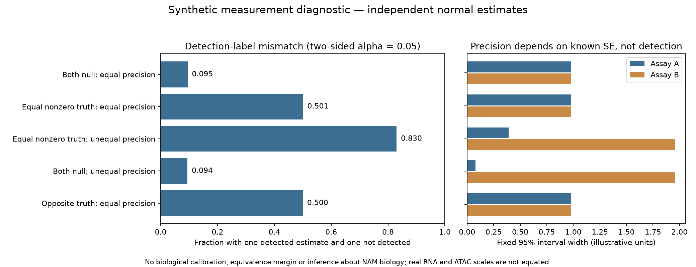
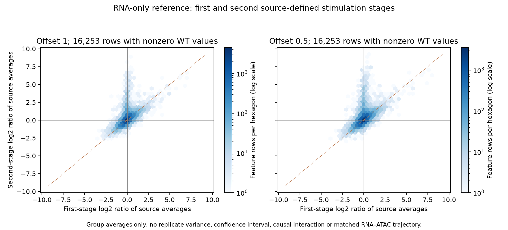

# DY1-P02 extension results and remaining holds

30 October 2026, Asia/Seoul. Five versioned runs completed the supported E1,
E2, E3 and E6 work. The [question](README.md) remains an exposed measurement and
model-discrimination question. Its original N. brasiliensis-history/later-IAV
context is preserved. External cultured-macrophage measurements and synthetic
data do not repair the original NAM inputs or establish its regulatory mechanism.
No canonical question or scientific acceptance decision changed.

## Disposition of E1–E6

| Extension | Completed endpoint | Remaining boundary |
|---|---|---|
| E1 | Complete reference matrix/metadata/annotation qualification, exact source hashes and column joins | Across-condition preparation reuse, cross-assay pairing, batches, timing conflict and exact annotation version remain unknown |
| E2 | Separate WT source-labelled RNA/ATAC transformed-mean contrasts; full deposited feature universe, two offsets, two mappings and distance/dependence sensitivities | Descriptive, compositional and model-conditional; no exact author replay, causal duration-matched effect or population-CI claim |
| E3 | Five illustrative synthetic scenarios, independent analytic probability/precision checks | Mathematical behavior only; no biological calibration or explanation of NAM outcomes |
| E4 | Reassessed original baseline input dependencies against newly acquired evidence | External counts do not supply original NAM gene-count semantics, common-region ATAC counts, units or pipeline/outlier provenance; no original effect rerun |
| E5 | Reassessed composition/regulatory-association prerequisites | No new original cell assignments, states, unit map, contrast eligibility or binding evidence; separate bulk ATAC still cannot identify within-state chromatin changes |
| E6 | Assay/source-specific temporal coverage qualification and a WT RNA-only description of published first/second-stage group averages | No replicate variance, causal temporal response, early-to-late RNA curve, matched RNA–ATAC trajectory or NAM persistence conclusion |

## E1: source qualification

The [source assessment](SOURCE_METHODS_2026-10-30.md) separates primary Methods
from repository checks. Public bulk endpoints supplied both matrices, complete
SOFT records, BioSample records and the annotation-bearing table despite challenged
GEO landing pages. Every acquired file has an immutable local copy and exact hash.

The [qualification](../../../analysis/research/runs/DY1_P02_reference_source_v1/qualification.json)
audited 29,872 RNA rows/27 columns and 144,411 region rows/24 columns. Every matrix
column joins to its source record. All 71,942 author-annotation rows match count
matrix coordinates; 64,757 author Ensembl assignments and 64,581 nearest-TSS
symbols match the complete deposited RNA identifiers. These are structural joins,
not evidence that a region regulates its assigned gene. The 259 independent
arithmetic/label/coordinate checks passed.

The exact [flag contingency](../../../analysis/research/runs/DY1_P02_reference_benchmark_v1/annotation_flag_contingency.tsv)
shows 71,942 annotated regions with `filtered=True`, 598 additional True regions
without annotation, and 71,871 False regions without annotation. The flag's name
does not establish retained/dropped meaning; it was not used to select effects.

Eight ATAC vehicle records retain the literal title `24h` versus characteristic
`Vehicle, 25 hours` conflict. Replicate labels and distinct BioSample IDs do not
recover across-condition preparation reuse or assay pairing. The declared RNA
“GENCODE release 27”/mm10 wording also lacks an exact annotation file; the source
assessment records the official mouse M27 assembly discrepancy without guessing
which file was used. These limits remain attached to E2.

## E2: descriptive reference benchmark

The comparison uses the source-labelled WT IL4 and vehicle libraries separately
in each assay: three per RNA group and four per ATAC group. All source rows remain
in library denominators. Only 4,070 RNA rows all-zero across the selected groups
are omitted from effect calculation; 25,802 RNA features and all 144,411 ATAC
regions receive effects, including unannotated regions. No selected-axis analysis,
genotype screen, enrichment, target ranking or source outlier exclusion was added.

The endpoint is the difference of mean `log2(CPM + offset)`, using offsets 1 and
0.5. This is a compositional descriptive adaptation, not a count-model log fold
change or absolute-output estimate. Independent-Welch intervals and all six RNA
or 24 ATAC one-to-one pairings are explicitly alternative design assumptions.
Their envelope is a dependence sensitivity summary, **not an unconditional
population confidence interval**. It does not exhaust partial overlap, batch or
normalization uncertainty. Degenerate variance models remain flagged.

At offset 1, the saved [mapping table](../../../analysis/research/runs/DY1_P02_reference_benchmark_v1/mapping_sensitivity.tsv)
reports:

| Mapping / distance subset | Mapped pair rows | Unique genes | Same nonzero sign | Both envelopes directional under declared models |
|---|---:|---:|---:|---:|
| Author Ensembl, all annotated |62,462|13,602|55.908%|6.489%|
| Author nearest-TSS symbol, all annotated |62,202|13,571|55.858%|6.432%|
| Author Ensembl, within 2 kb of source nearest TSS |8,712|7,067|62.890%|6.015%|
| Author nearest-TSS symbol, within 2 kb |8,665|7,039|62.897%|5.967%|

These are **mapped-pair-weighted descriptive proportions**: genes with more
regions recur. No significance relative to 50%, biological equivalence or
independent-region inference follows. Opposite signs and all zero/undefined
precision cases remain recorded. The 2 kb rule uses the source nearest TSS, which
need not belong to the different author-Ensembl assigned gene; it is a distance
sensitivity, not a certified promoter/regulatory link. Offset 0.5 retains mixed
signs and similar aggregate proportions; its full results are preserved.

The saved [verification](../../../analysis/research/runs/DY1_P02_reference_benchmark_v1/verification.json)
passed 1,608 checks: fixed source-order positions, scalar versus vectorized
transforms/means/variances/all pairings, and complete mapping partitions. The
parser and t-distribution implementation are shared and disclosed. Most mapped
rows are not jointly directional across the declared model set; this is not
evidence of unchanged RNA or of a chromatin-only mechanism. All unranked
[RNA](../../../analysis/research/runs/DY1_P02_reference_benchmark_v1/rna_descriptive_effects.tsv.gz)
and [ATAC](../../../analysis/research/runs/DY1_P02_reference_benchmark_v1/atac_descriptive_effects.tsv.gz)
feature results remain available.

## E3: synthetic uncertainty diagnostic

Five prespecified scenarios used 200,000 draws each from independent normal
estimates with known SEs and illustrative dimensionless truth. Equal latent
effects are an assumption of this simulation; real RNA and ATAC scales are not
equated. Detection uses a two-sided 0.05 rule; no biological effect margin was set.

| Synthetic scenario | Detection-label mismatch | Same estimate sign |
|---|---:|---:|
| Both null, equal precision |9.489%|50.0575%|
| Equal nonzero truth, equal precision |50.1145%|95.547%|
| Equal nonzero truth, unequal precision |83.025%|84.283%|
| Both null, unequal precision |9.4345%|49.8735%|
| Opposite truth, equal precision |50.0355%|4.4235%|

All 75 prespecified normal-CDF, mean and width checks passed. The
[analytic expectations](../../../analysis/research/runs/DY1_P02_synthetic_uncertainty_v1/analytic_expectations.tsv)
were calculated without simulation draws. Fixed known SEs imply fixed interval
widths within each scenario. Thus nonsignificance can accompany a narrow interval,
and detection-label mismatch does not identify unequal truth or opposite signs.
This demonstrates a statistical possibility; it does not show that this explains
the NAM paper or validate a biological equivalence margin.

## E6: assay coverage and RNA-only source averages

The [temporal input assessment](TEMPORAL_INPUTS_2026-10-30.md) and
[qualification](../../../analysis/research/runs/DY1_P02_temporal_source_v1/qualification.json)
cover six source records: 278 sample occurrences deduplicate to 217 GSMs without
conflicting repeated metadata. Shared source records remain one evidence lineage.
GSE115502 muscle-injury samples are not substituted for cultured macrophages.
GSE151015 supplies 55,450 raw RNA rows/12 columns, but its control/24-hour RNA
coverage does not acquire early points from a separate ChIP assay. Normalized
chromatin tracks were not converted into raw peak counts; no large archive ran.

GSE115504 supplies 23,420 rows of **author-labelled averaged CPM**. The bounded
RNA-only run uses its four WT columns; KO columns are unused. Every row remains
in the output. The 7,167 rows all-zero in those WT columns are separately counted,
leaving 16,253 rows for nonzero-WT summaries. For each fixed offset, it computes
first- and second-stage log ratios to their own controls, the baseline shift,
and the second-minus-first log-ratio contrast. A ratio of group averages is not
an average individual response, a causal interaction or a longitudinal trajectory.

Both offsets yield 10,730 same-sign and 3,809 opposite-sign nonzero stage ratios;
1,319 rows have a zero first-stage ratio only and 395 a zero second-stage ratio
only. At offset 1, 9,484 second-minus-first values are positive and 6,769 negative;
at offset 0.5, the counts are 9,482 and 6,771. The median changes from 0.05265 to
0.08296 illustrative log-ratio units. These are mixed source-table descriptions,
not evidence of an overall biological amplification or a PPARγ-dependent effect.

The [verification](../../../analysis/research/runs/DY1_P02_source_average_response_v1/verification.json)
passed 187,360 all-row scalar/vector arithmetic checks plus four partitions.
No variance, confidence interval, p-value or effective biological n was
reconstructed from the group averages. Exact
[offset outcomes](../../../analysis/research/runs/DY1_P02_source_average_response_v1/offset_sensitivity.tsv)
and unranked row contrasts are preserved.

## Execution records and validation

| Run / receipt | Frozen revision | Independent check |
|---|---|---|
| [E1 reference qualification](../../../analysis/research/runs/DY1_P02_reference_source_v1/receipt.json) | `7361a17` |259 structural/arithmetic/label checks|
| [E2 reference benchmark](../../../analysis/research/runs/DY1_P02_reference_benchmark_v1/receipt.json) | `3c1bc10` |1,608 arithmetic/partition checks|
| [E3 synthetic diagnostic](../../../analysis/research/runs/DY1_P02_synthetic_uncertainty_v1/receipt.json) | `48292da` |75 analytic checks|
| [E6 temporal qualification](../../../analysis/research/runs/DY1_P02_temporal_source_v1/receipt.json) | `3c1bc10` |34 source-table arithmetic checks|
| [E6 source-average description](../../../analysis/research/runs/DY1_P02_source_average_response_v1/receipt.json) | `218f063` |187,360 arithmetic checks and four partitions|

All five receipts verify execution with scientific acceptance not assessed.
All 19 targeted tests passed. The 161 repository tests passed with one skip.
Compilation, the claim contract, Nb1/Nb4/A16/A23/A22–A23 evidence verifiers,
11,618 repository checks and the research gate passed against freshly fetched
main `78320a186b6f52426e7c7c5349a2f26492b718b7`. Figures were visually inspected.
No scientific code, frozen output, validator,
governance file, root ignore rule or canonical question was overwritten.

The initial download utility failed before file creation because `requests` was
unavailable; standard-library retrieval succeeded and the event is retained in
the hash-bound retrieval record. No governed analysis run failed. Earlier source
failures and all original caches remain intact; no runtime install or external
service setting changed. The next step is integration of this stable handoff.
No additional supported numerical job is queued in this bounded extension pass.
