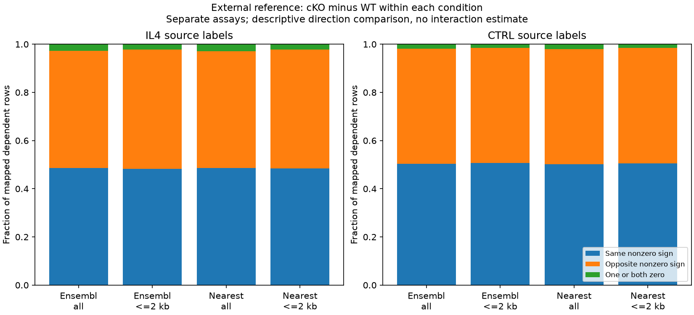

# DY1 follow-up execution results

30 October 2026, Asia/Seoul. Exposed descriptive work from the
[reviewed feasibility assessment](FOLLOWUP_FEASIBILITY_2026-10-30.md), preserving
all earlier runs. The original Nb-history/later-IAV context remains the broader
motivation; these jobs use a non-infectious cultured-macrophage reference and
human observational cohorts. Original count, biological-unit, paired-assay,
temporal and mediation holds remain. Technical execution/review does not confer
human scientific acceptance.

## F1: unequal representation has a small effect on aggregate agreement

**Question:** does the saved WT RNA/accessibility direction summary depend on
genes having different numbers of mapped regions? The principal alternative is
unequal representation or annotation coverage. Genes and regions are dependent
features nested in the same original libraries, not new biological replicates.
This audit reads frozen E2 offset-1 effects and membership; it does not refit the
WT comparison or repeat the offset/distance analysis.

Each gene's same-direction fraction uses **all its mapped rows**, including zero
directions, then equal-gene weighting averages these fractions. The pair-weighted
version gives each mapped region one contribution. No mapped zero directions
occur here, but their prespecified category and denominator treatment remain.

| Mapping / existing subset | Mapped rows / genes | Pair-weighted agreement | Equal-gene agreement | Mixed positive/negative ATAC genes |
|---|---:|---:|---:|---:|
| Author Ensembl, all annotated | 62,462 / 13,602 | 55.908% | 56.248% | 7,667 / 13,602 |
| Author Ensembl, nearest TSS ≤2 kb | 8,712 / 7,067 | 62.890% | 63.105% | 632 / 7,067 |
| Nearest-TSS symbol, all annotated | 62,202 / 13,571 | 55.858% | 56.254% | 7,652 / 13,571 |
| Nearest-TSS symbol, nearest TSS ≤2 kb | 8,665 / 7,039 | 62.897% | 63.093% | 622 / 7,039 |

Equal-gene shifts range from +0.196 to +0.396 percentage points. Thus the global
fraction is fairly stable to this particular weighting choice. It is not a
uniform gene-level relationship: roughly 56% of represented genes in the broad
annotation universe have both positive and negative ATAC regions. The proximal
subset is different and has mostly one region per gene (median one versus three
in the broad universe); its lower mixed fraction is not independent validation.

On the exact common support, the mappings share 61,541 broad-universe regions:
44 change assigned gene, and six change same/opposite direction class. The
proximal common support has 8,575 regions: six assignments and one class change.
An additional 921/661 broad regions and 137/90 proximal regions belong only to
the Ensembl/nearest-symbol eligible mapping, respectively. Common-support
assignment disagreement is therefore distinct from changing coverage.

The broad Ensembl mapping covers 43.253% of eligible ATAC regions and 52.717%
of eligible RNA genes. This limits extrapolation to the full deposited universe.
Nearest-TSS distance is source annotation, not proof of regulation or promoter
assignment to the different Ensembl gene. No independent-peak binomial test,
50% null, mechanism or target ranking is supplied.

Exact evidence: [weighting table](../../../analysis/research/runs/DY1_P02_representation_audit_v1/weighting_summary.tsv),
[common-support contingency](../../../analysis/research/runs/DY1_P02_representation_audit_v1/common_mapping_contingency.tsv),
[coverage](../../../analysis/research/runs/DY1_P02_representation_audit_v1/annotation_coverage.tsv),
and [complete per-gene output](../../../analysis/research/runs/DY1_P02_representation_audit_v1/gene_representation.tsv.gz).
The frozen [plot](../../../analysis/research/runs/DY1_P02_representation_audit_v1/representation_audit.png)
is supplemental; its long x-axis labels are crowded, so the exact table above is
the primary presentation. No frozen plot was overwritten for an editorial fix.

## F4: weak global cross-modal association in conditional genotype descriptions

**Question:** what are cKO-minus-WT transformed-mean contrasts within
source-labelled IL4, with a separate CTRL comparison for baseline context?
The unit is the source-reported mouse/preparation within assay/group; exact
preparation, litter and batch identities remain unqualified. Baseline differences,
compositional measurement and unknown dependence are consequential alternatives.
The published cofactor mechanism is a premise, not a new result from this audit.

The [source/model note](FOLLOWUP_SOURCE_MODELS_2026-10-30.md) reconciles the broad
Fig. 5c cKO n=4 caption with three deposited cKO IL4 RNA libraries (rep1, rep2,
rep4). WT RNA has three per group; cKO CTRL has four; ATAC has four in each group.
No fourth IL4 RNA library was invented. This is not exact reproduction of the
author's selected-feature or count-model analysis.

The common universe retains 27,979 RNA features, excluding only 1,893 all-zero
across all four selected groups. Of the retained features, 2,636 are all-zero
within the two IL4 genotype groups and 1,809 within CTRL; they retain zero
contrasts and degenerate uncertainty. All 144,411 ATAC regions remain eligible.
All-source rows remain in CPM denominators. Mean log2(1+CPM) differences are
compositional transformed-mean endpoints, not absolute-output differences.

| Source mapping / subset | IL4 same / opposite / zero rows | IL4 mapped-row Spearman | CTRL mapped-row Spearman |
|---|---:|---:|---:|
| Ensembl, all (63,592 rows) | 30,933 / 30,873 / 1,786 | +0.01642 | +0.05243 |
| Ensembl, ≤2 kb (8,834 rows) | 4,269 / 4,371 / 194 | −0.00135 | +0.04245 |
| Nearest symbol, all (63,346 rows) | 30,792 / 30,737 / 1,817 | +0.01605 | +0.05103 |
| Nearest symbol, ≤2 kb (8,785 rows) | 4,248 / 4,345 / 192 | −0.00108 | +0.04378 |

The full mapped universes have weak global monotonic association under these
measurement choices; same and opposite directions both remain common. This
does not exclude specific regulation, establish no genotype effect, or resolve
normalization and selection alternatives. Gene/region rows are dependent, and
fractions near one half are not tests against a 50% null. CTRL provides context;
no stimulus-by-genotype interaction or assay-scale subtraction was estimated.

Every feature includes sample n, SD and an unequal-n Welch interval conditional
on normal transformed observations and independence. Unknown dependence/batches
prevent a verified population-CI interpretation. Zero SE is flagged, not treated
as certainty. No effect margin, equivalence, locus selection or target ranking
was introduced. All mappings and unfavorable/zero outcomes remain available.

Exact evidence: [feature eligibility](../../../analysis/research/runs/DY1_P02_genotype_reference_v1/feature_eligibility.tsv),
[all mapping summaries](../../../analysis/research/runs/DY1_P02_genotype_reference_v1/mapping_summary.tsv),
[RNA effects](../../../analysis/research/runs/DY1_P02_genotype_reference_v1/rna_genotype_effects.tsv.gz),
[ATAC effects](../../../analysis/research/runs/DY1_P02_genotype_reference_v1/atac_genotype_effects.tsv.gz).

## F2: panel and donor robustness

The draft package is under independent review before freeze/execution. No
F2 numerical result is asserted in this checkpoint.

## F3: public-source qualification remains held

The [source/model note](FOLLOWUP_SOURCE_MODELS_2026-10-30.md#f3-bounded-public-qualification)
records the controlled EGA accession, duplicate-label/biological-unit distinction,
preprocessing versus analysis-repository distinction, and exact bounded retry.
The analysis repository timed out; this is not proof that public processed
matrices are absent. No controlled download, access request or external contact
occurred. Files, rights, paired barcodes, preparation independence and common-state
support remain prerequisites to a numerical contract.

## Execution and verification record

| Job | Reviewed freeze | Governed receipt | Independent arithmetic / parity |
|---|---|---|---:|
| F1 | `757d03f` | [receipt](../../../analysis/research/runs/DY1_P02_representation_audit_v1/receipt.json) | 429,215 checks |
| F4 | `2f74c6c` | [receipt](../../../analysis/research/runs/DY1_P02_genotype_reference_v1/receipt.json) | 1,458 checks |

F1 and F4 each passed four targeted synthetic tests before execution and passed
receipt verification afterward. F4 had two **draft preflight** hash failures
for the newly written parameter file: an exact Windows line-ending mismatch,
then an incomplete correction. The final file was saved with LF bytes and both
prospective input/code hashes matched. No governed run was created by those
draft failures, and they are not biological analysis failures. No governance
check was weakened. Final repository/integration checks remain pending while
the requested F2 package is reviewed.
