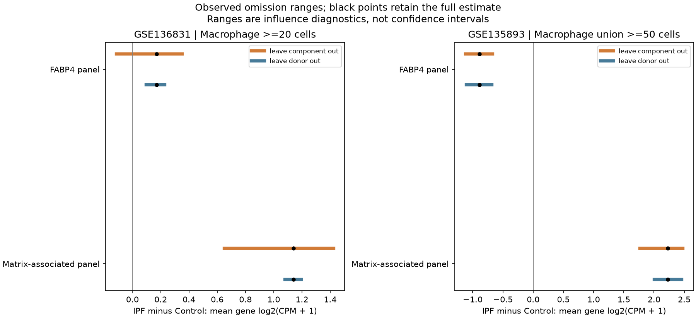

# DY1 follow-up execution results

30 October 2026, Asia/Seoul. Exposed descriptive work from the
[reviewed feasibility assessment](FOLLOWUP_FEASIBILITY_2026-10-30.md), preserving
all earlier runs. The original Nb-history/later-IAV context remains the broader
motivation; these jobs use a non-infectious cultured-macrophage reference and
human observational cohorts. Original count, biological-unit, paired-assay,
temporal and mediation holds remain. Technical execution/review does not confer
human scientific acceptance.

## F1: unequal representation has a small effect on aggregate agreement

**Question:** does the saved WT RNA/accessibility direction summary depend on
genes having different numbers of mapped regions? The principal alternative is
unequal representation or annotation coverage. Genes and regions are dependent
features nested in the same original libraries, not new biological replicates.
This audit reads frozen E2 offset-1 effects and membership; it does not refit the
WT comparison or repeat the offset/distance analysis.

Each gene's same-direction fraction uses **all its mapped rows**, including zero
directions, then equal-gene weighting averages these fractions. The pair-weighted
version gives each mapped region one contribution. No mapped zero directions
occur here, but their prespecified category and denominator treatment remain.

| Mapping / existing subset | Mapped rows / genes | Pair-weighted agreement | Equal-gene agreement | Mixed positive/negative ATAC genes |
|---|---:|---:|---:|---:|
| Author Ensembl, all annotated | 62,462 / 13,602 | 55.908% | 56.248% | 7,667 / 13,602 |
| Author Ensembl, nearest TSS ≤2 kb | 8,712 / 7,067 | 62.890% | 63.105% | 632 / 7,067 |
| Nearest-TSS symbol, all annotated | 62,202 / 13,571 | 55.858% | 56.254% | 7,652 / 13,571 |
| Nearest-TSS symbol, nearest TSS ≤2 kb | 8,665 / 7,039 | 62.897% | 63.093% | 622 / 7,039 |

Equal-gene shifts range from +0.196 to +0.396 percentage points. Thus the global
fraction is fairly stable to this particular weighting choice. It is not a
uniform gene-level relationship: roughly 56% of represented genes in the broad
annotation universe have both positive and negative ATAC regions. The proximal
subset is different and has mostly one region per gene (median one versus three
in the broad universe); its lower mixed fraction is not independent validation.

On the exact common support, the mappings share 61,541 broad-universe regions:
44 change assigned gene, and six change same/opposite direction class. The
proximal common support has 8,575 regions: six assignments and one class change.
An additional 921/661 broad regions and 137/90 proximal regions belong only to
the Ensembl/nearest-symbol eligible mapping, respectively. Common-support
assignment disagreement is therefore distinct from changing coverage.

The broad Ensembl mapping covers 43.253% of eligible ATAC regions and 52.717%
of eligible RNA genes. This limits extrapolation to the full deposited universe.
Nearest-TSS distance is source annotation, not proof of regulation or promoter
assignment to the different Ensembl gene. No independent-peak binomial test,
50% null, mechanism or target ranking is supplied.

Exact evidence: [weighting table](../../../analysis/research/runs/DY1_P02_representation_audit_v1/weighting_summary.tsv),
[common-support contingency](../../../analysis/research/runs/DY1_P02_representation_audit_v1/common_mapping_contingency.tsv),
[coverage](../../../analysis/research/runs/DY1_P02_representation_audit_v1/annotation_coverage.tsv),
and [complete per-gene output](../../../analysis/research/runs/DY1_P02_representation_audit_v1/gene_representation.tsv.gz).
The frozen [plot](../../../analysis/research/runs/DY1_P02_representation_audit_v1/representation_audit.png)
is supplemental; its long x-axis labels are crowded, so the exact table above is
the primary presentation. No frozen plot was overwritten for an editorial fix.

## F4: weak global cross-modal association in conditional genotype descriptions

**Question:** what are cKO-minus-WT transformed-mean contrasts within
source-labelled IL4, with a separate CTRL comparison for baseline context?
The unit is the source-reported mouse/preparation within assay/group; exact
preparation, litter and batch identities remain unqualified. Baseline differences,
compositional measurement and unknown dependence are consequential alternatives.
The published cofactor mechanism is a premise, not a new result from this audit.

The [source/model note](FOLLOWUP_SOURCE_MODELS_2026-10-30.md) reconciles the broad
Fig. 5c cKO n=4 caption with three deposited cKO IL4 RNA libraries (rep1, rep2,
rep4). WT RNA has three per group; cKO CTRL has four; ATAC has four in each group.
No fourth IL4 RNA library was invented. This is not exact reproduction of the
author's selected-feature or count-model analysis.

The common universe retains 27,979 RNA features, excluding only 1,893 all-zero
across all four selected groups. Of the retained features, 2,636 are all-zero
within the two IL4 genotype groups and 1,809 within CTRL; they retain zero
contrasts and degenerate uncertainty. All 144,411 ATAC regions remain eligible.
All-source rows remain in CPM denominators. Mean log2(1+CPM) differences are
compositional transformed-mean endpoints, not absolute-output differences.

| Source mapping / subset | IL4 same / opposite / zero rows | IL4 mapped-row Spearman | CTRL mapped-row Spearman |
|---|---:|---:|---:|
| Ensembl, all (63,592 rows) | 30,933 / 30,873 / 1,786 | +0.01642 | +0.05243 |
| Ensembl, ≤2 kb (8,834 rows) | 4,269 / 4,371 / 194 | −0.00135 | +0.04245 |
| Nearest symbol, all (63,346 rows) | 30,792 / 30,737 / 1,817 | +0.01605 | +0.05103 |
| Nearest symbol, ≤2 kb (8,785 rows) | 4,248 / 4,345 / 192 | −0.00108 | +0.04378 |

The full mapped universes have weak global monotonic association under these
measurement choices; same and opposite directions both remain common. This
does not exclude specific regulation, establish no genotype effect, or resolve
normalization and selection alternatives. Gene/region rows are dependent, and
fractions near one half are not tests against a 50% null. CTRL provides context;
no stimulus-by-genotype interaction or assay-scale subtraction was estimated.

Every feature includes sample n, SD and an unequal-n Welch interval conditional
on normal transformed observations and independence. Unknown dependence/batches
prevent a verified population-CI interpretation. Zero SE is flagged, not treated
as certainty. No effect margin, equivalence, locus selection or target ranking
was introduced. All mappings and unfavorable/zero outcomes remain available.

Exact evidence: [feature eligibility](../../../analysis/research/runs/DY1_P02_genotype_reference_v1/feature_eligibility.tsv),
[all mapping summaries](../../../analysis/research/runs/DY1_P02_genotype_reference_v1/mapping_summary.tsv),
[RNA effects](../../../analysis/research/runs/DY1_P02_genotype_reference_v1/rna_genotype_effects.tsv.gz),
[ATAC effects](../../../analysis/research/runs/DY1_P02_genotype_reference_v1/atac_genotype_effects.tsv.gz).

## F2: panel and donor robustness

**Question:** do single components or donors dominate the fixed macrophage RNA
panel differences and within-disease panel association? The biological unit is
the donor. The relevant alternatives are concentrated component/donor influence,
with annotation/site differences and observational confounding still unresolved.
This is robustness of reused exposed cohorts, not independent panel validation.

The full panels and donor sets are retained. Each component omission takes the
mean of the other three genes; in the panel association, only one panel changes
at a time. Each donor omission uses both full panels. These two diagnostics are
not crossed, and no favorable reduced panel or donor-excluded result replaces
the original analysis. Missing/nonfinite components fail explicitly.

The primary population remains Macrophage with ≥20 cells. The existing
AllMacrophages ≥50 comparator is also retained. External source-adapted union
and Macrophages-only use the original ≥50 floor, all-source and Vanderbilt
scopes, exact donors and site labels. New external component reaggregation
matches independently raw-reaggregated selected counts and all-gene totals;
full scores, point estimates and donor n reproduce the frozen results. Original
pointwise bootstrap intervals are copied with provenance, not recomputed.

| Population / IPF−Control panel | Full estimate | Leave one component out range | Leave one donor out range |
|---|---:|---:|---:|
| Primary Macrophage20, FABP4 | +0.172 | −0.114 to +0.351 | +0.096 to +0.229 |
| Primary Macrophage20, matrix-associated | +1.139 | +0.650 to +1.424 | +1.079 to +1.195 |
| External union50, FABP4 | −0.891 | −1.120 to −0.668 | −1.104 to −0.684 |
| External union50, matrix-associated | +2.230 | +1.764 to +2.475 | +2.006 to +2.459 |

Ranges are **observed influence diagnostics, not confidence intervals**. The
primary small positive FABP4-panel difference changes sign when FABP4 is omitted
(−0.114), but remains positive after every individual donor omission. The
original full-data pointwise interval already spans zero (−0.250 to +0.591).
Neither stable donor-omission signs nor component sensitivity changes that
sampling-uncertainty result. The
matrix-associated difference remains positive through every single component
and donor omission in these two displayed populations. These statements concern
the fixed RNA summaries, not matrix production or a repair phenotype.

Within IPF, the primary panel correlation is −0.624; its component-omission range
is −0.675 to −0.470 and donor-omission range −0.690 to −0.587. The external union
correlation is −0.545, with corresponding ranges −0.741 to −0.329 and −0.755 to
−0.409. Their signs are stable under these individual omissions; the original
external interval still spans zero (−0.889 to +0.090), and cohort differences
remain. Omission stability does not establish statistical significance, causality
or independent replication. All Control/COPD
and prespecified population/site diagnostics are in the complete tables.

The run retains 1,195 rows including 34 full estimates; 62 rows fail the unchanged
eight-donor association floor. Vanderbilt within-disease correlations remain
held, and comparisons to an unavailable full estimate are NA, not zero sign
reversals. External SELENOP remains unmapped; no alias/proxy substitution,
recipient-correlation fit, clinical/depth/floor rerun or new single-gene contrast
was performed. No donor was excluded from the primary result.

Exact evidence: [full estimates and original intervals](../../../analysis/research/runs/DY1_human_panel_robustness_v1/full_estimates.tsv),
[every omission](../../../analysis/research/runs/DY1_human_panel_robustness_v1/all_omissions.tsv),
[all influence summaries](../../../analysis/research/runs/DY1_human_panel_robustness_v1/robustness_summary.tsv),
[external component reaggregation](../../../analysis/research/runs/DY1_human_panel_robustness_v1/external_reaggregated_components.tsv).

## F3: public-source qualification remains held

The [source/model note](FOLLOWUP_SOURCE_MODELS_2026-10-30.md#f3-bounded-public-qualification)
records the controlled EGA accession, duplicate-label/biological-unit distinction,
preprocessing versus analysis-repository distinction, and exact bounded retry.
The analysis repository timed out; this is not proof that public processed
matrices are absent. No controlled download, access request or external contact
occurred. Files, rights, paired barcodes, preparation independence and common-state
support remain prerequisites to a numerical contract.

## Execution and verification record

| Job | Reviewed freeze | Governed receipt | Independent arithmetic / parity |
|---|---|---|---:|
| F1 | `757d03f` | [receipt](../../../analysis/research/runs/DY1_P02_representation_audit_v1/receipt.json) | 429,215 checks |
| F4 | `2f74c6c` | [receipt](../../../analysis/research/runs/DY1_P02_genotype_reference_v1/receipt.json) | 1,458 checks |
| F2 | `446b023` | [receipt](../../../analysis/research/runs/DY1_human_panel_robustness_v1/receipt.json) | 2,493 checks |

F1 and F4 each passed four targeted synthetic tests before execution and passed
receipt verification afterward. F4 had two **draft preflight** hash failures
for the newly written parameter file: an exact Windows line-ending mismatch,
then an incomplete correction. The final file was saved with LF bytes and both
prospective input/code hashes matched. No governed run was created by those
draft failures, and they are not biological analysis failures. No governance
check was weakened. F2 passed six tests after pre-freeze review required explicit
missing-component rejection and unavailable-reference comparison handling;
both corrections were tested before its sole governed run. The reviewer also
corrected F3's preprocessing/analysis repository distinction before delivery.
All three governed runs succeeded and passed receipt verification.

Parent F1 post-run review independently checked arithmetic/partitions against
frozen E2, provenance/freeze identity and the figure. The two annotation rules
largely coincide on common support; agreement between them is not independent
annotation validation. Parent F4 review passed 447 independent source/arithmetic
checks and 24 provenance/freeze checks. Parent F2 review passed 2,897 independent
checks reconstructing all 1,195 diagnostic rows, summary ranges/counts and eight
external components for 42 donor/population rows, plus 27 provenance/freeze
checks. F4/F2 figures were inspected and readable. These are independent technical
calculations on shared data, not biological replication or human acceptance.

Compileall, claim contract, Nb1/Nb4, A16, A23 and A22–A23 checks passed. The required
analysis suite initially failed because the Windows sandbox blocked creation and
cleanup of its temporary Git directories; its authorized retry passed 161 tests
with one skip. This environmental test failure did not create or alter a
biological run. Canonical 32-question registry entries, guides and infrastructure
are unchanged. Repository validation passed 11,702 checks, and the research gate
passed against freshly fetched `origin/main` at
`28fb61015f9b921f591e41ff26010a960c305947`. No remote change required reconciliation.
Only these scoped follow-ups and current summaries changed; ignored source caches
and earlier frozen evidence remain preserved. No external setting changed.
