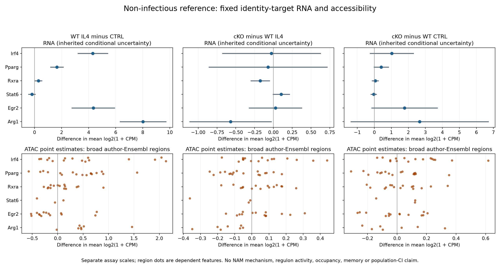

# DY1-P02: fixed identity-target reference results

3 November 2026. **Completed: Irf4 and Pparg increase together in the WT IL4
reference; the simple inverse identity-switch reading is unsupported here.**
This is conditional description in non-infectious cultured macrophages, not a
contradiction of Verwaerde's distinct IL13 alveolar-macrophage system.
[Specification](IDENTITY_TARGETS_SPEC_V1.md) ·
[Contract](config/identity_targets_contract_v1.json) ·
[Receipt](../../../analysis/research/runs/PS3_DY1_identity_targets_v1_20261103/receipt.json).
Freeze `94f6efb`; no count model was refitted.

## Question and complete RNA profile

The six targets were fixed from literature before reading their saved effects.
This adds a target-specific view beyond global F1/F4 summaries, without selecting
favorable genes/peaks or creating a regulon. Units remain source-reported
mouse/preparations: RNA WT 3/group, cKO IL4=3/CTRL=4; ATAC 4/group. Exact preparation,
litter, batch, condition reuse and assay pairing are unqualified.

Each cell below is the frozen difference in mean log2(1+CPM), followed by its
inherited uncertainty range. WT ranges are dependence-model sensitivity envelopes;
cKO ranges are independence-conditional Welch intervals. Neither is a verified
population confidence interval; no interval is an activity or binding measure.

| Target | WT IL4 − CTRL | cKO − WT within IL4 | cKO − WT within CTRL |
|---|---:|---:|---:|
| Irf4 | +4.309 [+3.220, +5.399] | -0.025 [-0.676, +0.625] | +1.027 [-0.243, +2.297] |
| Pparg | +1.655 [+1.193, +2.116] | -0.071 [-0.855, +0.713] | +0.408 [-0.014, +0.829] |
| Rxra | +0.281 [+0.036, +0.527] | -0.175 [-0.299, -0.051] | +0.055 [-0.126, +0.235] |
| Stat6 | -0.194 [-0.434, +0.046] | +0.105 [-0.002, +0.212] | -0.041 [-0.200, +0.118] |
| Egr2 | +4.339 [+2.770, +5.907] | +0.028 [-0.320, +0.376] | +1.775 [-0.154, +3.703] |
| Arg1 | +8.016 [+6.329, +9.703] | -0.569 [-1.111, -0.028] | +2.661 [-1.370, +6.691] |

Irf4 (+4.310) and Pparg (+1.655) co-increase under WT IL4, together with Egr2
and Arg1. Therefore IRF4 RNA elevation cannot by itself be used as a marker of
PPARgamma RNA loss in this reference. This does not establish PPARgamma activity,
homeostatic function or absence of another form of identity change. In cKO IL4,
Pparg/Irf4/Egr2 estimates are near zero with ranges spanning both directions;
that is uncertainty, not equivalence. Rxra and Arg1 point estimates are negative,
but preparation dependence remains unresolved. CTRL differences are separate
baseline context, not a stimulus-by-genotype interaction.

## Accessibility is not one value per regulatory gene

All 462 region/mapping/subset rows and72 summary rows are retained. The table
below gives positive/negative **point-estimate** counts for every broad
source-author-Ensembl region; they are dependent features, not replicate counts.
Both mappings and the<=2kb sensitivity remain in the complete output.

| Target | WT IL4 +/− | cKO IL4 +/− | cKO CTRL +/− |
|---|---:|---:|---:|
| Irf4 | 11/5 | 9/7 | 10/6 |
| Pparg | 13/4 | 7/10 | 8/9 |
| Rxra | 8/7 | 9/6 | 8/7 |
| Stat6 | 1/2 | 0/3 | 2/1 |
| Egr2 | 4/10 | 9/5 | 7/7 |
| Arg1 | 6/1 | 0/7 | 3/4 |

For example, WT Egr2 RNA increases while10/14 mapped region point estimates
are negative and4 positive. Arg1 cKO-IL4 RNA is negative and all 7 broad mapped
region point differences are negative. These are descriptive patterns, not
proof of true discordance, occupancy, a regulatory link or ARG1 catalytic output.
No significant-peak selection, region-independent test, gene ranking, across-assay
scale subtraction, causal mediation or pathway-activity score was calculated.

**Biological implication:** the reference does not support a universal inverse
IRF4/PPARgamma RNA switch; it also does not reduce each gene to a uniform
accessibility direction. Keep cell context, RNA, chromatin accessibility and
function separate when developing A3/DY1-P02. No NAM intervention is nominated,
and original unit/assay/timing/safety holds remain unchanged.

ATAC dots are point differences only; complete inherited uncertainty fields and
both mapping/subset views are in [all region rows](../../../analysis/research/runs/PS3_DY1_identity_targets_v1_20261103/target_region_effects.tsv).
[All 18 RNA rows](../../../analysis/research/runs/PS3_DY1_identity_targets_v1_20261103/target_rna_effects.tsv) ·
[all 72 region summaries](../../../analysis/research/runs/PS3_DY1_identity_targets_v1_20261103/target_region_summary.tsv) ·
[exact identifiers](../../../analysis/research/runs/PS3_DY1_identity_targets_v1_20261103/target_identifiers.tsv).

## Verification

The runner passed 7,272 copied-value checks. An independent standard-library
streaming audit across both new runs passed 8,604 checks, reproducing every
copied target value, region sign count and A5 mean/SD/subtraction. No refit or
biological replication was counted. All 18 RNA rows, all 462 region/mapping rows,
all 72 summaries and both mappings were retained; figures were visually checked.
Scientific acceptance remains unassessed; execution is complete at this scope.
