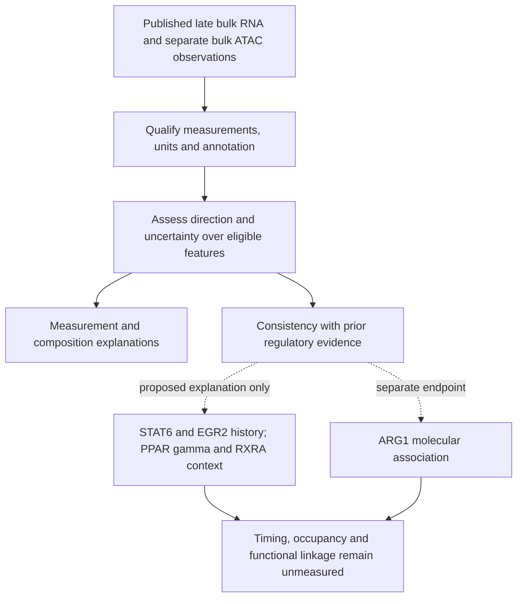

# DY1-P02: interpreting late RNA–ATAC discordance

30 October 2026. Owner-requested article-local question, proposed and exposed.
This develops the unresolved regulatory question in DY1-P01 into a specific
baseline measurement/model-discrimination question. It is not a new canonical
A-series RQ, a discovery of the STAT6–PPARγ pathway, or a claim of novelty.

## Research question

**Does the late bulk RNA–ATAC pattern in lung NAMs remain interpretable under
defensible measurement, mapping and RNA-composition analyses, and is it consistent
with independently established STAT6–EGR2–PPARγ/RXRA regulatory relationships?**

Composition within the separate bulk ATAC preparations remains unresolved. This
question can assess measured RNA-mixture contributions; it cannot exclude
unmeasured ATAC composition or certify a within-cell regulatory explanation.

Full source context is N. brasiliensis-associated type-2 immune history and the
paper's separate later IAV challenge. This candidate concerns the baseline host
molecular observations. Its endpoint is an assay-specific association, not
infection susceptibility, pathogen optimization, intervention prioritization or
proof of chromatin memory. The existing later-condition question remains separate.

## Published premise, repository observation and gap

The paper reports lower late Stat6/Egr2 RNA alongside accessibility changes and
PPARγ/RXRA-related observations in separate bulk preparations. The initial
scRNA-versus-ATAC wording should therefore be corrected: scRNA adds state and
composition information, while the highlighted discrepancy is bulk RNA versus
separate bulk ATAC. Exact figure locators are in the
[published evidence matrix](../PUBLISHED_EVIDENCE_BOUNDARIES_2026-10-30.md).

Our [baseline diagnostics](../BASELINE_QC_RESULTS_2026-10-30.md) establish file
integrity and an adapted sample profile; they do not estimate the gene/peak
effects or exclude mixture. The human descriptions show annotation-sensitive
RNA panels and weak within-disease recipient coupling; they do not test this
mouse axis. The unresolved question is whether there is a reliable cross-assay
pattern to explain before assigning a regulatory mechanism to it.

Earlier PPARγ memory and EGR2 relay studies are premises. The bounded
[literature refresh](LITERATURE_CONTEXT.md) adds a non-infectious cross-assay
reference and retains cofactor-dependent regulation as an alternative. The
contribution would be measurement validation and model discrimination in the NAM
context; published general mechanisms do not become new because the cell label changes.

## Working hypothesis and alternatives

Working hypothesis: some reported accessibility differences associated with the
PPARγ/RXRA regulatory context remain detectable despite nonparallel contemporary
RNA. This is compatible with distinct regulatory and transcriptional phases;
a single late snapshot does not establish that temporal sequence or persistence.
Stat6/Egr2 transcript abundance is not a measure of their earlier activity.

Relevant, nonexclusive explanations are:

- State abundance, cell origin or sampling changes account for bulk differences.
- Feature/counting definitions, peak-to-gene links, normalization, precision or
  source-version differences generate an apparent mismatch.
- Accessibility and occupancy/transcription are separated by cofactor or
  transcriptional-output requirements; accessibility alone is not activation.
- Continuing niche input maintains a state, rather than an autonomous memory
  persisting after verified cessation.

The PPARγ/RXRA association and these explanations can coexist. ARG1 is a separate
candidate downstream observation: it need not itself be discordant, and should
not define a gene set that is subsequently claimed to validate ARG1.

## Comparison, units and measured endpoint

| Field | Specification and limit |
|---|---|
| Population/context | Source-defined lung NAM bulk preparations at the published late baseline, history versus control; scRNA states only after independent population/assignment qualification |
| Biological unit | Independently collected animal or pool when source-qualified; the deposited-library/tag-to-pool/overlap map is unresolved. Cells, peaks and exon bins are not independent biological replicates |
| Primary comparison | Separate RNA and ATAC history/control contrasts over their full eligible universes, with uncertainty retained |
| Cross-assay endpoint | Direction/precision of mapped gene–region associations and sensitivity to defensible annotation choices; no subtraction of incomparable RNA and ATAC score scales |
| Composition endpoint | RNA state fractions and within-state expression only if units, condition/library support and common states qualify; separate bulk ATAC cannot establish within-state chromatin changes |
| Regulatory context | Pre-existing, source-qualified regulatory evidence compared with appropriate assay backgrounds; motif families, external binding and RNA remain distinct evidence types |
| Temporal/functional limit | No early-to-late trajectory, occupancy, enzyme output, mediator/outcome linkage or durable epithelial fate is measured by the present baseline comparison |

A nonsignificant RNA result alone establishes neither unchanged RNA nor poor
precision. Assess the effect interval against a justified biological margin.
A claim of near-zero expression change requires that margin and sufficient
precision; no such margin is invented here. Exact thresholds,
annotation resources, model and precision requirements remain prospective numerical
contract decisions, not post hoc choices made to maximize discordance.

## Additional extension work: feasibility, not completed numerical results

| Extension | What can start / required input | What it can answer | Current status |
|---|---|---|---|
| E1. External reference qualification | Inspect the listed gene-count matrix in GSE247223 and peak-count matrix in GSE248042; verify bytes, feature semantics, biological preparations, genotype/condition and batch labels, and cross-assay pairing separately | Whether a non-infectious macrophage dataset supports a defensible RNA–ATAC measurement benchmark | New source lead identified from primary paper/GEO records; qualification can start. Files have not been downloaded or hash-validated in this pass |
| E2. Cross-assay reference benchmark | E1 must pass; freeze a bounded comparison on the qualified reference counts with explicit mappings and uncertainty | How robust a concordance/discordance classification is to mapping and measurement choices in that reference | Feasible in principle after qualification, not execution-ready. Different macrophages and ongoing stimulation do not test NAM persistence or memory |
| E3. Uncertainty/threshold diagnostic | Prospectively specified synthetic data and realistic measurement scenarios, with any parameters estimated from real data disclosed | Whether significance thresholding alone can produce an apparent accessibility–RNA split | Technically feasible as a methodological extension; no biological result or demonstration that this explains the NAM paper |
| E4. Original NAM gene/region association | Recover qualified RNA counting semantics, ATAC common-region counts, source/pipeline/outlier information and fit-specific units | Whether the published baseline discrepancy survives defensible processing and annotation | Existing data/measurement hold remains; new external data do not repair it |
| E5. Composition and observational regulatory association | Qualified cell assignments/states/units, eligible contrasts, independent regulatory resources and valid backgrounds | Whether RNA mixture accounts for the pattern and whether a remaining association fits existing regulatory evidence | Conditional follow-up; no within-state ATAC, TF activity or causal mediation inferred |
| E6. Temporal regulatory evidence | Independently qualified external time-resolved datasets, with same-source reuse recorded | Whether a published temporal explanation is supported in its original reference context | Literature/metadata qualification only at present; no temporal reconstruction from the late NAM snapshot |

E1 is the most concrete new computational starting point: the external deposit
lists the type of peak-count matrix currently missing from the NAM package.
It is an additional reference analysis, not completion of the held original
reproduction. A successful source check must precede a new frozen numerical
contract and independent verification. No new numerical run was launched here.

## What the possible outcomes would teach

| Outcome | Interpretation |
|---|---|
| Mismatch disappears under defensible counting/mapping or is poorly resolved | The available evidence does not require a regulatory-memory explanation; retain measurement uncertainty |
| RNA differences are mainly associated with measured mixture | Composition contributes; this does not identify the within-state ATAC component or negate the paper's separate functional observations |
| A robust association remains in the expected regulatory context | Supports consistency with a regulatory model; does not identify early initiation, maintenance, direct occupancy or causal necessity |
| Cofactor/output evidence distinguishes accessibility from transcription in an external reference | Supports an alternative explanation in that reference; transfer to NAMs remains a separate test |
| Results are mixed or underpowered | Preserve mixed directions and intervals; do not expand gene sets or relax eligibility to obtain a coherent axis |

## Qualitative question map

This is a qualitative reasoning map. Arrows are not estimated effects. A
registered canonical SVG is pending any authorized canonical development.

## Relation to existing RQs and stopping rule

A1/A8 motivate separating regulatory/RNA state from later mature output; A14
motivates verified cessation versus continuing input; A2/A22 retain actual
source/delivery/recipient-output requirements; A19 retains functional reserve.
Their hypotheses and negative evidence are unchanged. The [article README](../README.md)
links their existing notes. This candidate does not supply their missing endpoints.

The owner requested framing and feasibility assessment. No human retain/reject
or scientific acceptance is recorded. The original DY1-P01 checklist stays closed
at its documented completed/held dispositions; E1–E6 are newly proposed extensions.
Stop numerical progression where a required source/assay/identity relationship
remains unknown, and keep published findings separate from future repository results.

## Technical framing review

The existing analysis chat reviewed only this dossier and its literature context.
Two corrections were adopted: nonsignificance does not itself imply poor precision,
and measured RNA-composition sensitivity does not resolve separate bulk-ATAC
composition. The review found no circular ARG1 validation, unjustified ready-to-run
claim or omitted qualified numerical job. It did not independently audit the
external papers/files; their access limits remain recorded. No numerical result
or human scientific acceptance was created.
