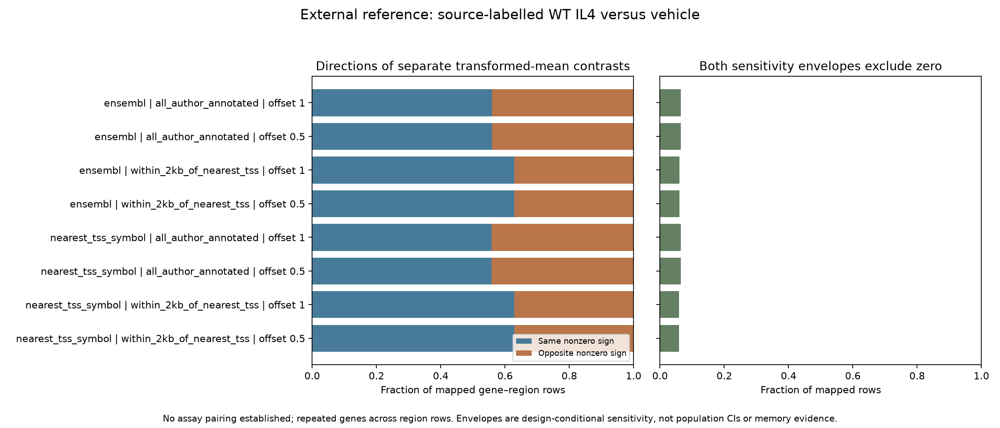
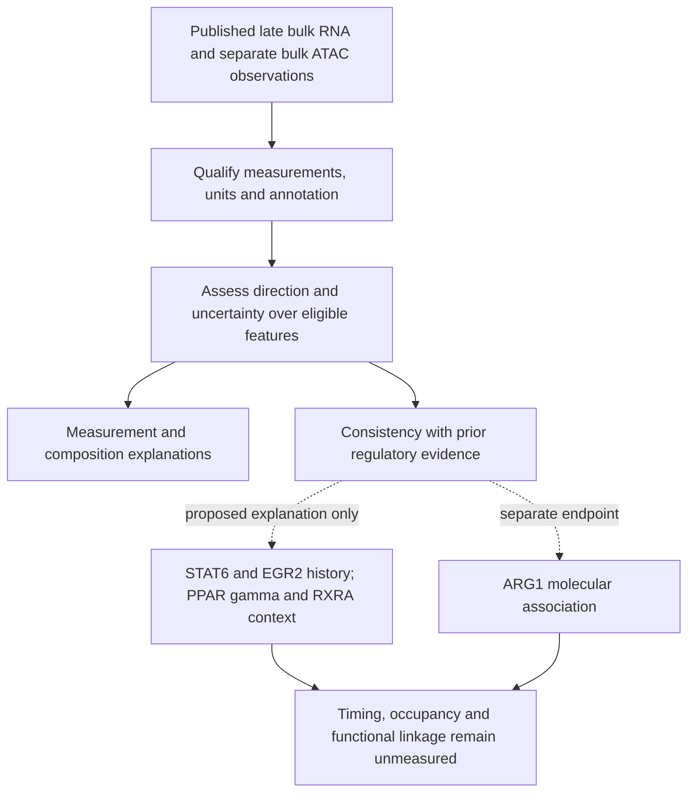

# DY1-P02: interpreting late RNA–ATAC discordance

30 October 2026. Owner-requested article-local question, proposed and exposed.
This develops the unresolved regulatory question in DY1-P01 into a specific
baseline measurement/model-discrimination question. It is not a new canonical
A-series RQ, a discovery of the STAT6–PPARγ pathway, or a claim of novelty.

## Research question

**Does the late bulk RNA–ATAC pattern in lung NAMs remain interpretable under
defensible measurement, mapping and RNA-composition analyses, and is it consistent
with independently established STAT6–EGR2–PPARγ/RXRA regulatory relationships?**

Composition within the separate bulk ATAC preparations remains unresolved. This
question can assess measured RNA-mixture contributions; it cannot exclude
unmeasured ATAC composition or certify a within-cell regulatory explanation.

Full source context is N. brasiliensis-associated type-2 immune history and the
paper's separate later IAV challenge. This candidate concerns the baseline host
molecular observations. Its endpoint is an assay-specific association, not
infection susceptibility, pathogen optimization, intervention prioritization or
proof of chromatin memory. The existing later-condition question remains separate.

## Published premise, repository observation and gap

The paper reports lower late Stat6/Egr2 RNA alongside accessibility changes and
PPARγ/RXRA-related observations in separate bulk preparations. The initial
scRNA-versus-ATAC wording should therefore be corrected: scRNA adds state and
composition information, while the highlighted discrepancy is bulk RNA versus
separate bulk ATAC. Exact figure locators are in the
[published evidence matrix](../PUBLISHED_EVIDENCE_BOUNDARIES_2026-10-30.md).

Our [baseline diagnostics](../BASELINE_QC_RESULTS_2026-10-30.md) establish file
integrity and an adapted sample profile; they do not estimate the gene/peak
effects or exclude mixture. The human descriptions show annotation-sensitive
RNA panels and weak within-disease recipient coupling; they do not test this
mouse axis. The unresolved question is whether there is a reliable cross-assay
pattern to explain before assigning a regulatory mechanism to it.

Earlier PPARγ memory and EGR2 relay studies are premises. The bounded
[literature refresh](LITERATURE_CONTEXT.md) adds a non-infectious cross-assay
reference and retains cofactor-dependent regulation as an alternative. The
contribution would be measurement validation and model discrimination in the NAM
context; published general mechanisms do not become new because the cell label changes.

## Working hypothesis and alternatives

Working hypothesis: some reported accessibility differences associated with the
PPARγ/RXRA regulatory context remain detectable despite nonparallel contemporary
RNA. This is compatible with distinct regulatory and transcriptional phases;
a single late snapshot does not establish that temporal sequence or persistence.
Stat6/Egr2 transcript abundance is not a measure of their earlier activity.

Relevant, nonexclusive explanations are:

- State abundance, cell origin or sampling changes account for bulk differences.
- Feature/counting definitions, peak-to-gene links, normalization, precision or
  source-version differences generate an apparent mismatch.
- Accessibility and occupancy/transcription are separated by cofactor or
  transcriptional-output requirements; accessibility alone is not activation.
- Continuing niche input maintains a state, rather than an autonomous memory
  persisting after verified cessation.

The PPARγ/RXRA association and these explanations can coexist. ARG1 is a separate
candidate downstream observation: it need not itself be discordant, and should
not define a gene set that is subsequently claimed to validate ARG1.

## Comparison, units and measured endpoint

| Field | Specification and limit |
|---|---|
| Population/context | Source-defined lung NAM bulk preparations at the published late baseline, history versus control; scRNA states only after independent population/assignment qualification |
| Biological unit | Independently collected animal or pool when source-qualified; the deposited-library/tag-to-pool/overlap map is unresolved. Cells, peaks and exon bins are not independent biological replicates |
| Primary comparison | Separate RNA and ATAC history/control contrasts over their full eligible universes, with uncertainty retained |
| Cross-assay endpoint | Direction/precision of mapped gene–region associations and sensitivity to defensible annotation choices; no subtraction of incomparable RNA and ATAC score scales |
| Composition endpoint | RNA state fractions and within-state expression only if units, condition/library support and common states qualify; separate bulk ATAC cannot establish within-state chromatin changes |
| Regulatory context | Pre-existing, source-qualified regulatory evidence compared with appropriate assay backgrounds; motif families, external binding and RNA remain distinct evidence types |
| Temporal/functional limit | No early-to-late trajectory, occupancy, enzyme output, mediator/outcome linkage or durable epithelial fate is measured by the present baseline comparison |

A nonsignificant RNA result alone establishes neither unchanged RNA nor poor
precision. Assess the effect interval against a justified biological margin.
A claim of near-zero expression change requires that margin and sufficient
precision; no such margin is invented here. Exact thresholds,
annotation resources, model and precision requirements remain prospective numerical
contract decisions, not post hoc choices made to maximize discordance.

## Extension execution and remaining holds

The owner authorized external qualification and every eligible E1-E6 extension.
The separate analysis chat completed five frozen runs. Its
[full results report](EXTENSION_RESULTS_2026-10-30.md) preserves every outcome. The coordinating
[review](REVIEW.md) checked prospective numerical designs, code, receipts, all
input/output hashes and saved results. No currently qualified extension is queued.
Completed reference work does not complete the held original NAM comparisons.

| Extension | Completed work | Specific remaining hold / reopening requirement |
|---|---|---|
| E1. External source qualification | GSE247223/GSE248042 counts, all 51 source-column joins, BioSample fields and author annotation audited; 259 structural checks pass | Across-condition preparation reuse, cross-assay pairing and batch labels remain unknown; ATAC vehicle title says 24h but characteristic says 25 hours; exact GENCODE annotation file/version is unresolved. These limit inference, not the completed audit |
| E2. Cross-assay reference benchmark | WT source-labelled IL4 versus vehicle: 25,802 RNA features and all 144,411 ATAC regions, two offsets, two mapping rules and a nearest-TSS distance subset; 1,608 arithmetic/category checks pass | Conditional Welch/all-pairing envelopes are not unconditional population CIs; partial overlap and batch are unqualified. Causal duration-matched effects, exact author replay and NAM persistence are not established |
| E3. Uncertainty/threshold diagnostic | Five fixed synthetic scenarios, 200,000 draws each; all 75 analytic checks pass | No empirical calibration to NAM RNA/ATAC, biological equivalence margin or demonstrated explanation of the original discrepancy |
| E4. Original NAM gene/region association | Existing file QC and adapted sample profile preserved; requirements reassessed | Need qualified RNA gene-count semantics, ATAC common-region counts/read-level QC, reconciled pipeline/annotation and author-excluded sample identity/rationale, plus fit-specific independent-pool/overlap evidence |
| E5. Composition/regulatory association | Existing CMO inventory, published regulatory premises and measurement boundaries preserved | Need validated cell-to-source assignments, state labels, biological units, condition/batch/common-state support and qualified regulatory resources/backgrounds. Separate bulk ATAC cannot identify within-state accessibility; external binding is not NAM occupancy |
| E6. Temporal reference | Six-deposit metadata audit (278 occurrences, 217 unique GSMs; 34 checks), then complete WT source-average RNA description (187,360 arithmetic checks and four partitions) | GSE115504 supplies averaged CPM without replicate variance or effective n; GSE151015 RNA/ATAC are baseline/24h while early evidence is other assays. No qualified matched temporal RNA-ATAC panel or common-region chromatin counts. Need appropriate time/assay coverage and preparation mapping for those claims |

ARG1 remains a separate downstream candidate. Neither external reference supplies
linked NAM RNA, occupancy, enzyme activity and functional-outcome measurements for
mediation. Published functional observations are retained; an unlinked molecular
association cannot establish the STAT6-EGR2-PPARgamma/RXRA-ARG1 causal chain.

## What the completed extensions show

- **Reference measurement benchmark:** about 56% of full mapped gene-region rows
  share a direction; about 63% do in the source nearest-TSS distance subset.
  Fixed offsets 1 and 0.5 change these proportions little. Both same and opposite
  directions remain. These are pair-weighted descriptions with repeated genes,
  not independent-trial proportions or a test against 50%. Only about 6% of rows
  have both declared sensitivity envelopes exclude zero; this alone establishes
  neither unchanged biology nor insufficient power.
- **Synthetic diagnostic:** equal nonzero truths yield 50.1145% detection-label
  mismatch with equal SE and 83.025% with unequal SE. Opposite truths also yield
  about 50% mismatch. Detection labels alone cannot identify biological agreement
  or disagreement. The assumptions are illustrative, not measured NAM properties.
- **RNA-only reference:** all 23,420 source rows are retained; 16,253 have a nonzero
  WT group average. At offset 1, second-minus-first log ratios are positive in
  9,484 rows and negative in 6,769. The median is 0.05265 (0.08296 at offset 0.5).
  These summarize ratios of group averages, not individual responses, uncertainty
  or a causal history effect. Mixed results and zero-response categories remain.

Evidence: [E1 qualification](../../../analysis/research/runs/DY1_P02_reference_source_v1/qualification.json),
[E2 mapping table](../../../analysis/research/runs/DY1_P02_reference_benchmark_v1/mapping_sensitivity.tsv),
[E3 diagnostic](../../../analysis/research/runs/DY1_P02_synthetic_uncertainty_v1/synthetic_diagnostic.png),
[E6 qualification](../../../analysis/research/runs/DY1_P02_temporal_source_v1/qualification.json),
[E6 RNA table](../../../analysis/research/runs/DY1_P02_source_average_response_v1/offset_sensitivity.tsv)
and [E6 figure](../../../analysis/research/runs/DY1_P02_source_average_response_v1/source_average_response.png).

Plan adjustments were evidence-driven: retain the complete ATAC effect universe
and apply annotation only during joining; distinguish a source-defined descriptive
comparison from unknown pairing/batch inference; separate eligible RNA-only E6
arithmetic from unavailable matched temporal evidence. The unrelated muscle RNA
subseries was not substituted for cultured memory RNA. The
[source-method assessment](SOURCE_METHODS_2026-10-30.md),
[temporal input assessment](TEMPORAL_INPUTS_2026-10-30.md) and
[temporal literature review](E6_SOURCE_REVIEW.md) retain exact qualifications.

## What the possible outcomes would teach

| Outcome | Interpretation |
|---|---|
| Mismatch disappears under defensible counting/mapping or is poorly resolved | The available evidence does not require a regulatory-memory explanation; retain measurement uncertainty |
| RNA differences are mainly associated with measured mixture | Composition contributes; this does not identify the within-state ATAC component or negate the paper's separate functional observations |
| A robust association remains in the expected regulatory context | Supports consistency with a regulatory model; does not identify early initiation, maintenance, direct occupancy or causal necessity |
| Cofactor/output evidence distinguishes accessibility from transcription in an external reference | Supports an alternative explanation in that reference; transfer to NAMs remains a separate test |
| Results are mixed or underpowered | Preserve mixed directions and intervals; do not expand gene sets or relax eligibility to obtain a coherent axis |

## Qualitative question map

This is a qualitative reasoning map. Arrows are not estimated effects. A
registered canonical SVG is pending any authorized canonical development.

## Additional feasibility assessment after E1–E6

The [paper/notes/results cross-check](FOLLOWUP_FEASIBILITY_2026-10-30.md) identifies
four prospective additions: F1 equal-gene/region-representation sensitivity with
qualified external inputs; F2 leave-one-component/donor panel robustness using
primary human inputs (external components require reaggregation); and F3 a
paired-modality macrophage time-course source whose EGA data require access and
identity qualification; plus F4 a descriptive NCOA2/GRIP1 cKO reference comparison
from existing counts, with group-specific provenance/model checks. None is a completed new run or a canonical RQ promotion.
The additions address measurement and interpretation gaps exposed by the completed
work; the original E1–E6 outcomes and inference limits are unchanged.

## Relation to existing RQs and stopping rule

A1/A8 motivate separating regulatory/RNA state from later mature output; A14
motivates verified cessation versus continuing input; A2/A22 retain actual
source/delivery/recipient-output requirements; A19 retains functional reserve.
Their hypotheses and negative evidence are unchanged. The [article README](../README.md)
links their existing notes. This candidate does not supply their missing endpoints.

The owner subsequently authorized qualification and eligible extension execution.
The five completed runs and remaining E4/E5 or inference holds are recorded above.
The original DY1-P01 checklist keeps its documented completed/held dispositions.
Reopen a held estimand only when its missing evidence is qualified, using a new
prospective versioned contract. No human retain/reject decision, scientific
acceptance, canonical-RQ promotion or mechanistic validation is recorded.

## Technical framing review

The existing analysis chat reviewed only this dossier and its literature context.
Two corrections were adopted: nonsignificance does not itself imply poor precision,
and measured RNA-composition sensitivity does not resolve separate bulk-ATAC
composition. The review found no circular ARG1 validation, unjustified ready-to-run
claim or omitted qualified numerical job. It did not independently audit the
external papers/files; their access limits remain recorded. No numerical result
or human scientific acceptance was created.

The earlier technical framing review remains historical. The subsequent
[execution review](REVIEW.md) covers all five newly completed runs and preserves
their stated biological limits.
