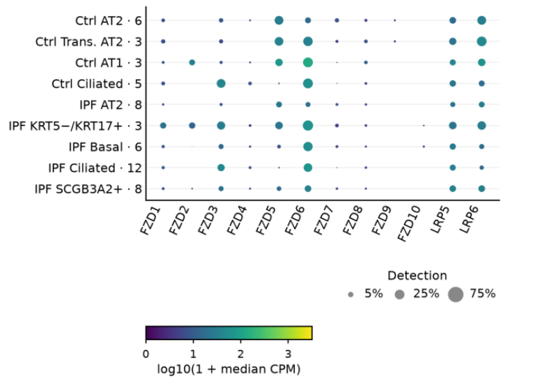
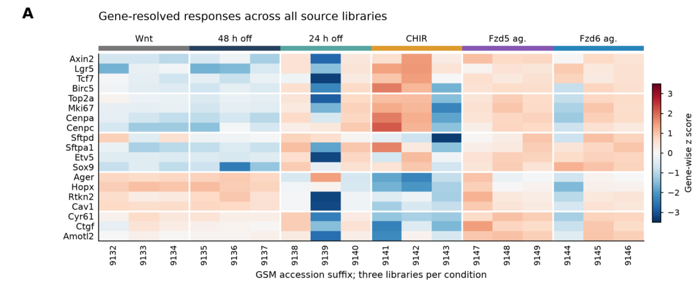
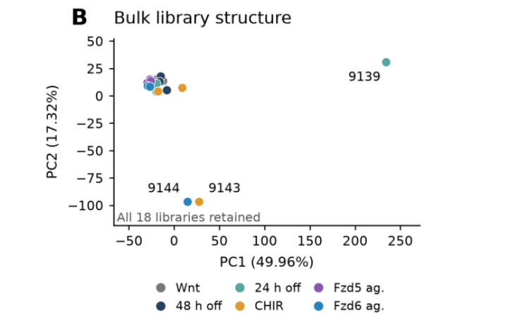
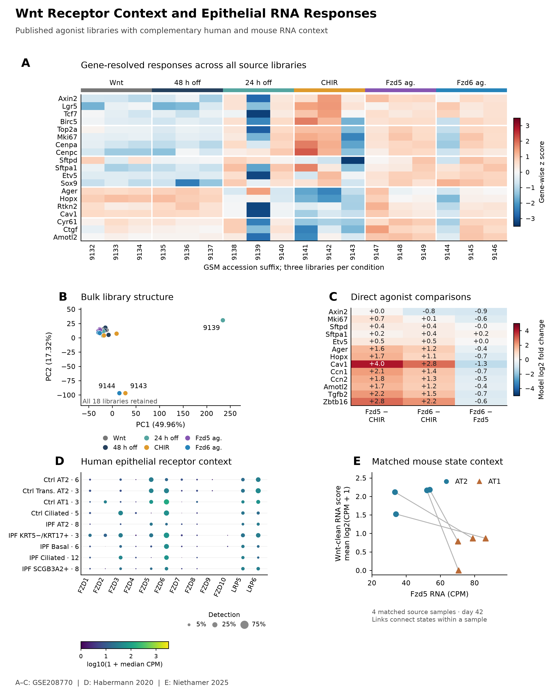

# Approved figure displays — 13 November 2026

These figures preserve approved public-data displays prepared for a research portfolio. They reuse the linked article analyses; they are not independent replication or new scientific acceptance. Numerical results and historical figures are unchanged.

[Article home](../README.md) · [Archive overview](../../../docs/PORTFOLIO_FIGURE_ARCHIVE_20261113.md)

G-SURF microscopy and personal outreach documents are deliberately excluded.

## Receptors

Figure 5. Human epithelial receptor context. Rows are source-defined states; row numbers identify eligible participant/sample units. Each unit/state has at least 50 cells, with at least three units per row. Color is log10(1 + median counts per million); dot area is median detection. Ctrl, control; IPF, idiopathic pulmonary fibrosis; Trans., transitional. These RNA measurements describe receptor context and do not predict agonist response.

[PNG](../../../analysis/research/runs/portfolio_nabhan_figures_20261113_v1/receptors.png) · [Provenance](../../../analysis/research/runs/portfolio_nabhan_figures_20261113_v1/manifest.json)

## Bulk Labeled

Approved presentation view of the existing article analysis; source units and limitations remain as documented in the linked article.

[PNG](../../../analysis/research/runs/portfolio_nabhan_figures_20261113_v1/bulk_labeled.png) · [Provenance](../../../analysis/research/runs/portfolio_nabhan_figures_20261113_v1/manifest.json)

## Wnt Pca

Figure 6. Expression patterns and library structure. (A) Gene-wise z scores; three libraries per source condition. Colors compare expression within each gene. CHIR is a GSK3 inhibitor used to modulate Wnt pathway activity. (B) PCA of all 18 libraries: PC1, 49.96%; PC2, 17.32% of variance. Colors identify conditions; labels mark separated libraries by accession suffix.

[PNG](../../../analysis/research/runs/portfolio_nabhan_figures_20261113_v1/wnt_pca.png) · [Provenance](../../../analysis/research/runs/portfolio_nabhan_figures_20261113_v1/manifest.json)

## Alternate Wnt composite

Earlier approved five-panel display of saved bulk RNA, PCA, direct effects, human receptor context and mouse within-unit differences. Not an additional analysis or independent validation; the current full portfolio separates these views. Culture independence remains unresolved and no selected bulk gene passes the per-contrast genome-wide FDR threshold.

[PNG](../../../analysis/research/runs/portfolio_nabhan_figures_20261113_v1/wnt_receptor_context.png) · [PDF](../../../analysis/research/runs/portfolio_nabhan_figures_20261113_v1/wnt_receptor_context.pdf) · [SVG](../../../analysis/research/runs/portfolio_nabhan_figures_20261113_v1/wnt_receptor_context.svg) · [Provenance](../../../analysis/research/runs/portfolio_nabhan_figures_20261113_v1/manifest.json)
