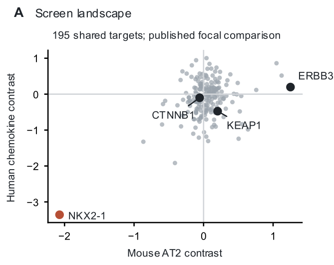
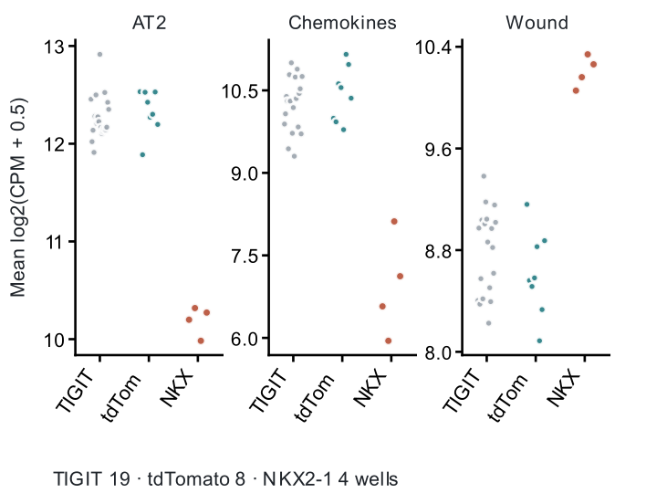
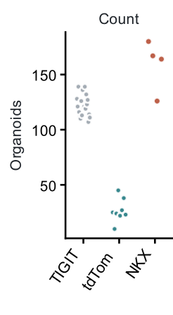
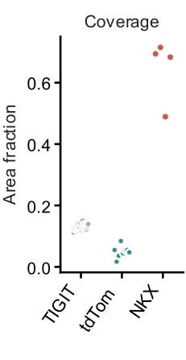
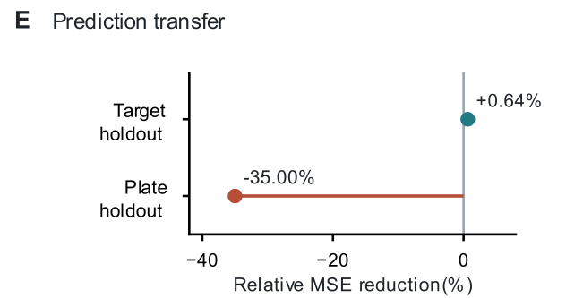

# Approved figure displays — 13 November 2026

These figures preserve approved public-data displays prepared for a research portfolio. They reuse the linked article analyses; they are not independent replication or new scientific acceptance. Numerical results and historical figures are unchanged.

[Article home](../README.md) · [Archive overview](../../../docs/PORTFOLIO_FIGURE_ARCHIVE_20261113.md)

G-SURF microscopy and personal outreach documents are deliberately excluded.

## Niche Landscape

Figure 7. Screen-wide context and the NKX2-1 comparison. Left: 195 shared target contrasts; each point is a target. Axes show plate-adjusted coefficients versus combined references in mean log2(TMM counts per million + 0.5) marker-panel units. Right: scores from 31 plate-1 technical wells: 19 TIGIT, eight tdTomato, and four NKX2-1-targeted wells. AT2 scores use mouse RNA; chemokine and wound-marker scores use human fibroblast RNA. TMM denotes trimmed mean of M values normalization.

[PNG](../../../analysis/research/runs/portfolio_nabhan_figures_20261113_v1/niche_landscape.png) · [Provenance](../../../analysis/research/runs/portfolio_nabhan_figures_20261113_v1/manifest.json)

## Niche

Figure 7. Screen-wide context and the NKX2-1 comparison. Left: 195 shared target contrasts; each point is a target. Axes show plate-adjusted coefficients versus combined references in mean log2(TMM counts per million + 0.5) marker-panel units. Right: scores from 31 plate-1 technical wells: 19 TIGIT, eight tdTomato, and four NKX2-1-targeted wells. AT2 scores use mouse RNA; chemokine and wound-marker scores use human fibroblast RNA. TMM denotes trimmed mean of M values normalization.

[PNG](../../../analysis/research/runs/portfolio_nabhan_figures_20261113_v1/niche.png) · [Provenance](../../../analysis/research/runs/portfolio_nabhan_figures_20261113_v1/manifest.json)

## Niche Count

Figure 8. Imaging context and prediction diagnostics. Left and center: day-14 organoid counts and image-area coverage for the 31 well identifiers in Figure 7. Right: relative reduction in equal-target mean squared prediction error after adding AT2 identity to an imaging/read-depth baseline, using 672 noncontrol wells and 201 targets. Positive values mean lower error; negative values mean worse prediction.

[PNG](../../../analysis/research/runs/portfolio_nabhan_figures_20261113_v1/niche_count.png) · [Provenance](../../../analysis/research/runs/portfolio_nabhan_figures_20261113_v1/manifest.json)

## Niche Coverage

Figure 8. Imaging context and prediction diagnostics. Left and center: day-14 organoid counts and image-area coverage for the 31 well identifiers in Figure 7. Right: relative reduction in equal-target mean squared prediction error after adding AT2 identity to an imaging/read-depth baseline, using 672 noncontrol wells and 201 targets. Positive values mean lower error; negative values mean worse prediction.

[PNG](../../../analysis/research/runs/portfolio_nabhan_figures_20261113_v1/niche_coverage.png) · [Provenance](../../../analysis/research/runs/portfolio_nabhan_figures_20261113_v1/manifest.json)

## Niche Prediction

Figure 8. Imaging context and prediction diagnostics. Left and center: day-14 organoid counts and image-area coverage for the 31 well identifiers in Figure 7. Right: relative reduction in equal-target mean squared prediction error after adding AT2 identity to an imaging/read-depth baseline, using 672 noncontrol wells and 201 targets. Positive values mean lower error; negative values mean worse prediction.

[PNG](../../../analysis/research/runs/portfolio_nabhan_figures_20261113_v1/niche_prediction.png) · [Provenance](../../../analysis/research/runs/portfolio_nabhan_figures_20261113_v1/manifest.json)
