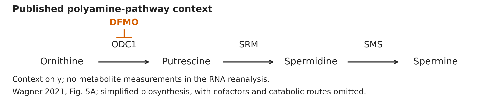
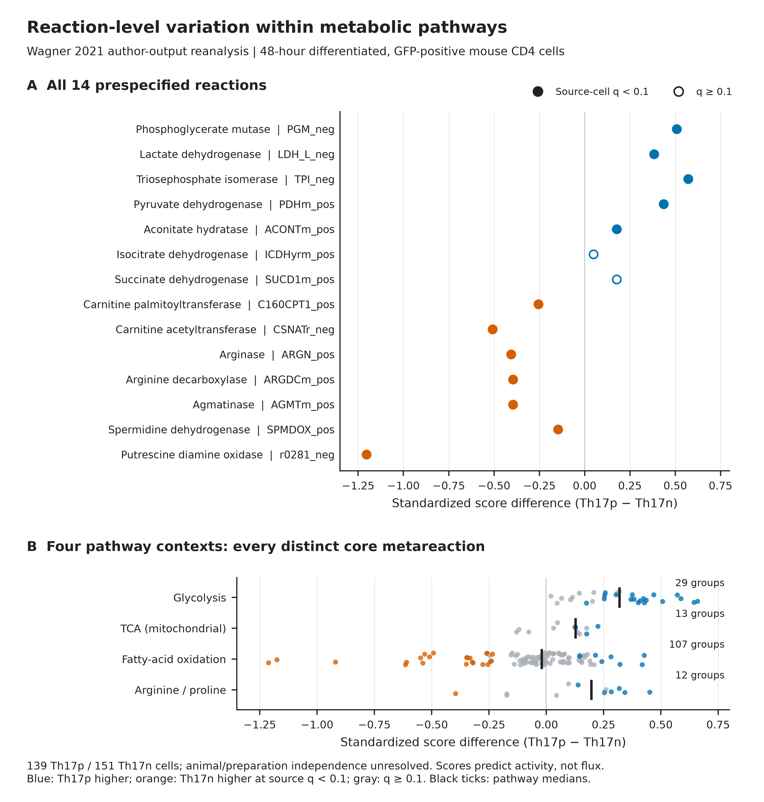
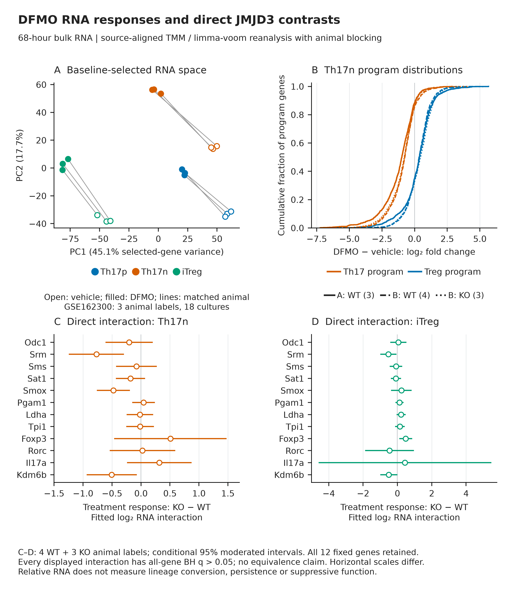

# Approved figure displays — 13 November 2026

These figures preserve approved public-data displays prepared for a research portfolio. They reuse the linked article analyses; they are not independent replication or new scientific acceptance. Numerical results and historical figures are unchanged.

[Article home](../README.md) · [Archive overview](../../../docs/PORTFOLIO_FIGURE_ARCHIVE_20261113.md)

G-SURF microscopy and personal outreach documents are deliberately excluded.

## Polyamine pathway context

Explanatory pathway context drawn for the existing Wagner reanalysis. The diagram does not add measured flux or establish causal links from RNA.

[PNG](../../../analysis/research/runs/portfolio_wagner_figures_20261113_v1/wg_polyamine_context_v2.png) · [PDF](../../../analysis/research/runs/portfolio_wagner_figures_20261113_v1/wg_polyamine_context_v2.pdf) · [SVG](../../../analysis/research/runs/portfolio_wagner_figures_20261113_v1/wg_polyamine_context_v2.svg) · [Provenance](../../../analysis/research/runs/portfolio_wagner_figures_20261113_v1/manifest.json)

## Compass reaction-score context

Fourteen reaction rows correspond to thirteen meta-reactions across four pathway contexts. Compass scores describe transcriptome-constrained reaction potential, not measured metabolic flux; cells are not independent animal replicates.

[PNG](../../../analysis/research/runs/portfolio_wagner_figures_20261113_v1/wg_reactions_v5.png) · [PDF](../../../analysis/research/runs/portfolio_wagner_figures_20261113_v1/wg_reactions_v5.pdf) · [SVG](../../../analysis/research/runs/portfolio_wagner_figures_20261113_v1/wg_reactions_v5.svg) · [Provenance](../../../analysis/research/runs/portfolio_wagner_figures_20261113_v1/manifest.json)

## DFMO transcriptomic context

Fixed contrasts and source RNA estimates are shown without new tests. No selected gene passes the stated per-contrast multiple-testing threshold. RNA is not metabolic flux or immune function.

[PNG](../../../analysis/research/runs/portfolio_wagner_figures_20261113_v1/wg_rna_v2.png) · [PDF](../../../analysis/research/runs/portfolio_wagner_figures_20261113_v1/wg_rna_v2.pdf) · [SVG](../../../analysis/research/runs/portfolio_wagner_figures_20261113_v1/wg_rna_v2.svg) · [Provenance](../../../analysis/research/runs/portfolio_wagner_figures_20261113_v1/manifest.json)
