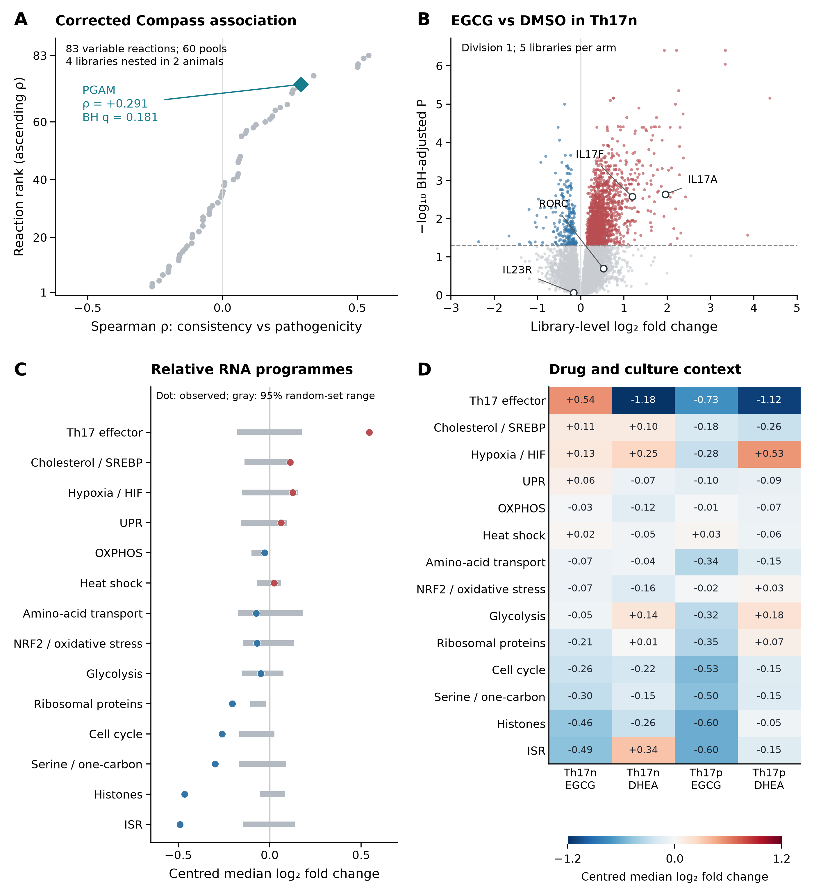

# Approved figure displays — 13 November 2026

These figures preserve approved public-data displays prepared for a research portfolio. They reuse the linked article analyses; they are not independent replication or new scientific acceptance. Numerical results and historical figures are unchanged.

[Article home](../README.md) · [Archive overview](../../../docs/PORTFOLIO_FIGURE_ARCHIVE_20261113.md)

G-SURF microscopy and personal outreach documents are deliberately excluded.

## PGAM perturbation context

Presentation of the existing PGAM RNA comparison, retaining source contrasts and sensitivity qualifications. Expression patterns do not establish pathogenic function or independent replication.

[PNG](../../../analysis/research/runs/portfolio_pgam_figures_20261113_v1/figure2_pgam_v1.png) · [PDF](../../../analysis/research/runs/portfolio_pgam_figures_20261113_v1/figure2_pgam_v1.pdf) · [SVG](../../../analysis/research/runs/portfolio_pgam_figures_20261113_v1/figure2_pgam_v1.svg) · [Provenance](../../../analysis/research/runs/portfolio_pgam_figures_20261113_v1/manifest.json)
