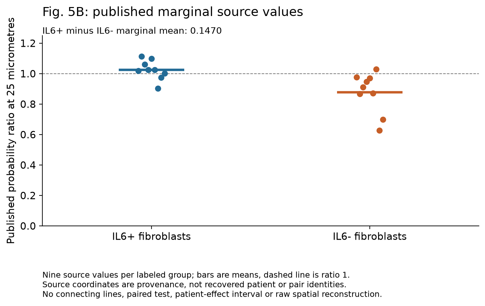

# Yadav: spatial, context and article-local synthesis checkpoint

30 October 2026. Owner **Yd1-P01**. The selected six-step source-feasibility
sequence is complete to the available-evidence boundary. F1-F5 and R1 remain
technically reviewed source descriptions; S1 now adds a bounded marginal run and
an explicit raw-reconstruction hold. C1 provenance and the Wg-P06/thesis synthesis
are complete as documentation. This is not scientific acceptance, a new RQ, an
experiment package or a claim of independent replication.

[Functional/RNA results](TECHNICAL_RESULTS.md) ·
[Spatial and source-access audit](SPATIAL_CONTEXT_AUDIT.md) · [Figures](FIGURES.md)

## S1: published marginals completed; raw reconstruction held

The Fig. 5B workbook columns map unambiguously to IL6-positive and IL6-negative
fibroblast labels. The exposed contract froze at commit
294a28b before this calculation; it retains all 18 source values and coordinates.
Coordinates identify workbook cells, not patients or paired observations.

| Published category | Source values | Mean | Median | Range |
| --- | ---: | ---: | ---: | --- |
| IL6+ fibroblast | 9 | 1.024680 | 1.025623 | 0.902191-1.114012 |
| IL6- fibroblast | 9 | 0.877634 | 0.912276 | 0.627208-1.029468 |

The fixed IL6+ minus IL6- marginal mean difference is **0.1470457** in the published
probability-ratio units. Both marginal ranges include values on either side of
one. No paired differences, tests, patient-effect intervals, new probability
ratios or spatial null were computed. The source labels do not resolve the
duplicated IL6+ Methods category.

[Contract](config/spatial_marginals_contract_v1.json) ·
[Source coordinates](../../analysis/research/runs/Yd1_spatial_marginals_v1/observations.csv) ·
[Marginals](../../analysis/research/runs/Yd1_spatial_marginals_v1/marginal_summaries.csv) ·
[Difference](../../analysis/research/runs/Yd1_spatial_marginals_v1/contrast.csv) ·
[Receipt](../../analysis/research/runs/Yd1_spatial_marginals_v1/receipt.json)

A separate openpyxl 3.1.5 read of the original XLSX verified every value, marginal
mean/median/range and the difference. The saved figure was visually inspected.
Raw reconstruction still needs the versioned spatial objects, class definitions,
patient/field/result joins and exact execution details listed in the
[audit's reopening conditions](SPATIAL_CONTEXT_AUDIT.md#s1-available-marginal-description-and-raw-hold).
The recovered participant/probe lists improve provenance but do not fill those gaps.

## C1 portability matrix

Purpose: determine which source/model statements can travel between contexts,
using primary provenance and existing repository evidence. Biological units,
capture and disease context constrain transport. No atlas download, expression
scan, correlation or new numerical context comparison was necessary to answer
this qualification question.

| Source / exact identity | Capture, unit and detection limits | Reuse / permitted inference / remaining hold |
| --- | --- | --- |
| **Mouse lung macrophages and cocultures**: Yadav Fig. 1/S2/6; GSE242510, six frozen library triplets | Reporter/protein evidence and selected CD11b+ culture context differ from adapted RNA classes. Unknown preparations/pooling/batches; 87 core macrophage-like cells and 518 mixed cells in WT coculture 1; 82/64 macrophage-like cells in Fib-alone libraries. | F1-F5/R1 and the paper reuse the same sources. R1 supports library-level Arg1 direction, with mixed Il6 KO-versus-WT directions, not pure-state or population genotype effects. It does not establish human neutrophil equivalence. |
| **IPF tissue neutrophils**: Yadav Fig. 2 MIBI; Fig. 5B Xenium; supplemental Table S1 | MIBI samples five reported IPF lungs and ARG1-selected fields; Xenium lists nine participants and a targeted probe panel. Protein phenotyping and ARG1-positive transcript groups are different measured entities; ARG1-positive Xenium cells are not automatically neutrophils. | Table S1 ID 1 is assigned both imaging applications. Field selection limits whole-lung prevalence. Source localization is compatible with a niche; no secretion, transfer, homogeneous lineage or independent imaging replication follows. Raw reconstruction remains held. |
| **Peripheral-blood neutrophil / lung-fibroblast cultures**: Yadav Fig. 5D-F and 6G | Two source donor combinations, technical cultures nested; 5D D2 blank. Blood isolation/culture and recipient lung context are not IPF tissue sampling. Shared 5D-F cultures and unknown cross-figure donor reuse remain. | Functional source directions are relevant to the nominated Wg-P06 model. They do not show that blood cells represent every IPF tissue source, nor establish a donor-population effect or source-specific action of coculture-wide blockade. |
| **BAL mixture**: Prasse 2019; GSE70867 -> GSE70866; GPL14550 selection; GEO updated 2019-04-03 | Yadav Fig. 1D reports 112 IPF and 20 healthy subjects for its selected platform. BAL bulk arrays mix cell abundance and per-cell expression; no single-cell source assignment. GSM/clinical records exist, but this audit did not reconstruct the selected donor/probe/center joins. | The source study and Yadav's reanalysis are one lineage. GSE70867 is a multi-platform superseries; whole-study totals are not the GPL14550 denominator. Useful as disease-associated bulk context, not neutrophil-specific activity, secretion, matching to imaging/cocultures or mechanistic validation. |
| **Strunz mouse injury time course**: GSE141259; updated 2022-05-17; [primary Fig. 1 / Methods](https://doi.org/10.1038/s41467-020-17358-3) | WholeLung Drop-seq captures multiple compartments across injury time; separate HighResolution data enrich epithelium. Deposited cellinfo/sample fields and reported mouse replicates permit a future unit audit; the actual Yadav-selected whole-lung objects/subset are not supplied. Sparse detection is not protein absence. | Yadav already reuses this source. Ravel [A5 audit](../../RQ_Specified/A5_developmental_programme_reuse/DATA_AUDIT.md) and [dataset register](../../docs/DATASETS.md) use the epithelial component; its verified units cannot simply be transferred to a myeloid subset. New reuse is not independent validation, and a whole-lung time course does not measure substrate routing. |
| **Tsukui mouse mesenchyme**: GSE210341 / PMID 38987592; Nature 2024; updated 2024-07-12 | CD45/CD31/EpCAM/Ter119-negative enrichment; 12 reported biological samples tagged across four injury times, pooled over four sequencing lanes. GEO/README provide the CMO-day mapping; a single GSM or a lane is not a biological replicate. Myeloid capture is deliberately depleted. | Suitable provenance for fibroblast-state RNA context, not absence/presence of a myeloid source or source-recipient covariance. Yadav's exact merged inputs and demultiplexed/sample joins remain unqualified. Ravel's [GSE132771 entry](../../docs/DATASETS.md) is Tsukui 2020, a distinct accession that must not substitute for this reference. |
| **NSCLC / adjacent and control lung neutrophils**: Salcher 2022; [processed version 2022.10.20](https://zenodo.org/records/7227571); author luca code | Fig. 1/S1 documents weak neutrophil capture in many platforms and enrichment in the BD Rhapsody UKIM-V data. Patient/sample/study annotations exist, but the Yadav-selected file, version, donors and filtering joins are unknown. Detection of ARG1 or IL6R was used to select its plotted cells. | RNA compatibility in tumor-associated contexts does not establish IPF IL6R function. The source atlas incorporates Adams/Habermann control data also represented in Ravel's dataset register: parent-source overlap is known, exact donor overlap is unjoined. Avoid independent-replication claims or a cell-level population correlation. |

Primary locators, exact access outcomes and metadata snapshot hashes are in
[SPATIAL_CONTEXT_AUDIT.md](SPATIAL_CONTEXT_AUDIT.md#c1-source-qualification-locators).
For Salcher, the primary Results distinguish a 298-person core atlas from a
318-person extended atlas; Yadav states 309 patients and more than 1.2 million
cells across 19 studies. Those descriptions are retained rather than silently
substituting a cohort count. Only the actual input/version and filter record
can resolve whether Yadav used a legitimate subset or another source version.
The Zenodo model archive is also not an all-gene expression matrix.

**C1 disposition:** provenance/eligibility work suffices for this scoped question.
The available atlases cannot replace unavailable Yadav spatial inputs or the
joint extracellular substrate measurements needed for Wg-P06. No further
numerical comparison is proposed here. Reopen a context analysis only after a
specific estimand, exact versioned input, cell capture/detection assessment,
donor/sample mapping and reuse/overlap audit qualify it, then return a prospective
design before numerical execution.

## Article-local synthesis: evidence types remain separate

| Evidence layer | What is supported | What remains unmeasured |
| --- | --- | --- |
| **Published mechanisms / premises** | Yadav's proposed P2RX4/IL-6/ARG1/ornithine circuit has intervention and localization evidence. The existing [P06 source review](../gate2_W1_wagner_th17_autoimmunity/rq_derivation/SOURCES_AND_GROUNDING.md) retains Hamanaka's recipient arginine requirement and Lee's OAT/ROS alternative. | The source comparisons do not by themselves quantify joint arginine consumption/ornithine delivery at the recipient or distinguish every routing/signaling alternative. Fig. 3K remains relative metabolite abundance. |
| **Source reanalysis** | F1-F5 retain all selected source arms and unfavorable uncertainty; mouse hydroxyproline's Welch interval spans zero. R1 retains lower macrophage-like Arg1 across KO libraries and heterogeneous fibroblast Il6 KO-versus-WT differences. S1 describes published marginal values only. | These are the authors' source data again, with unknown patient/preparation mappings, mixed-cell selection and technical nesting. They are not new biological replication or a demonstration of the entire circuit. |
| **Existing repository observations** | The [A3 dossier](../../docs/research_dossiers/A3.md) retains the ineligible ornithine gene set and confounded pseudobulk context. Wg's Th17 RNA/score work supplies measurement limits. Ravel's source-reuse records inform C1. | Ineligibility is not evidence against Yadav; transcript/reaction scores do not measure lung substrate transfer, arginase activity or regeneration. Existing unrelated RQs and decisions are unchanged. |
| **Wg-P06 / thesis gap** | The same source-supported blood-neutrophil/lung-fibroblast model remains nominated for a context/model comparison. | Actual extracellular substrate exposures, recipient routing and viable-recipient-normalized functional output remain unmeasured here; epithelial differentiation and tissue function are a further missing bridge. |

The [current Wg-P06 card](../gate2_W1_wagner_th17_autoimmunity/rq_derivation/P06.md)
remains authoritative and unchanged. Its hypothesis is that arginine preservation
can partly offset lost ornithine supply when recipient arginine is limiting.
Its strongest rival remains supply dominance without biologically relevant
arginine compensation over the actual conditioned range. This checkpoint
neither selects between those explanations nor establishes a crossover.

The current result makes the evidence boundary more explicit; it does not
materially reframe the question or propose a new discriminator. The valid
4 October P06 source review and the 30 October reading/source qualification are
reused with their recorded access limits. No renewed novelty certification,
new experiment package or broader literature clearance is claimed.
If the question/discriminator is later changed, follow
[the literature workflow](../../docs/LITERATURE_WORKFLOW.md) before freezing it.
Effect margin, precision, physiological exposure range and bench readiness remain
unknown. Reduced collagen cannot be relabeled epithelial regeneration.

## Full completion and hold ledger

| Job | Available work completed | Stronger work held / reopening evidence |
| --- | --- | --- |
| Q1 / steps 1-2 | Source/assay audit, source mapping and identity qualification. | Explicit unresolved definitions/identities remain in the source audits. |
| F1 | 3B/3D/5A marginal slice descriptions. | Patient assignment and original normalization map for patient effects. |
| F2 | 5D-F and separate 6G donor-combination descriptions; missing value retained. | Donor crossing, sharing, well pairing and sufficient qualified independent units for broader inference. |
| F3 | Two reported-animal contrasts with conditional Welch intervals. | Allocation/batch/control-genotype and targeting evidence for stronger causal claims. |
| F4 | All selected rescue/OAT/genetic arms; distinct collagen/alpha-SMA endpoints. | Preparation identity and route/specificity evidence for population or unique-mechanism claims. |
| F5 | Both relative metabolite abundances. | Tracer/normalizer data for flux or absolute synthesis claims. |
| R1 | Complete matrix integrity, fixed annotation/composition and both QC views of three contrasts. | Preparation/pool/batch identities and class validity for population models; no label retuning or endpoint expansion. |
| S1 | Availability/definition audit and all 18 published marginal values. | Raw spatial inputs, definitions, joins and exact code/call/subsamples as enumerated in the audit. |
| C1 | Seven-context provenance and portability matrix, source-reuse distinctions and version holds. | A selected comparison plus exact files, unit/capture and reuse qualification; no arbitrary atlas scan. |
| Step 6 synthesis | Article-local relation to unchanged Wg-P06 and the thesis aim. | Joint substrate/routing/functional measurements and a separate epithelial-function bridge; no scientific decision or readiness promotion. |

Access failures are retained in the audit: browser challenges/cache misses,
Nature/Cell access failures and an unresolved Tsukui XML HTTP 500. Alternative
primary metadata/author XML recovered the usable definitions; missing raw spatial
objects remain a source hold. The S1 numerical run executed successfully.
There is **no feasible work outstanding within this authorized bounded checkpoint**;
the stronger jobs above require the stated evidence or a newly selected scope.
Preserve frozen v1/v2 outputs and both ignored source caches. No Notion write,
push, PR, remote merge or external message was made.
