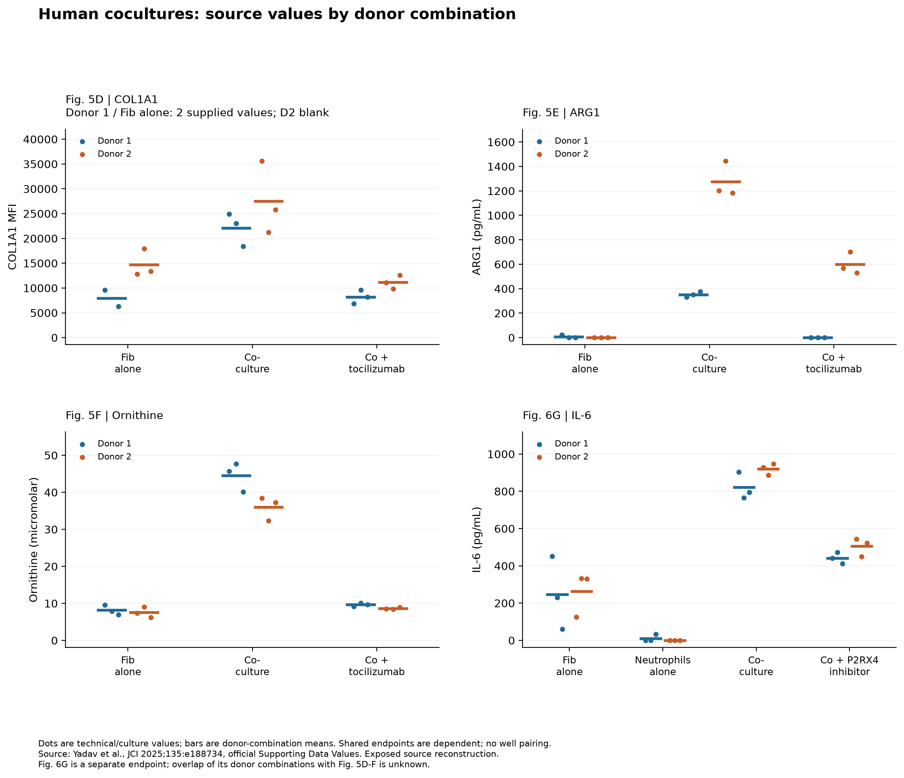
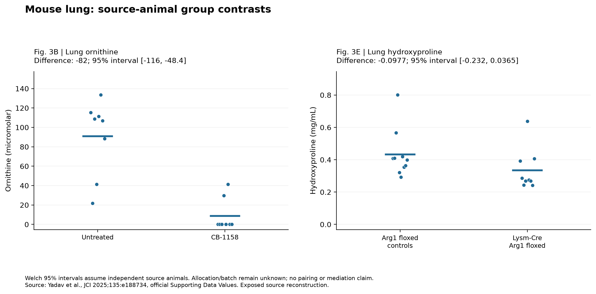
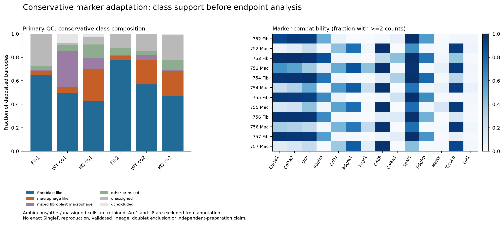
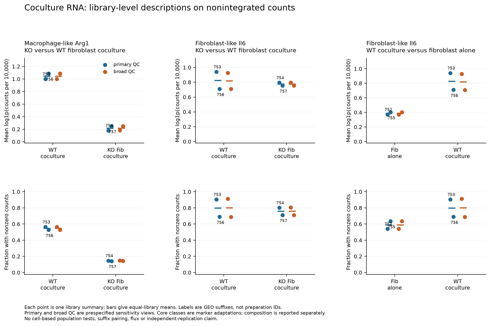

# Yadav checkpoint figures

30 October 2026. [Current interpretation and full job ledger](CONTEXT_AND_SYNTHESIS.md);
[functional/RNA detail](TECHNICAL_RESULTS.md).
All plots reuse published source data; none constitutes independent replication.
The v2 functional/QC display replaces only figure links, preserving all v1 files
and numerical tables. PDFs are saved beside each PNG.

| Figure | PDF | What is measured |
| --- | --- | --- |
| [F1 human slices](../../analysis/research/runs/Yd1_figure_display_v2/f1.png) | [PDF](../../analysis/research/runs/Yd1_figure_display_v2/f1.pdf) | Source slice endpoints; no patient inference. |
| [F2 human cocultures](../../analysis/research/runs/Yd1_figure_display_v2/f2.png) | [PDF](../../analysis/research/runs/Yd1_figure_display_v2/f2.pdf) | Each source donor combination, with missing D2 preserved; 6G kept separate. |
| [F3 mouse lung](../../analysis/research/runs/Yd1_figure_display_v2/f3.png) | [PDF](../../analysis/research/runs/Yd1_figure_display_v2/f3.pdf) | Reported source-animal values and conditional Welch intervals. |
| [F4 culture arms](../../analysis/research/runs/Yd1_figure_display_v2/f4.png) | [PDF](../../analysis/research/runs/Yd1_figure_display_v2/f4.pdf) | Rescue, OAT and Arg1-genotype arms; alpha-SMA separate. |
| [F5 metabolites](../../analysis/research/runs/Yd1_figure_display_v2/f5.png) | [PDF](../../analysis/research/runs/Yd1_figure_display_v2/f5.pdf) | Relative abundance, not flux. |
| [Technical QC](../../analysis/research/runs/Yd1_figure_display_v2/qc.png) | [PDF](../../analysis/research/runs/Yd1_figure_display_v2/qc.pdf) | Every deposited barcode; color saturation at 10% is display only. |
| [Annotation / composition](../../analysis/research/runs/Yd1_annotation_v1/annotation.png) | [PDF](../../analysis/research/runs/Yd1_annotation_v1/annotation.pdf) | Fixed marker classes, mixed/unassigned states and held-out compatibility. |
| [R1 RNA](../../analysis/research/runs/Yd1_rna_endpoints_v1/rna.png) | [PDF](../../analysis/research/runs/Yd1_rna_endpoints_v1/rna.pdf) | Library/class transcript summaries under both QC masks. |
| [S1 spatial marginals](../../analysis/research/runs/Yd1_spatial_marginals_v1/spatial_marginals.png) | [PDF](../../analysis/research/runs/Yd1_spatial_marginals_v1/spatial_marginals.pdf) | All published Fig. 5B values, no pairing or raw reconstruction. |

