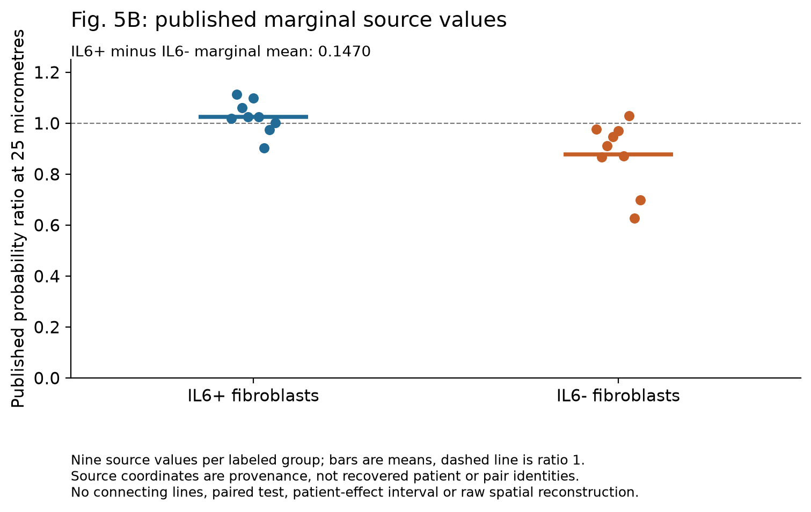

# Yadav et al. (2025) — Arginine metabolism and fibroblast collagen production

<a id="yadav-2025-source-evidence-and-article-local-synthesis"></a>

<a id="how-myeloid-cells-support-fibroblast-collagen-production"></a>

## Published findings

```text
Injured lung: a fibroblast signal and a myeloid metabolite form a reciprocal circuit
  Extracellular ATP → fibroblast P2RX4 → IL-6 release
    └─ IL-6 supports ARG1 expression in nearby myeloid cells.
         ├─ Mouse fibrosis: macrophages are a major ARG1-expressing population.
         └─ Human fibrotic lung: neutrophils supply prominent ARG1 signal.
       ARG1 converts arginine to ornithine → substrate for fibroblast proline metabolism
         └─ Arginase inhibition lowers collagen output. Ornithine supplementation
            partially restores COL1A1 staining in coculture.
  Human spatial measurements place the cell types near one another. Lung metabolite
  abundance and collagen measurements do not directly trace carbon between cells.

Implication: fibroblasts can recruit a metabolic contribution to matrix synthesis
             from different myeloid populations in mouse and human fibrosis.
```

The coculture experiment tested whether adding ornithine could restore collagen staining after arginase inhibition. Measurements of lung metabolites and tissue collagen supplied distinct in vivo endpoints. [Paper, Fig. 3 and Supplementary Fig. 3C](https://doi.org/10.1172/JCI188734) · [Cell sources, collagen response and P2RX4, Figs. 1–6](https://www.jci.org/articles/view/188734)

<details>
<summary>Detailed published evidence</summary>

<a id="evidence-card"></a>

### Experimental evidence

| Question / exact locator | Evidence | Main limit |
| --- | --- | --- |
| Who supplies ARG1? Fig. 1A-C, S1-S2; Fig. 2A-C | Mouse coculture RNA, reporter/flow evidence and human IPF MIBI | Mouse macrophages and human neutrophils are distinct source contexts. The small mouse LY6G+CD64+CD11C+ population has unresolved lineage correspondence. |
| Does ARG1 affect matrix output? Fig. 3B-E, H-K; S3B-D | Inhibitor/genetic comparisons, ornithine, COL1A1, lung hydroxyproline and fibroblast metabolite abundance | Converging interventions strengthen the circuit. LysM-Cre targeting still needs assessment; collagen is not alpha-SMA or epithelial repair. |
| Is ornithine universally sufficient? Fig. 3F-G; S3C-D | Supplementation increases selected collagen endpoints; the in vivo effect depends on injury context | No universal effect or self-sustaining loop follows. Alpha-SMA does not track the reported ornithine/OAT effect in S3D. |
| Is IL-6 involved? Fig. 4C-D; Fig. 5A, D-F | Mouse IL-6/ARG1 comparisons, amount-normalized ARG1, human slice/coculture blockade | Whole-animal IL-6 deletion affects abundance/environment. Human cultures have few donors; coculture-wide blockade is not source-specific. |
| Is the interaction spatially plausible? Fig. 5B | Xenium co-occurrence at 25 micrometres in nine patients | Proximity is not secretion, transfer or receptor engagement; tissue structure remains an alternative. |
| Is the receptor comparison disease-matched? Fig. 5C | ARG1/IL6R correlation in a reused NSCLC neutrophil atlas | Not an IPF cohort; gene-detection filtering and donor/study composition require assessment. |
| What initiates the circuit? Fig. 6C-G | P2RX4 perturbation and measured IL-6 in mouse/human systems | The source of eATP is not uniquely established. |

**Metabolic evidence qualification:** the Discussion mentions metabolic labeling,
but Fig. 3K, its legend and LC-MS Methods (p. 14) describe relative proline and
hydroxyproline abundance after ARG1 inhibition, without an identified tracer or
isotopologue analysis. The inspected S1-S3 supplement does not resolve this.
Record metabolite abundance; do not call this panel measured intercellular flux
or isotope-resolved incorporation into collagen. This reporting limit does not
negate the combined perturbation evidence.

</details>

## Ravel analyses and results

Ravel recovered three distinct results in the source data.

| Comparison | What changed |
|---|---|
| Coculture with arginase inhibition | Ornithine supplementation partly restored mean COL1A1 staining. |
| Mouse lungs with arginase inhibition | Mean ornithine concentration was lower. |
| Mouse lungs with myeloid *Arg1* deletion | The interval for the hydroxyproline difference included zero. |

These assays leave open how much myeloid-derived substrate reaches collagen in vivo. [Coculture and mouse results](TECHNICAL_RESULTS.md)

## Data and methods

The source includes mouse lungs, human tissue and cocultures. Ravel kept culture-level staining, mouse metabolite concentrations and tissue hydroxyproline in their original assay units. [Functional sources and comparisons](TECHNICAL_RESULTS.md)

<details>
<summary>Experimental and computational methods</summary>

<a id="stepwise-analysis-plan"></a>

### Analysis design

<a id="1-finish-the-claim-to-assay-map"></a>

#### Assays underlying the published findings

Purpose: critical interpretation. Review **Fig. 3 → Figs. 4-6 → Figs. 1-2**,
using S3C-D for rescue/endpoint specificity and S2 for source identity. For each
arrow, record species/model, intervention, comparator, endpoint, biological unit,
leading alternative and the figure that addresses it. Separate RNA, protein,
spatial, metabolite and intervention evidence.

The table above is the starting map. Resolve the main-text description of S3C
(coculture rescue) against its legend (which says monocultured fibroblasts) and
actual panel/source records before coding its contrast. Preserve the Discussion's
unresolved ARG2 contribution, polyamine routing, intracellular versus extracellular
ornithine generation and multiple possible eATP sources.

**Output:** one evidence card and an ambiguity list. No numerical run is needed.

<a id="2-qualify-sources-and-independent-units"></a>

#### Data sources and independent units

Purpose: metadata recovery. Build a panel-to-input manifest with version, URL,
hash, donor/animal/preparation, condition, batch, pairing and data reuse. Published
outcomes are already viewed; future reconstruction remains outcome-exposed.

| Source | Confirmed now | Needed before execution |
| --- | --- | --- |
| GSE242510 | Six hashed MTX/TSV triplets and joined GEO/BioSample/experiment records, GSM7764752-57 | Animal/pooling/preparation/pair maps remain absent. Numeric suffixes do not establish independence or matching; see the current qualification. |
| Supporting Data Values workbook | Recovered and inventoried: 34 sheets with cell locators | Two donor groups are labeled for human coculture; PCLS row-to-patient maps and culture preparation IDs remain absent. See the current qualification. |
| Human PCLS/cocultures | Fig. 3B/D uses three patients; Fig. 5A has three patients with three slices per condition per patient. Fig. 5D-F/6G identifies two donor combinations | Slice/well IDs, treatment matching and source/recipient donor pairings. Technical repeats do not add patients. |
| MIBI/Xenium | Five IPF lungs in Fig. 2; nine patients in Fig. 5B | Raw images/counts, segmentation, fields, coordinates and patient maps. These are not assumed to reside in GSE242510. |
| Reused studies | GSE70867/GPL14550 BAL microarray, Strunz/Tsukui time courses, Salcher NSCLC atlas | Exact files/versions, units and overlap with Ravel; these are separate cohorts, not matched multi-omics. |

**Decision:** qualified units permit the stated effect estimation. Unknown units
restrict work to metadata and clearly labeled descriptions. Missing spatial files
hold that branch, not the whole paper.

<a id="3-reconstruct-selected-functional-results-first"></a>

#### Reconstruction of functional measurements

Purpose: source-data reproduction and uncertainty assessment, not independent
replication. Prioritize **Fig. 3B/D**, **Fig. 5A, D-F**, and **S3C-D**, subject to
source qualification. Add the mouse genetic comparison in Fig. 3E/J as a separate
source-specificity check. Do not pool species or assays.

Estimands: within-patient or within-qualified-preparation treatment differences
for ornithine, ARG1 and the particular collagen endpoint. Display donor/preparation
points in original units, with technical repeats nested. Use pairing only when
documented and recover normalization denominators before calculating ratios.
With two or three donors, emphasize individual responses and limited precision;
many wells or a complex model cannot provide robust patient-population inference.

Reproduce published arithmetic separately from a biological-unit-aware sensitivity.
Retain disagreements and unfavorable results. Nonsignificance is not absence;
missing labels are not permission to invent donors. Static abundance alone does
not establish a synthesis rate.

**Output:** source-concordance report, qualified effect plots and exact unit limits.
If values/labels are unavailable, retain a qualitative audit.

<a id="4-reconstruct-bounded-coculture-rna-contrasts"></a>

#### Coculture RNA comparisons

Purpose: transcript-level consistency of the source/recipient chain. Primary
contrast: WT macrophages with **P2rx4-KO versus WT fibroblasts**; primary RNA
endpoint: macrophage **Arg1**. Companion endpoints: fibroblast **Il6** in that
contrast and fibroblast Il6 in coculture versus monoculture.

Use raw, nonintegrated counts for preparation-level summaries. Audit annotation,
ambient RNA/doublets, cell abundance versus within-state changes, and sample
coverage. Integration may aid annotation but cannot create replication. With
two listed libraries per condition and unverified specimen identity, default
to descriptive concordance; qualify stronger inference explicitly. Preserve
author-method reconstruction separately from an adapted analysis.

Consider CellChat only after the direct contrasts, as signaling compatibility.
IPA requires actual access/resource fidelity; substitutions are adaptations.
Compass is optional only if a specific additional question and model/runtime
qualify. Expression-constrained scores do not measure ornithine transfer or flux.

**Output:** expression/composition plots and agreement, disagreement and hold table.
Do not change gene sets or expand the analysis solely to recover a positive result.

<a id="5-assess-spatial-and-cross-context-portability-selectively"></a>

#### Spatial evidence and cross-study comparability

Purpose: determine where source identity and tissue context support the circuit.
If inputs qualify, reconstruct Fig. 5B's abundance-normalized co-occurrence ratio
at the published 25-micrometre radius, with patients as units and fields nested.
Check the Squidpy 1.5.0 cumulative-radius definition, cell classes and segmentation.
Five 50% cell subsamples assess sampling sensitivity; their min/max bounds are
not independent-patient confidence intervals. A separately specified spatial-null
or distance sensitivity can examine tissue structure without selecting the most
significant radius. MIBI fields selected using ARG1 staining cannot establish
unbiased whole-lung prevalence.

Keep mouse macrophages, human IPF neutrophils, blood-neutrophil cocultures and
NSCLC neutrophils separate. Assess cell capture, detection and donor coverage
before reuse of existing atlases. Sparse ARG1 RNA does not establish absent
protein/activity. Marker overlap in the small mouse mixed-marker population
does not establish a homologous human lineage or trajectory.

**Output:** portability matrix with unavailable sources and failures retained.
This conditional branch is not required to close the reading card.

<a id="6-return-to-wg-p06-and-the-thesis-question"></a>

#### Implications for the substrate-availability hypothesis

Purpose: decide what remains informative. Bring qualified findings to the
existing Wg-P06 proposal without changing its hypothesis or adding a global ID.
Its hypothesis is that source ARG1 consumes arginine while delivering ornithine,
so recipient arginine sufficiency can modify the net collagen response. The
strongest rival is an ornithine-supply effect with no meaningful arginine
compensation over the actual exposure range.

Possible outcomes include a reproducible source contrast, evidence for a particular
context boundary, or a source/measurement hold that further scoring cannot solve.
A future functional comparison needs qualified source/recipient donors, actual
substrate exposures and matrix output. RNA alone cannot decide the balance.
Effect margin, precision, physiological range and bench capability remain unknown;
this proposal supplies no experimental protocol or novelty certification.

For the broader thesis, whether changing this niche improves epithelial
differentiation or tissue function remains a missing bridge. Lower collagen
cannot be relabeled restored regeneration.

**Stopping point:** finish the evidence card and source-feasibility decision;
execute only the bounded eligible comparisons answering the chosen question.
Wider reading need not wait for all optional analysis branches.

<a id="literature-and-access-record"></a>

### Literature and data availability

Search date: **30 October 2026 (Asia/Seoul)**. Inspected the supplied 16-page
final article's relevant Results, legends, Methods and Discussion and the
seven-page S1-S3 supplement. Visually checked main Figs. 2, 3 and 5, Methods
p. 14 and S3 legend. Publisher version history lists August 28, 2025 in-press
and November 3, 2025 final versions, with no correction listed. A bounded DOI
correction/retraction search returned no notice; this is not exhaustive clearance.

Reuse the [4 October P06 source review](../gate2_W1_wagner_th17_autoimmunity/rq_derivation/SOURCES_AND_GROUNDING.md)
for unchanged Hamanaka 2025 (Figs. 3-6; recipient arginine requirement) and Lee
2024 (Figs. 6-7; OAT/PRODH/ROS alternative) premises. Live full-page requests
were challenged or failed here; indexed primary text was available. No new
full-read claim is made. Hamanaka's preprint and published successor are one
evidence lineage.

[Pesce 2009](https://doi.org/10.1371/journal.ppat.1000371) was checked at primary
abstract/summary level: macrophage Arg1 can constrain Th2-associated inflammation
and fibrosis in another disease/tissue context. This limits universal ARG1
language, without directly refuting Yadav's sterile lung comparison.

Live web queries: `GSE242510`; `fibroblast arginine ornithine 2026 collagen`;
`10.1172/JCI188734 correction retraction`; `macrophage arginase 1 deletion
increased fibrosis 2009 Pesce`; `lung fibrosis ornithine fibroblast OAT arginine
2025 2026 neutrophils`. This was a bounded 2025-2026 refresh plus unrestricted
older-rival lookup, not systematic forward-citation review. Reviews/conference
abstracts were discovery leads, not new mechanistic validation. No absent hit
is used to establish novelty.

At the initial proposal, direct GEO pages were challenged, the supplement was
retrieved, and workbook retrieval failed. The subsequent [qualification](SOURCE_QUALIFICATION.md)
recovered/hash-locked the workbook, GEO metadata and count archive. Raw spatial
inputs remain unavailable. Only metadata qualification has run.

</details>

## Interpretation and open questions

Partial restoration of COL1A1 supports a substrate contribution in coculture. In vivo collagen labeling would be needed to quantify the flow of myeloid-derived substrate into fibroblast collagen.

<details>
<summary>Interpretation and related questions</summary>

<a id="reading-aim-and-repository-fit"></a>

### Study rationale

**Aim:** understand how an inflammatory niche supports fibroblast collagen
production through reciprocal signaling and substrate availability, and what
evidence distinguishes this function from RNA compatibility or spatial proximity.
This connects immune-stromal metabolism to repair versus persistent dysfunction.
Yadav does not directly test AT2 fate, restored alveolar function or persistence
after withdrawal of injury.

The published working circuit is eATP → fibroblast P2RX4/IL-6 → myeloid ARG1 →
ornithine availability → fibroblast proline/collagen. Each arrow needs its own
assay, biological unit and interpretation boundary.

| Existing work | Connection and preserved boundary |
| --- | --- |
| [Wg-P06 current proposal](../gate2_W1_wagner_th17_autoimmunity/rq_derivation/P06.md) | Closest existing question: recipient arginine sufficiency may change the net collagen response to source ARG1 through consumption versus ornithine delivery. Already proposed; no new ID or novelty claim is needed. |
| [Wg checkpoint](../gate2_W1_wagner_th17_autoimmunity/PRE_RQ_EVIDENCE.md), [Wp corrections](../gate2_W2_wagner_Th17_PGAM/CORRECTIONS_2026-10-07.md) | Th17 RNA/Compass results supply measurement lessons, not measured lung flux or a Yadav reproduction. The later P06 derivation supersedes older specification-hold wording. |
| [A3 dossier](../../docs/research_dossiers/A3.md) | Niethamer W1 is macrophage pseudobulk. Its seven-gene ornithine set was ineligible, not evidence against Yadav. Injury history and continuing stimulation remain separate. |
| [A22 dossier](../../docs/research_dossiers/A22.md) | Reusable logic: source perturbation → recipient response → actual protein/functional endpoint. NKX2-1/chemokine results do not establish an IL-6/ARG1 mechanism. |
| [Current DY1 package](../ungated_damani_yokota_2026/README.md) | Newly integrated human descriptions retain sparse ARG1 and unstable within-disease recipient coupling. This limits reuse of those RNA sources; it neither refutes nor independently reproduces Yadav's perturbation evidence. |

<a id="execution-boundary-and-next-action"></a>

### Analytical scope and remaining questions

Before numerical work, register an appropriate existing owner or reviewed
article-local candidate and a separate versioned contract under
[research governance](../../docs/RESEARCH_GOVERNANCE.md). Declare exposure,
inputs/code, units, estimand, endpoint, exclusions, multiplicity, interpretation
limit and stop rule; use the gated runner and preserve every result. A later
freeze cannot erase prior outcome exposure. Existing RQs and frozen evidence
remain intact.

**Next:** review the [completed qualification and eligible-job record](SOURCE_QUALIFICATION.md),
then select and freeze the first bounded functional/RNA jobs. Missing unit maps
remain holds. No scientific acceptance or policy change is requested.

</details>

## Figures and supporting documentation

| Study materials | Location |
|---|---|
| Data and design | [Sources and study design](SOURCE_QUALIFICATION.md) |
| Computational methods | [Analysis code](scripts/) |
| Results | [Study results](TECHNICAL_RESULTS.md) |
| Figures | [Figures and captions](FIGURES.md) |

### Study context and analysis history

**Registration crosswalk — 2 November 2026:** Yd1-P02 now develops as proposed
[A32](../../RQ_Specified/A32_myeloid_arg1_matrix_epithelial_recovery/README.md). This package retains its historical source plans,
contracts, runs and outcomes; none is relabelled as an A32 effect. Earlier
article-local wording below records the pre-registration scope. Wg-P06 substrate
and routing work remains separately owned.

**New follow-up scope, 31 October 2026:** the owner authorized the
[three-plan research workspace](../../RQ_Specified/Yadav_followups_20261031/README.md)
after the original/extension closeouts below. Wg-P06 substrate balance and its
routing/signaling arm remain separate from proposed Yd1-P02 mature epithelial
repair. T0/T1 source analysis and T2 design qualification are now reviewed
complete; T3 is dispositioned with exact empirical holds. No feasible authorized
follow-up job remains. The workspace records the final review and conditions
for reopening; original and X0–X6 holds remain unchanged.

Prepared 30 October 2026 against fetched main `28fb61015f9b921f591e41ff26010a960c305947`.
Stable reading ID **16**, Gate **2W**. Reading was recorded complete by 29 October
and reconfirmed by the owner on 30 October; the exact completion day was not supplied.
**Current work, 31 October 2026:** The [final extension synthesis](extensions_20261031/FINAL_SYNTHESIS.md) passed [technical review](extensions_20261031/REVIEW_D.md). X0–X2 and X6 are complete; X3–X5 numerical work is held on exact source/design gaps, with metadata qualification complete. No feasible authorized execution job remains. Original six-step holds and scientific acceptance remain separate; see the [record](extensions_20261031/EXECUTION_LEDGER.md).

**Original-scope checkpoint:** [completed source-feasibility sequence and synthesis](CONTEXT_AND_SYNTHESIS.md).
F1-F5/R1 reconstructions, S1 published marginals, C1 portability qualification and
article-local Wg-P06/thesis synthesis are complete within the authorized scope.
Raw spatial reconstruction and stronger population/functional claims retain
explicit evidence holds; no scientific acceptance or canonical RQ change follows.
[Functional/RNA results](TECHNICAL_RESULTS.md), [source audit](SPATIAL_CONTEXT_AUDIT.md)
and [figures](FIGURES.md) preserve exact evidence. Read the current result before
the historical proposal below.



[Paper](https://doi.org/10.1172/JCI188734) ·
[Supplement](https://www.jci.org/articles/view/188734/sd/1) ·
[Supporting values](https://www.jci.org/articles/view/188734/sd/4) ·
[GSE242510](https://www.ncbi.nlm.nih.gov/geo/query/acc.cgi?acc=GSE242510) ·
[Roadmap](../README.md)

<a id="additional-display-archive"></a>

### Supplementary figures

[Approved public-data portfolio figures](portfolio_figures_20261113/README.md) (13 November 2026). Existing results and inference limits are unchanged.
