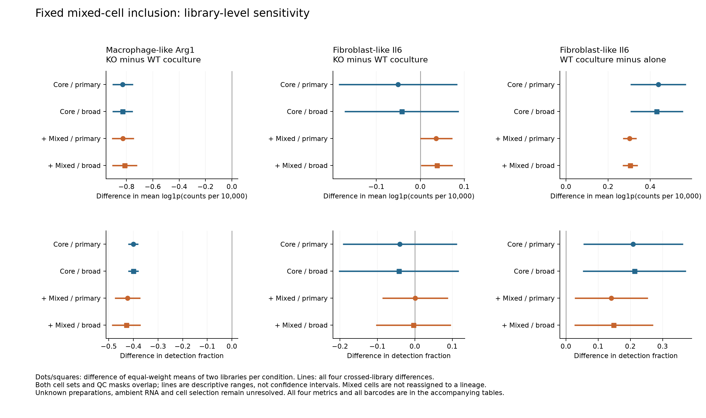
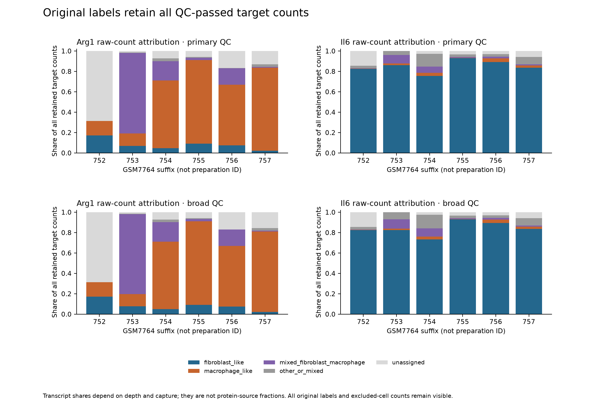
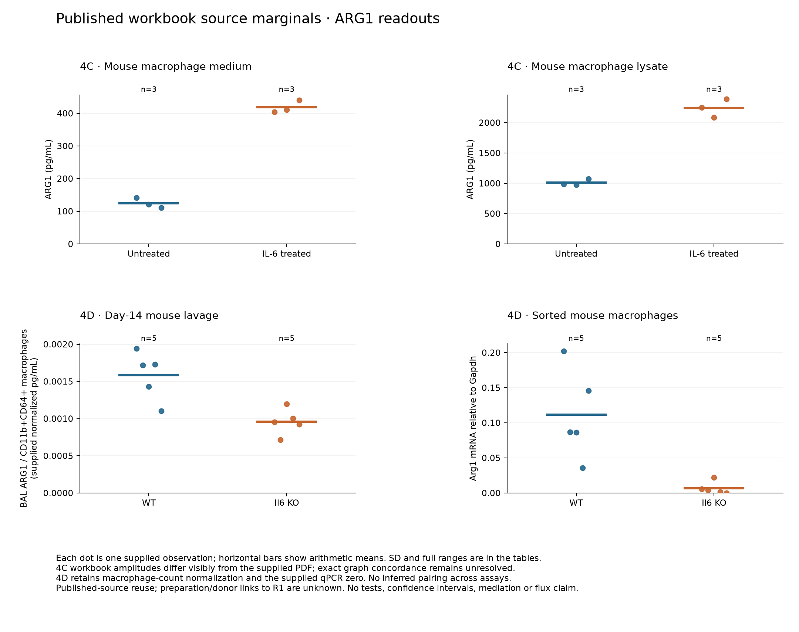
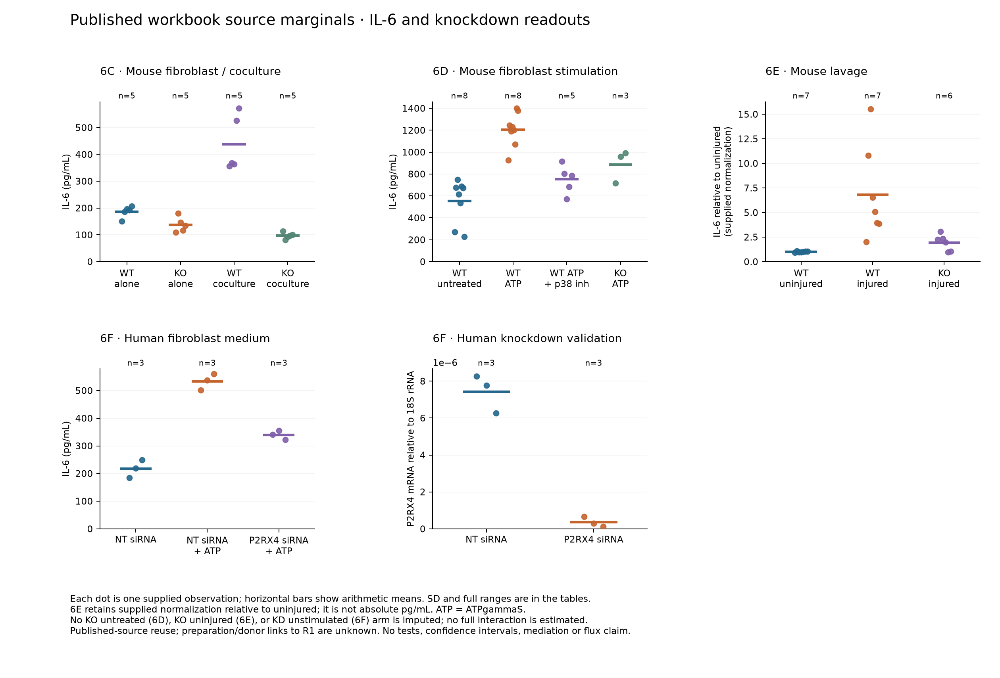

# Checkpoint A: fixed inclusion sensitivity and source protein marginals

31 October 2026, Asia/Seoul. Owner **Yd1-P01**; technical review pending.
[Plan](README.md) · [External feasibility/design return](EXTERNAL_FEASIBILITY.md) ·
[Execution ledger](EXECUTION_LEDGER.md).

The fibroblast-like Il6 KO-versus-WT RNA description depends on the fixed
mixed-cell inclusion choice: its primary mean difference changes sign under both
QC masks. Macrophage-like Arg1 remains lower in KO coculture; fibroblast-like
Il6 remains higher in WT coculture than alone. New source protein panels add
assay-specific observations, but cannot turn these unlinked libraries and source
preparations into a matched mechanistic experiment.

## Scope, exposure and provenance

This executes the reviewed extension plan at
`653b3761fe77124ef6de619f9a3a608fe42b2844`, after fast-forward from the prior
execution checkpoint. Integration base:
`8cb50dd15a12a41abc6d5edb36349d33fc512661`.
Original F1–F5, R1, S1, annotation and count-integrity analyses were not rerun.
All 32 canonical RQs, Wg-P06, original evidence and source caches remain intact.

| Job | Frozen contract and Git freeze | Receipt |
| --- | --- | --- |
| X0 metadata | [contract](config/x0_contract_v1.json), `01ad6f8` | [Yd1_extension_x0_v1](../../../analysis/research/runs/Yd1_extension_x0_v1/receipt.json) |
| X1 inclusion | [contract](config/x1_contract_v1.json), `dd2da0b` | [Yd1_extension_x1_v1](../../../analysis/research/runs/Yd1_extension_x1_v1/receipt.json) |
| X2 source marginals | [contract](config/x2_contract_v1.json), `dd2da0b` | [Yd1_extension_x2_v1](../../../analysis/research/runs/Yd1_extension_x2_v1/receipt.json) |

Published findings, old numerical results and the new workbook values/PDF panels
were already exposed. Freezes are prospective for these new calculations; they
do not make the study unexposed or confirmatory. X0 ran before X1/X2 freeze.
Receipts establish execution, not scientific acceptance or biological replication.

## X0: exact inputs, panels and units

The [input inventory](../../../analysis/research/runs/Yd1_extension_x0_v1/input_inventory.json)
binds 54 files, including inherited source hashes, the planning-cache copies,
small new metadata and versioned author code. The
[qualification checks](../../../analysis/research/runs/Yd1_extension_x0_v1/qualification_checks.json)
verify all 11 original Yadav receipts and their output hashes without rerunning
their analyses. The [panel map](../../../analysis/research/runs/Yd1_extension_x0_v1/panel_groups.csv)
and [rectangular cell/blank ledger](../../../analysis/research/runs/Yd1_extension_x0_v1/panel_cells.csv)
cover all 213 positions across sheets 4c, 4d and 6c–6f, including 111 numeric observations.
No source zero became missing, and no blank became zero.

The primary source is [Yadav, JCI188734](https://doi.org/10.1172/JCI188734),
the supplied final PDF (pp. 7 and 9) and official source-values workbook.
Repository evidence and the published source are the same underlying experiments,
not independent replications.

| Panel | Source coordinates | Condition/assay qualification | Unit limitation |
| --- | --- | --- | --- |
| 4C | A4:B6; D4:E6 | Untreated/IL-6, respectively; medium and lysate ARG1 ELISA, pg/mL | Reported n=3 biological replicates; preparation/animal IDs absent |
| 4D | A4:B8; D4:E8 | WT/Il6-KO; BAL ARG1 normalized to CD11b+CD64+ macrophages, and sorted-cell Arg1/Gapdh qPCR | Reported five mice/group; no cross-assay animal pairing |
| 6C | A2:D6 | Final figure color order resolves duplicate headers: WT alone, KO alone, WT coculture, KO coculture; IL-6 pg/mL | Reported five biological replicates/group; no RNA/protein preparation join |
| 6D | A2:A9, B2:B9, C2:C6, D2:D4 | WT untreated, WT ATPγS, WT ATPγS+p38 inhibitor, KO ATPγS; IL-6 pg/mL | n=8,8,5,3; unequal blank tails preserved; no KO untreated arm |
| 6E | A2:A8, B2:B8, C2:C7 | WT uninjured, WT injured, KO injured; BAL IL-6 **relative to uninjured** | n=7,7,6; supplied normalization, not recovered absolute concentration; no KO uninjured arm |
| 6F | A5:C7; F5:G7 | NT baseline, NT ATPγS, P2RX4 siRNA ATPγS IL-6; separate NT/KD P2RX4/18S qPCR | Three observations/group do not establish three donors; no KD unstimulated arm |

**4C source discrepancy:** workbook untreated medium values are 110.8861–140.9105,
whereas the supplied PDF plots the untreated dots visibly higher; lysate amplitudes
also visibly differ. Label, assay, compartment and count mapping is clear. The
calculations below reconstruct the explicitly identified workbook values only.
Exact reproduction of the PDF amplitudes remains held pending a reconciled
publisher/author source version. No digitization, replacement values or rescaling
was used to obtain agreement.

## X1: fixed mixed-class inclusion sensitivity

**Question/purpose:** dependence of three existing library descriptions on a
pre-existing class exclusion. **Unit:** library, two per condition; preparation
independence unknown. **Endpoint:** mean log1p(count/all-gene total × 10,000),
with detection, mean normalized counts and pseudobulk CPM companions.
**Main threat:** mixed/ambient signals, depth, composition and unknown preparation
can change a selected-class average without a causal genotype effect.

All 12,519 barcodes, five original labels, both QC masks and original class
eligibility are unchanged. The mixed-inclusive set adds the same
`mixed_fibroblast_macrophage` barcodes to each relevant core class; it does not
assign them to a true lineage. The two reporting sets overlap. Other/unassigned
cells remain visible in attribution, and QC-excluded counts are reported.

Primary metric, target minus reference; all entries are descriptive:

| Comparison | QC | Core difference | Core + mixed difference | Core crossed range | Core + mixed crossed range |
| --- | --- | ---: | ---: | --- | --- |
| Macrophage Arg1: KO–WT coculture | Primary | −0.828337 | −0.826351 | −0.906701 to −0.749974 | −0.910403 to −0.742299 |
| Same | Broad | −0.829156 | −0.813935 | −0.906167 to −0.752146 | −0.909429 to −0.718442 |
| Fibroblast Il6: KO–WT coculture | Primary | −0.050556 | +0.036220 | −0.185211 to +0.084098 | −0.000318 to +0.072757 |
| Same | Broad | −0.042221 | +0.037645 | −0.172235 to +0.087794 | +0.001815 to +0.073475 |
| Fibroblast Il6: WT coculture–alone | Primary | +0.437949 | +0.302613 | +0.306659 to +0.569239 | +0.269907 to +0.335319 |
| Same | Broad | +0.430546 | +0.304938 | +0.305928 to +0.555164 | +0.268824 to +0.341053 |

Each crossed range contains all four target-library minus reference-library
differences; it is not a confidence interval. Inclusion reduces the WT
coculture–alone magnitude while retaining its positive direction. The KO–WT Il6
primary difference flips sign, restricting a stable lower-fibroblast-Il6 claim.
The mixed-inclusive broad-QC primary range is positive, but the primary-QC range
still crosses zero and companion metrics remain heterogeneous.

For KO–WT Il6, mean normalized counts and pseudobulk CPM also change from negative
core means to positive mixed-inclusive means under both QC masks. Detection
changes from −0.040160 to +0.000691 under primary QC, but remains slightly negative
under broad QC (−0.042663 to −0.003907). Thus even the direction summary depends on
the metric. Every companion and crossed difference is retained, without tests,
confidence intervals, cell bootstrap, suffix pairing or a selection threshold.

In primary-QC WT coculture GSM7764753, the mixed category contains 518 cells and
78.97% of retained Arg1 raw counts; GSM7764756 contains 93 mixed cells and 16.11%.
The KO counterparts contain 219/31 mixed cells and 19.05%/0.76% of Arg1 counts.
These raw-count shares depend on depth and capture and are not protein-source
fractions or contamination probabilities. Il6 remains separately attributed;
all five labels and both QC views are shown.

Full evidence:
[120 attribution rows](../../../analysis/research/runs/Yd1_extension_x1_v1/target_attribution.csv),
[48 library/set summaries](../../../analysis/research/runs/Yd1_extension_x1_v1/library_endpoints.csv),
[48 contrasts](../../../analysis/research/runs/Yd1_extension_x1_v1/condition_contrasts.csv),
[192 crossed differences](../../../analysis/research/runs/Yd1_extension_x1_v1/crossed_library_differences.csv),
[all barcode memberships](../../../analysis/research/runs/Yd1_extension_x1_v1/barcode_membership.csv).
[Independent verification](../../../analysis/research/runs/Yd1_extension_x1_v1/independent_verification.json)
used separate CSV reads and Python integers/math.fsum/log1p, checked 288 new
library summary values and all contrasts/attribution/memberships, and matched 168
saved core values. The prior independent MatrixMarket verification remains valid;
the count archive was not reanalysed.

## X2: all mapped protein and qPCR marginals

**Purpose:** reconstruction of additional published-source measurements.
**Unit:** panel-specific source observation with reported replication statements
above; no inferred paired or independent donor structure. **Comparison:** all
16 frozen differences below. **Validity threat:** source normalization, unknown
cross-assay joins, cell/source composition and the 4C source discrepancy.
These observations do not estimate mediation or a post-transcriptional mechanism.

| Panel / endpoint | Target − reference | Difference in supplied units |
| --- | --- | ---: |
| 4C medium ARG1, pg/mL | IL-6 − untreated | +294.1103 |
| 4C lysate ARG1, pg/mL | IL-6 − untreated | +1228.4193 |
| 4D macrophage-normalized BAL ARG1 | Il6-KO − WT | −0.000627274 |
| 4D Arg1/Gapdh qPCR | Il6-KO − WT | −0.104843002 |
| 6C IL-6, pg/mL | KO − WT, fibroblast alone | −49.16112 |
| 6C IL-6, pg/mL | KO − WT, coculture | −339.98655 |
| 6C IL-6, pg/mL | Coculture − alone, WT | +250.74843 |
| 6C IL-6, pg/mL | Coculture − alone, KO | −40.07700 |
| 6D IL-6, pg/mL | ATPγS − untreated, WT | +651.63172 |
| 6D IL-6, pg/mL | p38-inhibited stimulated − WT stimulated | −454.49367 |
| 6D IL-6, pg/mL | KO stimulated − WT stimulated | −317.75781 |
| 6E normalized BAL IL-6 | Injured KO − injured WT | −4.883092 |
| 6E normalized BAL IL-6 | Injured WT − uninjured WT | +5.815313 |
| 6F human IL-6, pg/mL | KD stimulated − NT stimulated | −193.37777 |
| 6F human IL-6, pg/mL | NT stimulated − NT baseline | +315.31257 |
| 6F P2RX4/18S qPCR | KD − NT | −0.00000707015 |

The [111 coordinate-linked observations](../../../analysis/research/runs/Yd1_extension_x2_v1/observations.csv),
[24 group summaries](../../../analysis/research/runs/Yd1_extension_x2_v1/group_summaries.csv)
and [16 contrasts](../../../analysis/research/runs/Yd1_extension_x2_v1/contrasts.csv)
contain every n, mean, sample SD, minimum and maximum. No p-values, confidence
intervals or inferred pairs were calculated.
[Independent verification](../../../analysis/research/runs/Yd1_extension_x2_v1/independent_verification.json)
read the XLSX directly through OOXML, checked all 213 mapped cells/blanks and 111
values, and used 45-digit Decimal arithmetic for 120 summary values and all 16
differences. It shares neither the frozen-CSV parsing route nor NumPy aggregation
with the main calculation.

The source medium-protein KO–WT difference in 6C is negative, while R1/X1
fibroblast Il6 RNA is heterogeneous and inclusion-sensitive. Different
preparations, timing, normalization and source composition preclude a matched
RNA/protein correlation or an explanation by post-transcriptional regulation.
4C medium protein is accumulation, not secretion rate or enzymatic flux; 4D and
6E retain supplied normalizers. No missing arm was invented to estimate an
interaction. Original unfavorable F3 and the spatial source holds remain intact.

## Review return and limits

X0–X2 are executed with independent arithmetic and visually inspected figures.
X3–X5 returned source feasibility and specific holds in
[EXTERNAL_FEASIBILITY.md](EXTERNAL_FEASIBILITY.md); no external expression
extraction occurred. X3 has a bounded conditional design for review, not an
execution authorization. X6 is still pending eligible reviewed evidence.

The first local commit attempt hit the sandbox boundary at the shared Git index;
the runner correctly refused unfrozen execution. An approved local Git escalation
completed the freeze before any run. No analysis failed and no frozen output was
overwritten. Network DNS failed inside the sandbox; permitted bounded retrievals
then succeeded, with both attempt receipts preserved. The publisher challenge
page is recorded as failed content access despite HTTP 200.

Validation and the fresh integration-base check are recorded in the execution
ledger. No claim grade, scientific retain/reject decision, canonical question,
governance rule, Notion content or remote repository state was changed.
