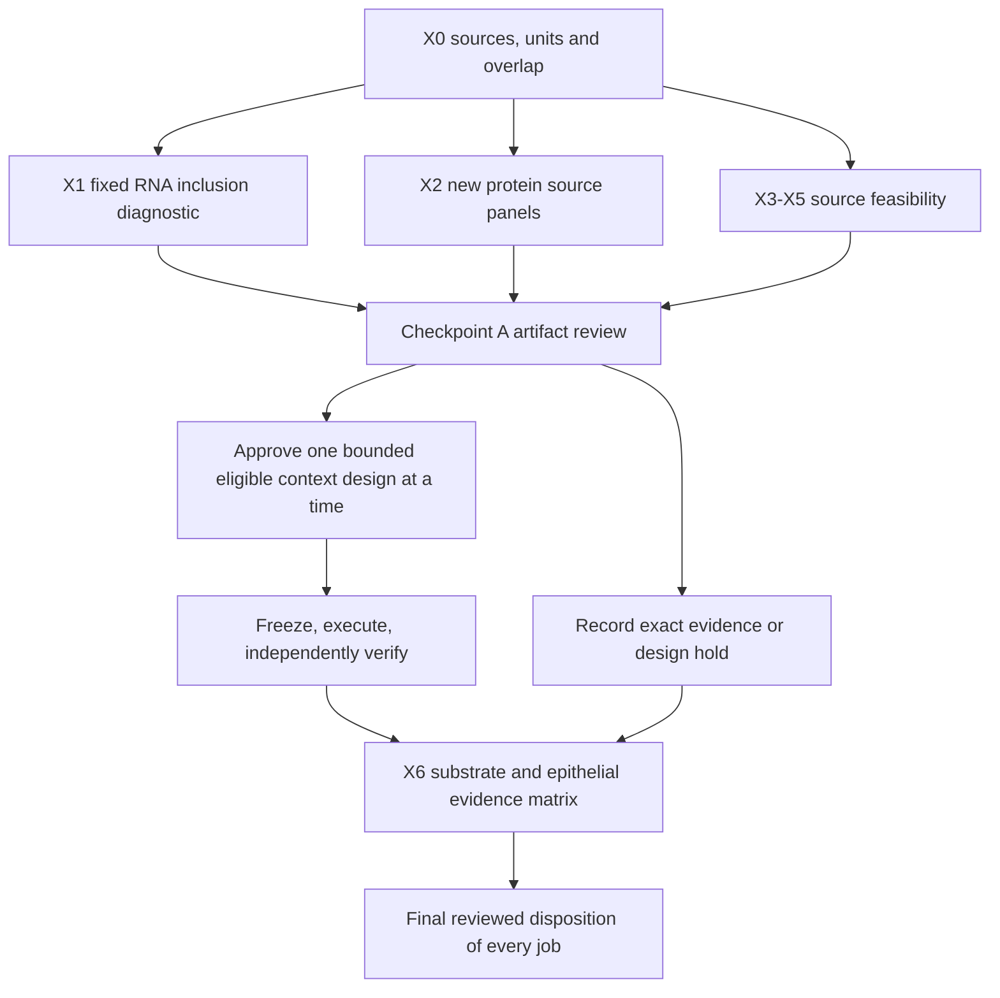

# Yadav extensions: source assignment, protein output and tissue context

31 October 2026, Asia/Seoul. Article owner **Yd1-P01**. The owner requested a
repository-wide status scan, additional plausible branches, a finalized stepwise
plan and execution through the existing technical chat. This opens a new bounded
extension sequence; the original six-step closeout remains valid for its scope.

**Current checkpoint:** [C source maps and held design](CHECKPOINT_C_RESULTS.md)
are returned for technical review. Gupta original feature coverage and both
studies’ GEO/BioSample/SRA joins are recovered; retained-neutrophil/state/zero-cell
denominators and participant/preparation joins still hold X5 expression.
[B metadata and provisional synthesis](CHECKPOINT_B_RESULTS.md) passed
[bounded review](REVIEW_B.md); the [X6 matrix](PROVISIONAL_X6_MATRIX.md) remains
provisional with only source eligibility updated.
Tsukui author-code labels are recovered; actual object retention/state support
remains held on export/runtime qualification. SCAHN Table S1 and FAQ are recovered;
source/donor/preparation and gene-measurement joins still hold expression. X4
remains held. [X0–X2](CHECKPOINT_A_RESULTS.md) passed [review](REVIEW_A.md); no
external expression comparison or final extension closeout is claimed.

[Repository scan](REPO_SCAN.md) · [Literature context](LITERATURE_CONTEXT.md) ·
[Execution/review ledger](EXECUTION_LEDGER.md) ·
[Original results](../TECHNICAL_RESULTS.md) · [Original synthesis](../CONTEXT_AND_SYNTHESIS.md).

## Question and intended contribution

Which parts of the apparent P2RX4–IL-6–ARG1 chain are stable to source-cell
assignment and measured at protein level, and which depend on fibroblast state,
culture or tissue context? The existing Wg-P06 consumption-versus-delivery question
remains unchanged. This sequence combines measurement robustness, additional
published-source reconstruction and conditional context qualification. It does
not discover the published circuit, demonstrate flux, certify novelty or create
a canonical RQ. Each conditional branch has its own comparison and decision.

The important observations are lower macrophage-like Arg1 but heterogeneous
fibroblast Il6 KO-versus-WT RNA, substantial mixed-cell content, source-level
functional effects, and missing preparation identities. Repo-wide evidence adds
source/delivery-versus-RNA distinctions (A2/A22), incomplete fibroblast-to-epithelial
output attribution (A13), and the separation of matrix, support and mature output
(A20/A8/A19). Their hypotheses, failed results and thresholds remain authoritative.

## Branches and readiness

| Job | Incremental question / endpoint | Unit and main threat | Disposition |
| --- | --- | --- | --- |
| X0 | Exact source, panel, identity, assay and overlap qualification for X1–X5 | Workbook observation or documented sample/donor; missing joins and reused cohorts | X0 reviewed complete; B1/B2 add governed source metadata |
| X1 | How much of the original Arg1/Il6 pattern depends on exclusion of mixed-class barcodes? | Library; class selection, mixed/ambient signals and unknown preparations | Reviewed complete; genotype Il6 mean is sensitive to fixed mixed-class inclusion |
| X2 | What do the unanalysed IL-6/ARG1 protein and qPCR source panels actually show, alongside R1? | Reported animal/preparation/well, kept panel-specific; unlinked cohorts and normalization | Reviewed source marginals complete; 4C plot amplitudes and missing units/arms remain restricted |
| X3 | Does Il6/P2rx4 RNA vary with injury time within author-defined fibroblast states, separately from changing state abundance? | Qualified mouse/tagged sample; time, state selection and capture | Author-code labels recovered; actual retained states/support held; expression awaits review |
| X4 | How comparable are cultured fibroblasts, native tissue and early-versus-late disease contexts for this question? | Donor, lobe, preparation and culture passage; assay/site/specimen confounding | Held: culture/donor/protocol joins and early-stage specimen design unresolved |
| X5 | How do assay capture and source-state definitions affect human ARG1/IL6R evidence? | Donor/sample/study; expression-conditioned selection and reused atlas parents | C qualifies Gupta/Wigerblad metadata; exact retained/state/zero-denominator and participant joins still held |
| X6 | Which evidence distinguishes Wg-P06 substrate balance, signaling/viability alternatives and a separate epithelial-repair consequence? | Future qualified source/recipient donors and measured outputs | Provisional matrix returned; pending X3/X5 and functional discriminators retained |

## Step 1 — X0: qualify without replaying completed work

Use the approved 54daedc execution checkpoint and f3828f6 review as the baseline.
Verify the existing cache/receipt identities and reuse valid checks. Do not rerun
F1–F5/R1/S1, old annotation, DY1 or portfolio pipelines. Record exact inherited
commits, paths, checksums, source figure/panel and outcome exposure.

For the newly selected Yadav panels (4C–D and 6C–F), map every column, value, blank,
unit, genotype/stimulation label, normalization and reported replication statement
to the final PDF and official workbook. Duplicated generic headers need figure
evidence. Never infer pairing or preparation identity from row order or the word
replicate. A mapping failure holds that panel while other work proceeds.

For X3–X5, inspect small primary metadata, sample sheets, code/readmes and existing
local caches first. Build donor/sample/assay/state/time/condition and parent-study
maps, recording absent fields. Identify exact file sizes and required subsets
before acquiring new matrices. No repeated search for unchanged raw Yadav spatial
objects: its explicit source hold remains unless this pass finds a new concrete lead.

## Step 2 — X1: fixed mixed-class inclusion diagnostic

Purpose: test the sensitivity of the three original descriptive RNA contrasts to
the already observed mixed category, without tuning labels to obtain agreement.
Use frozen cell_labels.csv, cell_endpoints.csv, composition and class eligibility
from Yd1_annotation_v1 and Yd1_rna_endpoints_v1. Preserve all 12,519 barcodes.

- Keep both existing QC masks and original labels unchanged. Do not rerun
  clustering, annotation or gene selection. Arg1 and Il6 remain the only targets.
- Show per library/QC/label cell counts, target-count totals, detection fractions,
  and the fraction of all retained target counts allocated to each of the five
  existing labels. A zero total has an explicitly undefined share, not an invented
  zero denominator. Raw transcript attribution is affected by depth/capture.
- Compare two fixed reporting sets for each original target class: the frozen core
  class alone, and that same core plus mixed_fibroblast_macrophage. The second is
  an inclusion sensitivity, not reassignment of mixed cells to a true lineage.
  Other/unassigned cells stay visible in the attribution table but do not enter
  these class summaries. Do not combine mutually overlapping sets as independent.
- Reuse the original primary mean log1p(count/total*10,000), detection fraction,
  arithmetic mean normalized counts and pseudobulk CPM. Recompute core values
  only as a deterministic join/arithmetic check against saved results.
- Retain the original three comparisons: macrophage-like Arg1, P2rx4-KO versus
  WT fibroblast coculture; fibroblast-like Il6 for that same comparison; and
  fibroblast-like Il6, WT coculture versus fibroblast alone. Equal library weights,
  all four crossed-library differences, two QC masks and two inclusion sets.
- Require the original core eligibility; do not rescue a failing core with mixed
  cells. Report every result, change of direction and magnitude without p-values,
  confidence intervals, cell bootstrap or suffix pairing. A mixed-inclusive range
  is not a validated contamination bound or biological uncertainty interval.

Informative outcomes: stability narrows one selection sensitivity but cannot
exclude contamination or batch; material dependence restricts the original core
description. Neither outcome estimates a causal genotype effect. Filtered matrices
without empty-droplet/background information do not justify claimed ambient-RNA
removal. Stop after the fixed tables, figure and independent arithmetic checks.

## Step 3 — X2: protein/output evidence alongside RNA

This is a new source reconstruction, not independent replication or a matched
multi-assay experiment. Use all mapped source values and explicit missingness.
Default to descriptive group counts, means, SD, ranges and target-minus-reference
differences; no population interval or significance test in this checkpoint.

| Panel | Prespecified comparison once labels qualify | Measured endpoint / essential limit |
| --- | --- | --- |
| 4C | IL-6-treated minus untreated, separately for each supplied compartment | ARG1 ELISA in lysate and conditioned medium; accumulation is not an enzymatic flux or secretion rate |
| 4D | Il6-KO minus WT, separately for the two supplied readouts | Macrophage-count-normalized BAL ARG1 and sorted-cell Arg1 qPCR; retain supplied normalization, not inferred raw numerators |
| 6C | P2rx4-KO minus WT within fibroblast-alone and coculture conditions; coculture minus alone within genotype | Conditioned-medium IL-6; no row pairing, no invented independent RNA/protein matches |
| 6D | WT ATP-stimulated minus WT untreated; p38-inhibited stimulated minus WT stimulated; KO stimulated minus WT stimulated | Conditioned-medium IL-6; absence of a KO untreated arm prevents claiming a complete genotype-by-stimulation interaction |
| 6E | Injured KO minus injured WT; injured WT minus the supplied uninjured reference | BAL IL-6; source composition and whole-lung context remain distinct from fibroblast secretion |
| 6F | KD minus nontargeting control within each available stimulation condition; stimulation minus baseline within each siRNA group; separate KD-validation qPCR | Human fibroblast IL-6 and knockdown validation; n=3 wells does not establish three independent donors |

The final PDF provides 6C–F labels and differing reported replicate counts.
Validate those against actual sheet ranges; do not fill absent arms. Use a new
panel-to-condition map and separate contract/run(s). Preserve original 6G/F2.
Compare direction, context, assay and uncertainty qualitatively with R1. Because
the preparations/timing are unlinked, do not correlate panel means with RNA,
estimate mediation or diagnose a post-transcriptional mechanism from disagreement.

## Checkpoint A — review X0, X1 and X2 before new atlas effects

Return a clean local commit, contracts/freeze commits, receipts, source maps,
all results/figures and independent checks. Include X3–X5 feasibility records.
The reviewer checks exact artifacts, biological units, arithmetic and limits.
X1 and X2 can proceed independently once their respective inputs qualify.
Do not stop the whole sequence because a new source or one panel is held.

## Step 4 — X3: fibroblast state/time context

Primary candidate: Tsukui GSE210341, with 12 CMO-tagged source samples across four
injury times. A lane or the single GSM is not a biological unit. Qualify the
barcode-to-tag/sample-to-time joins, demultiplexing ambiguity and author state
annotation. Strunz GSE141259 whole-lung data is a separate comparison candidate;
the epithelial HighResolution object and A5 unit audit cannot substitute for it.

Nominate Il6 as primary and P2rx4, Col1a1 and Acta2 as distinct companion RNA
endpoints. Proposed output is sample/state/time detection and abundance plus state
composition, with state-label dependence explicitly assessed. No merged embedding,
pseudotime, RNA-velocity fate, pooled cell DE or transcript-based metabolic flux.
The contractor must return exact exclusions, unit coverage, denominator and time
contrasts for review before new expression extraction. An informative pass
separates within-state descriptions from abundance changes; it does not establish
IL-6 secretion, a causal state transition or a regenerative function.

## Step 5 — X4 and X5: qualify new context branches separately

**X4 culture/native and stage context.** Inspect the April 2026 fibroblast preprint
and GSE331144, especially native fixed-RNA versus cultured passage-1/passage-6
assays. The public series currently describes native tissue; availability of
culture matrices and matched donor/preparation identities is not yet established.
Checkpoint-A source inspection identifies fixed-RNA profiling for both native
and cultured material. Do not treat tissue FFPE and fixed cultured cells as a
paired comparable effect without valid donor/assay/normalization support. The May 2026 early-IPF preprint is a
second lead; cryobiopsy-versus-explant/site differences confound a simple stage
contrast. GSE286182 is a referenced cohort, not automatically the full deposited
early-IPF study. Both records remain preprints in this scan. Return one justified
comparison or an evidence-backed hold; do not launch all possible contrasts.

**X5 human source identity and capture.** Inspect the October 2026 SCAHN atlas
source table and its overlap with Salcher/Adams/Habermann and existing repo inputs.
Use healthy/noninfectious lung or blood sources relevant to the present question;
this task does not add infection experiments. Qualify ARG1/IL6R gene measurement,
cell annotation, donor identities, raw counts and all-zero cells before proposing
any description. Expression-positive filtering, pooled cross-study correlations
and atlas integration must not manufacture a shared phenotype or independent
replication. A human neutrophil reference cannot establish homology of the small
mouse LY6G/CD64/CD11C population. Return a single bounded design for review; no
whole-million-cell download is authorized by source discovery alone.

## Step 6 — X6: connect to substrate balance and epithelial recovery

Use reviewed X1/X2 and eligible X3–X5 findings to produce an evidence-to-decision
matrix for unchanged Wg-P06: actual arginine preservation versus lost ornithine
supply, with cytokine/viability and OAT–PRODH/ROS alternatives retained. Compare
with the closest Hamanaka, Lee and Yadav experiments before proposing an increment.
If preparing an experiment-readiness package, refresh the literature workflow and
state unknown model access, donor crossing, physiological exposures, effect margin
and precision. No concentrations, sample size or laboratory capability are invented.

Keep a separate epithelial bridge to A13/A20/A8/A19: collagen abundance, support
RNA, lineage output and mature tissue function answer different questions. Existing
AF1/AF2 support-plus-ECM findings and failed A13/A22 models must remain in the
crosswalk. Do not reopen those analyses by renaming a score. A direct repair claim
needs linked functional evidence that this sequence may still lack.

## Workflow, review authority and stopping rule

Use the repository contract/runner for every substantive numerical run and metadata
recovery. Record all prior outcome exposure. New IDs use the Yd1-P01 extension
namespace and new immutable output paths. Preserve original v1/v2 results, raw
caches, unfavorable findings and every canonical question. No governance or gate
change, claim promotion, Notion write, external outreach, push, PR or remote merge.
The coordinator may send the existing technical chat bounded follow-up jobs and
integrate reviewed local checkpoints. No unrelated chat is contacted.

Finish when X0–X6 are reviewed as completed or specifically held, with no feasible
authorized work remaining. A hold names the exact missing source/identity/design
and reopening condition. Scientific acceptance remains the owner's decision.
