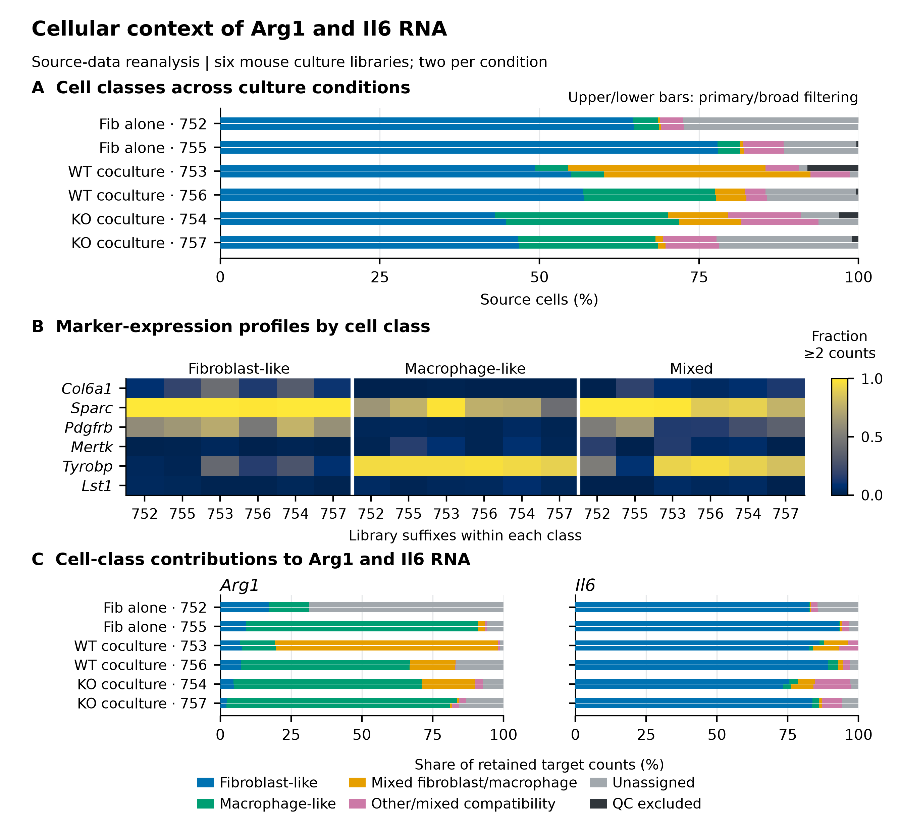
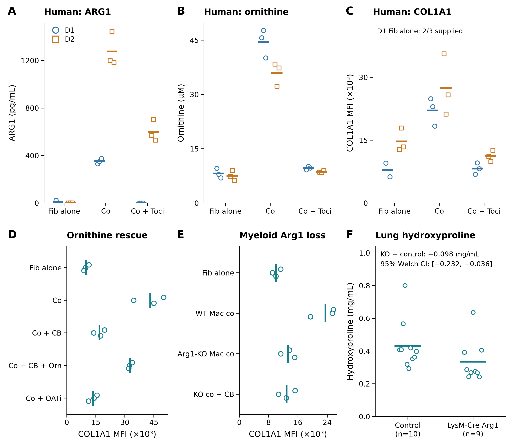
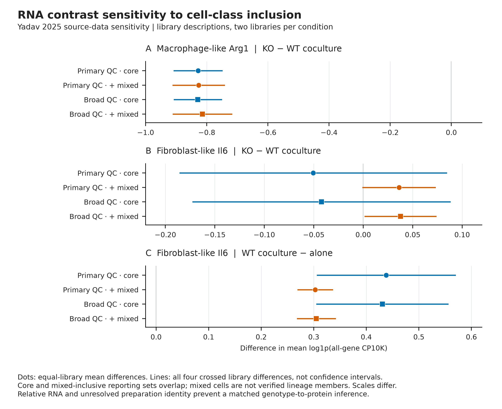

# Approved figure displays — 13 November 2026

These figures preserve approved public-data displays prepared for a research portfolio. They reuse the linked article analyses; they are not independent replication or new scientific acceptance. Numerical results and historical figures are unchanged.

[Article home](../README.md) · [Archive overview](../../../docs/PORTFOLIO_FIGURE_ARCHIVE_20261113.md)

G-SURF microscopy and personal outreach documents are deliberately excluded.

## Cell annotation and candidate eligibility

Source annotations and marker support are retained; broad cell classes are not verified lineages. Differences in captured cell numbers remain relevant to interpretation.

[PNG](../../../analysis/research/runs/portfolio_yadav_figures_20261113_v1/yadav_cell_context_v5.png) · [PDF](../../../analysis/research/runs/portfolio_yadav_figures_20261113_v1/yadav_cell_context_v5.pdf) · [SVG](../../../analysis/research/runs/portfolio_yadav_figures_20261113_v1/yadav_cell_context_v5.svg) · [Provenance](../../../analysis/research/runs/portfolio_yadav_figures_20261113_v1/manifest.json)

## Yadav functional and RNA observations

Previously archived measurements and contrasts are assembled for comparison. Reused source observations are not an independent replication; molecular scores do not establish tissue repair.

[PNG](../../../analysis/research/runs/portfolio_yadav_figures_20261113_v1/figure1_yadav_v1.png) · [PDF](../../../analysis/research/runs/portfolio_yadav_figures_20261113_v1/figure1_yadav_v1.pdf) · [SVG](../../../analysis/research/runs/portfolio_yadav_figures_20261113_v1/figure1_yadav_v1.svg) · [Provenance](../../../analysis/research/runs/portfolio_yadav_figures_20261113_v1/manifest.json)

## Candidate inclusion sensitivity

Existing sample-aware summaries and inclusion alternatives are retained, including the Il6 sign reversal. Two deposited libraries limit population inference; no alternative was selected to improve the result.

[PNG](../../../analysis/research/runs/portfolio_yadav_figures_20261113_v1/yadav_inclusion_v5.png) · [PDF](../../../analysis/research/runs/portfolio_yadav_figures_20261113_v1/yadav_inclusion_v5.pdf) · [SVG](../../../analysis/research/runs/portfolio_yadav_figures_20261113_v1/yadav_inclusion_v5.svg) · [Provenance](../../../analysis/research/runs/portfolio_yadav_figures_20261113_v1/manifest.json)
